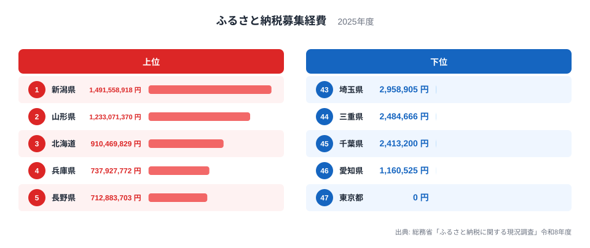
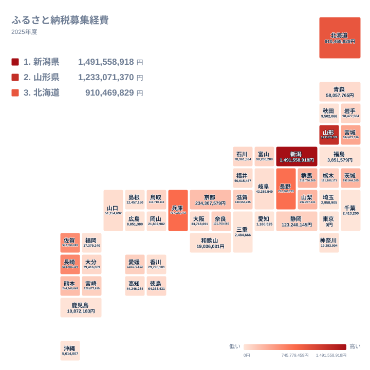

ふるさと納税は、寄付を集める仕組みであると同時に、寄付を集めるために費用がかかる仕組みでもあります。返礼品の調達、送料、ポータルサイトへの手数料、広告などの支出が積み重なり、募集経費として表れます。2025年のデータで都道府県を並べると、最も多い新潟県は1,491,558,918円、最も少ない東京都は0円でした。東京都が0円のため、1位と47位の倍率は計算できません。そこで0円を除いた最下位の愛知県と比べると、新潟県は約1,285倍にあたります。

この記事では、上位と下位の並びを図で確かめ、その背景を地理と産業の面から仮説として整理します。実データは都道府県別の値と順位だけですので、理由の断定は避け、読み取れる範囲にとどめます。

> [!NOTE]
> ここでの募集経費は、寄付額そのものではなく、寄付を募るために支出された費用の合計です。本記事では都道府県の値をそのまま扱い、人口や寄付受入額で割ってはいません。県内の市町村分が合算されているのか、県の支出だけなのかは、このデータからは分かりません。元の調査の定義で確かめる必要があります。

## 上位と下位の顔ぶれ

まず、上位5県と下位5県を並べた図です。

<source-link href="/ranking/furusato-fundraising-cost-prefecture">ふるさと納税募集経費ランキングをもっと見る</source-link>

上位5県の内部にも差があります。1位の新潟県は1,491,558,918円で、5位の長野県は712,883,703円です。新潟県は長野県の2倍を少し超える水準で、上位とはいえ一様ではありません。2位の山形県が1,233,071,370円、3位の北海道が910,469,829円と、1位から3位までは段階的に下がっていきます。4位の兵庫県と5位の長野県は近い水準で並んでいます。

下位側は水準が一段違います。下位5県で最も多い埼玉県でも2,958,905円で、5位の長野県と比べると約240分の1です。東京都の0円を含め、この5県はいずれも300万円に満たない範囲に収まっています。上位と下位は連続的につながるというより、二つの層に分かれて見えます。

ただし、層の境目がどこにあるかは、図の上位と下位だけでは分かりません。たとえば7位の佐賀県は542,096,085円、9位の群馬県は316,790,260円で、この間に差があります。確かめられるのはここまでで、境目の位置を一点に決める根拠は、この記事のデータにはありません。

> [!WARNING]
> 東京都の0円は、「支出がなかった」のか「集計に計上されていない」のかを、このデータだけでは区別できません。0円を「努力ゼロ」と読む前に、元の調査での扱いを確認してください。また、この値は単年の総額で、寄付受入額との対応も示されていません。

## 産地を抱える県が上位に並ぶ理由

上位には、農産物や水産物の産地として知られる県が目立ちます。新潟県は米、山形県は果物、北海道は海産物や乳製品、長崎県と佐賀県は肉や魚介といった連想が働きます。ただし、これは各県の一般的な印象にもとづく見方です。実データには返礼品の内訳がないため、「その産品が経費を押し上げた」とは言い切れません。

そのうえで、仮説としては次のように考えられます。

- 返礼品に使いやすい産品が多い県ほど、募集の規模を広げやすく、結果として調達費や送料が増える可能性があります。
- 経費の大半が調達や発送に関わる支出であれば、募集の規模が大きい県ほど総額も大きくなりやすいという見方もできます。
- 6位の長崎県は568,486,104円、7位の佐賀県は542,096,085円で、二県の差は小さく、同じ水準の支出が続いています。

一方で、上位5県には兵庫県も入っています。産地の印象だけでは説明しにくい県も含まれており、産地と経費の関係は仮説にとどまります。詳しくは[新潟県のデータ](/areas/15000)や[山形県のデータ](/areas/06000)で、他の指標と並べて確かめられます。産業構造の指標と合わせて見ると、仮説が裏づけられるか、外れるかを判断しやすくなります。

> [!TIP]
> この値は都道府県ごとの総額です。順位が高いことは、一件あたりの経費が高いことも、寄付が多く集まったことも意味しません。まず自県の値が何円かを確かめ、続いて隣り合う順位の値の差を見ると、順位の並びが実額でどれだけ開いているかが分かります。人口や寄付受入額のデータと合わせて初めて、効率の議論ができます。

## 地理分布をタイルマップで見る

次に、全国の分布をタイルマップで確認します。

地図の特徴は、色の濃い県が一か所に固まらず、全国に散らばっていることです。北海道・東北では北海道と山形県、中部では新潟県と長野県、近畿では兵庫県、九州・沖縄では長崎県と佐賀県が上位です。一つの地方が丸ごと上位になるのではなく、地方ごとに数県ずつが突出する形です。

一方で、色の薄い県は関東と中部の大都市圏の周辺に集まって見えます。東京都、埼玉県、千葉県は、いずれも関東に区分される県です。愛知県は中部、三重県は近畿に区分されます。ただ、関東の群馬県は9位で316,790,260円、茨城県は10位で292,944,385円と中位に入っており、関東という括りだけで水準を言い切ることはできません。地方単位では整理しにくい点です。

下位の側には、沖縄県が41位で5,014,007円、福島県が42位で3,851,579円と、大都市圏とは言いにくい県も入っています。さらに、秋田県は39位で9,502,066円、島根県は37位で12,457,150円です。農林水産業が盛んな印象のある県でも、経費が小さい県があります。この事実は、産地であることと経費の大きさが直結しない可能性を示しています。

## 経費の差から読み取れること

ここまでの確認で、データから言えることを整理します。

- 上位は、新潟県、山形県、北海道、兵庫県、長野県の5県で、いずれも7億円を超えています。
- 下位は、東京都の0円をはじめ、300万円に満たない県が並びます。
- 上位と下位の差が人口や産地の違いによるものかどうかは、このデータからは判断できません。

制度の運用や各自治体の方針、寄付の受け手か出し手かという立場の違いも、経費に影響しうる要素です。ただし、これらを裏づける数値は今回の実データにありません。したがって、各県の戦略や歴史的な経緯まで断定することは避けます。年次の推移が分かるデータがあれば、取り組みの積み重ねと経費の関係も検証できるはずです。

## データについて

この記事の数値は、総務省「ふるさと納税に関する現況調査」令和8年度にもとづく、2025年のふるさと納税募集経費です。単位は円で、全47件の都道府県別の値を使っています。本文の数値は、調査の値をそのまま引用しています。ほかの財政指標とあわせて見たいときは、[同じカテゴリの統計一覧](/category/administrativefinancial)をご覧ください。

## まとめ

募集経費が最も多いのは新潟県の1,491,558,918円で、最も少ないのは東京都の0円でした。上位は一部の県に厚く、下位は桁の小さい県が並ぶという二層の構図が見えます。

その背景として、産地の有無や都市の規模といった見方は成り立ちますが、データだけで原因を確定することはできません。数字の大小は優劣ではなく、各県の置かれた条件と取り組み方の違いが重なった結果として、慎重に読むことが大切です。
