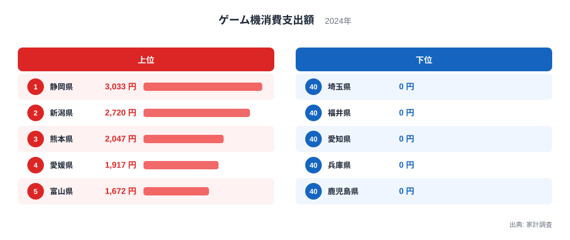
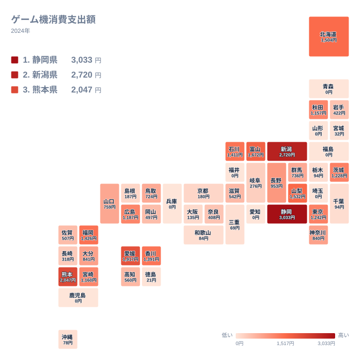

## ゲーム機への支出で首位に立ったのは静岡県

ゲーム機への支出が最も多い県はどこでしょうか。家計調査の2024年のデータで見ると、1位は静岡県で3,033円でした。2位は新潟県の2,720円で、3位は熊本県の2,047円です。4位に愛媛県の1,917円、5位に富山県の1,672円が続きます。

先に断っておくと、この記事では上位の県がなぜ多いのか、理由を断定することはできません。ゲーム機は購入頻度が低い品目で、県別の数字は標本の揺れの影響を大きく受けると考えられます。記事の前半では数字そのものを確認し、後半で背景として考えられる仮説を、限界とあわせて検討します。

この金額は、1世帯が1年間にゲーム機の購入へ使った額を表します。上位の県でも数千円にとどまります。ゲーム機は毎月買うものではなく、数年に一度の買い替えなどで買われる耐久財です。そのため、たまたま購入があった世帯が調査に入るかどうかで、数字が大きく動く可能性があります。

一方、下位には0円の県が並びます。青森県、山形県、福島県、埼玉県、福井県、愛知県、兵庫県、鹿児島県は、いずれも0円でした。人口の多い埼玉県や愛知県、兵庫県が0円になっている点は、この指標の性格をよく表しています。

> [!NOTE]
> ここでいう支出は、家計調査の「ゲーム機」の項目に計上された購入額です。ソフトの購入費やオンラインの課金、サブスクリプションの利用料が含まれるかどうかは、このデータからは確認できません。ゲームにどれだけお金をかけているかではなく、本体の項目に計上された額を見る数字として読んでください。

## 上位と下位を並べると見えるもの

まず、上位5県と下位5県を図で確認します。

<source-link href="/ranking/game-console-consumption-expenditure">ゲーム機への支出ランキングをもっと見る</source-link>

図の上位には、静岡県、新潟県、熊本県、愛媛県、富山県が並びます。大都市圏の県は入っていません。東京都は1,242円で11位、神奈川県は840円で18位、大阪府は135円で32位です。人口が多いからといって、世帯あたりの支出が大きくなるとは限らないことがわかります。

下位は、0円の県で占められます。0円の県は8県あり、すべて同じ40位です。0円は、その年に調査対象の世帯でゲーム機の購入が記録されなかったことを意味すると考えられます。県内でまったく売れなかったという意味ではありません。

上位と下位の差は大きく見えますが、順位の差をそのまま県民の嗜好の差と受け取るのは危険です。1位の静岡県と2位の新潟県は、3位以下と比べて高い水準にあります。それでも、1年分のデータだけで「この県はゲーム好き」と言い切ることはできません。

> [!WARNING]
> 家計調査は選ばれた世帯を対象にした標本調査です。ゲーム機のように購入頻度の低い品目では、数世帯の購入の有無が順位を左右する可能性があります。0円の県は、購買がなかったと断定できる根拠にはなりません。

## 地理分布で読む:上位は特定の地域に偏らない

次に、都道府県ごとの水準を地図上で確認します。

地図を見ると、静岡県、山梨県、新潟県、富山県、石川県と、中部地方に支出の多い県が集まっています。山梨県は1,532円で6位、石川県は1,411円で9位です。ただし長野県は953円で16位、岐阜県は276円で29位と、同じ中部でも差があります。

九州と四国にも上位の県があります。熊本県が3位、愛媛県が4位、福岡県が1,426円で8位、香川県が1,391円で10位です。北海道も1,504円で7位に入っています。上位は一地域に偏らず、全国に散らばって現れています。

東北では、秋田県が1,157円で15位、岩手県が422円で26位、宮城県が32円で38位です。青森県、山形県、福島県は0円でした。同じ東北でも差が大きく、地域単位でひとくくりに語ることはできません。

> [!TIP]
> 地図は、色の濃い県を探すだけでなく、隣り合う県の差にも注目してください。隣り合う県で大きな差があるときは、生活文化の違いだけでなく、標本の揺れの可能性もあります。複数年のデータで同じ傾向が続くかを確かめると、読み違えを減らせます。

## 気候や暮らしとの結びつきをどう考えるか

気候との関係としては、冬の降雪が多い地域で家の中の時間が長くなり、家庭用ゲーム機が選ばれやすいという見方があります。たしかに新潟県は2位、富山県は5位、北海道は7位です。

しかし、この見方は成り立ちにくいと考えられます。同じ降雪地域でも、青森県、山形県、福島県は0円です。秋田県は15位、岩手県は26位、宮城県は38位で、上位とは言えません。雪国という条件だけでは、上位に入る県と入らない県を分けられません。気候は仮説の一つにすぎず、決め手とは言えません。

もう一つ考えたいのは、世帯の構成です。ゲーム機は子どものいる世帯での購入が多い品目と考えられますが、本データでは確認できません。静岡県や新潟県に特有の家族の形が関わっている可能性もありますが、これも裏づける数字はありません。

産地や歴史との結びつきという面では、ゲーム機は食品のような地場の産業と直結しにくい商品です。全国で似た価格や流通網で買える品目だとすれば、地域差は文化よりも世帯の事情や購入時期の偶然の影響を受けやすいのではないか、という仮説も立てられます。ただし、これも本データからは検証できません。

静岡県と新潟県の他の指標もあわせて見ると、背景を探る手がかりになります。[静岡県のデータ](/areas/22000)と[新潟県のデータ](/areas/15000)で、世帯や家計に関する指標を確認できます。

## 関連品目との対比:本体は少なく、遊びの支出は別にある

ゲーム機への支出が小さい県でも、ゲームで遊んでいないわけではありません。ソフトのダウンロード購入や、スマートフォンでのアプリ課金、動画配信の視聴など、別の項目に入る支出も考えられます。

本体の購入は、数年に一度の大きな出費です。その年に買い替えがなければ、世帯の支出は0円になります。これに対して、食品や日用品のように頻繁に買う品目は、標本が小さくても県ごとの傾向が安定して現れやすいと考えられます。ゲーム機の数字は、同じ家計調査の中でも揺れやすい部類に入る可能性があります。

つまり、ゲーム機への支出は「その年に買い替えが起きた世帯の多さ」を映した数字と読むのが安全です。遊びの習慣の強さを測る物差しとしては、一部しか見ていません。

家計の別の項目を調べたいときは、[同じカテゴリの統計一覧](/category/economy)から、関連する指標を選べます。

## ランキングを使うときの心がまえ

このランキングから読み取れる確かなことは、次のとおりです。

- 2024年の1位は静岡県で3,033円、2位は新潟県で2,720円でした。
- 上位は中部、九州、四国、北海道に広く分かれ、大都市圏の県は上位に入りませんでした。
- 0円の県は8県あり、その中には埼玉県、愛知県、兵庫県のような人口の多い県も含まれます。

逆に、このデータだけでは言えないことも明確です。ある県の住民が特にゲーム好きだとか、別の県の住民がゲームに関心がないといった結論は、導けません。来年は別の県が上位に来ても不思議ではありません。

それでも、静岡県と新潟県が上位にいるという事実は、調べ始めるきっかけとしては十分です。複数の年を並べたり、他の娯楽の支出と比べたりすると、この2県の高さが一時的なものか、続いているものかが見えてきます。

## データについて

この記事で使った指標は、家計調査の「ゲーム機消費支出額」です。2024年の、1世帯あたりの年間支出額を円で示しています。対象は全47都道府県です。

0円は、調査対象の世帯で購入が記録されなかったことを示すと考えられます。0円の県は8県あり、同額なのでいずれも40位です。41位から47位は存在しません。

同額の県は他にもあります。栃木県と千葉県はともに94円で、同順位の33位です。次の順位は35位になります。
