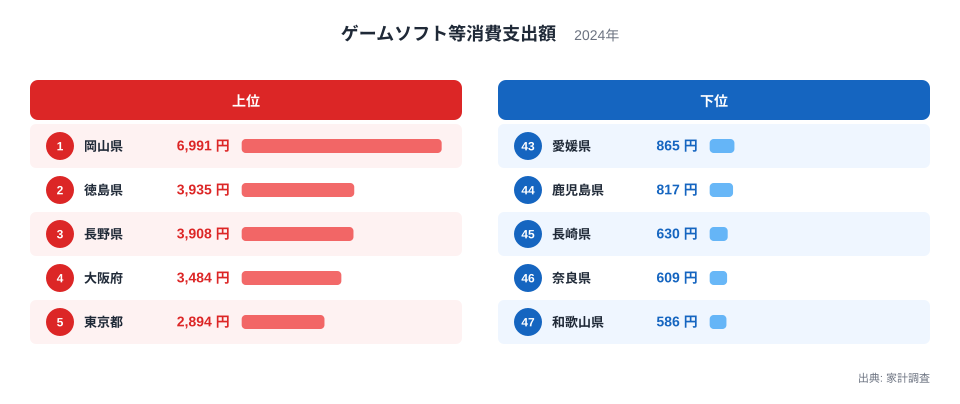
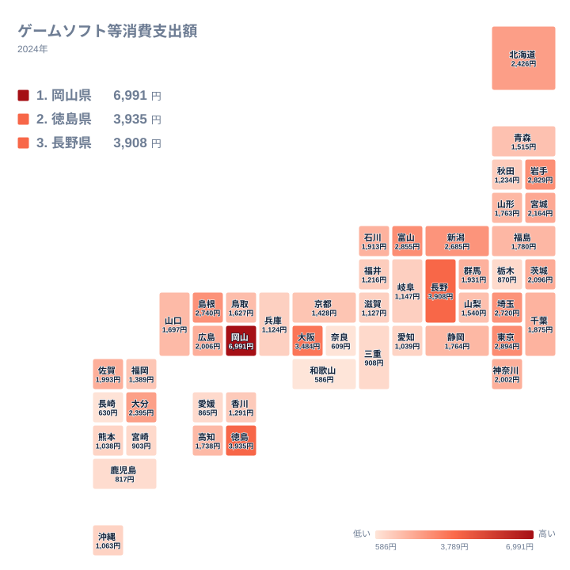

ゲームソフトへの支出は、県によってどれほど違うのでしょうか。2024年の家計調査では、1位の岡山県が6,991円、47位の和歌山県が586円でした。同じ日本に暮らしていても、支出額には大きな開きがあります。

最初に、この記事で言えることの範囲をはっきりさせておきます。データから確認できるのは、1位の水準が他の県より大きく離れていること、そして地方ごとにきれいなまとまりがないことの2点です。なぜ岡山県が1位なのかという理由までは、手元の数値では答えられません。そのため理由に関する話は、仮説として切り分けて書きます。

## 上位と下位の顔ぶれ

まず、上位5県と下位5県を図で確認します。

<source-link href="/ranking/game-software-consumption-expenditure">ゲームソフト等への支出ランキングをもっと見る</source-link>

上位の形は、1位だけが突出し、2位と3位はほぼ同水準で、その後に緩やかに下がっていく、というものです。1位は岡山県で6,991円です。2位の徳島県は3,935円、3位の長野県は3,908円で、この2県の差は27円しかありません。4位の大阪府は3,484円、5位の東京都は2,894円と続きます。1位の金額は2位のおよそ倍近くに達しており、上位の層が全体に厚いというより、岡山県だけが別格の水準にあります。

下位は、47位が和歌山県で586円、46位が奈良県で609円、45位が長崎県で630円です。ここまでの3県は500円台から600円台に収まり、互いの差は小さい様子です。一方、44位の鹿児島県は817円、43位の愛媛県は865円で、長崎県との間には段差があります。下位5県を一括りにはできず、下位3県と4・5位で水準が分かれています。

最大の岡山県と最小の和歌山県の値は、6,991円と586円です。これは1年分の調査値同士を並べたもので、実際の購買行動の差をそのまま表しているとは限りません。上位には中国、四国、中部、近畿、関東の県が並び、下位には近畿、九州・沖縄、四国の県が入ります。特定の地方だけが高い、あるいは低いとは言えない顔ぶれです。

> [!NOTE]
> この指標は家計調査の「ゲームソフト等」への年間支出額で、単位は円です。調査対象の世帯が1年間に使った金額から求めた値であり、県全体の販売額やプレイ人口を示すものではありません。ゲーム機本体や周辺機器などは別の項目になる場合があるため、ここで見ているのはソフト等への支出だけです。

## 四国と近畿に見る地方内のばらつき

次に、47都道府県の分布を地図で見ます。

地図を見ると、濃淡が地方ごとにきれいに分かれているわけではありません。とくにばらつきが際立つのは四国と近畿です。

四国では、徳島県が3,935円で2位なのに対し、愛媛県は865円で43位です。同じ地方の中で、順位に40位以上の開きがあります。高知県は1,738円で24位、香川県は1,291円で31位で、四国の4県が上位から下位寄りまで広く散らばっています。四国というくくりで傾向を語ることは難しい状況です。詳しくは[徳島県のデータ](/areas/36000)でも確認できます。

近畿では、大阪府が3,484円で4位と目立ちます。ところが兵庫県は1,124円で36位、奈良県は609円で46位、和歌山県は586円で47位です。上位と最下位が同じ地方に同居しており、大都市圏かどうかでは説明しきれません。

中国地方でも、岡山県が1位、島根県が2,740円で8位に入る一方、山口県は1,697円で25位でした。最も高い県を含む地方でも、県ごとの違いは大きいのです。[岡山県のデータ](/areas/33000)とあわせて見ると、1位の突出ぶりがよくわかります。

## 考えられる背景(仮説)

ゲームソフトは、食品のように産地や気候で消費差を説明しにくい品目です。全国どこでも同じ商品が手に入るため、食文化や風土との結びつきを示す材料は、今回のデータにはありません。

そのうえで、理由として考えられることを仮説として挙げます。いずれも、本記事の数値では確かめられません。

- 新作の発売時期と調査月が重なり、少数の世帯の購入が平均を押し上げた可能性があります
- 店舗購入とダウンロード購入で、家計簿への記録のされ方が異なる可能性があります
- 子どものいる世帯の割合など、世帯構成の違いが影響している可能性があります

これらはどれも、岡山県が1位である理由として示せる根拠ではありません。また、都市部かどうかで説明しようとしても、愛知県が1,039円で38位、神奈川県が2,002円で16位、兵庫県が36位という結果と食い違います。購入の選択肢の多さなど、よく聞く説明は、データからは裏づけられません。

> [!WARNING]
> 家計調査は標本調査で、県ごとの調査世帯数は多くありません。ゲームソフトのように購入頻度が低く、1回の金額が大きい品目は、少数の世帯の購入で平均が大きく動きます。1位の水準の高さが、県民の傾向を表しているのか、標本の偏りによるものかは、この1年分のデータだけでは区別できません。

## 順位の間隔を読む

順位を読むときは、順位そのものよりも金額の間隔に注目すると、見え方が変わります。

上位では、1位の6,991円から2位の3,935円へ大きく落ちたあと、3位は3,908円とほぼ並び、4位は3,484円、5位は2,894円と段階的に下がります。つまり1位と2位の間にだけ大きな断層があります。

中位では、北海道が2,426円で11位、大分県が2,395円で12位、宮城県が2,164円で13位、茨城県が2,096円で14位と、数百円の幅に県が並びます。下位に近い側でも、沖縄県は1,063円で37位、愛知県は1,039円で38位、熊本県は1,038円で39位でした。この水準では、わずかな金額差で順位が入れ替わります。順位が上か下かだけを見ると、差の有無を読み違えやすい領域です。

> [!TIP]
> この指標は購入頻度が低く単価が大きいため、少数世帯の購入有無で県の平均が動きやすい性質があります。そのため、隣り合う順位の差が小さいときは、順位の違いよりも金額の近さに注目しましょう。数十円程度の差であれば、同水準とみなせる可能性があります。順位は上位・中位・下位のおおまかな層をつかむ目安として使うのが適切です。

## データについて

ここで使った数値は、家計調査の2024年のゲームソフト等消費支出額です。単位は円で、調査対象世帯の年間の支出額にあたります。本文での比較は、掲載されている値と順位をそのまま並べたもので、独自の計算や推計は加えていません。ほかの家計関連の指標とあわせて見たい方は、[同じカテゴリの統計一覧](/category/economy)もご覧ください。

## まとめ

2024年のゲームソフト等への支出は、岡山県が6,991円で1位、徳島県が3,935円で2位、長野県が3,908円で3位でした。下位は和歌山県が586円で47位、奈良県が609円で46位、長崎県が630円で45位です。

確認できた事実は、1位の水準が大きく離れていることと、同じ地方の中でも順位が大きくばらつくことです。とくに四国では徳島県が2位、愛媛県が43位と開きが大きく、近畿でも大阪府が4位、和歌山県が47位でした。理由については、発売時期、購入方法、世帯構成といった仮説は挙げられるものの、今回のデータで裏づけられるものはありません。標本調査という性質もあるため、順位は目安として受け止め、金額の間隔とあわせて読むことが大切です。
