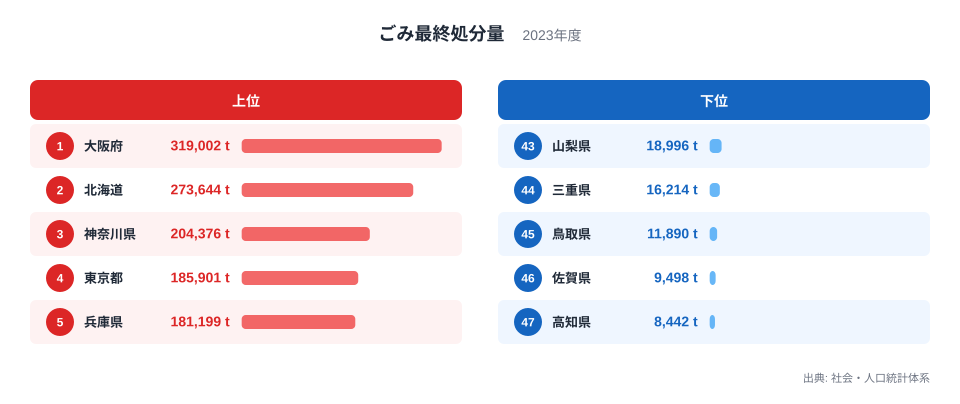
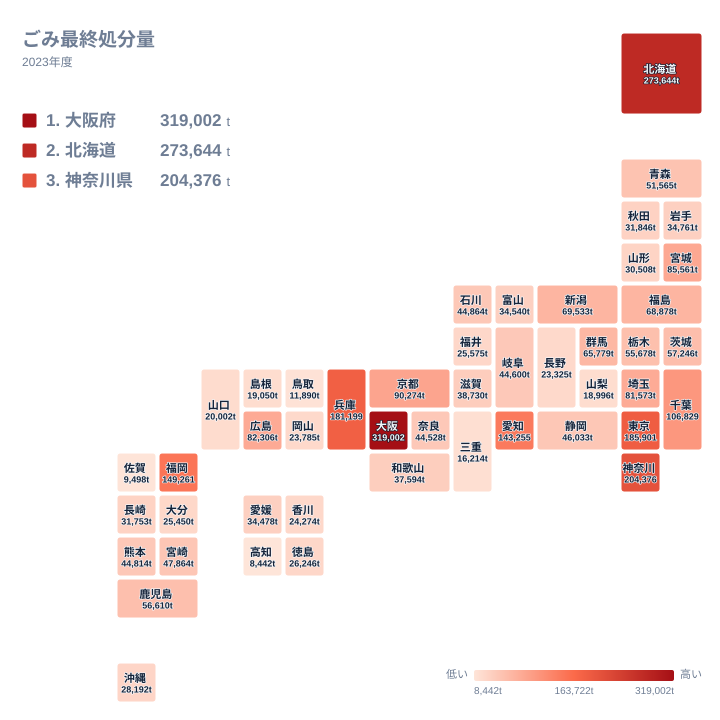

家庭や事業所から出たごみは、焼却や破砕、資源化を経て、最後に残ったものが埋め立てられます。この埋立量が、ごみ行政の「出口」にあたる最終処分量です。2023年のデータでは、最も多い大阪府が319,002t、最も少ない高知県が8,442tで、県による開きは非常に大きくなっています。

この記事では、上位と下位がなぜその順になるのかを、地理や産業構造、処理の歴史という視点から考えます。ただし、順位の背景は実データから直接確かめられるものではありません。理由として挙げる内容は、あくまで仮説として読んでください。

## 上位と下位を並べると見えるもの

<source-link href="/ranking/garbage-final-disposal">ごみ最終処分量ランキングをもっと見る</source-link>

上位5位は、1位の大阪府、2位の北海道、3位の神奈川県、4位の東京都、5位の兵庫県です。地方でみると、関東が神奈川県と東京都、近畿が大阪府と兵庫県、そして北海道が1道です。大都市圏を抱える府県が並ぶなかに、北海道が2位で割って入っている点が目を引きます。

図から一歩進めて、両端の差を数字で確かめてみます。1位の大阪府は319,002t、47位の高知県は8,442tです。この比は、実データの最大と最小の比にあたり、およそ38倍です。5位の兵庫県が181,199tで、5位でもまだ18万tを超えています。一方、下位5県で最も多い43位の山梨県でも18,996tにとどまります。上位5県の最低ラインである兵庫県の181,199tと、下位5県の最高ラインである山梨県の18,996tのあいだには、大きな断絶があります。

つまり、順位表は連続的に少しずつ下がっているというより、上位に少数の突出した県が固まり、下位に小さな値の県が密集する形をしています。下位は47位の高知県、46位の佐賀県、45位の鳥取県、44位の三重県、43位の山梨県の順で、いずれも2万t前後以下です。上位と下位の距離の大きさを意識すると、この指標が県ごとの事情にかなり左右されることが見えてきます。

> [!NOTE]
> ここでのごみ最終処分量は、一般廃棄物のうち、最終的に埋立処分された量を指します。統計名は「ごみ最終処分量」、出典は社会・人口統計体系、単位はtです。ごみの排出量そのものではなく、焼却や資源化を経て最後に残った量である点に注意してください。

## 大阪府と北海道が上位に来る背景

大阪府が1位になる背景には、人口や事業活動の集積が関わっている可能性があります。ごみの発生量が多ければ、焼却後に残る灰の量も増えるはずです。加えて、近畿では大阪湾の埋立処分場に広域で廃棄物を受け入れる仕組みが長く使われてきたとされます。灰を埋め立てる流れが制度として根づいていることが、数字に表れているのかもしれません。同じ近畿の兵庫県が5位に入っていることも、こうした歴史と関係している可能性があります。

北海道が2位に入る理由は、大阪府とは少し違うかもしれません。北海道は面積が広く、都市が離れて点在しています。そのため、小さな施設で処理して近隣の処分場に埋め立てる形になりやすく、広域での集約が進みにくいという仮説が考えられます。土地に余裕があり、埋立地を確保しやすいことも、埋立中心の処理が続いてきた一因かもしれません。

ただし、こうした説明は推測の域を出ません。実データから言えるのは、大阪府が319,002tで1位、北海道が273,644tで2位という事実までです。個別の自治体の事情は、[大阪府のデータ](/areas/27000)や[北海道のデータ](/areas/01000)から、ほかの統計とあわせて確かめてください。

> [!WARNING]
> この指標は県全体の合計量です。人口1人あたりの量ではないため、人口の多い県ほど数字が大きくなりやすい性質があるとみられます。上位の県がごみ処理に劣るという意味にはなりません。公平な比較には人口規模も合わせて考える必要がありますが、この記事では人口の数値を扱っていません。

## 首都圏と地方中心都市の並び

地図で見ると、数値の大きい県は関東と近畿、そして北海道に目立ちます。関東では3位の神奈川県が204,376t、4位の東京都が185,901t、8位の千葉県が106,829tです。12位の埼玉県は81,573tで、同じ関東のなかでも順位には幅があります。

東京都は大都市でありながら、1位ではなく4位です。神奈川県は204,376tで、東京都の185,901tを上回っています。この違いについては、焼却施設の整備状況や灰の資源化の取り組みなどが影響している可能性がありますが、データからは判断できません。ごみの量が多くても、最終的に埋め立てる量は処理の仕組みしだいで変わりうる、という点が、この指標を読む際の要点です。

中部以西では、6位の福岡県が149,261t、7位の愛知県が143,255tです。どちらも地域の中心となる県で、上位10位に入っています。九州・沖縄に目を移すと、福岡県と46位の佐賀県の9,498tとのあいだには大きな開きがあります。同じ地方でも、中心都市を持つ県と持たない県で値が大きく違う傾向は読み取れますが、その理由は別の統計で確かめる必要があります。

> [!TIP]
> 最終処分量が少ないことを、ごみ自体が少ないことと取り違えないでください。資源化や焼却灰の処理を進めている県では、ごみが多くても最終処分量は小さくなる可能性があります。順位は「ごみの量」ではなく「最後に埋め立てた量」を表しています。

## 下位の県から見えること

最も少ないのは47位の高知県で8,442t、次いで46位の佐賀県が9,498t、45位の鳥取県が11,890tです。この三県の値は、上位の大阪府の319,002tと比べると桁が違います。理由としては、ごみの発生量が少ないことや、処理の過程で埋立量が抑えられていることなどが仮説として考えられますが、データからは確かめられません。

注目したいのは44位の三重県で、値は16,214tです。三重県は近畿に属し、1位の大阪府や5位の兵庫県と同じ地方でありながら、最終処分量はかなり少なくなっています。焼却灰を埋め立てずに別の用途へ回す取り組みが進んでいる可能性もありますが、これも推測にとどまります。同じ近畿でも、結果が大きく分かれていることは確かです。

43位の山梨県は18,996tで、内陸の県であることから埋立地の確保に制約がある可能性も考えられます。中位に目を向けると、10位の宮城県が85,561t、11位の広島県が82,306tで、各地方の中核となる県が並びます。33位の山形県は30,508t、34位の沖縄県は28,192tです。順位の並びは、人口規模や施設の配置、灰の扱いなどが重なって生じている可能性があり、仮説として整理するのが妥当です。

## 数字を読むときに押さえたいこと

最終処分量は、次の三つの視点で読むと理解しやすくなります。

- 規模の視点: 人口が多い県ほど、ごみの総量も最終処分量も大きくなりやすいと考えられます。
- 処理方法の視点: 焼却後の灰を埋め立てるか、資源化するかで、同じごみ量でも最終処分量が変わる可能性があります。
- 地理と歴史の視点: 広域の処分場の有無や、埋立地を確保しやすいかどうかが、処理のやり方に影響してきたかもしれません。

この三つを重ねて見ると、大阪府が1位、北海道が2位という並びも、単なる「ごみが多い県」の順位ではない可能性が見えてきます。同じ分野の統計は[同じカテゴリの統計一覧](/category/safetyenvironment)でも確認できます。

最も多い大阪府の319,002tと、最も少ない高知県の8,442tという両端は、県ごとの条件が大きく異なることを示しています。自分の住む県が何位で、どの要因が効いていそうかを考えながらランキングを見ると、ごみ行政の違いが具体的に見えてきます。

## データについて

この記事で使ったのは、社会・人口統計体系に収録されている2023年のごみ最終処分量で、47都道府県すべての値を対象にしています。単位はtです。数値は県全体の合計であり、人口1人あたりに換算した値や、排出量に対する埋立の割合ではありません。そのため、順位の背景として述べた処理方法や歴史の話は、データから直接確かめられるものではなく、読み解きのための仮説として示しています。
