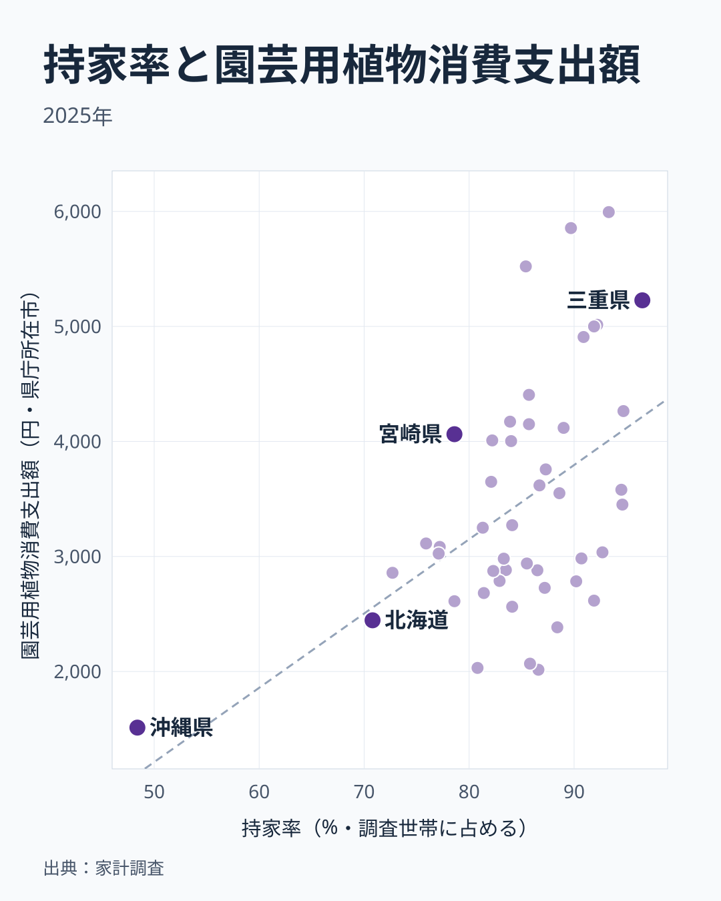

庭の手入れにお金をかける県と、ほとんどかけない県。その差は最大で約4倍にのぼります。総務省の家計調査によると、2025年の園芸用植物消費支出額は茨城県が5,994円で全国1位、沖縄県が1,512円で最下位でした。

上位には茨城・山口・長野・三重・鳥取といった県が並びます。一方で大阪・静岡・青森・沖縄などは下位に沈んでいます。この記事では、支出額の分布の形を確認したうえで、同じ家計調査の持家率と重ね合わせ、庭付きの持ち家が多い県ほど支出が多いのかを確かめます。

> [!NOTE]
> 「園芸用植物」は家計調査の品目で、植木・草花・苗など植物そのものの購入額を指します。肥料や園芸資材などの道具・消耗品は別の品目「園芸用品」に入るため、この指標には含まれません。値は都道府県庁所在市の二人以上世帯の年間支出額で、茨城県なら水戸市、山口県なら山口市、長野県なら長野市の世帯が対象です。庭を持つ世帯が多い郊外や農村部の暮らしは、県全体と一致しない可能性があります。

## 上位7県は4,900円以上に集まり、下位は裾野が長い

<source-link href="/ranking/garden-plants-consumption-expenditure">園芸用植物消費支出額ランキングをもっと見る</source-link>

上位の特徴は、1位から7位までが4,900円以上に集まっていることです。1位の茨城県は5,994円、2位の山口県は5,855円、3位の長野県は5,522円、4位の三重県は5,227円、5位の鳥取県は5,014円、6位の群馬県は5,000円、7位の佐賀県は4,908円です。ところが7位と8位の間では503円下がり、8位の岡山県は4,405円です。その後は10位の和歌山県が4,172円と、4,100円台へ段階的に下がります。そのため、この記事では1位から7位を上位グループとして、8位以下とは区別して読みます。

下位側は裾野が長く続きます。47位の沖縄県は1,512円、46位の青森県は2,015円、45位の静岡県は2,031円、44位の大阪府は2,068円で、下位4県は2,000円前後から2,100円弱に集まり、最下位の沖縄県だけが1,500円台まで下がります。その上の43位の石川県は2,384円です。なお東京都は2,787円で35位、京都府は2,563円で41位、北海道は2,445円で42位でした。大都市だから下位とは限らず、東京都は中位に位置しています。

[仮説]として、大阪などの大都市圏では集合住宅の比率が高く庭のスペースを持つ世帯が少ないこと、青森など積雪の多い地域では園芸シーズンが短いことが、支出を押し下げている可能性があります。ただしこれは一例の推測です。積雪とは関係の薄い静岡県も下位にあり、すべての県に当てはまる説明ではありません。住宅の種類や積雪量のデータで確かめるまでは、仮説のままにしておきます。

## タイルマップで見ると、特定の地方に偏りはない

この図は各県を同じ大きさの正方形に並べたタイルマップで、実際の面積や形ではありません。支出額が高い県(濃い青)は関東の茨城・群馬、中部の長野、近畿の三重、中国の山口・鳥取、九州の佐賀などに散らばっています。支出額が低い県(薄い青)も大阪・静岡・青森・沖縄などに分かれていて、特定の地方にまとまった偏りは読み取りにくい分布です。

中間の層を見ると、順位ごとの差は小さくなります。20位の千葉県は3,550円、21位の神奈川県は3,451円、22位の滋賀県は3,272円、23位の栃木県は3,250円、25位の福岡県は3,083円と、20位から25位までの幅は約470円です。支出額は地域ごとの明確な区分ではなく、なだらかに変化しています。地方の名前では説明しにくいなら、県ごとの住まい方のような別の物差しで見るほうが手がかりになります。

## 持家率と重ねると、関係はあるが決定的ではない

<source-link href="/ranking/home-ownership-rate-kakei">持家率ランキングをもっと見る</source-link>

庭の手入れは持ち家で行われやすいと考え、同じ家計調査の持家率(二人以上世帯のうち持ち家に住む世帯の割合)と重ねました。2025年の47都道府県を並べると、相関係数は0.50で、持家率が高い県ほど園芸用植物の支出額が多い向きの関係がありました。沖縄県を除いた46都道府県でも0.43です。持家率の上位10県の単純平均は園芸用植物が4,309円、下位10県の単純平均は2,799円で、差は確かにあります。

ただし、持家率だけでは説明しきれません。三重県は持家率が96.5%と47都道府県で最も高く、園芸用植物でも4位ですが、福井県の持家率は94.7%で園芸用植物は9位です。神奈川県は94.6%、富山県は94.5%、新潟県は92.7%と持家率は上位でも、園芸用植物の支出額はいずれも20位前後で中位に収まります。逆に宮崎県は持家率が78.6%と低めなのに4,063円で13位です。大阪府は85.8%、青森県は86.6%と持家率は中位ですが、園芸用植物は下位です。

沖縄県の持家率は48.4%で、次に低い北海道の70.8%と比べても突出して低く、図の左下に離れて位置します。園芸用植物も最下位の沖縄県が、相関を押し上げている面があります。三重県のように両方が高い県の様子は[三重県のデータ](/areas/24000)でも確認できますが、持家率が高い県の中でも園芸用植物の支出額が大きく分かれる以上、庭付きの持ち家という説明は一部にとどまります。

> [!WARNING]
> 相関係数0.50は、持家率が高い県で園芸用植物の支出額も高い傾向を示すだけで、持ち家だから庭の手入れにお金をかけるという因果は示しません。どちらの値も県庁所在市の世帯の標本から出ているため、庭の有無や戸建ての割合、世帯の年齢構成といった要因はこの図に含まれません。

## 地方別に見た上位10県の顔ぶれ

地方は北海道・東北、関東、中部、近畿、中国、四国、九州・沖縄の7区分で数えます。上位10県を見ると、関東の茨城県・群馬県、中部の長野県・福井県、近畿の三重県・和歌山県、中国の山口県・鳥取県・岡山県、九州・沖縄の佐賀県が入っています。なお福井県は9位、和歌山県は10位です。北海道・東北と四国からは入っておらず、7区分のうち5区分に散らばっています。

下位10県の顔ぶれを見ると、沖縄県、青森県、静岡県、大阪府、石川県、北海道、京都府、高知県、岐阜県、広島県が並びます。上位にも下位にも複数の地方が混在していて、地方でまとめて語れる偏りは見られません。家計調査の県庁所在市の値は年による変動もあるため、1年の順位だけで県の傾向を決めつけるのは避けたほうがよいでしょう。

## 自分の県の順位をどう受け取るか

> [!TIP]
> 自分の県の順位が低いことは、庭の手入れに関心が薄いことを意味しません。集合住宅が多い、庭が小さい、種や苗を自分で育てるなどの理由でも、購入額は小さくなります。順位は購入額の比較として読み、住まいの形や気候といった事情と合わせて受け取ってください。

この指標で見えるのは、県庁所在市の二人以上世帯が1年間に植物へ使った金額の違いです。持家率と重ねても説明できたのは一部で、残りは住宅の種類や敷地の広さ、気候、園芸の習慣などによるのかもしれません。[仮説]として、戸建て住宅の比率や世帯の年齢構成が関わっている可能性がありますが、本記事ではこれらの指標を扱っておらず、検証できていません。次に確かめるなら、戸建て率との関係が最初の候補です。

## まとめ

- 1位は茨城県で5,994円、47位は沖縄県で1,512円、その差は約4倍
- 上位は1位から7位までが4,900円以上に集まり、8位以下は4,405円から段階的に下がる
- 下位は沖縄・青森・静岡・大阪・石川で、[仮説]として集合住宅の比率や積雪が関係している可能性があるが、当てはまらない県もある
- 上位10県は7区分のうち5区分に散らばり、特定の地方への偏りは見られない
- 持家率との相関係数は0.50で、関係はあるものの、持家率が高くても支出が中位の県が多く、持家率だけでは説明できない
