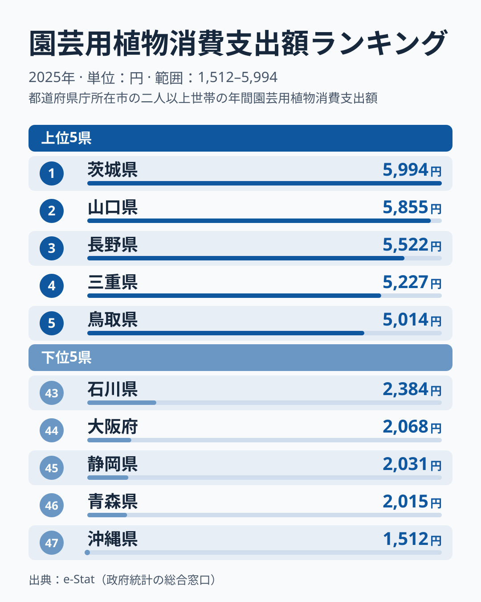
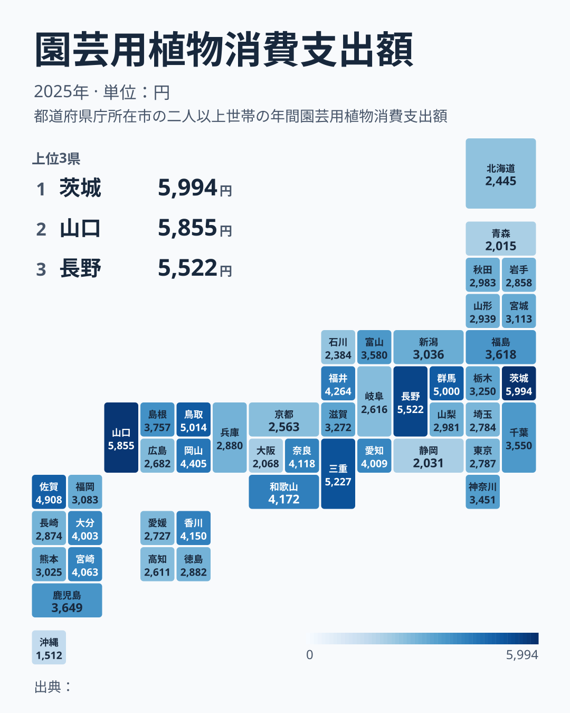

庭の手入れにお金をかける県と、ほとんどかけない県。その差は最大で約4倍にのぼります。総務省の家計調査によると、2025年の植木・園芸用品消費支出額は茨城県が5,994円で全国1位、沖縄県が1,512円で最下位でした。

上位には茨城・山口・長野・三重・鳥取といった県が並びます。一方で大阪・静岡・青森・沖縄などは下位に沈んでいます。この記事では、支出額の分布の形を確認したうえで、住環境と高齢化という2つの切り口から背景を仮説として考えます。

> [!NOTE]
> 「植木・園芸用品」は総務省の家計調査における品目分類で、鉢植え・苗木・肥料・園芸資材などの購入額を指します。1世帯あたり(2人以上の世帯)の年間支出額を都道府県庁所在市で集計した値で、県全体の値ではありません。苗や肥料などの消耗品は購入の時期や回数で金額が動きやすく、単年の順位はぶれも大きくなります。庭そのものの有無や広さは統計に含まれず、あくまで購入金額の比較です。

## 上位7県は4,900円以上に集まり、下位は裾野が長い

<source-link href="/ranking/garden-plants-consumption-expenditure">植木・園芸用品ランキングをもっと見る</source-link>

上位の特徴は、1位から7位までが4,900円以上に集まっていることです。1位の茨城県は5,994円、2位の山口県は5,855円、3位の長野県は5,522円、4位の三重県は5,227円、5位の鳥取県は5,014円、6位の群馬県は5,000円、7位の佐賀県は4,908円です。ところが8位の岡山県は4,405円、10位の和歌山県は4,172円と、7位と8位の間で一段下がり、その後は4,100円台へ段階的に下がります。この記事では1〜7位を上位の団子状態とみなし、8位以下とは区別して読みます。

[仮説]として、持ち家率・戸建て率が高く庭付き一戸建てが多い地域では、植木や花壇の手入れへの継続的な支出が生まれやすいのかもしれません。ただし本記事のデータに持ち家率や戸建て率は含まれないため、確認はできません。4位三重県の詳しい地域データは[三重県のページ](/areas/24000)で、他の指標は[農業カテゴリ](/category/agriculture)でも確認できます。

下位側は裾野が長く続きます。47位の沖縄県は1,512円、46位の青森県は2,015円、45位の静岡県は2,031円、44位の大阪府は2,068円で、下位4県は1,500円から2,100円ほどの範囲にあります。その上の43位の石川県は2,384円です。なお東京都は2,787円で35位、京都府は2,563円で41位、北海道は2,445円で42位でした。[仮説]として、大阪などの大都市圏では集合住宅の比率が高く庭のスペースを持つ世帯が少ないこと、青森など積雪の多い地域では園芸シーズンが短いことが支出を押し下げている可能性があります。ただしこれはあくまで一例の推測です。積雪とは関係の薄い静岡県も下位にあり、東京都のように下位に入らない大都市もあるため、すべての県に当てはまる説明ではありません。

## 分布から考えられる2つの仮説

地図で見ると、支出額が高い県(濃い緑)は関東の茨城・群馬、中部の長野、近畿の三重、中国の山口・鳥取、九州の佐賀などに散らばっており、支出額が低い県(薄い緑)も大阪・静岡・青森・沖縄などに分かれています。特定の地方にまとまった偏りは読み取りにくい分布です。[仮説]として、持ち家率が高く戸建て住宅が多い地域ほど庭の手入れに投資することは考えられますが、本記事のデータに持ち家率は含まれないため、この仮説は本データでは検証できません。庭付き戸建てに住む世帯の割合が園芸用品への支出を底上げしているかどうかは、別の統計で確かめる必要があります。

もう一つの仮説は高齢化です。[仮説]として、定年後に自宅の庭仕事を趣味として楽しむ高齢世帯が多い地域では、植木・園芸用品への継続的な支出が生まれやすいと考えられます。逆に大阪府のような大都市圏では、現役世代の単身世帯・賃貸世帯の比率が高く、庭仕事に時間や資金を割く余地が小さいのかもしれません。こちらも本データに高齢化率は含まれず、裏付けはありません。

中間の層を見ると、順位ごとの差は小さくなります。20位の千葉県は3,550円、21位の神奈川県は3,451円、22位の滋賀県は3,272円、23位の栃木県は3,250円、25位の福岡県は3,083円と、20位から25位まででも500円ほどの幅しかありません。支出額は地域ごとの明確な区分ではなく、なだらかに変化しているように見えます。

## 地方別に見た上位10県の顔ぶれ

上位10県を地方別に見ると、関東の茨城県・群馬県、中部の長野県・福井県、近畿の三重県・和歌山県、中国の山口県・鳥取県・岡山県、九州・沖縄の佐賀県が入っています。北海道・東北と四国からは入っておらず、九州・沖縄を1区分として数えると、7区分のうち5区分(関東・中部・近畿・中国・九州・沖縄)に散らばっています。

下位10県の顔ぶれを見ると、沖縄県、青森県、静岡県、大阪府、石川県、北海道、京都府、高知県、岐阜県、広島県が並びます。地方でまとめて語れるほどの偏りは見られず、上位にも下位にも複数の地方が混在しています。家計調査の県庁所在市の値は年による変動もあるため、1年の順位だけで県の気質を決めつけるのは避けたほうがよいでしょう。

## まとめ

- 1位は茨城県で5,994円、47位は沖縄県で1,512円、その差は約4倍
- 上位は1位から7位までが4,900円以上に集まる団子状態で、8位以下は4,405円から段階的に下がる
- 下位は沖縄・青森・静岡・大阪・石川で、[仮説]として集合住宅の比率や積雪が関係している可能性があるが、当てはまらない県もある
- 上位10県は7地方区分のうち5区分(関東・中部・近畿・中国・九州・沖縄)に散らばり、特定の地方への偏りは見られない
- 支出額の分布は、持ち家率や高齢化と重なる可能性があるが、本データだけでは検証できない
