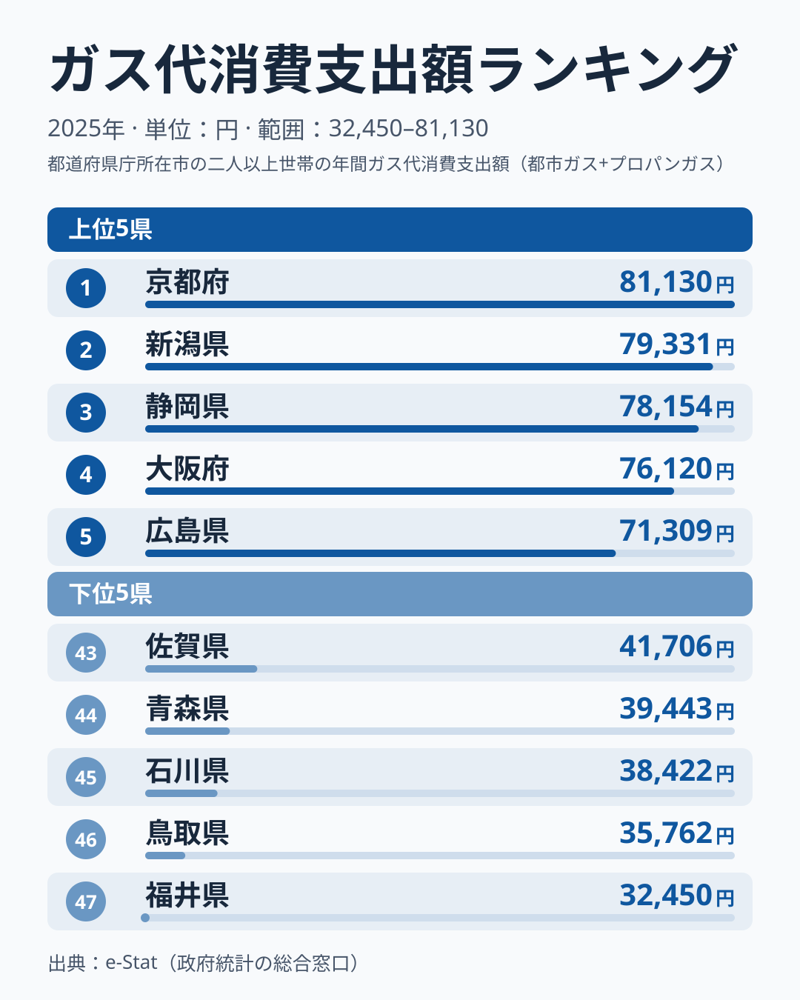
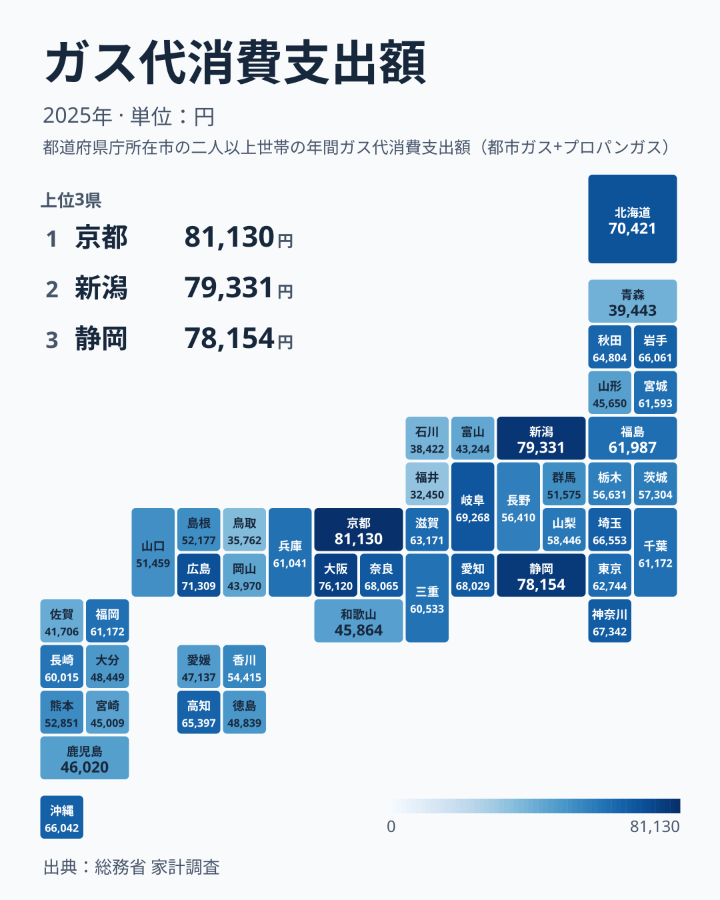

「ガス代が高いのは雪国だから」——そう思っている人は多いはずです。総務省の家計調査（二人以上世帯・都道府県庁所在市）で2025年の年間ガス代消費支出額を見ると、1位は京都府で81,130円、2位は雪国の新潟県で79,331円でした。最下位は福井県の32,450円で、1位との差は2.5倍に達します。

ところが同じ寒冷地でも順位は大きく割れます。北海道は6位で70,421円、岩手県は12位で66,061円と上位にいる一方、青森県は44位の39,443円まで下がり、岩手県とは約1.7倍の差があります。この記事では、ガス代を都市ガスとプロパンの内訳に分け、寒さだけでは説明できない地域差を、データで言えることと言えないことに分けて整理します。

> [!NOTE]
> このガス代消費支出額は、総務省「家計調査」の都道府県庁所在市・二人以上世帯データで、**都市ガスとプロパンガス（LPG）の支出を合算した金額**です。合算の例として、2025年の京都府は都市ガス消費支出額が80,565円、プロパンガス消費支出額が565円で、合計が81,130円です。都市ガスは導管で供給されるため比較的安く、プロパンは個別配送のコストが乗るため割高になりやすいという特性があります。

## 上位と下位

<source-link href="/ranking/gas-consumption-expenditure">ガス代ランキングをもっと見る</source-link>

図で目立つのは、上位5県の中での差の小ささと、上位と下位の間の差の大きさです。1位の京都府81,130円から5位の広島県71,309円までは1万円ほどにおさまっています。これに対し、1位と最下位の福井県32,450円との差は4万円を超えます。上位は近畿・中部・中国の都市が並び、そこに中部の新潟県が割り込んでいる点が特徴的です。内訳を分けて見ると、上位は2つのタイプに分かれます。[都市ガス消費支出額](/ranking/city-gas-consumption-expenditure)は京都府が80,565円、大阪府が74,947円、新潟県が71,677円で、この3府県が全国の1〜3位を占めます。合計額のほぼ全部を都市ガスが占める「都市ガス型」です。いっぽう北海道はガス代消費支出額で6位ですが、都市ガスは31,265円で24位にとどまります。[プロパンガス消費支出額](/ranking/propane-gas-consumption-expenditure)が39,157円で全国2位と高く、合算で押し上げられる「プロパン型」です。

下位側は、47位の福井県から43位の佐賀県まで、5県とも4万円台前半以下に集まっています。いずれも都市ガス消費支出額が小さく、福井県は46位、鳥取県は44位、石川県は40位、佐賀県は45位、青森県は47位です。プロパンが多少あっても都市ガスの薄さを補えないため、合算でも低くなっています。中部の福井県・石川県・富山県は、ガス代消費支出額が47位、45位、42位と下位に連なっており、冬の厳しい地域が必ずしも高支出になるとは限らないことがうかがえます。

## 寒冷地なのに安い、その理由

あわせて見る: [都市ガス供給区域内世帯比率ランキング](/ranking/city-gas-supply-area-household-ratio)

最も興味深いのは、同じ東北地方でも順位が大きく分かれていることです。岩手県は66,061円で12位、青森県は39,443円で44位と、両県とも冬の寒さは厳しいのに、支出額には約1.7倍（26,618円）の差があります。内訳を見ると、この差のほとんどは都市ガスです。都市ガス消費支出額は岩手県が29,098円、青森県が6,699円で、差は22,399円あります。プロパンガス消費支出額は岩手県が36,963円、青森県が32,745円とどちらも高く、差は4,218円にすぎません。

データで言えるのは、青森県の低さは都市ガスの少なさによるものだという点までです。その背景について、[仮説] 青森県では暖房と給湯の主役がガスではなく灯油だと考えられます。実際に[灯油消費支出額ランキング](/ranking/kerosene-consumption-expenditure)では、青森県が96,780円、北海道が86,812円、秋田県が59,044円で、この3道県が上位に並びます。ガス代が下位の青森県が灯油消費支出額では全国で最も高いという対照は、仮説と整合します。ただし岩手県も灯油消費支出額は45,857円で全国4番目に多いのにガス代は12位にいるため、灯油の多さだけでは説明がつきません。世帯の暖房の種類や住宅の形態を調べた統計との突き合わせが必要で、住宅・土地統計調査の暖房設備に関する指標が使えれば確かめられます。

> [!WARNING]
> 家計調査の市別の値は調査世帯が限られるため、年ごとの変動が大きい点に注意してください。京都府は2024年の8位（69,318円）から2025年に1位（81,130円）へ上がり、福井県は2024年の41位（41,320円）から2025年に47位（32,450円）へ下がりました。1年の順位だけで地域の構造を断定せず、都市ガスとプロパンの内訳や灯油など他の指標と合わせて読むのが安全です。また、このランキングは支出額（円）であり、使用量そのものではありません。

もう一つの視点は、都市ガスの導管が届くかどうかです。ただし[都市ガス供給区域内世帯比率](/ranking/city-gas-supply-area-household-ratio)（2016年度）の順位は、青森県が36位、岩手県が41位で、比率だけで見ると岩手県のほうが低いのに、都市ガスの支出は岩手県のほうが大きくなっています。供給区域の広さだけでは、県庁所在市の都市ガス利用の差を説明しきれないということです。県庁所在市に限った家計調査と、県全体の供給区域比率では、見ている範囲そのものが違う点にも注意が必要です。

> [!TIP]
> ガスの少なさを電気で補っている地域があるかを確かめるには、[電気代消費支出額ランキング](/ranking/electricity-consumption-expenditure)と並べるのが近道です。2025年は電気代消費支出額が福井県1位（220,481円）、富山県2位、石川県3位、山形県4位と北陸・東北の県が並んでいます。電気代の高い県にガス代の低い県が目立つため、電気がガスの少なさを補っている可能性があります。

## 47都道府県の全体像

地図で見ると、上位10県は、近畿の京都府・大阪府・奈良県、中部の新潟県・静岡県・岐阜県・愛知県、中国の広島県、北海道・東北の北海道、関東の神奈川県です。一方、下位5県の福井県・鳥取県・石川県・青森県・佐賀県は低支出側にあります。「都市か地方か」「寒いか暖かいか」という一軸だけでは説明しにくく、都市ガス網の整備状況とプロパン依存度、さらに灯油や電気といった他の燃料との組み合わせが地域差に関わっている可能性があります。

たとえば新潟県はガス代消費支出額が2位の79,331円で、豪雪地帯でありながら都市ガス消費支出額が71,677円と高く、都市ガス供給区域内世帯比率（2016年度）の順位も10位です。[仮説] 新潟市では給湯・暖房でのガス利用が定着していることが背景にあると考えられますが、住宅形態別の光熱費との照合が必要です。対照的に、佐賀県は都市ガス消費支出額が11,416円と低く、プロパンガス消費支出額の30,290円を足しても、ガス代消費支出額の合計は43位の41,706円にとどまります。鳥取県は都市ガス消費支出額が13,375円、プロパンガス消費支出額が22,387円で、合計は35,762円です。ガスが「どれだけ都市ガスに寄っているか」と「電気や灯油で何を補っているか」の2点が、ランキングを読むときの鍵になります。

## まとめ

- 1位は京都府81,130円、最下位は福井県32,450円で2.5倍の差
- 上位は都市ガス型（京都府・大阪府・新潟県）とプロパン型（北海道など）が混在
- 同じ東北でも岩手県は12位、青森県は44位と割れ、差の大半は都市ガス消費支出額で、その背景は仮説の段階
- 市別の値は年ごとの変動が大きく、1年の順位だけで構造は断定できない
