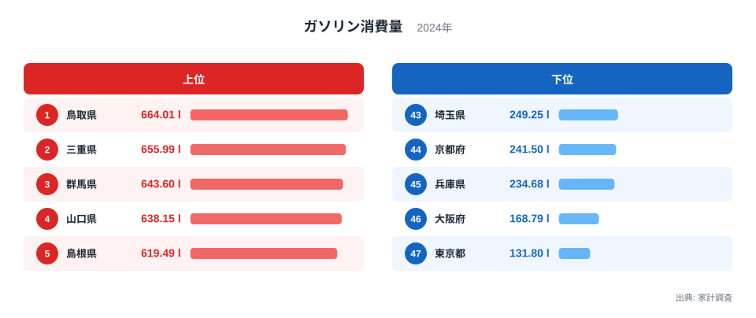
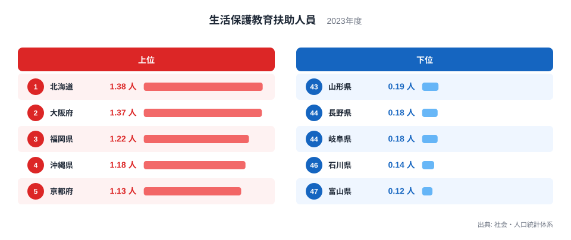
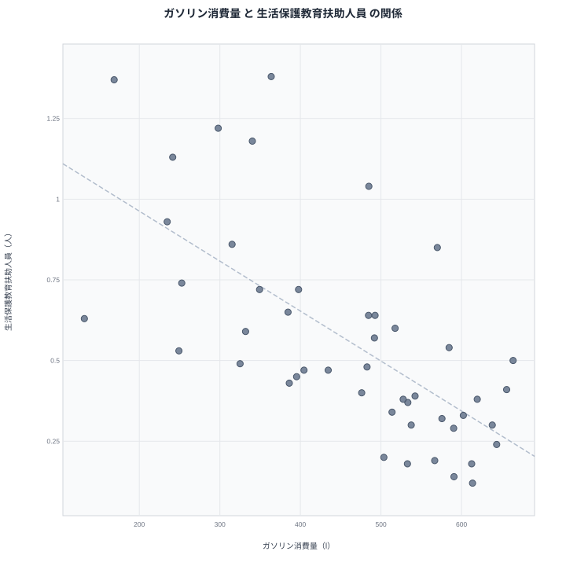

ガソリンの消費量が多い県ほど、生活保護の教育扶助を受ける人の割合が低い。2つの統計を並べると、そんな傾向が浮かびます。ただし、ガソリンを使うことが扶助を減らしているわけではありません。この記事では、見かけの相関と、その裏にあると考えられる暮らし方の違いを分けて読み解きます。

## まずガソリン消費量を見る

最初に、家計調査で見たガソリン消費量の上位5県と下位5県を確認します。

<source-link href="/ranking/gasoline-consumption-quantity">ガソリン消費量ランキングをもっと見る</source-link>

2024年のガソリン消費量で1位は鳥取県の664.01lです。2位は三重県の655.993l、3位は群馬県の643.604lで、4位に山口県の638.148l、5位に島根県の619.49lが続きます。上位には中国地方の県が3つ入っています。鳥取県、山口県、島根県です。ほかに近畿の三重県、関東の群馬県が並びます。

一方、下位は東京都の131.797lが47位で最も少なく、46位が大阪府の168.789lです。45位は兵庫県の234.682l、44位は京都府の241.495l、43位は埼玉県の249.248lです。大都市圏とその周辺が下位に集まっています。

最大の鳥取県と最小の東京都を比べると、664.01lと131.797lで、約5倍の開きがあります。同じ日本の中でも、車に頼る度合いに大きな差があることがわかります。鉄道やバスが日常の足になる地域と、一人一台の車が前提になる地域の違いが、そのまま数字に出ています。

> [!NOTE]
> ここでのガソリン消費量は、家計調査にもとづく1世帯あたりの購入量で、単位はリットルです。県内の販売総量ではありません。家計調査は標本調査のため、標本の少ない県では年ごとの振れが出やすい点に注意が必要です。

## 教育扶助を受ける人の分布

次に、生活保護の教育扶助を受ける人員のランキングです。

2023年の1位は北海道の1.38人、2位は大阪府の1.37人です。3位は福岡県の1.22人、4位は沖縄県の1.18人、5位は京都府の1.13人でした。大阪府、京都府のように、ガソリン消費量が少ない側の府が上位に入っているのが目を引きます。

反対に最も少ないのは富山県の0.12人です。46位は石川県の0.14人、45位は岐阜県の0.18人、44位は長野県の0.18人、43位は山形県の0.19人と続きます。北陸や中部内陸、東北の県が低い側に並びます。

最大の北海道1.38人と最小の富山県0.12人を比べると、約11.5倍の差です。教育扶助は、経済的に困難な世帯の子どもの学用品費などを支える制度です。この数字の大小は、家計の厳しさの違いだけでなく、世帯構成や地域の就労環境の違いも映していると考えられます。

詳しい順位は[生活保護教育扶助人員ランキング](/ranking/public-assistance-education-beneficiaries-per-1000)で確認できます。

> [!WARNING]
> 教育扶助の人員は、生活保護を受給している世帯の中で教育扶助が適用された人数です。受給できる状態でも申請していない世帯は含まれません。そのため、子どもの貧困の実態そのものを表す数字ではありません。

## 2つの指標を重ねると見えるもの

2つの指標を散布図にすると、次のようになります。

47都道府県で計算したピアソンの相関係数は-0.67です。ガソリン消費量が多い県ほど教育扶助人員が少ない、という右下がりの関係がはっきり読み取れます。

具体例を見ましょう。ガソリン消費量1位の[鳥取県](/areas/31000)は664.01lですが、教育扶助人員は22位の0.5人です。同じく上位の山口県は38位の0.3人、群馬県は41位の0.24人、島根県は33位の0.38人です。富山県はガソリン消費量6位の613.642lで、教育扶助は47位の0.12人でした。

逆側では、東京都のガソリン消費量は47位の131.797lですが、教育扶助は16位の0.63人です。大阪府はガソリン消費量46位の168.789lで、教育扶助は2位の1.37人です。兵庫県は45位と7位の0.93人、京都府は44位と5位の1.13人です。

ただし、例外もあります。[三重県](/areas/24000)はガソリン消費量が2位の655.993lですが、教育扶助は29位の0.41人で、中位にとどまります。北海道はガソリン消費量35位の363.801lに対し教育扶助は1位の1.38人で、傾向どおりとはいえ極端な位置にあります。相関は全体の傾向であって、すべての県に当てはまる法則ではありません。

> [!TIP]
> 散布図を読むときは、傾向線から大きく外れた県に注目します。三重県のように傾向とずれる県には、産業構造や世帯の特徴など、2指標だけでは説明できない事情があるはずです。

## 相関は因果ではない:真因はどこにあるか

ここで重要なのは、ガソリンの消費が教育扶助を減らしているわけではない、という点です。ガソリンを買う量を増やしても、生活保護の状況は変わりません。逆に、教育扶助が少ないからガソリンが増えるわけでもありません。

2つを結びつけているのは、背後にある別の要因だと考えられます。一つは都市化の程度です。東京都、大阪府、兵庫県、京都府のような都市部は、公共交通が発達していて車の利用が少なくなります。同時に、都市部には単身世帯やひとり親世帯、非正規雇用が集まりやすく、生活保護を利用する世帯の割合も高くなりがちです。

もう一つは、地方の世帯構成と就労のあり方です。ガソリン消費量が多い県では、通勤や買い物に車が欠かせません。三世代同居や持ち家が多く、共働きで世帯収入が一定の水準に保たれやすい地域もあります。こうした暮らし方が、教育扶助の少なさにつながっている可能性があります。ただし、これらは仮説であり、この2つのデータだけでは確かめられません。

つまり、-0.67という値が示すのは「2つの数字が一緒に動く傾向がある」ことだけです。因果の大きさや、一方でもう一方を説明できる割合を示すものではありません。車社会かどうかという地域の特性が、両方の数字に影響している、と考えるのが自然です。

北海道と沖縄県は注意が必要です。北海道は教育扶助が1位の1.38人、沖縄県は4位の1.18人と高く、ガソリン消費量は北海道が35位、沖縄県が37位の340.326lです。広い土地や離島といった地理条件、経済構造が異なるため、都市化だけでは説明しきれません。地域ごとの事情を丁寧に見る必要があります。

## 数字を読むときの注意

この分析の限界を整理します。

- 2つの指標は調査年が異なります。ガソリン消費量は2024年、教育扶助人員は2023年のデータです。
- 出典も別です。ガソリン消費量は家計調査、教育扶助人員は社会・人口統計体系にもとづきます。
- 47都道府県の比較なので、県内の地域差は見えません。
- 相関係数は、全体の傾向の強さを見る道具であり、個々の県の事情を語るものではありません。

地方別に見ても傾向は一様ではありません。九州・沖縄では、福岡県は教育扶助が3位の1.22人、ガソリン消費量は41位の297.964lで、傾向どおりの位置です。同じ九州の大分県は、ガソリン消費量が11位の584.588l、教育扶助が20位の0.54人です。鹿児島県はガソリン消費量が13位の569.909lながら、教育扶助は9位の0.85人と高めです。

こうした県ごとの違いを知るには、各県のデータを個別に見るのが近道です。ほかの経済関連の指標は[同じカテゴリの統計一覧](/category/economy)から探せます。

## データについて

ガソリン消費量は家計調査の2024年の値で、単位はリットルです。生活保護教育扶助人員は社会・人口統計体系の2023年の値で、単位は人です。相関係数は、この2つの値を47都道府県分そろえて計算したピアソンの相関係数で、値は-0.67でした。

## まとめ

ガソリン消費量が多い県ほど教育扶助人員が少ない、という右下がりの関係は確かにあります。相関係数は-0.67で、47都道府県を通した傾向として読み取れます。

ただし、この関係はガソリンが扶助を左右することを意味しません。背景には、都市化の程度、公共交通の有無、世帯構成、就労環境といった、暮らし方の違いがあると考えられます。数字を読むときは、相関を入口にして、その裏にある地域の事情を探ることが大切です。
