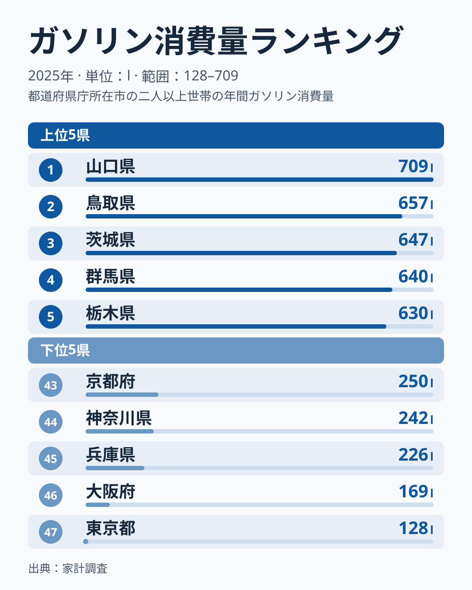
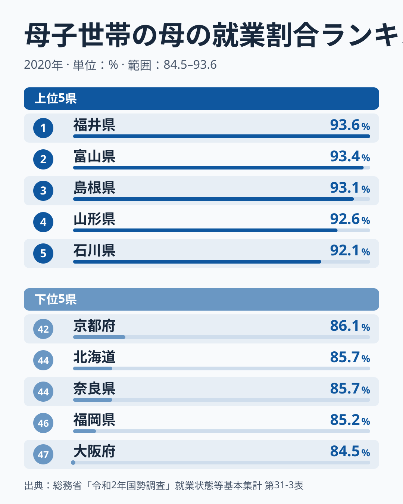
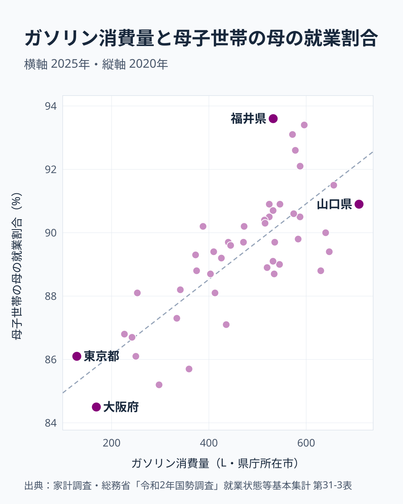

ガソリンの消費量が多い県ほど、母子世帯の母の就業割合も高いのでしょうか。一見すると無関係に見える二つの指標ですが、47都道府県で並べると、はっきりした重なりが見えてきます。

この記事では、家計調査にもとづくガソリン消費量と、国勢調査にもとづく母子世帯の母の就業割合を比べます。結論を先に言えば、二つの間には強めの相関があります。ただし、ガソリンが母親を働かせているわけでも、働くからガソリンが増えるわけでもありません。見かけの相関の背後にある共通の要因を、順に考えていきます。

## ガソリン消費量の上位と下位

まず、ガソリン消費量のランキングを確認します。2025年の家計調査では、1位は山口県で708.668l、2位は鳥取県で656.686lです。一方、最下位は東京都で128.469lでした。1位は最下位の5.52倍にあたります。

<source-link href="/ranking/gasoline-consumption-quantity">ガソリン消費量ランキングをもっと見る</source-link>

上位10県を地方別に見ると、関東が3県、北海道・東北が2県、中部が2県、中国が2県、近畿が1県です。関東では茨城県が3位、群馬県が4位、栃木県が5位と、北関東の3県が続けて上位に入っています。同じ関東でも、千葉県は39位、埼玉県は42位、神奈川県は44位、東京都は47位で、都心に近いほど少なくなっています。

下位10県は、関東が4県、近畿が4県、九州・沖縄が2県です。近畿では京都府が43位、兵庫県が45位、大阪府が46位となっています。大都市圏ほど消費量が少ない傾向がはっきり出ています。中央値は514.273lで、24位の香川県がちょうどこの値です。

[山口県のデータ](/areas/35000)や[鳥取県のデータ](/areas/31000)を見ると、1位と2位の差は51.982lで、上位に中国地方の県が並ぶことも確認できます。

## 母子世帯の母の就業割合の上位と下位

次に、母子世帯の母の就業割合です。2020年の国勢調査では、1位は福井県で93.6％、2位は富山県で93.4％、3位は島根県で93.1％です。最下位は大阪府で84.5％でした。1位は最下位の1.11倍で、ガソリンの5.52倍と比べると、県ごとの開きはずっと小さい指標です。

上位10県の内訳は、中部が4県、中国が3県、北海道・東北が2県、九州・沖縄が1県です。下位10県は、近畿が4県、北海道・東北が2県、関東が2県、九州・沖縄が2県でした。近畿では兵庫県が40位、京都府が43位、奈良県が45位、大阪府が47位です。

関東を見ると、東京都は42位で86.1％、神奈川県は41位で86.7％です。ガソリン消費量の下位に並んだ首都圏と近畿の大都市圏が、就業割合でも下位に集まっています。中央値は89.4％で、全体としては8割台後半から9割台前半に多くの県が収まっています。詳しい順位は[母子世帯の母の就業割合ランキング](/ranking/single-mother-employment-rate)で確認できます。

> [!NOTE]
> ガソリン消費量は家計調査にもとづく、1世帯あたりの購入量です。県庁所在地など調査対象の都市の家計が中心で、県全体の走行量を直接測ったものではありません。母子世帯の母の就業割合は、2020年の国勢調査の結果で、調査年が5年ずれています。

## 二つの指標を重ねると何が見えるか

二つの指標の散布図を描くと、右上がりの分布になります。ピアソンの相関係数は0.77で、47都道府県を使って計算しています。相関としては強めの部類です。

両方の上位10位に入る県は、山口県、鳥取県、富山県、石川県、山形県の5県です。山口県はガソリン消費量が1位、就業割合が9位で、鳥取県はガソリン消費量が2位、就業割合が6位です。富山県はガソリン消費量が6位、就業割合が2位、石川県はそれぞれ7位と5位、山形県は10位と4位です。

逆に、両方が低い側にそろうのは大都市圏です。東京都はガソリン消費量が47位、就業割合が42位です。大阪府はガソリン消費量が46位、就業割合が47位と、ともに最下位かそれに近い位置にあります。

ただし、きれいに揃わない県もあります。栃木県はガソリン消費量が5位ですが、就業割合は31位です。茨城県はガソリン消費量が3位で就業割合は24位、徳島県はガソリン消費量が16位で就業割合は34位でした。相関が強いといっても、全ての県が同じ向きに並ぶわけではありません。

> [!WARNING]
> 相関係数の0.77は、二つの順位が似た向きに動くことを示すだけです。因果の大きさや、一方で他方をどれだけ説明できるかを表す数字ではありません。県単位の平均どうしの関係であり、個々の母親の暮らしにそのまま当てはめることはできません。

## 見かけの相関と真因を分けて考える

では、なぜこの二つが似た並びになるのでしょうか。ここからは仮説です。ガソリンの消費が多いことが就業を押し上げる、あるいはその逆、と考えるより、共通の背景を考えるほうが自然です。

一つ目の仮説は、車社会の度合いです。公共交通が充実した大都市圏では、通勤に車が必須ではないため、ガソリン消費量は少なくなります。逆に、車で通勤するのが当たり前の地域では、消費量が増えます。母子世帯の母にとっても、車があれば勤め先の選択肢が広がり、働きやすくなる可能性があります。

二つ目の仮説は、地域の暮らし方です。中部や中国、北海道・東北の上位県には、実家や親族が近くにいて、子育てを支え合える環境が残っている地域が多いと考えられます。そうした環境が、就業のしやすさにも、車での移動の多さにも関わっているのかもしれません。

三つ目の仮説は、大都市圏に特有の事情です。大阪府や東京都のような地域では、求職しても条件が合わない、あるいは就業以外の状態にある人の比率が高くなるなど、別の要因が働いている可能性があります。ここは本記事のデータだけでは確かめられません。

つまり、ガソリン消費量は母子世帯の母の就業を説明する原因ではなく、車社会の度合いや地域の生活構造を映す「目印」として動いている、と読むのが妥当です。

## 数字を読むときのコツ

二つの指標は、そもそも測っているものが違います。ガソリン消費量は、世帯が1年に買った量です。就業割合は、母子世帯の母のうち働いている人の割合です。同じ県でも、前者は家計の支出行動、後者は就業状態という別の側面を見ています。

また、就業割合の開きは小さい点にも注意が必要です。1位の福井県は93.6％、最下位の大阪府は84.5％で、差は9.1％にとどまります。順位が数位違っても、実際の値の差はごくわずかな場合があります。たとえば秋田県、新潟県、山口県は、いずれも90.9％で並んでいます。

> [!TIP]
> 順位だけでなく、必ず値の差も見てください。就業割合は上位から中位まで値が密集しているため、順位の上下より、「どの地方にまとまっているか」を見たほうが傾向をつかめます。散布図で全体の向きを見てから、栃木県のような外れた県を個別に確認する順序がおすすめです。

## データについて

ガソリン消費量は家計調査の2025年の値で、単位はlです。母子世帯の母の就業割合は、総務省「令和2年国勢調査」就業状態等基本集計の2020年の値で、単位は％です。相関係数は、この二つを47都道府県で組み合わせて計算したピアソンの相関係数で、値は0.77です。

調査の年も方法も異なる二つの統計を並べているため、厳密な同時点の比較ではありません。この点を踏まえて、傾向の把握として読むことをおすすめします。同じ分野の他の指標は、[同じカテゴリの統計一覧](/category/economy)から確認できます。

## まとめ

ガソリン消費量と母子世帯の母の就業割合には、相関係数0.77という強めの関係があります。山口県、鳥取県、富山県、石川県、山形県は、どちらの上位10位にも入っています。一方で、東京都や大阪府など大都市圏は、どちらも下位側に位置しています。

しかし、これは因果を示すものではありません。車社会の度合いや地域の生活構造といった共通の背景が、二つの数字を同じ向きに動かしていると考えるのが自然です。栃木県や茨城県のように、ガソリン消費量は上位でも就業割合は中位以下という県があることも、単純な因果では説明できないことを物語っています。
