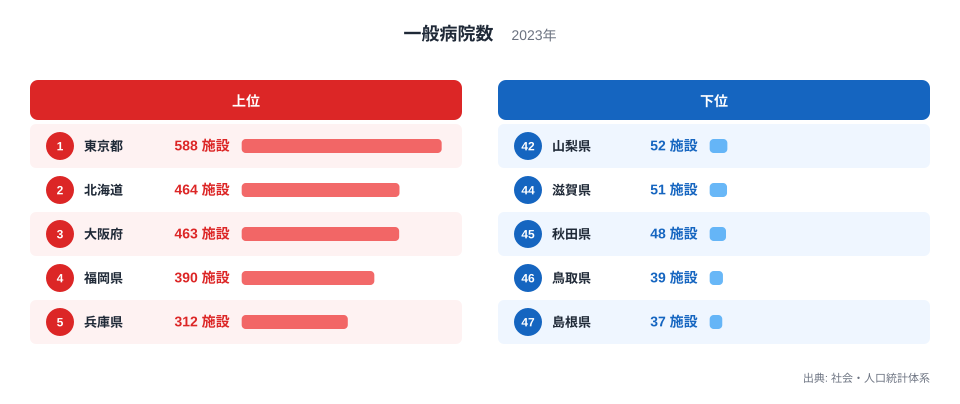
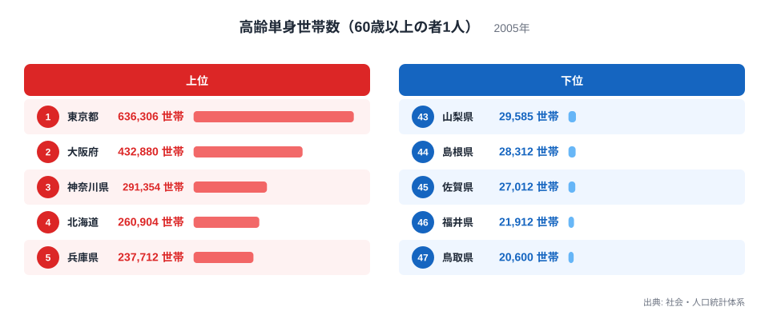
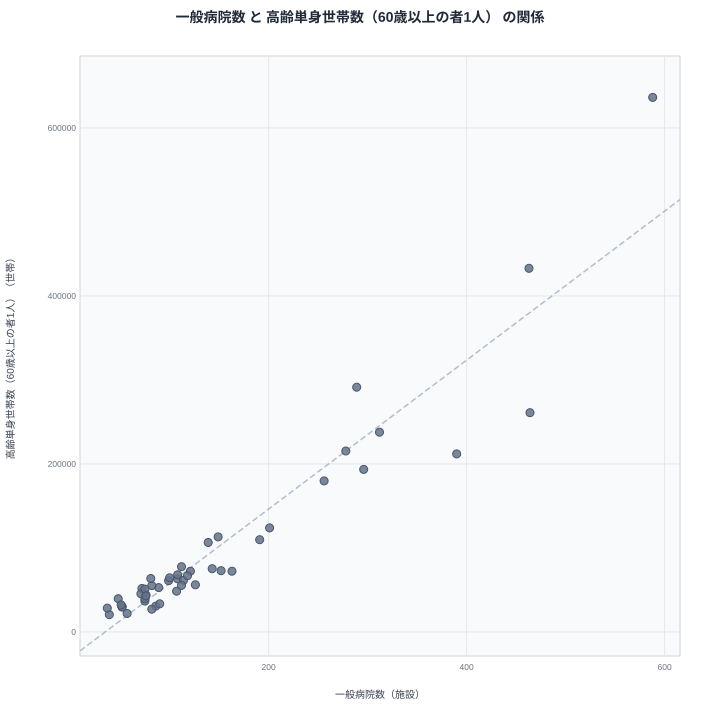

「病院が多い県には、一人暮らしの高齢者も多い」。そう聞くと、病院が高齢単身世帯を引き寄せているようにも、逆に高齢単身世帯が病院を増やしているようにも思えます。しかし、2 つの数字が並んで動くことと、一方がもう一方の原因であることは別の話です。

この記事では、2023 年の一般病院数と、2005 年の高齢単身世帯数（60 歳以上の者 1 人の世帯）を都道府県別に並べます。上位と下位の顔ぶれを確かめ、散布図で関係を眺めたうえで、見かけの相関の背後にある要因について、人口規模を有力な候補とした仮説を立てます。人口の値そのものはこの記事のデータにないため、あくまで仮説として扱います。

## 一般病院数の上位と下位

まず一般病院数を見ます。2023 年の数字で、単位は施設です。

<source-link href="/ranking/general-hospital-count">一般病院数ランキングをもっと見る</source-link>

1 位は東京都で 588 施設です。2 位は北海道で 464 施設、3 位は大阪府で 463 施設、4 位は福岡県で 390 施設、5 位は兵庫県で 312 施設と続きます。下位では、47 位が島根県で 37 施設、46 位が鳥取県で 39 施設、45 位が秋田県で 48 施設、44 位が滋賀県で 51 施設、43 位が山形県と山梨県で 52 施設です。

ここで注目したいのは、上位 5 件の顔ぶれです。この後に見る高齢単身世帯数の上位 5 件と比べると、東京都、大阪府、北海道、兵庫県の 4 都道府県が共通しています。違うのは、病院数では福岡県が入り、世帯数では神奈川県が入る点だけです。北海道と大阪府の差が 1 施設しかないことよりも、この顔ぶれの重なりの大きさが、2 つの指標の関係を考える出発点になります。

[東京都のデータ](/areas/13000)と[北海道のデータ](/areas/01000)を見ると、どちらも病院数の上位ですが、病院が多い理由は同じとは限りません。都市に人が集まっているためか、広い土地に施設が点在しているためか、このデータだけでは判断できません。

> [!NOTE]
> 一般病院は、病院のうち精神科病院や結核療養所などを除いたものを指します。診療所（いわゆる町のクリニック）は含まれないため、この数字は地域医療の全体像ではなく、入院機能を持つ比較的大きな施設の数を表しています。

## 高齢単身世帯数の上位と下位

次に、60 歳以上の一人暮らし世帯の数を見ます。こちらは 2005 年の数字で、単位は世帯です。

1 位は東京都で 636,306 世帯です。2 位は大阪府で 432,880 世帯、3 位は神奈川県で 291,354 世帯、4 位は北海道で 260,904 世帯、5 位は兵庫県で 237,712 世帯です。東京都は 2 位の大阪府を大きく引き離しています。

下位では、47 位が鳥取県で 20,600 世帯です。46 位は福井県で 21,912 世帯、45 位は佐賀県で 27,012 世帯、44 位は島根県で 28,312 世帯、43 位は山梨県で 29,585 世帯となっています。

[高齢単身世帯数（60歳以上の者1人）ランキング](/ranking/elderly-single-person-households)で全体を確かめると、上位に大都市圏を抱える都道府県が多いことが分かります。この指標は「割合」ではなく「実数」です。人口が多い県ほど世帯数が大きくなるのは自然なことだと考えられますが、人口の値はここにないため、推測の域を出ません。

> [!WARNING]
> 2 つの指標は年が異なります。病院数は 2023 年、高齢単身世帯数は 2005 年です。約 18 年の開きがあるため、同時点の関係ではなく、「古い世帯の分布」と「現在の病院の分布」を重ねた比較になります。この間に高齢化は大きく進んでおり、現在の世帯数は別の値になっていると考えられます。

## 散布図で見る見かけの相関

2 つの指標を 1 枚に重ねると、次のようになります。

散布図では、右上に東京都、大阪府、北海道、兵庫県、福岡県といった県が集まり、左下に鳥取県、島根県などが集まります。病院数が多い県ほど高齢単身世帯数も多いという、右上がりの関係が読み取れます。

順位でも両端はよく揃っています。東京都は病院数で 1 位、世帯数でも 1 位です。鳥取県は病院数で 39 施設の 46 位、世帯数で 47 位です。島根県は病院数で 47 位、世帯数で 44 位です。この 3 件は、右上がりの傾向を確かめる例です。

ただし、ここで「病院が多いから高齢単身世帯が多い」と結論するのは早計です。相関があることは、片方がもう片方を生み出していることを意味しません。次の節で、見かけの関係を生んでいる可能性のある共通の要因を考えます。

> [!TIP]
> この散布図で見るべきは、順位がずれる県です。たとえば北海道は病院数 2 位に対して世帯数 4 位、神奈川県は病院数 7 位に対して世帯数 3 位で、傾向線から離れる方向が逆です。こうした県を見つけたら、実数同士の比較に潜む別の要因を疑う手がかりになります。

## 人口規模は有力な候補だが仮説にとどまる

見かけの相関を生んでいる有力な候補は、人口規模です。人口が多い都道府県では、病院も多く必要になり、高齢者の世帯も数多く存在すると考えられます。人口という第三の要因が両方の数字を押し上げていれば、2 つの指標が並んで大きくなるのは自然です。ただし人口の値はこの記事のデータに含まれないため、検証はできていません。

順位のずれは、この仮説の限界を示す材料にもなります。北海道は病院数が 2 位、世帯数が 4 位で、病院の順位が世帯の順位より上です。神奈川県は病院数が 7 位、世帯数が 3 位で、病院の順位が世帯の順位より下です。人口規模だけで説明できるなら、順位はもっと揃うはずです。ずれが残る以上、人口以外の要因も働いている可能性があります。

ずれの理由としては、北海道は面積が広く病院が各地に分散する必要があるのかもしれません。神奈川県は人口が密集し、一つの病院が多くの住民を受け持つのかもしれません。しかし、面積や人口密度のデータは本記事にないため、いずれも可能性の指摘にとどまります。

因果の向きも決められません。高齢単身世帯が増えたから病院が増えた可能性もあれば、病院があるから高齢者が移り住んだ可能性もあります。ただ、2005 年の世帯数と 2023 年の病院数では時点が異なり、単純な前後関係も言い切れません。また、都市部と地方では一人暮らしになる事情が異なることも考えられ、病院との関係を一律に語ることは難しそうです。

## 数字を正しく使うために

この比較から言えることを整理します。

- 病院数が多い県ほど高齢単身世帯数も多い、という右上がりの関係は見られます
- その理由として、どちらも人口規模に比例して大きくなる可能性が考えられますが、本記事では検証していません
- 北海道と神奈川県のように順位がずれる県があり、人口以外の要因も示唆されます
- 2 つの指標は年が異なり、同時点の関係とは言えません

本当に知りたいのが「医療が足りているか」であれば、人口や高齢者数あたりの病院数、病床数、医師数などを使う必要があります。実数の順位だけで、医療の充実度や高齢者の暮らしやすさを判断することはできません。

[同じカテゴリの統計一覧](/category/socialsecurity)には、医療や福祉に関する他の指標が並んでいます。人口あたりの数字や病床数といった別の切り口と組み合わせると、見かけの相関に惑わされず、地域の実態に近づけます。

## データについて

一般病院数は 2023 年、高齢単身世帯数（60 歳以上の者 1 人）は 2005 年の値で、どちらも社会・人口統計体系に基づいています。前者の単位は施設、後者の単位は世帯です。いずれも実数であり、人口あたりに換算した値ではありません。

高齢単身世帯数は、60 歳以上の者が 1 人で暮らす世帯の数を表します。年齢の区切りが 60 歳であるため、65 歳以上を高齢者とする統計とは対象が少し異なります。他の資料と比べる際は、年齢の区切りと調査年をあわせて確認してください。

相関は因果ではありません。2 つの数字が揃って動いていても、その間に人口のような共通の要因が潜んでいる可能性があります。数字を読むときは、「何と何が並んでいるのか」に加えて、「なぜ並ぶのか」を考えることが大切です。
