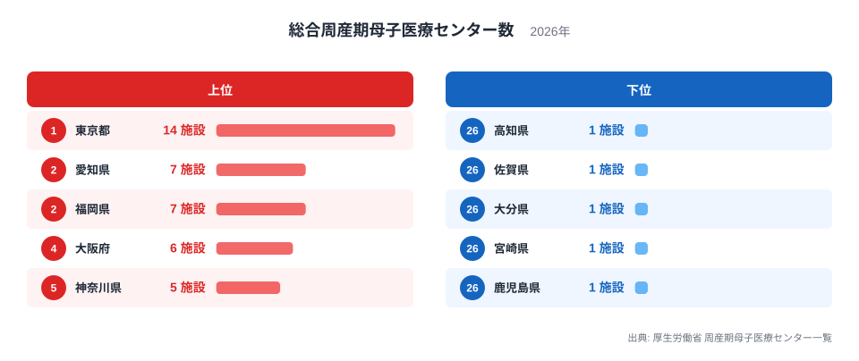
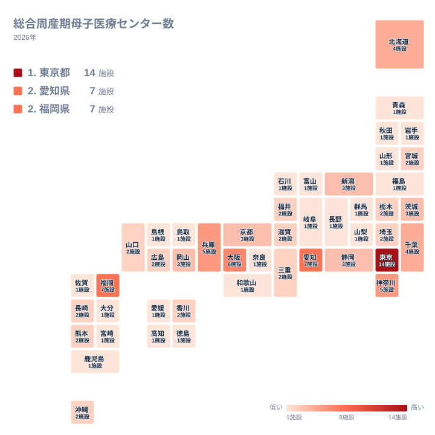

早産や重い妊娠合併症など、母子の命にかかわる場面で最後に頼るのが総合周産期母子医療センターです。厚生労働省の周産期母子医療センター一覧(2026年)をもとに、この拠点が都道府県でどう違うのかを見ていきます。

最も多いのは東京都の14施設で、最も少ない県は1施設です。最大と最小の比は14倍ですが、この比は東京都と1施設のどの県を組み合わせても同じです。特定の県が特別に少ないわけではなく、1施設の県が大きな塊をなしていることが、この指標の最大の特徴です。この記事では、順位の分布の形と地方ごとの違いを確かめ、差が生まれた理由として考えられることを、根拠の強さを区別しながら整理します。

## 上位と下位の顔ぶれ

まず、上位5都府県と下位5県を図で確認します。

<source-link href="/ranking/general-perinatal-center-count">総合周産期母子医療センター数ランキングをもっと見る</source-link>

1位は東京都で14施設です。その後ろに、愛知県と福岡県がどちらも7施設で並びます。続いて大阪府が6施設、神奈川県と兵庫県がどちらも5施設です。同じ施設数の県は同じ位置にある県として読むのが適切で、愛知県と福岡県の間に優劣はありません。東京都は7施設の愛知県や福岡県を大きく上回り、頭ひとつどころではなく抜けています。

下位には、高知県、佐賀県、大分県、宮崎県、鹿児島県が並び、いずれも1施設です。これらの県の間にも差はありません。図の下位5県は、同じ1施設の県のなかから表示の都合で選ばれたにすぎず、1施設の県はほかにも数多くあります。実際、47都道府県のなかで1施設の県は最も多い塊を作っています。

つまり、この指標は少数の大都市圏に拠点が集まり、残りの多くの県が1施設か2施設を置く、という構図です。2施設の県は宮城県、栃木県、埼玉県、福井県、三重県、滋賀県、広島県、山口県、香川県、長崎県、熊本県、沖縄県で、中間層を形づくっています。順位の細かな上下よりも、2施設以上を持つかどうかが一つの分かれ目になります。

> [!NOTE]
> 総合周産期母子医療センターは、母体・胎児集中治療室(MFICU)と新生児集中治療室(NICU)を備え、リスクの高い妊娠や出産に対応する、都道府県の周産期医療の中核施設です。この記事で数えているのは施設の数であり、ベッド数や医師数ではありません。

## 東京都が突出する背景

東京都が14施設を持つ背景には、人口や医療機関が集積していることがあると考えられます。大学病院や高度専門病院が多く、救急搬送の需要も大きいため、重症例を受け入れる拠点が複数必要になっている可能性があります。ただし、この記事では人口や病院数のデータを使っていないため、これは仮説の域を出ません。

関東の他の都県を見ると、神奈川県は5施設、千葉県は4施設、茨城県は3施設です。栃木県と埼玉県は2施設、群馬県は1施設です。東京都に隣接していても、埼玉県のように2施設にとどまる県があります。東京都内の拠点が周辺県の患者を受け止めている可能性もありますが、搬送実績のデータがないため、ここでは可能性の指摘にとどめます。

東京都の詳しい数値は[東京都のデータ](/areas/13000)でも確認できます。

> [!TIP]
> 順位の数字より、施設数の値そのものを読むのが近道です。1施設の県が多いため、施設数が1つ違うだけで順位が大きく動きます。反対に、同じ施設数の県の間には実質的な差がありません。

## 地方ごとに見る最大と最小

次に、47都道府県の分布を地図で確認します。

地図を見て目立つのは、同じ地方のなかに、最大の県と1施設の県が同居していることです。関東は東京都が14施設で、群馬県は1施設です。この地方は、全国の最大値と最小値の両方を含みます。中部では愛知県が7施設を持つ一方、富山県、石川県、山梨県、長野県、岐阜県は1施設で、新潟県と静岡県の3施設、福井県の2施設がその間を埋めます。愛知県の詳しい値は[愛知県のデータ](/areas/23000)で見られます。

北海道・東北では、北海道が4施設、宮城県が2施設です。青森県、岩手県、秋田県、山形県、福島県は1施設で、東北は宮城県を除くと1施設の県だけが連なっています。近畿は大阪府が6施設、兵庫県が5施設、京都府が3施設と都市部に厚く、奈良県と和歌山県は1施設です。

地図から直接は読み取りにくい点として、最大の県を除いた残りの顔ぶれがあります。多くの地方で、最大の県の次に位置する県は、最大の県の施設数よりかなり少ない値に落ちます。拠点が一つの県に集まる傾向は、全国の分布だけでなく、地方の内部にも当てはまります。

## 西日本の様子と1施設の県の多さ

九州・沖縄では、福岡県が7施設で、地方の最大です。長崎県、熊本県、沖縄県は2施設、佐賀県、大分県、宮崎県、鹿児島県は1施設です。福岡県だけが群を抜いており、地方の拠点としての役割が数に表れている可能性があります。ただし、患者の流入実績を示すデータはないため、断定はできません。

中国では、岡山県が3施設で最大、広島県と山口県が2施設、鳥取県と島根県が1施設です。四国は香川県が2施設で最大、徳島県、愛媛県、高知県が1施設です。西日本の中四国では、地方の最大でも3施設以下に収まり、最小は1施設です。そのため、地方の内部の幅は東日本よりも狭く、施設数の分布は低い水準で平らです。

こうして見ると、1施設の県は特定の地方に偏っているわけではなく、すべての地方に存在します。北海道・東北、関東、中部、近畿、中国、四国、九州・沖縄のどの地方にも、1施設の県が含まれています。1施設という状態は、特殊な事情による例外ではなく、全国的な標準に近いものです。

> [!WARNING]
> この指標が数えるのは「総合」周産期母子医療センターだけで、一段下の機能を担う「地域」周産期母子医療センターは含まれません。総合センターが1施設の県でも、地域センターが補っている場合があります。反対に、総合センターが多い県が、周産期医療全体でも厚いとは限りません。

## データについて

本記事の数値は、厚生労働省の周産期母子医療センター一覧(2026年)による総合周産期母子医療センター数で、単位は施設です。全47都道府県の値を使っています。本文では同じ施設数の県を同じ位置にある県として扱い、順位の細かな上下は重視していません。

人口や出生数で調整していないため、施設数の多寡をそのまま医療の手厚さの差と読むことはできません。同じ分野の統計は[同じカテゴリの統計一覧](/category/socialsecurity)にまとまっています。出生数や産科医の数といった指標とあわせて見ると、拠点数の意味がより立体的に見えてきます。
