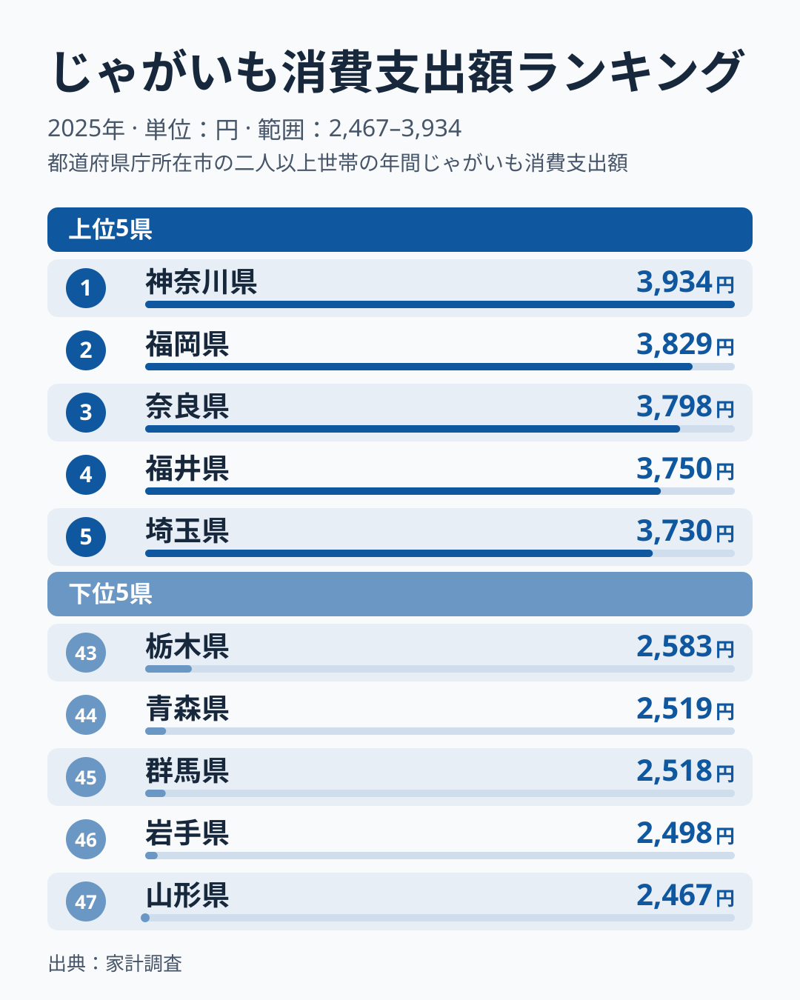
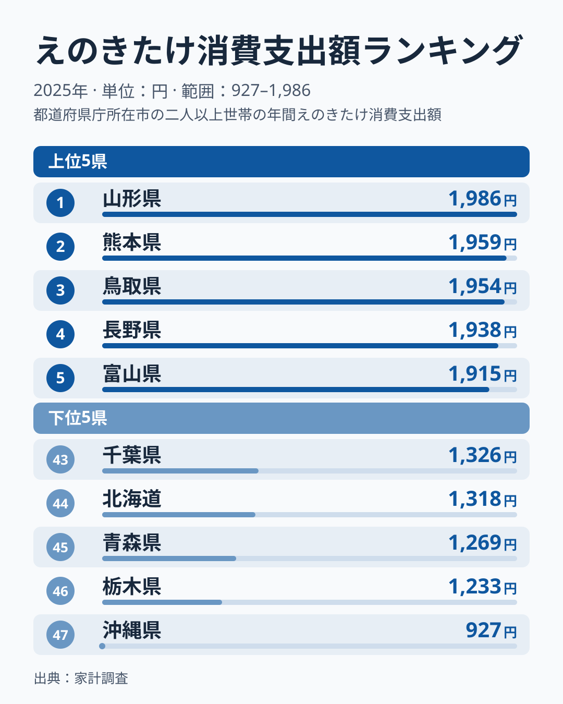
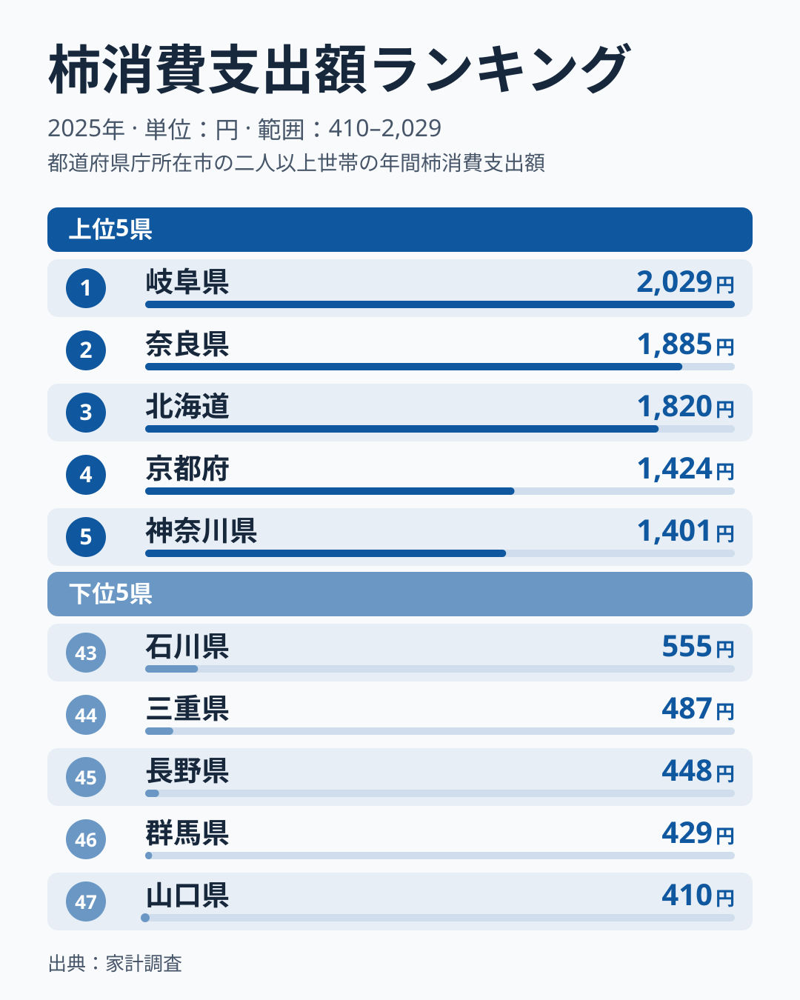
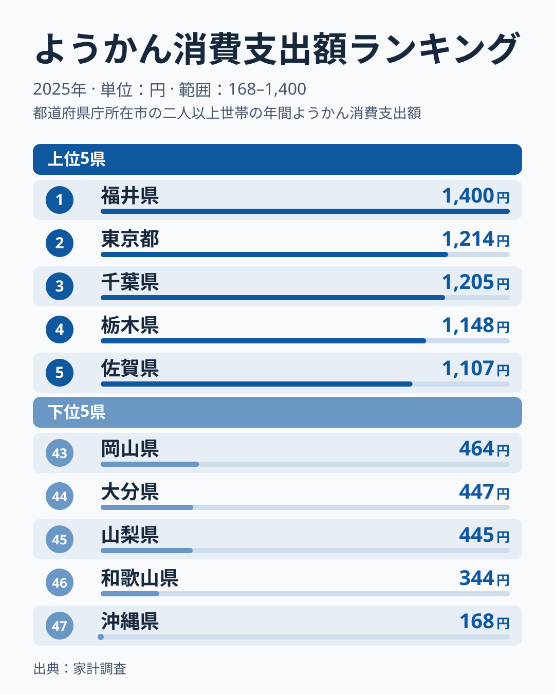
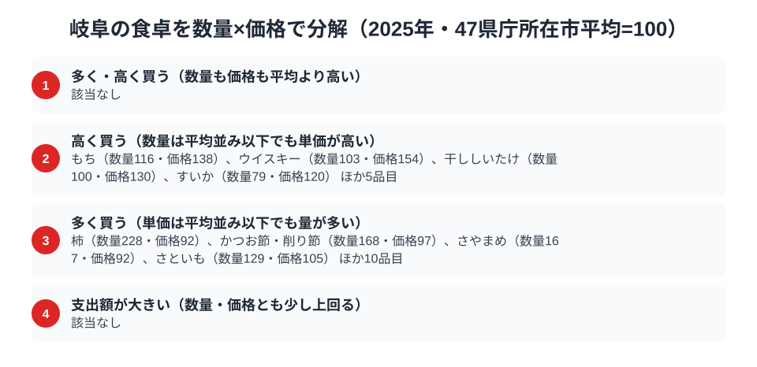

岐阜県の食卓を数字で覗くと、今回取り上げた4品目で日本一に立つのは柿ひとつだけです。2025年の柿消費支出額は2029円で全国1位でした。一方で、山あいの産地というイメージに合いそうなじゃがいも消費支出額は3446円で18位、えのきたけ消費支出額は1612円で18位と、どちらも上位5位には入っていません。甘味の代表格である羊羹消費支出額は537円で39位と下位圏です。じゃがいもとえのきたけの2品目に限れば、「山の幸に強い県」という見立ては数字で支えられません。

家計調査の品目別データ（2025年、県庁所在市・二人以上世帯）を都道府県ごとに集計し、じゃがいも・えのきたけ・柿・羊羹の4品目を並べると、岐阜の強い品目と上位に届かない品目がはっきり分かれます。この記事では、岐阜の食卓が品目ごとにどんな顔をしているのかを探ります。[岐阜県の地域プロフィール](/areas/21000)や[経済カテゴリ一覧](/category/economy)と合わせて読むと、県の産業構造との結びつきも見えてきます。

> [!NOTE]
> 使うのは総務省統計局「家計調査（品目別）」の、県庁所在市（岐阜県は岐阜市）・二人以上世帯の1世帯あたり年間支出額（円）です。県全体の値ではなく、消費量（グラム数など）でもありません。

## じゃがいも — 3446円で18位、上位5位には届かず

<source-link href="/ranking/potato-consumption-expenditure">じゃがいも消費支出額ランキングをもっと見る</source-link>

岐阜県のじゃがいも消費支出額は年間3446円で18位です。この品目の読みどころは、中位が10円単位の混戦だという点です。17位の大阪府は3450円、19位の広島県は3435円で、岐阜との差はわずか数円から十数円しかありません。小さな差で順位が動く層なので、18位という数字は「上位5位には入らない中位のどこか」くらいに受け止めるのが安全です。

上位5位は神奈川県、福岡県、奈良県、福井県、埼玉県で、冷涼な産地県に限らない顔ぶれです。岐阜北部の飛騨地方は冷涼な高原で、じゃがいもの栽培に向いた気候といえますが、[仮説] 産地であることがそのまま県庁所在市の購入額を押し上げるわけではなく、産地での直売所購入や贈答の融通が、スーパーなどでの支出として表れにくいために上位に届かない可能性があります。この点は、産地側の購入先や消費量など別の資料がなければ確かめられません。

## えのきたけ — 1612円で18位、上位は山形・熊本・鳥取

<source-link href="/ranking/enoki-consumption-expenditure">えのきたけ消費支出額ランキングをもっと見る</source-link>

えのきたけ消費支出額でも岐阜県は年間1612円で18位です。ここでも読みどころは中位の厚さです。17位の愛媛県は1613円、19位の愛知県は1596円で、岐阜とは1円から16円の差しかなく、ほぼ横一線です。上位3県の山形県1986円、熊本県1959円、鳥取県1954円も僅差の接戦で、全体として順位が小さな差で入れ替わりやすい品目といえます。

上位5位には山形・熊本・鳥取・長野・富山が並び、岐阜は入っていません。えのきたけは菌床栽培で通年生産できるため、産地の立地と消費額が必ずしも結びつかない品目です。[仮説] 鍋物や味噌汁の具材として日常的に買われる品目なので、都道府県間の差は産地よりも調理習慣や価格の違いで生まれている可能性があります。検証するには、同じ家計調査の購入数量と単価の内訳を県別に比べる必要があります。

## 柿 — 全国1位2029円、奈良を抑えて首位

<source-link href="/ranking/persimmon-consumption-expenditure">柿消費支出額ランキングをもっと見る</source-link>

柿消費支出額は岐阜県が年間2029円で全国1位です。2位の奈良県は1885円、3位の北海道は1820円と続きます。最下位の山口県は410円で、1位と最下位の差は4.9倍と、全国で大きく開いた品目です。

岐阜県南部の美濃地方は柿の産地として知られ、「堂上蜂屋柿」という干し柿の名産品も生産されています。[仮説] こうした産地としての背景が、柿の支出額の高さと関わっている可能性がありますが、この記事のデータだけでは裏付けられません。上位は1位の岐阜県、2位の奈良県、3位の北海道、4位の京都府、5位の神奈川県と、特定の地方にまとまらない顔ぶれです。単年の調査で上位の順位が入れ替わっても不思議はないので、順位は目安として読むのが安全です。

> [!WARNING]
> 柿の支出額が高いことは、柿の値段が高いことを意味しません。金額の大きさだけで「高級な柿を買う県」と読まないでください。内訳は後段の数量×価格の分解で確かめます。

## 羊羹 — 39位537円、甘味は下位圏

<source-link href="/ranking/yokan-consumption-expenditure">ようかん消費支出額ランキングをもっと見る</source-link>

羊羹消費支出額を見ると、岐阜県は年間537円で39位と下位圏です。1位の福井県は1400円、最下位の沖縄県は168円で、1位と最下位の差は8.3倍と、4品目の中で最も大きな開きです。2位の東京都は1214円、3位の千葉県は1205円、4位の栃木県は1148円、5位の佐賀県は1107円で、上位5県には関東の3都県が入る一方、福井県や佐賀県も含まれます。

[福井の食卓](/blog/fukui-food-culture)では羊羹消費支出額が全国1位で紹介されており、岐阜はその対極に近い位置にいます。岐阜には「鮎菓子」や「柿羊羹」といった郷土和菓子も存在しますが、家計調査の「ようかん」区分としての購入額には結びついていないようです。[仮説] 羊羹は贈答や専門店での購入が多く、日常の家計支出には出にくいことが影響している可能性があります。

## 岐阜の食卓を貫くもの

4品目を並べると、岐阜が突出しているのは柿だけで、じゃがいも・えのきたけは18位で上位5位に届かず、羊羹は39位の下位圏という構図です。家計調査の市別の値は単年のぶれが大きいので、「山の幸に強い県」「甘味に弱い県」といった性格づけを1年の順位から断定することはできません。今回確認できたのは、じゃがいもとえのきたけの2品目では上位5位に入っていない、という範囲までです。

これは、りんごという単一の名産品で首位に立つ[青森の食卓](/blog/aomori-food-culture)や、ぶり・いか・昆布・餅と海産物中心に日本一を並べる[富山の食卓](/blog/toyama-food-culture)とは異なる型です。岐阜の場合は、複数の品目が並んで突出するのではなく、柿という1品目だけが際立っています。

> [!TIP]
> 「産地=消費が多い」と決めつけず、県の名産と家計調査の支出額が一致するかを品目ごとに確かめると、食文化の見え方が変わります。岐阜ではじゃがいも・えのきたけが産地のイメージほど上位に出ておらず、柿だけが一致していました。気になる品目は[ランキングページ](/ranking/persimmon-consumption-expenditure)で年ごとの推移も確認してください。

## 数量×価格で分解する岐阜市の食卓

<source-link href="/ranking/persimmon-consumption-quantity">柿消費量ランキングをもっと見る</source-link>

柿を、47都道府県庁所在市の平均を100とした数量指数と価格指数に分解すると、岐阜市の支出額の順位がどこから来ているのかが見えてきます。

柿だけが際立っています。数量指数は228と平均の2倍以上の量を買っている一方、価格指数は92と平均をわずかに下回ります。つまり岐阜市が柿で1位に立っているのは、高い柿を選んでいるからではなく、購入する量が多いからです。なぜ量が多いのかは、この分解だけでは分かりません。

今回の分解では、数量指数・価格指数がともに平均より高い「多く・高く買う」品目は該当なしでした。数量が多く単価は平均並み以下の「量で買う」品目には、柿のほか、かつお節・削り節（数量168・価格97）、さやまめ（数量167・価格92）、さといも（数量129・価格105）などがあり、ほか10品目を含みます。一方、単価が高い品目にはもち（数量116・価格138）、ウイスキー（数量103・価格154）、干ししいたけ（数量100・価格130）、すいか（数量79・価格120）があります。岐阜の食卓の特徴は、高い品を選ぶ目利きよりも、特定の品目を量でたくさん買う習慣にあると言えそうです。

> [!NOTE]
> 数量指数・価格指数の基準は47都道府県庁所在市の単純平均=100であり、家計調査が公表する全国平均とは一致しません。価格指数は支出額÷数量から逆算した相対値なので、買っている品種や加工の違いも含みます。

## まとめ

- 柿消費支出額は岐阜県が年間2029円で全国1位、2位の奈良県は1885円
- じゃがいも消費支出額は岐阜県が年間3446円で18位、1位の神奈川県は3934円
- えのきたけ消費支出額は岐阜県が年間1612円で18位、1位の山形県は1986円
- 羊羹消費支出額は岐阜県が537円で39位、1位の福井県は1400円
- 数量×価格で分解すると、柿は数量指数228・価格指数92と「量で買う」型
- 4品目で日本一に立つのは柿ひとつだけで、じゃがいも・えのきたけの2品目は上位5位に入っていない
