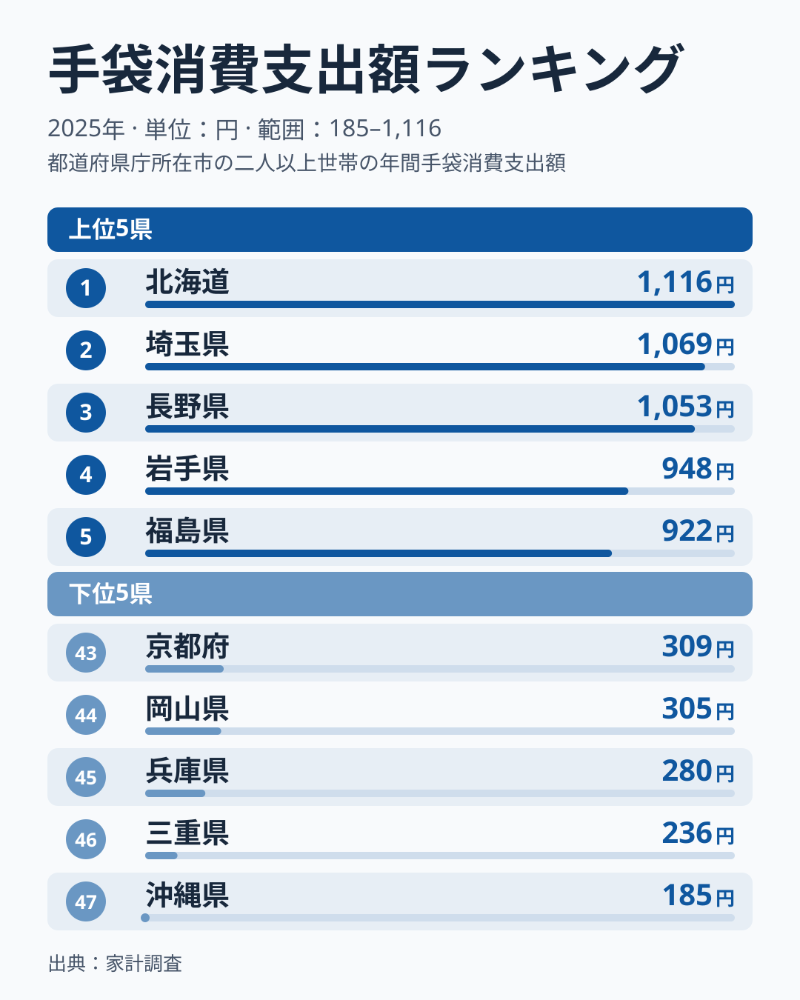
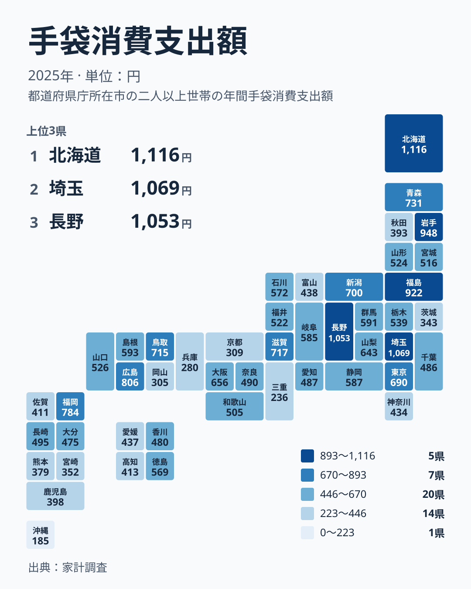

## 手袋は寒さの指標なのか

冬の入り口に手袋を買い足す家庭は多いはずです。ところが、その支出額を都道府県ごとに並べると、「寒い地域ほど多い」という単純な話にはおさまりません。2025年の家計調査で、1世帯あたりの手袋への年間支出が最も多かったのは北海道の1,116円でした。2位は埼玉県の1,069円、3位は長野県の1,053円です。

一方、最も少なかったのは沖縄県の185円です。1位と最下位の間には、同じ手袋でも大きな開きがあります。ただ、気温だけで説明できるなら、順位表は北から南へなだらかに並ぶはずです。実際の並びはそうなっていません。

この記事では、まず上位と下位の顔ぶれを確かめます。次に、地方ごとのまとまりと、同じ地方の中でのばらつきを見ます。最後に、読者の暮らしにとってこの数字が何を意味するのかを考えます。

## 上位と下位の顔ぶれ

まずは上位5位と下位5位を図で確認します。

<source-link href="/ranking/gloves-consumption-expenditure">手袋への支出ランキングをもっと見る</source-link>

上位は、北海道が1,116円、埼玉県が1,069円、長野県が1,053円、岩手県が948円、福島県が922円の順です。北海道・東北から3道県、関東から埼玉県、中部から長野県が入っています。冬の冷え込みが厳しい土地が目立つ一方で、関東の埼玉県が2位に入っている点は見逃せません。

下位は、沖縄県が185円で47位、三重県が236円で46位、兵庫県が280円で45位、岡山県が305円で44位、京都府が309円で43位です。この5つのうち、三重県・兵庫県・京都府の3つは近畿に属します。残りは九州・沖縄の沖縄県と、中国の岡山県です。

沖縄県の少なさは暖かさで納得がいきます。しかし、近畿や中国の県が並ぶ理由は、暖かさだけでは説明しきれません。冬に手袋が要る日があっても、買う頻度や買い方が違えば、年間の支出額は変わります。

> [!NOTE]
> この数字は、家計調査で集計された1世帯あたりの年間支出額です。1人あたりの金額でも、手袋1組の値段でもありません。世帯人数が多い地域では、同じ買い方でも金額が大きくなりやすい点に注意してください。

## 地方でまとめると見えること

次に、地理的な広がりを見ます。

北海道・東北では、北海道が1位、岩手県が4位、福島県が5位、青森県が8位で731円です。ここまでは「寒いから多い」という見方と合います。ただし、同じ東北でも宮城県は25位で516円、山形県は23位で524円、秋田県は39位で393円と、順位に大きな幅があります。

中部では、長野県が3位、新潟県が11位で700円、山梨県が14位で643円と、上位から中位に集まっています。その一方で、富山県は33位で438円、愛知県は29位で487円です。同じ中部の中でも、手袋にかける金額には開きがあります。

関東は特に差が大きい地方です。埼玉県が2位の1,069円であるのに対し、東京都は12位で690円、群馬県は16位で591円です。千葉県は30位で486円、茨城県は42位で343円、神奈川県は35位で434円となっています。同じ首都圏に含まれる県でも、順位の位置は大きく異なります。

近畿は、滋賀県が9位で717円、大阪府が13位で656円と中位以上にある一方、京都府、兵庫県、三重県が下位に沈みます。中国は、鳥取県が10位で715円、広島県が6位で806円と上位に近い県があり、岡山県が44位で305円です。同じ地方でも、順位表の上と下に分かれています。

つまり、地方のくくりで平均的に語るより、県ごとの暮らし方の違いを見る必要があります。気温は一つの要因にすぎず、それ以外の要素が順位を動かしています。

> [!WARNING]
> 家計調査は調査対象世帯の数が限られます。そのため、県庁所在地を中心とした標本の偏りや、年ごとの変動が結果に出やすい指標です。1年分の順位の差を、そのまま県民性や気候の差と決めつけるのは避けてください。

## 寒さでは説明できない部分

では、順位を分けているものは何でしょうか。ここでは実データから確かめられる範囲に絞って考えます。

一つ目は、近い県どうしでも金額が違うことです。埼玉県は1,069円で2位ですが、隣り合う東京都は690円で12位、千葉県は486円で30位です。通勤で屋外を歩く時間、自転車や車の使い方、防寒具を買う場所など、日常の行動の違いが金額に表れている可能性があります。

二つ目は、買い方の違いです。手袋は毎年買い替えるとは限らない品物です。数年に一度まとめて良いものを買う家庭と、安価なものを毎冬少しずつ買う家庭とでは、年間の支出額が変わります。調査された年にたまたま買い替えた世帯が多かった県は、順位が上に動きます。

三つ目は、手袋の役割そのものです。雪かきや農作業、通学など、防寒より作業用に必要な地域では、消耗する分だけ支出が増えます。北海道や長野県、岩手県、福島県が上位にいるのは、こうした実用の需要が背景にあるとも考えられます。ただし、この記事で使うデータだけでは、その理由を証明することはできません。

> [!TIP]
> 順位を読むときは、金額の大小だけでなく、隣の順位との間隔に注目してください。中位には500円台や600円台の県が密集しており、数位の入れ替わりは小さな金額差で起こります。上位と下位の両端だけが、本当に目立つ差です。

## 暮らしに引き寄せて読む

手袋への支出は、家計全体から見れば小さな項目です。しかし、小さいからこそ、暮らし方の違いがはっきり出ます。1位の北海道は1,116円、最下位の沖縄県は185円です。この数字は、冬に手袋をはめる日数と、手袋に求める役割の違いをそのまま映しているように見えます。

引っ越しや転勤で地域を移る人は、この結果を参考にできます。北海道、長野県、岩手県、福島県のような上位の地域へ移るなら、防寒具の予算を多めに見ておくと安心です。逆に、沖縄県、三重県、兵庫県、岡山県、京都府のように支出が少ない地域では、手袋に多くを使わない暮らしが定着していると読めます。

ただし、上位だからといって、その地域の人が高価な手袋を買っているとは限りません。買う頻度が多いのか、1つあたりの値段が高いのかは、この指標だけでは分かりません。自分の地域の数字を見るときは、順位よりも金額を、金額よりも自分の買い方を振り返ってみるのがおすすめです。

地域ごとの詳しい数字は、[北海道のデータ](/areas/01000)や[埼玉県のデータ](/areas/11000)で確認できます。ほかの暮らしの指標と並べて見たい場合は、[同じカテゴリの統計一覧](/category/economy)も役立ちます。たとえば、衣類や光熱費の支出と組み合わせると、寒さへの備え方がより立体的に見えてきます。

## データについて

この記事で使ったのは、家計調査の手袋消費支出額です。対象年は2025年で、単位は円です。1世帯あたりの年間支出額を都道府県別に並べたもので、記事中の金額と順位はすべてこの集計から引いています。

記事の中では、気温や買い替えの頻度、作業の有無といった背景を推測として述べました。これらは、この指標だけから証明された事実ではありません。数字から言えるのは、手袋への支出に地域差があること、そして順位が寒さの順に単純には並ばないことです。

結論として、手袋への支出が多いのは寒い地域だけではありません。北海道が1位であることは確かですが、2位には関東の埼玉県が入っています。暮らしの習慣や買い方まで含めて見ることで、同じ冬でも地域ごとに違う手袋との付き合い方が見えてきます。
