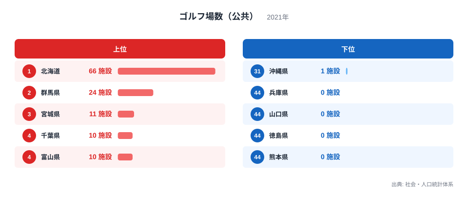
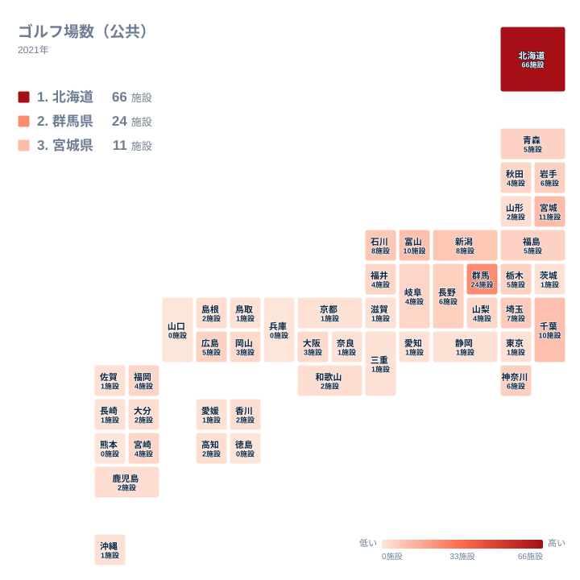

公共ゴルフ場の数を都道府県別に並べると、1位の北海道は66施設です。一方、44位の兵庫県、45位の山口県、46位の徳島県、47位の熊本県は0施設です。同じ日本の中で、これほど大きな開きがあります。この記事では2021年の公共ゴルフ場の数を、図から読み取れる集計を軸に整理します。背景については、地理・産業構造・歴史の面から「考えられる仮説」として紹介し、本データだけでは確かめられない点はそのように明示します。

## 公共ゴルフ場数の上位と下位

まずは上位5県と下位5県を図で確認します。

<source-link href="/ranking/golf-course-public">ゴルフ場数（公共）ランキングをもっと見る</source-link>

図の県名や数値を追うだけでは見えにくい点を、集計で補います。1位の北海道と2位の群馬県を合わせると90施設になります。この2道県だけで、全国の公共ゴルフ場の大きな部分を占めている計算です。3位の宮城県は11施設ですので、2位から3位にかけて13施設も減ります。上位の中でも、北海道と群馬県が別格で、3位以下は10施設前後から一気に小さな数字へ並び替わります。

反対に、下位側は「同じ数字の団子状態」が特徴です。0施設の県が4つ、1施設の県が13あり、合わせて1施設以下は17県にのぼります。47都道府県のうち、およそ3分の1強が1施設以下という分布です。順位が31位から43位まで離れていても、値はすべて1施設で同じです。平均的な県を思い浮かべるより、「少数の県が多く持ち、大半の県はごくわずか」という形で捉えるほうが実態に近いといえます。

> [!NOTE]
> この指標は、公共として区分されたゴルフ場の施設数です。民間のゴルフ場は含まれていません。そのため、公共の数が少ない県でも、民間を含めたゴルフ場の総数が少ないとは限りません。ゴルフの盛んさを直接示す数字ではない点に注意してください。

## 北海道の突出をどう読むか

北海道の66施設は、2位の群馬県の24施設の2倍を大きく超えています。この差の理由を、本データだけで特定することはできません。ここでは、考えられる仮説を挙げるにとどめます。

一つは、土地の広さです。ゴルフ場は一施設あたりの用地が大きいため、土地に余裕のある地域で整備しやすい可能性があります。もう一つは、自治体による施設整備の方針や、観光・住民サービスとしての位置づけです。ただし、どちらも本データには土地面積や自治体の取り組みの情報が含まれていないため、検証はできません。「広い土地が背景にあるかもしれないが、確認はできない」という扱いが適切です。

確実にいえるのは、北海道が全国で最も多く、2位との差が42施設あるという事実です。北海道の他の統計を知りたい方は[北海道のデータ](/areas/01000)をご覧ください。

> [!WARNING]
> 施設数は規模を反映しません。9ホールの小さな施設も、18ホールを超える大型の施設も、同じ1施設として数えられます。北海道の66施設と他県の施設数を比べても、コースの総ホール数や利用可能な規模の差までは分かりません。

## 群馬県は2位でも3位以下とは別の水準

2位の群馬県は24施設で、北海道に次ぐ数です。3位の宮城県との差は13施設あり、3位から5位までが10〜11施設に収まっていることを考えると、群馬県は2位でありながら、上位集団の中でも一段高い位置にいます。

関東の中で見ると、群馬県の24施設に対し、茨城県と東京都は1施設です。隣り合う地域でも数に大きな差があることが分かります。理由は本データからは読み取れません。地形や自治体の方針、歴史的な経緯などが関係している可能性はありますが、いずれも仮説の域を出ません。群馬県の詳しい統計は[群馬県のデータ](/areas/10000)からご覧ください。

## 地図で見る全国の広がり

続いて、全国の分布を地図で確認します。

地図にすると、北海道だけが突出して濃く、そのほかの多くが薄い色で塗られていることが分かります。県名と施設数は図に書かれていますので、ここでは全体の傾向に絞ります。

5施設以上の県は、北海道から広島県までの15県にとどまります。残る32都府県は4施設以下です。4施設以下の中には、0施設の4県、1施設の13県、2施設の7県が含まれます。つまり、全国的には「少ない県が多数派」で、数が多い県は一部に限られます。

地域の傾向としては、東北から北陸にかけて5施設以上の県が比較的目立ち、近畿から九州にかけては0〜2施設の県が多い印象です。ただし、この印象は例外も多く、強い規則性とまでは言えません。たとえば0施設の4県のうち、兵庫県は近畿、山口県は中国、徳島県は四国、熊本県は九州と、地域が分散しています。「西日本に少ない」という言い方は、あくまで大まかな傾向にすぎません。

> [!TIP]
> 地図の色の濃淡は施設数の多い少ないを示しますが、1施設の県が13もあるため、順位が数位違っても実質的な差はありません。読むときは順位よりも「0、1、数施設、二桁以上」という大きな段階で見ると、実態に近い理解になります。

## 少ない県の事情は一つに決まらない

公共ゴルフ場が少ない県には、東京都、大阪府、愛知県、静岡県のように人口や産業が集まっている県が含まれます。こうした県では、土地の使われ方など都市部ならではの事情が影響している可能性があります。

ただし、そう単純にはいきません。茨城県や京都府、滋賀県、奈良県、長崎県、沖縄県なども同じ1施設です。これらの県を、産業の集積だけで説明することは難しいでしょう。少ない理由は県ごとに異なり、本データから共通の原因を導くことはできません。

数字から確かに言えるのは、公共ゴルフ場の数が一部の道県に偏っているということ、そして0施設の県が4つ存在するということです。その背景を探るには、土地利用、自治体の施設方針、民間施設の分布といった別の統計を重ねて見る必要があります。ほかのスポーツや教育に関する統計と並べると、地域の特徴がより立体的に見えてきます。[同じカテゴリの統計一覧](/category/educationsports)もあわせてご覧ください。

## データについて

この記事で扱う指標の正式な統計名は「ゴルフ場数（公共）」で、出典は社会・人口統計体系です。年は2021年、単位は施設で、47都道府県すべての値が公表されています。順位は施設数の多い順に付けています。同じ施設数の県が複数ある場合は同じ数字が並ぶため、順位の差は実質的な差を表しません。
