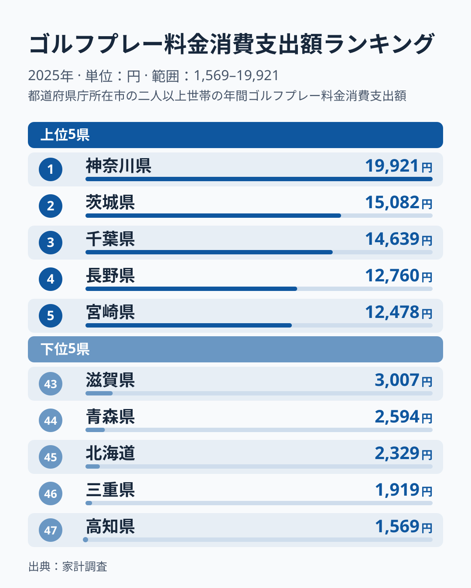
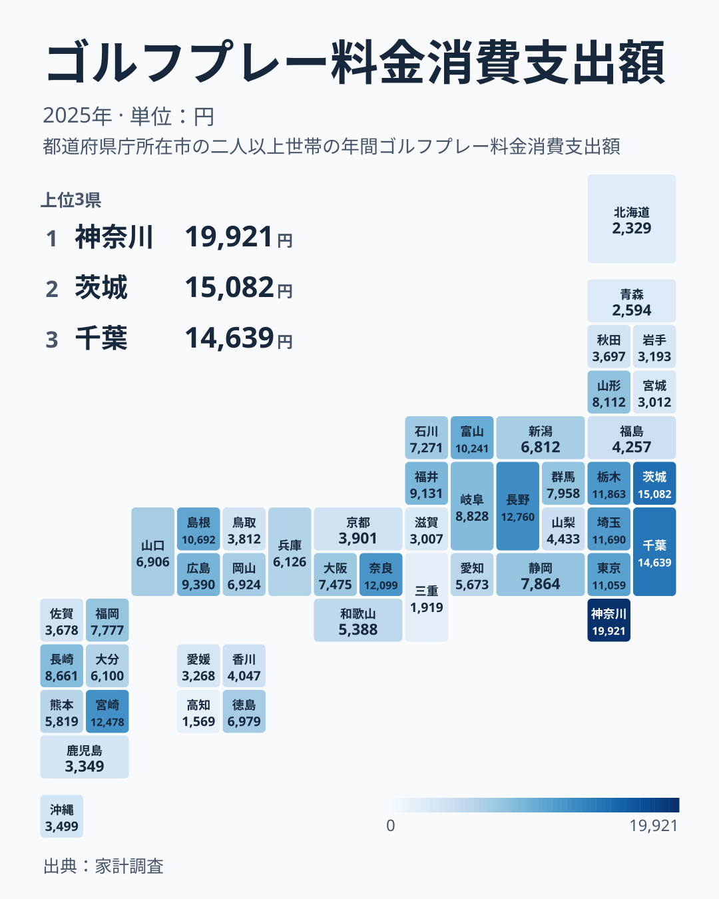
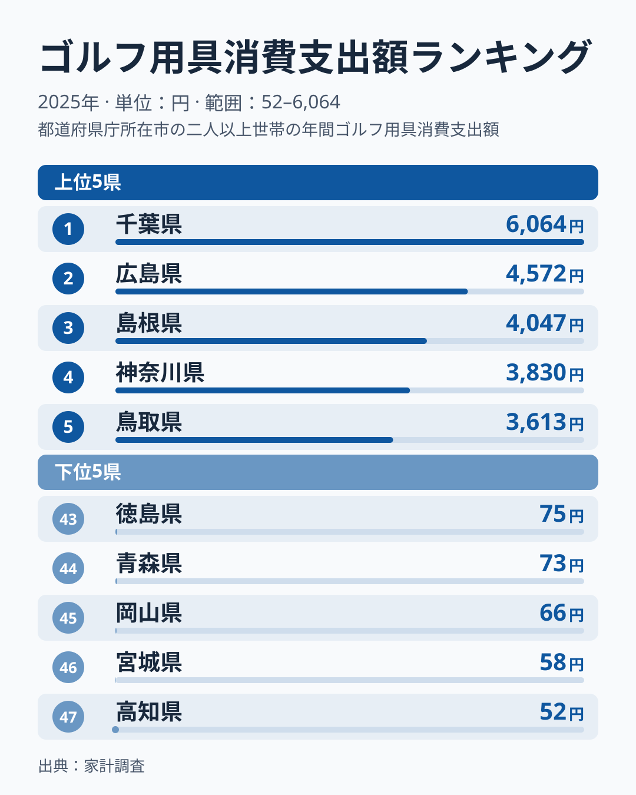

ゴルフはお金持ちのスポーツ、というイメージを持つ人は多いはずです。では実際に、ゴルフのプレー料金にいちばんお金を払っているのはどの都道府県でしょうか。

総務省「家計調査」(2025年、都道府県庁所在市の二人以上世帯)によると、年間のゴルフプレー料金消費支出額は**神奈川県が1万9,921円で全国トップ**でした。2位は茨城県1万5,082円、3位は千葉県1万4,639円と関東の3県が上位3位を占めています。最下位の高知県1,569円との間には12.7倍の差が生まれています。

興味深いのは、実際にゴルフを「した」人の割合を示す行動者率では、全国トップは愛知県だという点です。愛知県のプレー料金の支出額は29位で、プレーする人が多い県と、プレー料金にお金をかける県は必ずしも一致しません。本記事では2025年のゴルフプレー料金消費支出額を47都道府県で比較し、そのズレの手がかりを探ります。

> [!NOTE]
> この記事の金額は総務省「家計調査」の**都道府県庁所在市**(神奈川県なら横浜市)における二人以上世帯の年間消費支出額で、都道府県全体の平均ではありません。また県庁所在市データは対象となる世帯数が少なく、同じ県でも年によって数値が大きく上下しやすい性質があります。実際、同じ指標の2024年は首位が茨城県で、京都府が3位、富山県が最下位でしたが、2025年は京都府が34位、富山県が11位に入れ替わりました。1年分の数字を「その県の実力」と断定せず、あくまで目安として読んでください。

## ゴルフプレー料金消費支出額の格差は12.7倍―トップ5とワースト5

図で目を引くのは、上位5県の最下位である5位宮崎県1万2,478円が、下位5県の最上位である43位滋賀県3,007円を大きく上回っている点です。12.7倍という差は、1位だけが突出しているのではなく、上位と下位の間に大きな段差があることから生まれています。

地図で見ると、上位10位に限れば、神奈川県1位・茨城県2位・千葉県3位・栃木県7位・埼玉県8位・東京都9位と関東の6都県が入り、ひとつの塊になっています。残る4県は、長野県4位(中部)、宮崎県5位(九州・沖縄)、奈良県6位(近畿)、島根県10位(中国)で、地方ごとに1県ずつです。11位以降では、富山県11位、福井県13位(いずれも中部)と広島県12位(中国)が続きます。反対に下位では、宮城県42位・青森県44位・北海道45位と北海道・東北の県が並ぶ一方、滋賀県43位・三重県46位の近畿、高知県47位の四国も混じっており、特定の地方にまとまっているとは言えません。上位は関東が塊をつくるものの、下位は北海道・東北に加えて近畿・四国が散らばる形です。しかも、2024年に3位だった京都府が34位に下がるなど、順位は年ごとに大きく動きます。

<source-link href="/ranking/golf-green-fee-consumption-expenditure">ゴルフプレー料金消費支出額ランキングをもっと見る</source-link>

## 関東3県が上位を占める―神奈川・茨城・千葉の並び

2025年は神奈川県、茨城県、千葉県の順で、関東の3県が上位3位を占めました。栃木県7位、埼玉県8位、東京都9位まで含めると、上位9位のうち6つが関東の都県です。群馬県だけは17位で、上位の塊からは外れています。

この並びについて、データだけから原因は断定できません。[仮説]として、茨城県・千葉県・栃木県など平地の広い県のコースへ日帰りで通える距離にあるため、世帯あたりのプレー料金が大きくなっている可能性があります。ただし家計調査の支出額はプレー回数と1回あたりの単価に分けられず、県庁所在市の標本も小さいため、検証には回数と単価を分けた別の統計が必要です。

茨城県は2024年に首位、2025年は2位と、2年続けて上位に入りました。ただし2年分の順位からわかるのは上位が続いたことだけで、その理由まではわかりません。神奈川県が首位に立ったのも2025年の値であり、来年以降も続くかは見えていません。

## ゴルフ用具消費支出額は千葉が首位―プレー代と上位の顔ぶれが入れ替わる

クラブやウェアなどの**ゴルフ用具消費支出額**では、千葉県が6,064円で全国トップでした。2位は広島県4,572円、3位は島根県4,047円、4位は神奈川県3,830円、5位は鳥取県3,613円で、プレー料金の上位とは顔ぶれが大きく異なり、中国地方の県が3つ入っています。下位は43位徳島県75円、44位青森県73円、45位岡山県66円、46位宮城県58円、47位高知県52円で、ほぼゼロに近い水準まで落ち込む県が並びます。1位と最下位の差は116.6倍にのぼり、プレー料金の12.7倍よりもはるかに大きな開きです。

プレー料金と用具の両方で10位以内に入ったのは5県で、神奈川県はプレー料金が1位で用具が4位、千葉県は3位で1位、宮崎県は5位で6位、埼玉県は8位で9位、島根県は10位で3位でした。一方、プレー料金2位の茨城県は用具では29位、愛知県も24位にとどまります。高知県はプレー料金も用具も47位で、両方で最下位になったのはこの県だけです。

用具は数年に一度まとめて買い替える品目で、標本が小さい県庁所在市の調査では、たまたま買った世帯がいるかどうかで金額が大きく動きます。[仮説]として、用具の順位はプレー料金よりぶれが大きく、単年の順位から県ごとの消費文化を読み取るのには向かない可能性があります。1位と最下位の差が100倍を超えている点も、その見方と整合します。

<source-link href="/ranking/golf-equipment-consumption-expenditure">ゴルフ用具消費支出額ランキングをもっと見る</source-link>

## 「プレーする県」と「お金を払う県」のずれは、データからは分解できない

この記事で使うデータのうち、プレー料金・用具の消費支出額は2025年、行動者率と公共ゴルフ場数は2021年の数値で、4年の開きがあります。その前提を踏まえたうえで、以下の対比を見ていきます。

実際にゴルフを「した」人の割合を示す行動者率の上位は、愛知県9.0%、兵庫県8.8%、奈良県8.5%、大阪府と宮崎県が8.4%、茨城県8.1%、栃木県8.0%です。このうち奈良県はプレー料金が6位、宮崎県は5位、茨城県は2位、栃木県は7位と支出額も上位で、プレーする人の多さと支出額の大きさが重なっています。一方、行動者率で全国トップの愛知県は支出額では29位、兵庫県は26位、大阪府は20位にとどまり、プレーする人は多いものの、世帯あたりの年間支出額はそれほど大きくありません。逆に、神奈川県は行動者率が15位の7.2%なのに、プレー料金は1位です。愛知県と神奈川県は、「プレーする人が多い県」と「お金を払う県」がずれている例と言えます。ただし、なぜずれるのか、つまりプレー回数の違いなのか、1回あたりの単価の違いなのかは、この記事のデータからは分解できません。プレーする人の広がりを詳しく見たい方は[ゴルフの行動者率ランキング](/ranking/sports-participation-rate-golf)も参考にしてください。数字の全体像を知りたい方には[ゴルフ実施率は愛知9%vs青森2.8%で3.2倍｜なぜ宮崎が大阪と並ぶ?](/blog/golf-participation-prefecture-gap)もおすすめです。

> [!TIP]
> この記事の支出額ランキングと、[ゴルフの行動者率ランキング](/ranking/sports-participation-rate-golf)を重ねて見ると、「プレーする人の広がり(行動者率)」と「世帯あたりの年間支出額(消費支出額)」という2つの軸でゴルフ市場を捉えられます。ただし家計調査の支出額だけでは、プレー回数と1回あたりの単価に分解することはできません。愛知県のように行動者率は高いが世帯あたりの支出額は控えめな県もあれば、茨城県のように行動者率も支出額もともに上位に入る県もあり、同じ「ゴルフが盛ん」という言葉でも中身は県によって違います。

もうひとつ、支出額と結びつかないデータがあります。公共のゴルフ場数を都道府県別に見ると、北海道が66施設で全国トップ、群馬県が24施設で2位、宮城県が11施設で3位、千葉県と富山県が10施設で4位に並びます。ところがプレー料金の支出額では、北海道は45位、宮城県は42位と下位に沈む一方、千葉県は3位、富山県は11位、群馬県は17位と上位から中位に入っています。公共ゴルフ場数と支出額の間に、はっきりした対応は見えません。詳しい内訳は[公共ゴルフ場数ランキング](/ranking/golf-course-public)で確認できます。

> [!WARNING]
> 「ゴルフ場の数が多い県ほどプレー料金への支出も多い」とは限りません。公共ゴルフ場数が全国最多の北海道は66施設あるのにプレー料金の消費支出額は45位、3位の宮城県は11施設で42位です。公共ゴルフ場数は公共のコースだけを数えた指標で、民間コースや料金の水準は含まれません。住民の支出額とは見ている対象が異なる点に注意してください。

## まとめ

- プレー料金の消費支出額は1位が神奈川県1万9,921円、最下位が高知県1,569円で、12.7倍の差でした。
- 用具の消費支出額は千葉県が1位で6,064円、プレー料金と用具の両方で10位以内に入ったのは神奈川県・千葉県・宮崎県・埼玉県・島根県の5県です。
- 1位神奈川県、2位茨城県、3位千葉県と関東の3県が上位3位を占め、上位9位のうち6つが関東の都県でした。下位は北海道・東北に加えて近畿・四国の県が散らばっています。
- 行動者率トップの愛知県はプレー料金では29位にとどまり、プレーする人の多さと支出額の大きさは一致しませんでした。ずれの理由は、このデータからは分解できません。
- 公共ゴルフ場数トップの北海道は45位、3位の宮城県は42位で、公共ゴルフ場数と支出額に対応は見えませんでした。

## データについて

- 総務省統計局「家計調査」(都道府県庁所在市・二人以上の世帯、2025年) ゴルフプレー料金消費支出額・ゴルフ用具消費支出額
- 総務省統計局「社会・人口統計体系」(2021年度) ゴルフ場数(公共)
- 総務省統計局「社会生活基本調査」(2021年) ゴルフの行動者率

いずれもe-Stat経由でstats47が取得・加工して掲載しています。
