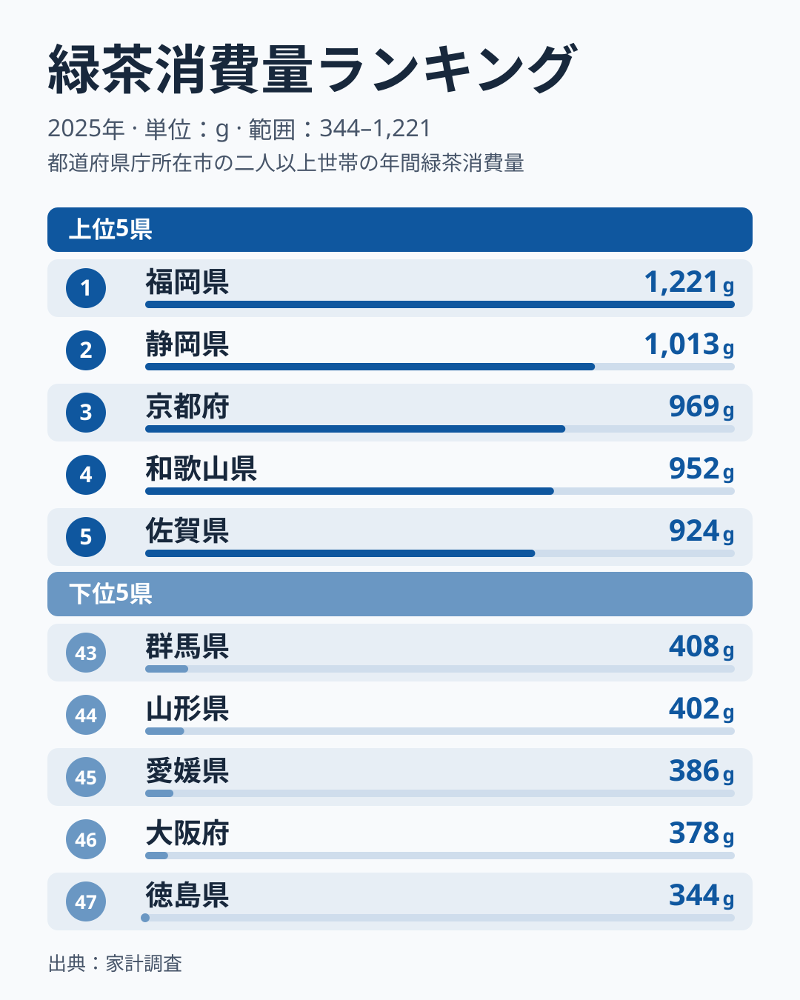
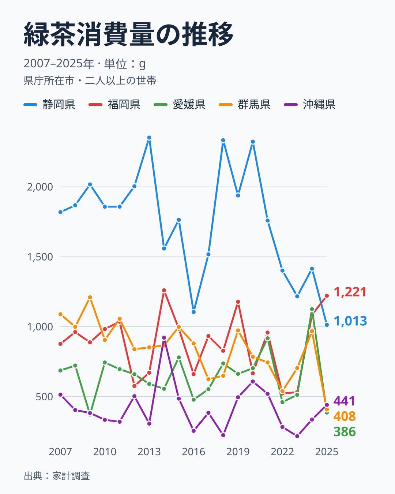

緑茶といえば静岡、というのが多くの人の直感でしょう。実際、家計調査の緑茶消費量で静岡県が首位になった年は、2007年から2025年までの19年のうち13回あります。ところが2025年は福岡県が1,221gで、この19年で初めて首位に立ちました。静岡県は1,013gの2位です。

2025年は上位の顔ぶれも大きく入れ替わりました。2024年に2位だった愛媛県は45位の386gへ、2024年に5位だった群馬県は43位の408gへ落ちています。静岡の2位は一時的な揺れなのか、それとも緑茶の地図が変わりつつあるのか。この記事では2025年のランキングと2007年からの推移を並べて、「単年の順位をどこまで読めるか」を整理します。

## 2025年の上位5県と下位5県：首位は福岡、静岡は2位

<source-link href="/ranking/green-tea-consumption-quantity">緑茶消費量ランキングの全47都道府県を見る</source-link>

首位の[福岡県](/areas/40000)は1,221gで、2位の静岡県は1,013gです。差は208gあります。3位以下は京都府の969g、和歌山県の952g、佐賀県の924gと続きます。上位5県は九州の福岡・佐賀、近畿の京都・和歌山、東海の静岡にまたがっていて、特定の地域に固まってはいません。2位の静岡から10位の茨城県の810gまでは203gの幅に収まっており、2位以下は僅差の争いになっています。

下位5県は、最下位の徳島県が344gで、大阪府378g、愛媛県386g、山形県402g、群馬県408gの順です。首位の福岡県と最下位の徳島県の差は約3.5倍になります。下位は東日本の群馬・山形、四国の愛媛・徳島、近畿の大阪と、これも地域がばらけています。同じ近畿でも京都府は3位、和歌山県は4位、奈良県は6位と上位に入る一方で、大阪府は46位にとどまり、地域のくくりより県ごとの違いのほうが大きいことが分かります。

> [!NOTE]
> 本データは家計調査の「緑茶」について、各都道府県の県庁所在市に住む二人以上の世帯が1年間に購入した量（g）を示します。県全体の平均ではなく、家庭で購入した量なので、職場や外食先で飲む分は含まれません。

## 静岡の首位陥落は一時的か：19年の推移

2007年から2025年の19年間で、静岡県の順位は首位が13回、2位が3回、3位が2回、5位が1回です。つまり静岡は19年を通じて、ほぼつねに上位にいました。2025年の福岡の首位は、静岡の定位置が崩れた結果というより、この年だけ順位が入れ替わったと読むのが妥当です。

ただし静岡の数字そのものは、この数年で大きく下がっています。静岡県の2020年は2,323gでしたが、2021年は1,759g、2022年は1,401g、2023年は1,217gと下がり、2024年の1,415gで少し戻したあと、2025年は1,013gです。2025年の値は2020年の半分以下で、19年の中でも最も低くなりました。首位を保てた2021年・2022年・2024年は、静岡が下がっても他県がそれ以上に低かった年です。

2025年の逆転は、静岡が402g減った（2024年の1,415gから1,013gへ）ことと、福岡が136g増えた（1,085gから1,221gへ）ことが重なって起きました。福岡県の値にも波があります。2022年は522g、2023年は532gでどちらも38位でしたが、2024年に3位、2025年に1位と急に上がりました。2年前に38位だった県が首位に立つほど、この指標の単年の順位は動きます。

静岡の下落が長く続く変化なのかどうかは、この指標だけでは言い切れません。[仮説] 茶葉を買って急須で淹れる家庭が減り、ほかの飲み物に移っている可能性があります。ただしこれを確かめるには、飲料全体の購入量や支出の推移など別の指標との突き合わせが必要で、2025年の1年分の差から結論は出せません。静岡県の他の統計は[静岡県のエリアデータ](/areas/22000)で見られます。

## 愛媛・群馬の急落：1年で40位近く動いた県

2024年に2位だった愛媛県の値は1,125gでした。2025年は386gで45位です。1年で43位も下がったことになります。愛媛県の19年を見ると、2021年の10位と2024年の2位を除けば、順位は29位から47位の間にありました。2024年の2位は、愛媛の長期の姿からは外れた年だったと分かります。群馬県も同じです。2024年は967gで5位でしたが、2025年は408gで43位に落ち、408gは19年の中で最も低い値です。

> [!WARNING]
> 家計調査の都道府県別の値は、県庁所在市の標本世帯から推計したもので、単年では大きく振れます。愛媛県の2024年の2位と2025年の45位のように、1年で順位が40位前後動く県が実際にあります。「2024年の愛媛は緑茶の県だった」と読んで愛媛の食習慣を語るのは危険です。順位は数年分をまとめて見ることが大切です。

ここから読み取れるのは、静岡のように19年を通じて上位にいる県と、愛媛・群馬のようにある年だけ急に上位へ入る県が混ざっているということです。前者は県の習慣を反映した値として読めますが、後者は標本の違いやその年の事情が表れた値である可能性が高く、1年分だけで解釈を広げられません。

## 最下位の顔ぶれも固定ではない：沖縄は最下位を脱した

下位でも入れ替わりがありました。沖縄県は2007年から2025年までに11回、47位になっています。最下位の常連といえる県ですが、2025年は441gで40位に上がり、最下位は徳島県の344gになりました。沖縄県の2024年は336gで47位でしたので、1年で7位上がり、105g増えたことになります。

最下位の徳島の344gは、沖縄が最下位だった2024年の336gと近い水準で、最下位の値そのものは大きく変わっていません。沖縄の値が上がったことで、徳島が最下位になった形です。下位5県の値はいずれも300g台から400g台に収まり、首位の福岡の3分の1ほどにとどまります。

緑茶消費量の地図を読むときは、2025年の順位だけを見て「福岡が緑茶県」「愛媛は飲まない県」と決めつけないことが大切です。静岡は19年を通して上位の常連、沖縄は下位の常連、愛媛・群馬・福岡は年による振れが大きい県、という見方が、この19年分のデータからは最も無理なく言えます。

## まとめ

- 2025年の緑茶消費量の首位は福岡県の1,221gで、静岡県は1,013gの2位に下がりました
- 最下位は徳島県の344gで、首位との差は約3.5倍です
- 静岡県は2007年から2025年の19年のうち13回が首位で、2025年の1,013gは19年の中で最も低い値です
- 2024年に2位だった愛媛県は386gの45位、5位だった群馬県は408gの43位へ急落しました
- 沖縄県は19年のうち11回が最下位でしたが、2025年は441gの40位で最下位を脱しました
