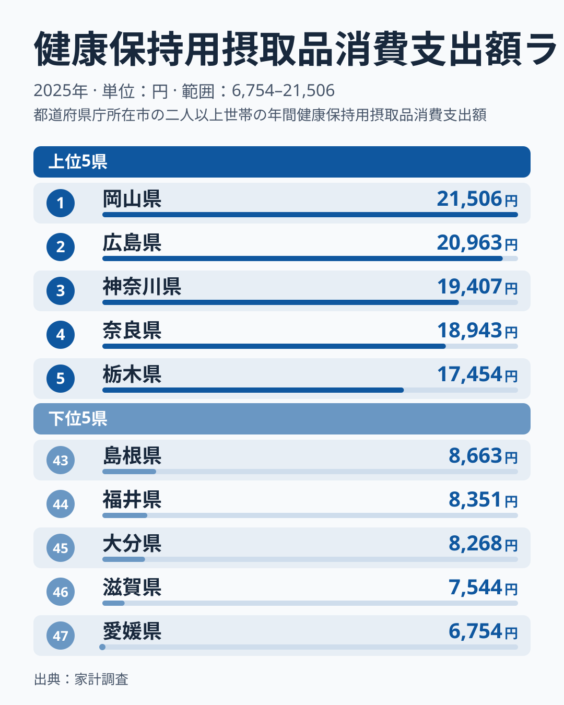
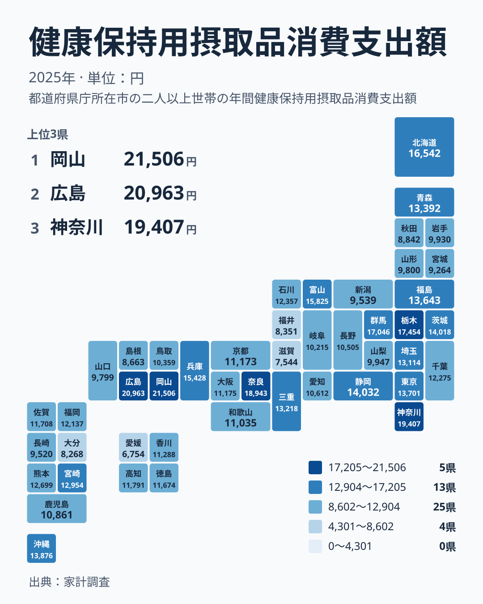

## 健康のための摂取品に、いちばんお金をかけている県はどこか

サプリメントや栄養補助食品のように、健康の維持を目的に口にする品物があります。家計の中では小さな項目ですが、県ごとに並べると、はっきりした差が見えてきます。

2025年の家計調査で、この支出が最も多かったのは岡山県で、21,506円でした。2位は広島県で20,963円、3位は神奈川県で19,407円です。一方、最も少なかったのは愛媛県で6,754円、46位は滋賀県の7,544円でした。

この記事では、まず上位と下位の構造を図で確かめます。次に、地方ごとのばらつきを見ます。最後に、数字を暮らしの中でどう読めばよいかを、仮説であることを明示したうえで整理します。

> [!NOTE]
> この記事で扱う指標は、家計調査の「健康保持用摂取品消費支出額」です。1世帯が1年間に、健康の保持を目的とした摂取品に支払った金額を指します。薬や医療費とは別の項目で、数字は摂取量や効果ではなく、あくまで支払額です。

## 上位と下位の構造

<source-link href="/ranking/health-supplements-group-consumption-expenditure">健康保持用摂取品への支出ランキングをもっと見る</source-link>

図でまず目に入るのは、1位の岡山県と2位の広島県が、ともに中国地方で隣り合っていることです。1位と2位の差は、21,506円と20,963円で、さほど大きくありません。上位は特定の1県が突出しているのではなく、中国地方の2県が並んで先頭に立つ形です。

上位5県を地方で見ると、中国の岡山県と広島県、関東の神奈川県と栃木県、近畿の奈良県に分かれます。上位が一つの地方に固まっているわけではありません。奈良県は4位で18,943円、栃木県は5位で17,454円です。

下位5県は、四国の愛媛県、近畿の滋賀県、九州・沖縄の大分県、中部の福井県、中国の島根県です。こちらも5県が5つの地方にばらけています。つまり上位も下位も、特定の地方が丸ごと高い、あるいは低いという形ではありません。

最大と最小の比で見ると、岡山県の21,506円は愛媛県の6,754円の約3倍にあたります。ただし、この倍率は両端の2県を比べたものです。中央付近の県は1万円台前半から後半に集まっているため、両端だけで全体を語るのは避けたいところです。

## 東京は上位ではなく中位にある

大都市ほど健康関連の支出が多いと思われがちですが、東京都は13位で13,701円でした。上位10位以内には入っていません。

大都市圏の県を並べても、順位は一方向にそろいません。大阪府は27位の11,175円、愛知県は31位の10,612円です。一方で、神奈川県は3位の19,407円、兵庫県は9位の15,428円と上位に入っています。データ上は、都市規模と順位のあいだに単純な関係は見えません。

関東の中でも差があります。群馬県は6位で17,046円、茨城県は11位で14,018円、埼玉県は17位で13,114円、千葉県は21位で12,275円です。同じ関東でも、6位から21位まで順位が広がっています。

> [!TIP]
> 順位は小さな金額差で入れ替わります。たとえば大阪府は11,175円で27位、京都府は11,173円で28位と、差は2円です。順位の一つ一つに注目するより、上位・中位・下位という大きなまとまりで読むほうが安全です。

## 地方ごとに見るばらつき

タイルマップで見ると、濃い県と薄い県が列島のなかで入り混じっています。中国地方の岡山県と広島県のまとまりはひときわ目立ちますが、西日本全体が高いわけではありません。四国には最下位の愛媛県がありますし、九州・沖縄には45位の大分県もあります。

地方内のばらつきが最も大きく見えるのは近畿です。奈良県は4位で18,943円、兵庫県は9位で15,428円と上位にいます。それに対して、滋賀県は46位で7,544円です。同じ近畿の中で、4位と46位が並んでいます。

中部も同様です。富山県は8位で15,825円、静岡県は10位で14,032円と上位10位以内に入ります。一方、福井県は44位で8,351円です。長野県は32位の10,505円、愛知県は31位の10,612円で、中位の下寄りに位置します。

九州・沖縄では、沖縄県が12位で13,876円、宮崎県が18位で12,954円と比較的高めです。これに対し、長崎県は40位で9,520円、大分県は45位で8,268円です。北海道・東北では、北海道が7位で16,542円と上位にある一方、秋田県は42位で8,842円、宮城県は41位で9,264円と下位に近い位置です。

> [!WARNING]
> 家計調査は限られた調査世帯をもとにした標本調査です。県全体の実態をそのまま映したものとは言えず、標本の偏りや年ごとの振れが順位に影響する可能性があります。1年分の数字だけで、その県の傾向を断定しないでください。

地方の平均で語ると、こうした県ごとの違いを見落とします。この指標では、地方より県単位の違いのほうが目立ちます。

## 暮らしにどうつなげるか

ここから先は、データに含まれない要因を扱うため、あくまで仮説です。この統計には年齢構成や購入先、食生活の内訳がありません。したがって、なぜ差が生じるのかを断定することはできません。

確実に言えるのは、次の三点です。

- 年間の支出額は、県によって最大で約3倍の開きがあります。
- 都市の大きさや地方の区分だけでは、順位を説明できません。
- 隣り合う県でも、位置が大きく異なる例があります。

岡山県の21,506円を月あたりに直すかどうかは読者次第ですが、年間で見れば、愛媛県の6,754円との差は小さくありません。自分の世帯が毎年どれだけ使っているかを、一度家計簿で確かめてみる価値はあります。

順位が高いことを「良い」、低いことを「悪い」と読む必要はありません。支出が多い県が健康に気を配っているとも、少ない県が気を配っていないとも、この数字からは言えないからです。必要なものに必要な分だけ使えているかを、自分の暮らしに照らして考える材料にしてください。

県ごとの詳しい情報は、[岡山県のデータ](/areas/33000)と[広島県のデータ](/areas/34000)で確認できます。ほかの統計と合わせて見たい場合は、[同じカテゴリの統計一覧](/category/economy)も役立ちます。

## データについて

使用した数値は、家計調査における2025年の「健康保持用摂取品消費支出額」です。単位は円で、全47都道府県の値が公表されています。順位は金額の高い順に付けています。

この指標は、家計が支払った金額です。摂取品の量や効果、健康状態を直接示すものではありません。数字の大小は、支出の多さを表すだけだと理解して読んでください。地方のまとめ方は、北海道・東北、関東、中部、近畿、中国、四国、九州・沖縄の7区分に統一しています。

## まとめ

2025年の健康保持用摂取品への支出は、岡山県が21,506円で1位、広島県が20,963円で2位、神奈川県が19,407円で3位でした。反対に、愛媛県は6,754円で47位、滋賀県は7,544円で46位です。

東京都は13位で13,701円でした。大都市だから多いという単純な見方は、データからは支持されません。近畿では4位の奈良県と46位の滋賀県が同居し、中部でも8位の富山県と44位の福井県が並んでいます。

数字が語るのは支出の多さであり、その理由ではありません。ご自身の暮らしや地元の数字と見比べながら、活用してみてください。
