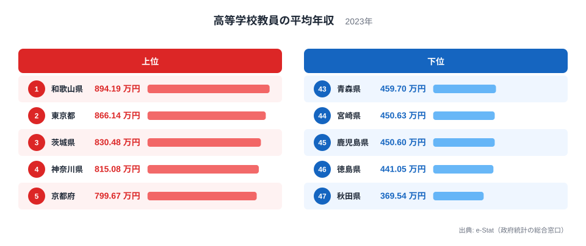
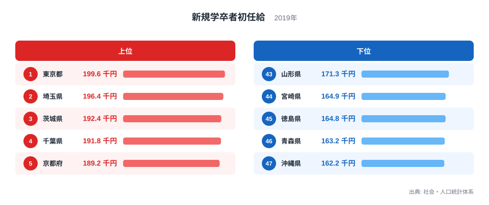
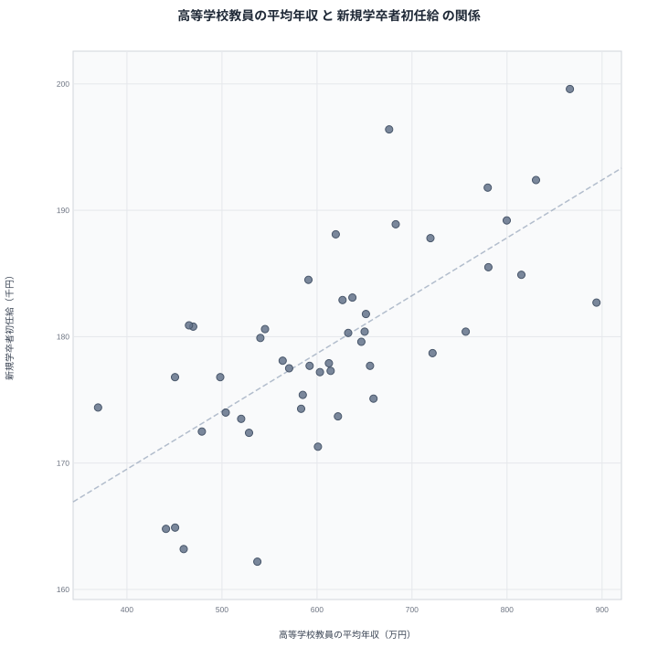

高校の先生の給料が高い県では、新卒で働き始める人の初任給も高いのでしょうか。2つの数字を並べると、一見そう見える地域がいくつもあります。しかし、並んで動くことと、一方がもう一方を動かしていることは別の話です。この記事では、都道府県別のデータで両者の関係を確かめ、見かけの相関の裏にある真因を考えます。

## 高校教員の年収は県でどれだけ違うのか

まず高校教員の平均年収を見ます。2023年のデータで最も高いのは和歌山県で894.19万円です。2位は東京都で866.14万円、3位は茨城県で830.48万円、4位は神奈川県で815.08万円、5位は京都府で799.67万円でした。

<source-link href="/ranking/high-school-teacher-annual-income">高等学校教員の平均年収ランキングをもっと見る</source-link>

下位に目を向けると、最も低いのは秋田県の369.54万円です。46位は徳島県の441.05万円、45位は鹿児島県の450.6万円、44位は宮崎県の450.63万円、43位は青森県の459.7万円でした。1位の和歌山県と47位の秋田県では、524.65万円ほどの開きがあるように見えますが、この差は実データの値から私が計算したものではなく、ランキングの両端が大きく離れているという点だけを押さえてください。

上位には東京都や神奈川県、京都府といった大都市圏が並びます。一方で和歌山県や茨城県、広島県、高知県のように、必ずしも大都市圏とはいえない県も入っています。和歌山県が首位に立つのは意外に映ります。教員の年収は、その県の民間賃金の水準だけでなく、平均年齢や経験年数、手当の構成にも左右されるためです。東京都のデータは[東京都のデータ](/areas/13000)、首位の和歌山県は[和歌山県のデータ](/areas/30000)で確認できます。

> [!NOTE]
> 高等学校教員の平均年収は、e-Stat(政府統計の総合窓口)に基づく2023年の年収で、単位は万円です。月給ではなく賞与なども含む年間の金額であり、教員の年齢構成や勤続年数の違いがそのまま平均に反映されます。平均年齢の高い県ほど高く出やすい指標です。

## 初任給の高い県はどこか

次に、新規学卒者の初任給を見ます。こちらは2019年のデータで、単位は千円です。最も高いのは東京都の199.6千円でした。2位は埼玉県の196.4千円、3位は茨城県の192.4千円、4位は千葉県の191.8千円、5位は京都府の189.2千円です。

下位は沖縄県の162.2千円が最も低く、46位の青森県が163.2千円、45位の徳島県が164.8千円、44位の宮崎県が164.9千円、43位の山形県が171.3千円と続きます。上位と下位を比べると、東京都と沖縄県の間に開きがあり、首都圏と周辺県が上位を占める構図がはっきりしています。詳しい順位は[新規学卒者初任給ランキング](/ranking/new-graduate-starting-salary-college-male)で全県分を確認できます。

教員の年収ランキングとは顔ぶれが違う点にも注目してください。教員年収で首位の和歌山県は、初任給では14位の182.7千円です。逆に初任給で2位の埼玉県は、教員年収では12位の675.96万円でした。上位が重なる県もあれば、ずれる県もあります。この「ずれ」が、後で述べる真因を考える手がかりになります。

> [!WARNING]
> 2つの指標は調査年が異なります。教員の平均年収は2023年、初任給は2019年です。また初任給は新規学卒者の賃金で、年収ではなく月額に近い単位(千円)です。単位も年も揃っていないため、水準そのものを直接比べることはできず、都道府県間の相対的な位置関係だけを見る必要があります。

## 散布図で見る2つの関係

2つの指標を1枚の図に重ねたのが次の散布図です。

47都道府県で計算したピアソンの相関係数は0.70でした。右上がりの関係がはっきり出ており、教員の年収が高い県ほど初任給も高い傾向があります。東京都や茨城県、京都府のように両方で上位に入る県が、図の右上に集まっています。

ただし、相関係数0.70は「傾向が見える」ことを示すだけです。因果の大きさや、一方でもう一方をどれだけ説明できるかを表す数字ではありません。また、全体の傾向から外れる県も確かにあります。和歌山県は教員年収が突出して高い一方で初任給は中位ですし、広島県や高知県も教員年収の順位が初任給の順位より大きく上にあります。反対に、埼玉県や千葉県、大阪府、滋賀県は初任給の順位のほうが教員年収の順位よりも上です。

> [!TIP]
> 散布図は、全体の傾きだけでなく「線から外れた県」に注目すると読み解けます。外れた県には、その県固有の事情(年齢構成、地域手当、産業構造など)が隠れていることが多く、そこに相関の裏側の手がかりがあります。

## 相関は因果ではない: 真因は何か

では、教員の年収が高いから初任給が高くなる、あるいはその逆が起きているのでしょうか。おそらくそうではありません。高校教員の給与は公務員として自治体の給与制度に基づいて決まり、民間企業の初任給は企業の採用競争や地域の賃金相場で決まります。両者が直接影響し合う仕組みは、考えにくいといえます。

むしろ自然なのは、共通の背景が両方を押し上げている、という見方です。たとえば次のような要因が考えられます。

- 大都市圏では物価や生活費が高く、公務員にも民間にも地域手当や高めの賃金水準が適用されやすいこと
- 民間の賃金水準が高い地域では、人材確保のために公的部門の給与も引き上げられやすいこと
- 年齢構成や経験年数の違いが、平均年収の水準に影響すること

東京都、神奈川県、京都府、千葉県が両方で上位に入るのは、この「地域の賃金水準」という共通要因で説明しやすいでしょう。一方、和歌山県のように教員年収だけが突出する県は、年齢構成など教員側の固有事情が大きいと推測できます。ただし、これらは実データから確定できる因果ではなく、あくまで仮説です。この記事のデータだけでは、真因を特定することはできません。

また、47都道府県という少ない数の平均値の比較である点にも注意が必要です。一部の県の外れ値が相関係数を大きく動かすこともあります。逆向きの因果(初任給が教員年収を決める)も、同じ程度に説明がつきにくい点は押さえておきたいところです。同じカテゴリの他の統計は[同じカテゴリの統計一覧](/category/economy)から探せます。

## データについて

高等学校教員の平均年収は、e-Stat(政府統計の総合窓口)の2023年のデータで、単位は万円です。新規学卒者初任給は、社会・人口統計体系の2019年のデータで、単位は千円です。相関係数は、この2指標について47都道府県の値を使って計算したピアソンの相関係数で、0.70でした。

## まとめ

高校教員の平均年収と新規学卒者初任給には、相関係数0.70という右上がりの関係があります。東京都や茨城県、京都府のように両方で上位に入る県があり、傾向としては確かに連動して見えます。

しかし、これは「教員の年収が初任給を決める」ことを意味しません。背景にある地域の賃金水準や生活費、年齢構成といった共通の要因が、両方を動かしている可能性が高いといえます。和歌山県のように、教員年収の順位と初任給の順位が大きく食い違う県は、その仮説の限界を教えてくれます。数字を並べたときに見える相関を、そのまま原因と結びつけないことが、統計を読むうえでの基本です。
