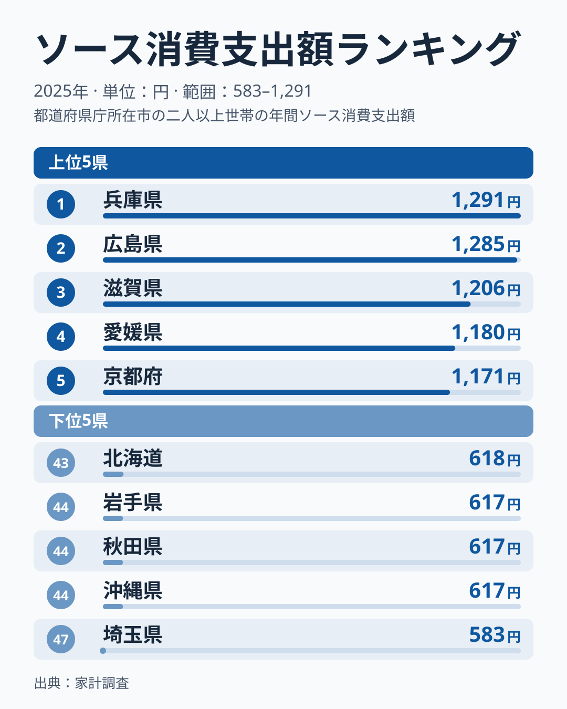
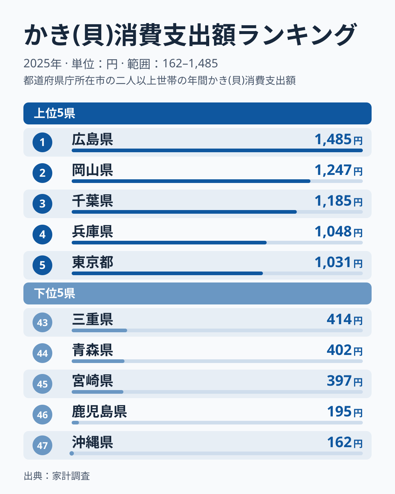
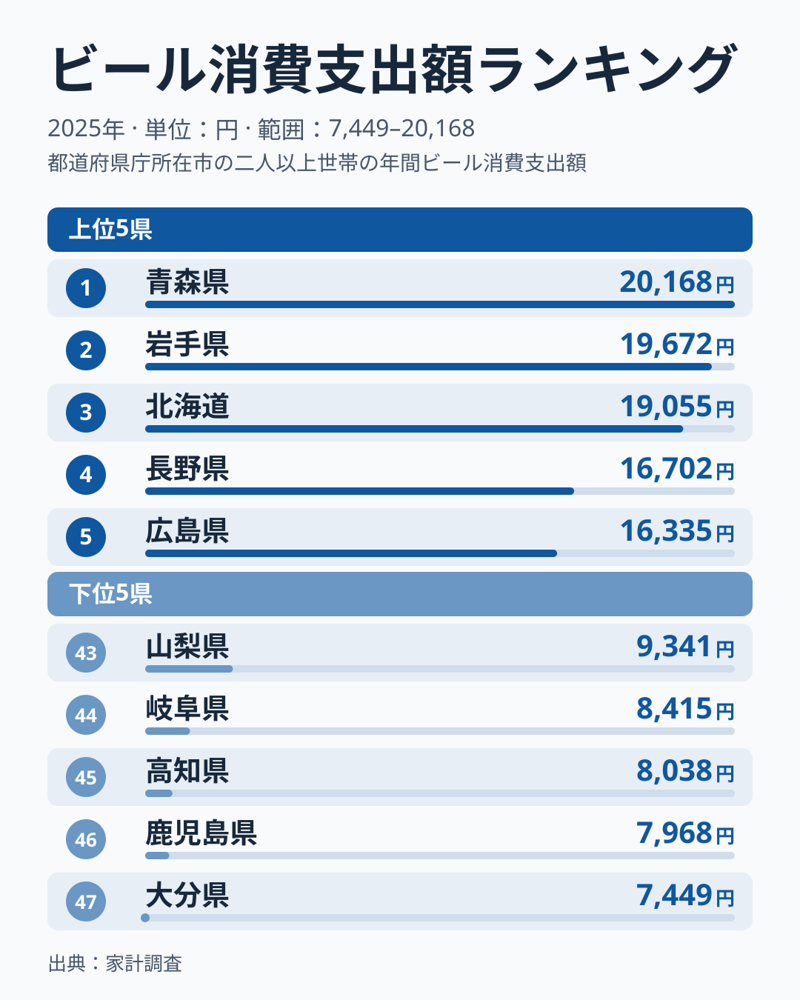
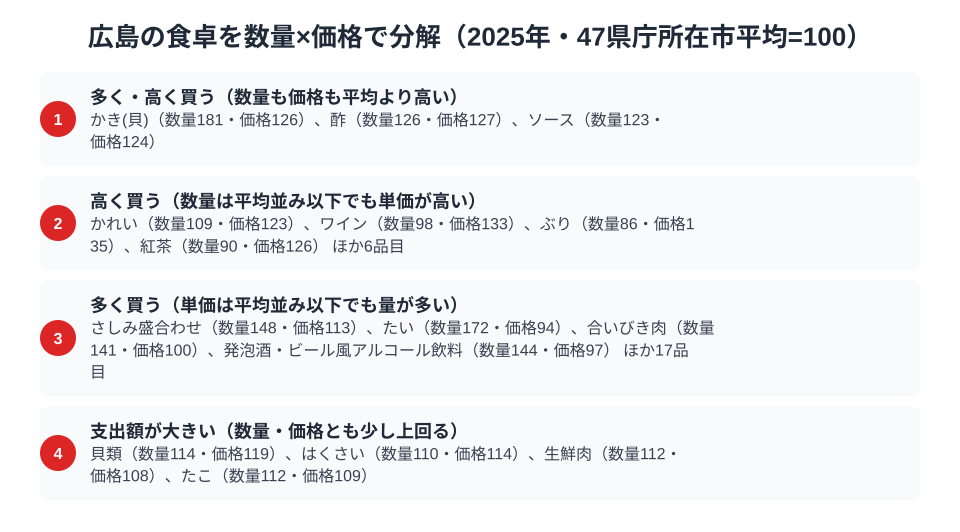

広島県の食卓には、他の都道府県には見られない偏りがあります。総務省「家計調査（品目別）」の2025年データを見ると、広島はかき消費支出額で全国1位、ソース消費支出額で全国2位に入っています。ソースの首位は兵庫県に譲りました。

さらにビールの消費支出額でも全国5位と高水準にあります。この記事では、広島の食卓がどのような形で支出に表れているかを、順位と数量×価格の分解から読み解きます。かきとソースは産地や郷土料理との関係を [仮説] として整理しますが、ビールは広島に固有の説明を付けられる材料がなく、順位の事実を示すにとどめます。

> [!NOTE]
> 本記事の数値は総務省統計局「家計調査（品目別）」2025年、県庁所在市（広島市）の二人以上世帯における年間支出額です。県全体の値ではありません。また「ソース」の品目範囲(お好み焼きソースなどをどこまで含むか)は、この記事のデータと指標定義(指標の設定ファイル)の記載の範囲では確認できませんでした。専用ソースの購入が別の品目に分かれている可能性には注意してください。

## ソース消費支出額 — 全国2位1,285円、お好み焼きが根づかせた調味料

<source-link href="/ranking/sauce-consumption-expenditure">ソース消費支出額ランキングをもっと見る</source-link>

広島県のソース消費支出額は1,285円で全国2位です。1位は兵庫県で1,291円、3位は滋賀県で1,206円、4位は愛媛県で1,180円、5位は京都府で1,171円と続き、上位5県は近畿と中国、四国の県が並びます。最下位は埼玉県で583円にとどまり、1位の兵庫県の半分以下です。

広島でソースの支出が大きい理由として、お好み焼きという「ソースをかけて食べる」料理が県民食として定着していることが考えられます [仮説]。家庭でお好み焼きを焼く習慣があり、複数の種類のソースを使い分ける家庭も多い可能性があります。6位に香川県、7位に岡山県が続いており、粉もの文化とソースの結びつきが広い地域で共有されている可能性があります。ただし単年の順位はぶれが大きく、首位が兵庫県に入れ替わった点も踏まえると、広島だけの構造と断定はできません。

## かき消費支出額 — 全国1位1,485円、養殖日本一の産地が生む食卓の距離感

<source-link href="/ranking/oyster-consumption-expenditure">かき消費支出額ランキングをもっと見る</source-link>

かき消費支出額は広島が1,485円で全国1位です。2位は岡山県で1,247円、3位は千葉県で1,185円、4位は兵庫県で1,048円と続きます。最下位は沖縄県で162円にとどまり、広島の約9.2倍という開きがあります。

広島湾は日本有数の牡蠣養殖地であり、産地が家庭のすぐそばにあることで、旬の時期に牡蠣を買う機会が多く、購入頻度と量が底上げされている可能性があります [仮説]。購入数量と単価のどちらが支出を押し上げているかは、後の数量×価格の節で確かめます。

## ビール消費支出額 — 全国5位16,335円、広島固有の理由は読み取れない

<source-link href="/ranking/beer-consumption-expenditure">ビール消費支出額ランキングをもっと見る</source-link>

ビール消費支出額は広島県が16,335円で全国5位です。首位は青森県で20,168円、2位の岩手県が19,672円、3位の北海道が19,055円、4位の長野県が16,702円と続きます。上位5県のうち西日本は広島県のみです。最下位は大分県で7,449円にとどまり、青森県の半分にも届きません。

上位には青森県・岩手県・北海道と寒冷な地域が並んでおり、寒冷地で支出が高い傾向が見られます。一方、広島がなぜ上位に入るのかは、この記事のデータからは説明できません。家計調査の支出額は家庭での購入額で、外食でのビールは含まれないため、飲食店での飲酒がこの順位を押し上げているとは言えません。ソースや牡蠣との関係を示す材料もなく、広島固有の理由は付けられないというのが正直なところです。

> [!WARNING]
> 家計調査の支出額は「購入金額」であり、消費量そのものではありません。牡蠣は外食店での消費（お好み焼き店や牡蠣小屋での食事）が集計に含まれないため、実際の牡蠣消費の広島県内シェアは、この家庭内購入額が示す以上に大きい可能性があります。

## 広島の食卓を貫くもの

かきとソースには、「産地」と「郷土料理」という2つの軸が家計支出に結びついているように見える点があります [仮説]。かきは広島湾という産地が、ソースはお好み焼きという郷土料理が、それぞれ支出を押し上げているのかもしれません。ビールは広島に固有の説明を付けられず、この2つと同じ軸では読めません。他県との比較データはこの記事にないため、2品目が重なる点が広島だけの特徴かどうかも断定できません。

## 数量×価格で分解する広島市の食卓

<source-link href="/ranking/sauce-consumption-quantity">ソース消費量ランキングをもっと見る</source-link>

ここまで見てきた支出額は、「数量×単価」に分解できます。総務省「家計調査」は品目ごとの購入数量と支出額を別々に集計しており、47都道府県庁所在市の平均を100とした指数で比べると、広島がどちらの要因で上位に立っているかが見えてきます。2025年のソースは数量指数123・価格指数124で、どちらも平均を上回っています。酢も数量126・価格127と同じ型で、広島の調味料は量も単価も高めに出ています。

かきは数量指数181・価格指数126と、数量・価格の両方が平均を上回るパターンです。数量が突出する点は、広島湾が国内有数の養殖地で購入機会が多いことと関係している可能性があります [仮説]。価格指数が平均を上回る理由は、品種・形態・購入先の違いがすべて含まれるため、データからは分かりません。

そのほか、ぶり（数量86・価格135）やワイン（数量98・価格133）のように、数量は平均並み以下でも価格指数が高い品目があります。一方、たい（数量172・価格94）や発泡酒・ビール風アルコール飲料（数量144・価格97）は、単価は平均並み以下でも量が多い品目です。広島市の食卓は「量で稼ぐもの」と「単価で稼ぐもの」が混在する複合的な消費パターンを持っています。

> [!NOTE]
> 指数の基準は47都道府県庁所在市の単純平均を100とした値で、家計調査の全国平均そのものではありません。価格指数は同一品目内の品種・ブランド差を平均化した値なので、実際の店頭価格差とは一致しない場合があります。数値はいずれも2025年、二人以上世帯の年間データです。

## まとめ

- ソース消費支出額は広島県が1,285円で全国2位（1位兵庫県1,291円、3位滋賀県1,206円）
- かき消費支出額は広島県が1,485円で全国1位（2位岡山県1,247円、最下位沖縄県162円）
- ビール消費支出額は広島県が16,335円で全国5位（1位青森県20,168円、2位岩手県19,672円）
- お好み焼き文化と牡蠣養殖という地場要因が広島の食卓の支出に関わっている可能性がありますが、家計調査のデータだけでは原因までは確かめられません

[広島県の地域プロフィール](/areas/34000)や[経済カテゴリ一覧](/category/economy)では、広島の他の家計データも確認できます。
