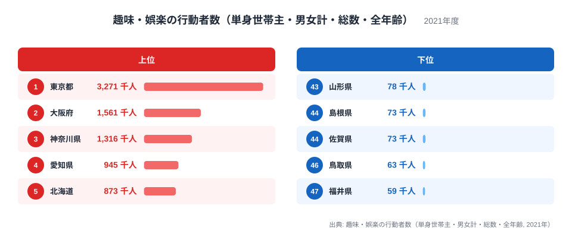
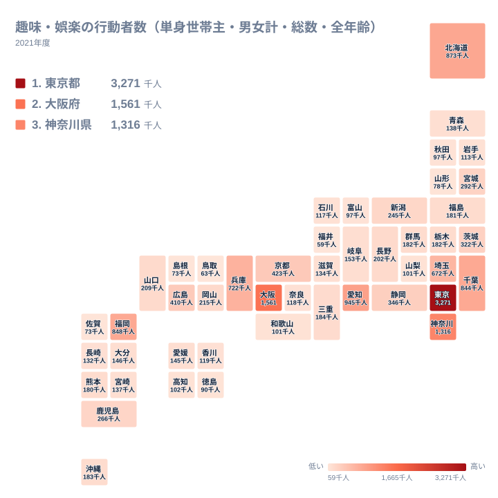

ひとり暮らしの世帯主で、この一年に趣味や娯楽を楽しんだ人は、どの県に多いのでしょうか。2021年のデータでは、東京都が3,271千人で1位、福井県が59千人で47位です。最大と最小の比は約55倍で、3,271千人対59千人という開きです。

この記事は、上位と下位がどう並ぶのかを地方ごとに確かめます。ただし先に断っておくと、このデータは行動者の「人数」であり、趣味の活発さを示す割合ではありません。そのため「なぜ東京都が多いのか」という理由までは、データだけでは断定できません。答えられるのは「どこに多く、どこに少ないか」という分布です。

> [!NOTE]
> この指標は、単身世帯主のうち、調査期間の一年間に趣味・娯楽を行った人の数です。単身世帯主とは、ひとりで暮らす世帯の代表者を指します。同居家族のいる世帯の人は含まれません。単位は千人で、人口に対する割合ではなく実数です。

## 上位と下位を並べると見えるもの

まず、上位5県と下位5県を図で確認します。

<source-link href="/ranking/hobby-activity-singleperson">単身世帯主で趣味・娯楽をした人の数ランキングをもっと見る</source-link>

図で目を引くのは、1位の東京都と2位の大阪府の差です。東京都は3,271千人、大阪府は1,561千人で、1位と2位のあいだにも大きな隔たりがあります。3位の神奈川県は1,316千人で、大阪府との差は比較的小さく、上位3都府県が他を引き離す形です。4位の愛知県は945千人、5位の北海道は873千人で、ここから先は数字が詰まっていきます。

下位側は、さらに差が小さくなります。43位の山形県が78千人、島根県と佐賀県はどちらも73千人、46位の鳥取県が63千人、47位の福井県が59千人です。下位5県は59千人から78千人という狭い範囲に収まっています。上位は数字が大きく離れ、下位は密に固まるのが、このランキングの形です。

もう一点、上位5県の顔ぶれには、東京都、大阪府、神奈川県、愛知県という大都市を抱える都府県と、北海道が入っています。北海道は、上位5県の中で唯一、東京・大阪・名古屋のいずれの周辺でもない位置にあります。ここから、北海道の値が大きい理由を言い切ることはできません。広い県土に人が散らばっていることが関係するのかもしれませんが、このデータだけでは確かめられません。

## 東京都の突出をどう読むか

東京都の値が大きい理由を、このデータだけで確かめることはできません。単身世帯主そのものが多いから趣味人も多い、という説明は考えられますが、これは「数が多いから数が多い」に近い話です。趣味をする人の割合が高いのかどうかは、この指標からは分かりません。割合を比べるための単身世帯主の総数が、手元の実データにないためです。

大阪府も同じ構図です。人の集まる大都市で値が大きくなる、という見方は自然ですが、あくまで仮説にとどまります。値の詳細は[東京都のデータ](/areas/13000)や[大阪府のデータ](/areas/27000)で、他の指標と見比べてください。

> [!TIP]
> 3位の神奈川県、7位の千葉県、9位の埼玉県は、いずれも東京都に隣接しています。このデータから言えるのは、東京都に隣接する県が上位に並んでいるという事実までです。理由として人口や通勤の影響を想像することはできますが、それを裏づける数字は載っていません。仮説として心にとどめ、結論にはしないでください。

## 地理分布で見る広がり

次に、地理分布をタイルマップで見ます。

関東は、9位以内に4都県が入っています。東京都が1位、神奈川県が3位、千葉県が7位、埼玉県が9位です。これに加えて、茨城県が13位に入ります。関東7都県のうち5都県が13位以内という、色の濃い地域です。一方、栃木県と群馬県はどちらも182千人で、同じ関東でも中位にとどまります。

近畿では、大阪府が2位、兵庫県が8位、京都府が10位です。大阪府を中心に値が集まる点は、関東と似ています。同じ近畿でも、三重県は20位、滋賀県は31位、奈良県は34位、和歌山県は39位と順位が下がり、近畿の中で濃淡がはっきり分かれます。

中部は、順位が大きく割れます。愛知県が4位、静岡県が12位、新潟県が16位、長野県が19位と上位から中位に入ります。これに対して、岐阜県は26位、石川県は35位、山梨県は38位、富山県は41位、福井県は47位と、順位が下がっていきます。同じ中部でも、上位と下位の差が大きい地方です。

九州・沖縄では、福岡県が6位に入ります。次いで鹿児島県が15位、沖縄県が21位、熊本県が25位です。同じ九州でも、佐賀県は73千人にとどまり、福岡県の848千人とは大きく離れています。北海道・東北では、北海道が5位、宮城県が14位に対し、山形県は43位です。地方の中心となる都市を持つ県と、そうでない県で差が出ているようにも見えますが、都市の規模を示す数字がないので、印象にとどまります。

## 下位の県に見える並び

下位5県を地方で見ると、福井県は中部、鳥取県と島根県は中国、佐賀県は九州・沖縄、山形県は北海道・東北に属します。地方はばらばらで、共通の地域性は見当たりません。見えるのは、値が59千人から78千人の範囲に収まっているという点だけです。

中国地方の中でも、順位は大きく違います。広島県は11位の410千人、岡山県は17位の215千人、山口県は18位の209千人です。一方で、鳥取県は63千人、島根県は73千人です。同じ地方に属していても、これだけ値が離れていますから、地方という枠では説明しにくい差だと言えます。

> [!WARNING]
> 下位の県が「趣味に乏しい」と言えるわけではありません。人数のデータなので、そもそも単身世帯主が少ない県であれば、割合が高くても人数は小さくなりえます。ただし、各県の単身世帯主の数はここにないため、実際にそうなっているかは確認できません。順位は、活動の質や満足度の高さも示しません。

## 中位の県の横並び

上位と下位の間にも、読み取れる点があります。10位の京都府が423千人、11位の広島県が410千人、12位の静岡県が346千人です。このあたりは、300千人から400千人台の中堅の層を作っています。

さらに下って、三重県は184千人、沖縄県は183千人、栃木県と群馬県はどちらも182千人、福島県は181千人、熊本県は180千人です。この付近では、わずか数千人の差で順位が入れ替わります。順位の一つ違いに大きな意味はないので、値の近さにも目を向けてください。他の統計との比較には、[同じカテゴリの統計一覧](/category/educationsports)が役立ちます。

## データについて

ここで扱った指標は、趣味・娯楽の行動者数（単身世帯主・男女計・総数・全年齢）で、2021年の都道府県別の値です。単位は千人です。男女を合わせた総数で、年齢の区分は設けていないため、若い世代も高齢の世代も同じ枠で数えられています。

千人単位で公表されているため、小さな県では端数の影響が相対的に大きくなります。島根県と佐賀県のように同じ値の県が並ぶ場合は、表示上の順序を厳密な優劣として受け取らないでください。

まとめると、東京都の3,271千人から福井県の59千人まで、行動者数には約55倍の幅があります。上位は関東と近畿の大都市に集まり、下位は地方がばらばらに並びます。「なぜ」の部分は、割合のデータがなければ確かめられません。数字を読むときは、「何人いるか」と「どれだけ盛んか」を分けて考えることが、読み違いを防ぐ近道です。
