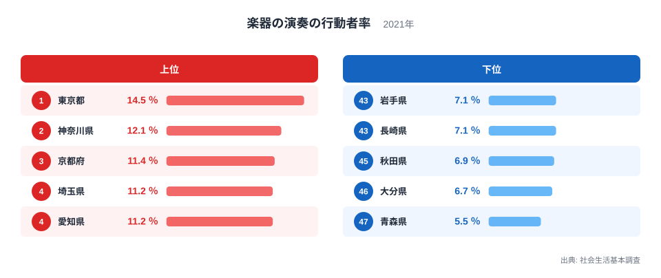
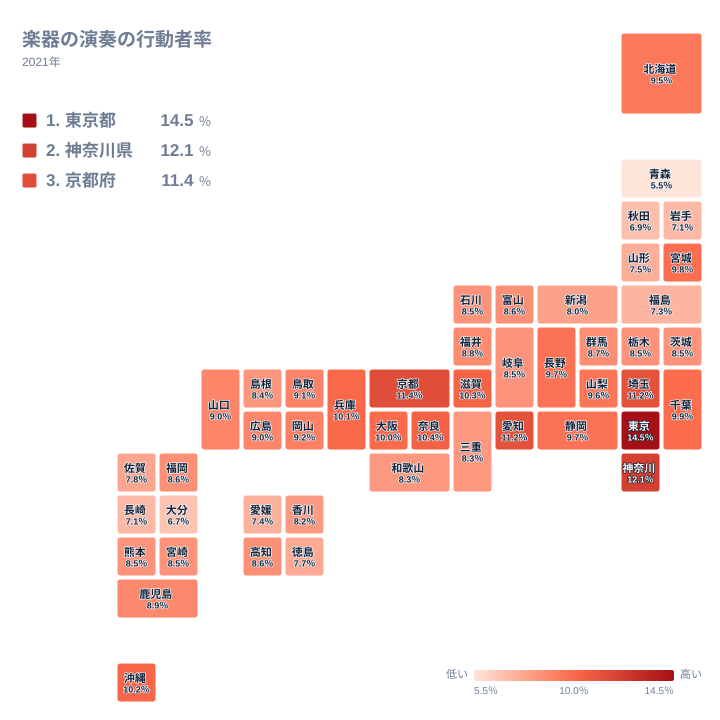

## 東京都14.5％、青森県5.5％ 両端の開きは約2.6倍

楽器の演奏は、音を出せる場所や練習の時間、教室や仲間との出会いなど、いくつもの条件がそろって続けやすくなる趣味です。そのため、楽器を演奏した人の割合には、都道府県ごとの暮らしの条件が表れやすいと考えられます。

2021年の社会生活基本調査では、楽器の演奏をした人の割合が最も高いのは東京都の14.5％でした。最も低いのは青森県の5.5％です。14.5を5.5で割ると約2.6倍で、これが実データにある最大と最小の比です。東京都の水準は青森県の水準の2.6倍ほどに当たります。

この倍率は、地域差の大きさをつかむ目安として便利です。ただし、この調査は標本調査です。県ごとの標本には限りがあるため、倍率を「演奏人口の正確な比」と読むのは避けるべきでしょう。「大きな差がありそうだ」という方向を示すものとして受け止めるのが適切です。

まず、上位5県と下位5県を図で確認します。

<source-link href="/ranking/hobby-participation-rate-instrument">楽器の演奏をした人の割合ランキングをもっと見る</source-link>

上位5県は、東京都、神奈川県、京都府、埼玉県、愛知県です。注目したいのは1位と2位の段差です。東京都が14.5％なのに対し、神奈川県は12.1％で、2位から5位までが11〜12％台に固まる中で、東京都だけが抜けています。

下位5県は、青森県、大分県、秋田県、長崎県、岩手県です。下位の中でも青森県の5.5％は、46位の大分県の6.7％からさらに離れています。47位だけが孤立した位置にあることが、図から読み取れます。

上位は関東、中部、近畿の都市圏に集まり、下位は北海道・東北と九州・沖縄に偏っています。ただし、この並びは都市圏の県で割合が高いという事実を示すだけです。都市であることが原因だと言い切る根拠は、このデータにはありません。

> [!NOTE]
> ここでの数値は「行動者率」で、調査の対象期間内に一度でも楽器を演奏した人が、対象者に占める割合です。演奏の頻度や時間は反映されません。年に一度弾いた人も、毎日練習する人も、同じ一人として数えられます。

## 上位は大都市圏が多く、背景は仮説にとどまる

上位10位までを見ると、近畿の府県が目立ちます。京都府が11.4％で3位、奈良県が10.4％で6位、滋賀県が10.3％で7位、兵庫県が10.1％で9位、大阪府が10％で10位です。関東では、東京都、神奈川県、埼玉県が上位に入り、千葉県も9.9％で11位につけています。中部では愛知県が11.2％で5位です。

人口が多い地域には、音楽教室、楽器店、練習スタジオ、演奏会場が集まりやすいと言われます。大学や企業にサークルや楽団ができやすいことも、一つの見方です。ただし、これらは一般的な見方であり、今回のデータで確かめたものではありません。施設の数や人口、世帯の状況は、この指標には含まれていないからです。

京都府が3位に入っている点も、同様です。伝統芸能や邦楽の文化が背景にあるという説明は成り立つかもしれません。しかし、この調査は楽器の種類を分けていません。ピアノなのか、ギターなのか、和楽器なのかは、このデータからは分かりません。

首都圏の2県を比べるなら、[東京都のデータ](/areas/13000)と[神奈川県のデータ](/areas/14000)で、人口構成や教育・文化に関する他の指標を並べてみてください。1位の14.5％と2位の12.1％の段差が、都市機能の違いと重なるのか、それとも別の要因なのかを検討する材料になります。

> [!TIP]
> 上位の6位から8位は、奈良県が10.4％、滋賀県が10.3％、沖縄県が10.2％と、0.1ポイント刻みで並びます。標本調査のため県ごとに誤差があり、この程度の差は誤差の範囲に収まりうるものです。この3県の順位の前後は、優劣ではなく「ほぼ同水準」と読むのが安全です。

## 地理分布では東北と九州の内部差が目立つ

次に、47都道府県の分布を地図で見ます。

地図では、関東と近畿に高い県が多く、北海道・東北と九州・沖縄に低めの県が目立ちます。ただし、地方ごとに一様ではありません。

北海道・東北を見ると、宮城県は9.8％で12位、北海道は9.5％で16位と、中位より上に位置しています。一方、山形県は7.5％で40位、福島県は7.3％で42位、岩手県は7.1％で43位、秋田県は6.9％で45位、青森県は5.5％で47位です。同じ地方の中に、宮城県と青森県のような大きな落差があります。

九州・沖縄でも同じことが言えます。沖縄県は10.2％で8位と、近畿や関東の府県と肩を並べます。鹿児島県は8.9％で21位、福岡県は8.6％で26位です。大分県は6.7％で46位、長崎県は7.1％で44位となっています。「九州は低い」という一括りの見方は、実態に合いません。

中国と四国にも目を向けます。中国では岡山県が9.2％で17位、鳥取県が9.1％で18位、広島県と山口県がどちらも9％で19位と20位です。四国では高知県が8.6％で25位、香川県が8.2％で36位、徳島県が7.7％で39位、愛媛県が7.4％で41位です。同じ四国でも、高知県と愛媛県の間にはっきりした開きがあります。

沖縄県の高さについては、地域の音楽文化と結びつけた説明をよく目にします。たしかに魅力的な見方ですが、このデータだけでは裏付けられません。ここでは、大都市圏でなくても上位に入る県があるという事実を押さえておくにとどめます。

> [!WARNING]
> 表示値が同じでも順位が分かれている県があります。たとえば埼玉県と愛知県は、どちらも11.2％ですが、4位と5位です。長野県と静岡県も9.7％で、13位と14位です。8.5％には茨城県、栃木県、石川県、岐阜県、熊本県、宮崎県の6県が並び、27位から32位に分かれています。順位が分かれる理由は、公開されている小数第1位までの値からは分かりません。順位は、このデータでの並びとして受け止めてください。

## 下位の背景は、考えられる範囲にとどめて読む

下位の青森県、大分県、秋田県、長崎県、岩手県について、何が違うのかを知りたくなります。人口密度が低く、教室や練習場所へ通う負担が大きいこと。仕事や家事に追われ、練習の時間を確保しにくいこと。若い世代が学校や習い事で楽器に触れる機会が限られること。こうした説明は、ありそうな仮説です。

ただし、今回のデータには、人口密度や年齢構成、時間の使い方、施設の数は含まれていません。これらが割合に影響しているかどうかは、別の資料で確かめる必要があります。ここでは「考えられる」という段階にとどめておきます。

もう一つ、見落とせない点があります。割合が低いことは、楽器に関心がないことと同じではありません。測っているのは、対象期間内に演奏したかどうかだけです。

楽器の演奏と、ほかの趣味やスポーツ、学習の行動者率を並べて読むと、この趣味の位置づけがはっきりします。[同じカテゴリの統計一覧](/category/educationsports)から、関連する指標を探してみてください。

まとめると、楽器の演奏をした人の割合は、東京都の14.5％から青森県の5.5％まで、約2.6倍の幅で分布しています。上位は都市圏に集まりますが、宮城県や沖縄県のように、都市圏の外にも高い県があります。近い値の県は誤差も踏まえ、順位より値の近さで読むのが適切です。

## データについて

このページの数値は、社会生活基本調査の「楽器の演奏の行動者率」です。2021年の調査結果で、単位は％です。

行動者率は、調査対象者のうち、対象期間内にその活動を行った人の割合を指します。標本調査にもとづく推計のため、県ごとの値には誤差が含まれます。値は小数第1位までの表示で、同じ表示値でも順位が分かれている県があります。順位は、このデータに記載された並びに従っています。
