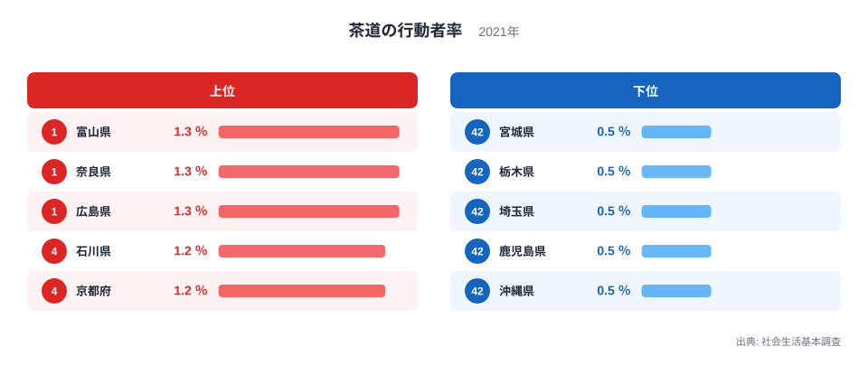
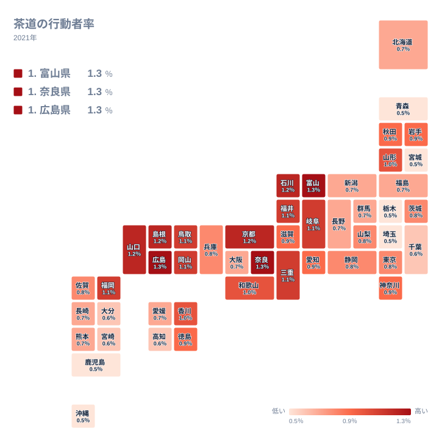

茶道は日本の伝統文化の象徴ですが、実際に茶道をした人の割合は、どの県でも1.3％以下にとどまります。それでも都道府県別に並べると、地域ごとの傾向がはっきり見えてきます。この記事では、茶道をした人が多い県はどこかを実データで確かめ、上位と下位がなぜその順になるのかを、地理と歴史の観点から考えます。ただし、原因を直接示すデータは手元にないため、理由に踏み込む部分は仮説として扱います。

## 茶道をした人の割合は最大1.3％、最小0.5％

2021年の社会生活基本調査によると、茶道をした人の割合が最も高いのは1.3％です。1位の富山県、2位の奈良県、3位の広島県が同じ値で並んでいます。一方、最も低い0.5％の県は、42位の青森県、43位の宮城県、44位の栃木県、45位の埼玉県、46位の鹿児島県、47位の沖縄県の6県です。

最大と最小の比は2.6倍です。倍率としては大きく見えますが、値そのものはどちらも1％前後の小さな水準です。この点は後で述べる注意点とも関わります。

<source-link href="/ranking/hobby-participation-rate-tea-ceremony">茶道をした人の割合ランキングをもっと見る</source-link>

上位5県は、1位の富山県、2位の奈良県、3位の広島県が1.3％で、4位の石川県と5位の京都府が1.2％です。中部が2県、近畿が2県、中国が1県で、特定の一地方だけが突出しているわけではありません。上位がひとつの地方に固まらず、日本海側に限らず内陸や瀬戸内にも広がっている点が、まず目を引きます。

下位は先に挙げた0.5％の6県です。北海道・東北の青森県と宮城県、関東の栃木県と埼玉県、九州・沖縄の鹿児島県と沖縄県が並びます。上位に近畿・中国・中部が多く、下位には東北・関東・九州南部が現れるという対比が、全体の特徴です。ただし1位と47位の差は0.8ポイントしかなく、順位の差を過大に読まない姿勢が必要です。

> [!NOTE]
> ここでいう「茶道をした人の割合」は、社会生活基本調査の「茶道の行動者率」です。調査の対象となる1年間に、茶道を1回以上行った10歳以上の人が、全体に占める割合を示します。習い事として続けているかどうかや、頻度の違いは区別されません。

## 上位に並ぶ県を歴史の仮説で読む

上位の顔ぶれを見ると、古くから寺社や町の文化が育った地域が含まれています。京都府は5位で1.2％、[奈良県のデータ](/areas/29000)で確認できる奈良県は2位で1.3％です。茶の湯の歴史と結びつけて考えたくなりますが、このデータは歴史的背景と行動者率の関係を検証したものではありません。あくまで、そう考えることもできるという仮説にとどまります。

注目したいのは、[富山県のデータ](/areas/16000)にある富山県が1位であることです。同じ中部の石川県が4位、福井県が8位、岐阜県が9位と、近い県が上位に集まっています。茶席に使う菓子や道具を支える地域の文化が影響しているのではないか、という見方はできますが、これも裏付けは示せません。

中国地方では、広島県が3位、島根県が6位、山口県が7位、鳥取県が11位、岡山県が12位と、5県すべてが12位以内に入っています。地方としてのまとまりが強いことは、データから読み取れる事実です。その背景に歴史的な要因があるかどうかは、別の資料で確かめる必要があります。

> [!TIP]
> 同じ値の県が多いので、順位だけで優劣を判断しないでください。1位から3位は1.3％で並び、4位から7位は1.2％で並びます。順位より、値のまとまりで見る方が実態に近くなります。

## 地理分布で見える広がり

地図で全体の分布を見ると、個別の順位表では気づきにくい広がりが見えてきます。

最も目立つのは、色の濃い県が中部の北側から近畿、中国へと、ひと続きの帯のように連なっている点です。上位の県が飛び地として散らばるのではなく、隣り合う県どうしで同じような水準を示しています。茶道をした人の割合は、県単位の個別事情というより、地域ごとのまとまりとして現れやすい指標だと考えられます。

一方、関東から東北にかけては色が薄い県が多く、帯のような連続性は見えません。九州・沖縄は一様ではなく、福岡県が13位で1.1％と濃い一方、鹿児島県は46位、沖縄県は47位で0.5％です。同じ地方のなかでも、福岡県と南部の県とで差が大きい点は、地図でこそ見えやすい特徴です。

大都市圏でも傾向は分かれます。東京都は24位、大阪府は34位で、いずれも上位には入っていません。人口が多い都市部では選べる趣味が多いために数字が伸びにくい、という見方もありえますが、人口規模はこのデータに含まれず、確かめることはできません。事実として言えるのは、大都市の都府が上位に入っていないということまでです。

## 下位の県をどう読むか

下位を見ると、東北では青森県と宮城県が0.5％で並ぶ一方、山形県は14位で1％、岩手県と秋田県は17位と18位で0.9％です。同じ北海道・東北でも、県によって水準はかなり異なります。地方ごとの傾向だけで、個々の県の数字を説明することはできません。

九州では、大分県が40位、宮崎県が41位でともに0.6％、鹿児島県が46位で0.5％です。これに対して福岡県は13位の1.1％、佐賀県は28位の0.8％です。九州・沖縄のなかで、数字の差がはっきりあります。

下位の背景として、茶道に触れる教室や場の数、地域ごとの文化の違いなどが考えられます。ただし、これらを裏付けるデータは今回ありません。調査項目の「茶道」が、県ごとに異なる形で親しまれている茶文化をどこまで捉えているのかも分かりません。下位だからといって、茶の文化が乏しいと結論づけることはできません。

> [!WARNING]
> 行動者率は標本調査にもとづく推定値で、0.5％や1.3％のような小さな数値では、わずかな誤差が順位に大きく響きます。0.1ポイントの違いを、実際の文化の差と断定することは避けてください。

## 数字の読み方と、この統計が示すもの

ここまでの内容を整理します。1位は富山県、奈良県、広島県の1.3％で、4位の石川県、5位の京都府は1.2％です。上位は中部、近畿、中国に集まり、0.5％の6県は東北の一部、関東の一部、九州南部と沖縄に見られます。

中位には愛知県が20位、滋賀県が21位でともに0.9％、静岡県が26位、兵庫県が27位でともに0.8％という県が並びます。近畿に属する滋賀県や兵庫県が中位にとどまるように、同じ地方でも順位は一様ではありません。地方のまとまりは強い傾向ですが、例外もあります。

読者がこのデータを使うときは、次の点に留意してください。

- 値が近い県が多く、順位の差が小さいこと
- 調査の対象は1年間に茶道をした人で、日常的に続けている人だけではないこと
- 理由の説明は仮説であり、このデータだけでは検証できないこと

他の趣味や教養の指標も比べたい場合は、[同じカテゴリの統計一覧](/category/educationsports)から確認できます。茶道が盛んな県が、ほかの文化的な活動でも高いのかどうかを重ねて見ると、地域の文化の特色がより立体的に見えてきます。

## データについて

この記事の数値は、社会生活基本調査(2021年)にある「茶道の行動者率」を使っています。単位は％で、10歳以上の人口に占める、調査対象の1年間に茶道を行った人の割合です。小数第1位までの公表値を使っているため、同じ値の県が多く、同じ値の県の並びは便宜的な順位として読んでください。

茶道は1.3％という最高値でも、100人に1人あまりの少数派の趣味です。それでも、地図の上では隣り合う県が似た水準で連なる様子が見えます。数字の大小だけでなく、その広がり方に注目して読むと、統計がより豊かな情報になります。
