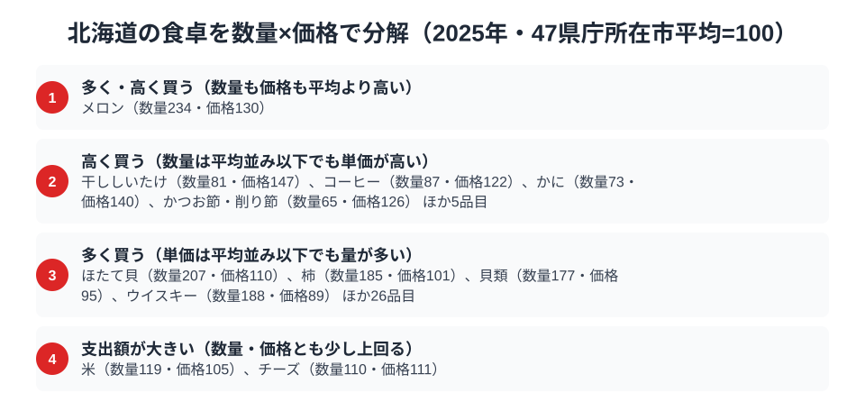
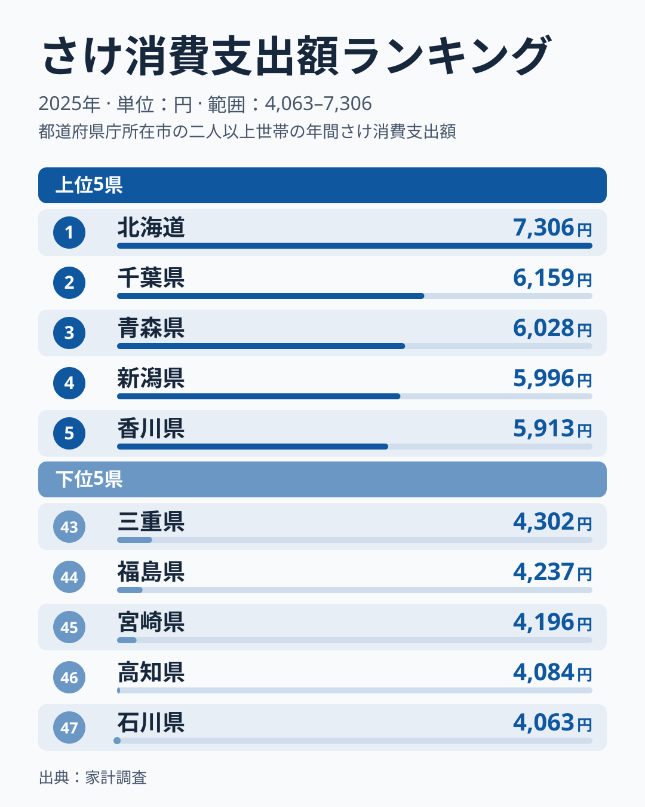
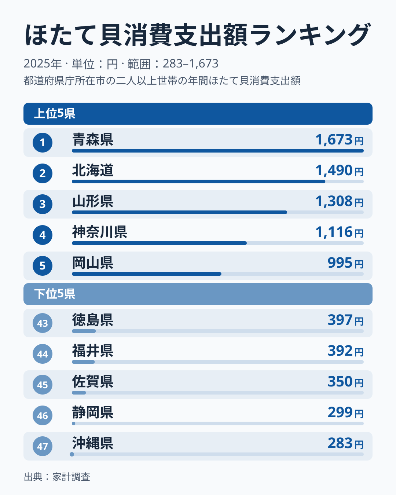
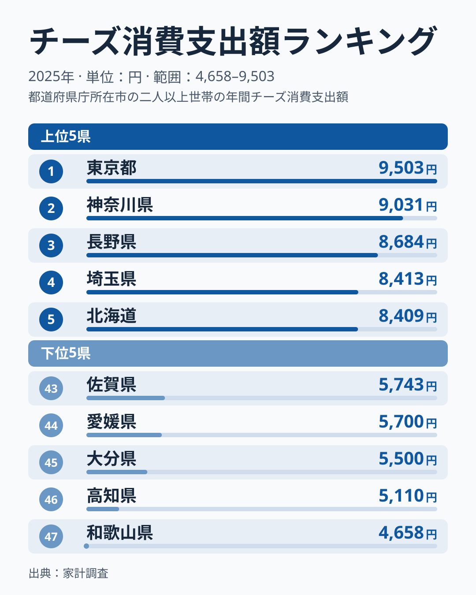

札幌市の世帯は、全国平均と比べて何を多く、何を高く買っているのでしょうか。家計調査（品目別）の数量と支出額を47都道府県庁所在市の単純平均（100）と比べると、答えは品目ごとに分かれます。ほたて貝は数量指数207と平均の約2倍を買う「多く買う」型です。メロンは数量指数234・価格指数130で、量も単価も上回ります。かには数量指数73と少なめですが、価格指数は140と単価が高い「高く買う」型です。

支出額の順位では、鮭が7,306円で全国1位、チーズは8,409円で5位、ほたて貝は1,490円で2位（首位は青森県の1,673円）でした。この記事では、まず数量×価格の分解で札幌市の買い方の型を示し、そのうえで鮭・ほたて・チーズの3品目の順位を読みます。

> [!NOTE]
> 対象は札幌市の二人以上世帯で、道全体の値ではありません。1市あたり約100世帯の標本のため、単年の順位や指数は動きやすく、この記事で言えるのは2025年の1年で見た姿までです。支出額は金額であって消費量そのものではありません。指数は47都道府県庁所在市の単純平均を100とした相対値で、価格指数は「支出額÷数量」を平均と比べたものです。品種やグレードの違いも含むため、小売価格の高さそのものではありません。

## 数量×価格で見る札幌市の食卓

<source-link href="/ranking/scallop-consumption-quantity">ほたて貝消費量ランキングをもっと見る</source-link>

支出額の順位は、「数量」と「単価」が掛け合わさった結果です。数量指数と価格指数の組み合わせで品目を4区分に分けたのが上の図です。ほたて貝消費量の指数は数量指数が207、価格指数が110でした。価格指数は平均を1割ほど上回る程度なので、支出額を押し上げているのは単価ではなく購入量の多さです。

メロンは数量指数234・価格指数130で、量も単価も上回る唯一の品目でした。[仮説] 道内に産地を抱える果物を、単価の高い品も含めて多く買っているのかもしれませんが、品種やグレードの内訳はこのデータからは分かりません。

一方で、数量は平均以下なのに単価が高い品目もあります。かには数量指数73、価格指数140です。干ししいたけ（数量指数81・価格指数147）、コーヒー（同87・同122）、かつお節・削り節（同65・同126）も同じ区分です。いずれも頻繁には買わず、買うときに単価の高いものを選ぶ傾向が読み取れます。なぜ札幌市でこれらの単価が高いのかは、今回のデータからは分かりません。

チーズ（数量指数110・価格指数111）と米（同119・同105）は、数量も価格も平均を少し上回る区分です。ほたて貝とチーズの価格指数は110と111でほぼ同じ水準で、区分名の違いは単価の差ではなく、数量指数が207と110で大きく違うことによるものです。チーズは突出した品目ではなく、平均をやや上回る程度と読むのが妥当です。

支出額の順位だけでは、「たくさん食べている」のか「高いものを買っている」のかは区別できません。ランキングを読むときは、数量と価格のどちらが効いているかを分けて見る必要があります。以下の3品目の順位も、この見方で読みます。

## 鮭 — 全国1位7,306円

<source-link href="/ranking/salmon-consumption-expenditure">鮭消費支出額ランキングをもっと見る</source-link>

北海道のさけ消費支出額（鮭）は7,306円で全国1位です。2位の千葉県は6,159円で、最下位の石川県4,063円と比べると1.8倍の開きがあります。鮭は北海道近海で豊富に獲れる魚で、塩鮭のほか、石狩鍋やちゃんちゃん焼き、新巻鮭や筋子・いくらなどの加工品まで、北海道の食文化に広く登場する食材です。ただし、家計調査の支出額から言えるのは「札幌市の世帯が全国で最も多く支出した」ところまでで、食文化上の位置づけまでは示せません。

[仮説] 地元で水揚げされる魚が家庭の食卓で多く買われる「産地型」の消費かもしれません。青森県は鮭の支出額で3位、新潟県は4位と、鮭になじみの深い地域が上位に並ぶ点はこの見方と整合します。一方、千葉県は2位、東京都は7位と、産地とは言いにくい都市部も入っています。千葉市が2位になった理由は今回のデータだけでは説明できず、産地型で上位が説明できるとは言えません。市別の値は単年のぶれが大きいため、別の年でも同じ顔ぶれになるかを確かめる必要があります。

## ほたて貝 — 首位に届かず、全国2位1,490円

<source-link href="/ranking/scallop-consumption-expenditure">ほたて貝消費支出額ランキングをもっと見る</source-link>

ほたて貝の消費支出額で、北海道は1,490円の全国2位でした。首位は青森県の1,673円で、差は183円です。北海道はオホーツク海や噴火湾でほたての養殖・漁が盛んな産地ですが、前の節の通り、札幌市のほたて貝の数量指数は207で、世帯は平均の約2倍を買っています。この上位の順位自体が、地元での購入の多さを示しています。

首位との183円差は、約100世帯の標本で単年の値を比べた差です。順位が動きやすい規模の差と考えられるため、「産地なのに首位を逃した」ことに特別な理由を探す必要はないかもしれません。[仮説] 首位と次点の差は標本のぶれの範囲に収まっている可能性があります。検証するには、別の年でも両者の順位が入れ替わるかを見ます。産地であることと家計の支出額の順位は、[青森県の食卓](/blog/aomori-food-culture)（ほたて1位）と読み比べると確かめやすくなります。

## チーズ — 僅差の5位8,409円

<source-link href="/ranking/cheese-consumption-expenditure">チーズ消費支出額ランキングをもっと見る</source-link>

チーズの消費支出額で、北海道は8,409円の全国5位でした。1位は東京都の9,503円、2位は神奈川県、3位は長野県、4位は埼玉県で、上位は都市部が占めています。6位の宮城県は8,408円で、北海道とは1円差でした。僅差の順位は年ごとに入れ替わりうるため、「上位グループに入っている」と読むのが妥当です。

北海道は酪農が盛んな地域ですが、チーズの支出額が上位であることと酪農との関係は、今回のデータからは確かめられません。数量指数110・価格指数111はどちらも平均をやや上回る程度で、突出した買い方は示されていません。チーズ支出では東京都や神奈川県といった都市部の県が上位に並びます。[仮説] 洋食文化や購買力の影響が考えられます（[チーズ消費支出の記事](/blog/cheese-expenditure-ranking)で詳述）。

## まとめ

- 札幌市の食卓は、ほたて貝のように「多く買う」型と、かにのように「高く買う」型に分かれます
- 鮭の消費支出額は北海道が全国1位（7,306円）で、2位の千葉県とは1,147円差でした
- ほたて貝は首位が青森県の1,673円、北海道は1,490円の2位でした。数量指数は207で、地元での購入量は多いと読めます
- チーズは8,409円で全国5位ですが、東京都など都市部が上位で、酪農との関係はこのデータからは確かめられません

北海道の他の統計は[北海道の地域プロフィール](/areas/01000)、食品・家計消費の地域差は[経済カテゴリ一覧](/category/economy)からご覧いただけます。
