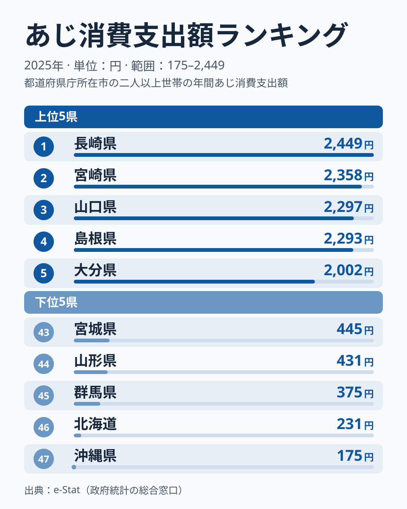
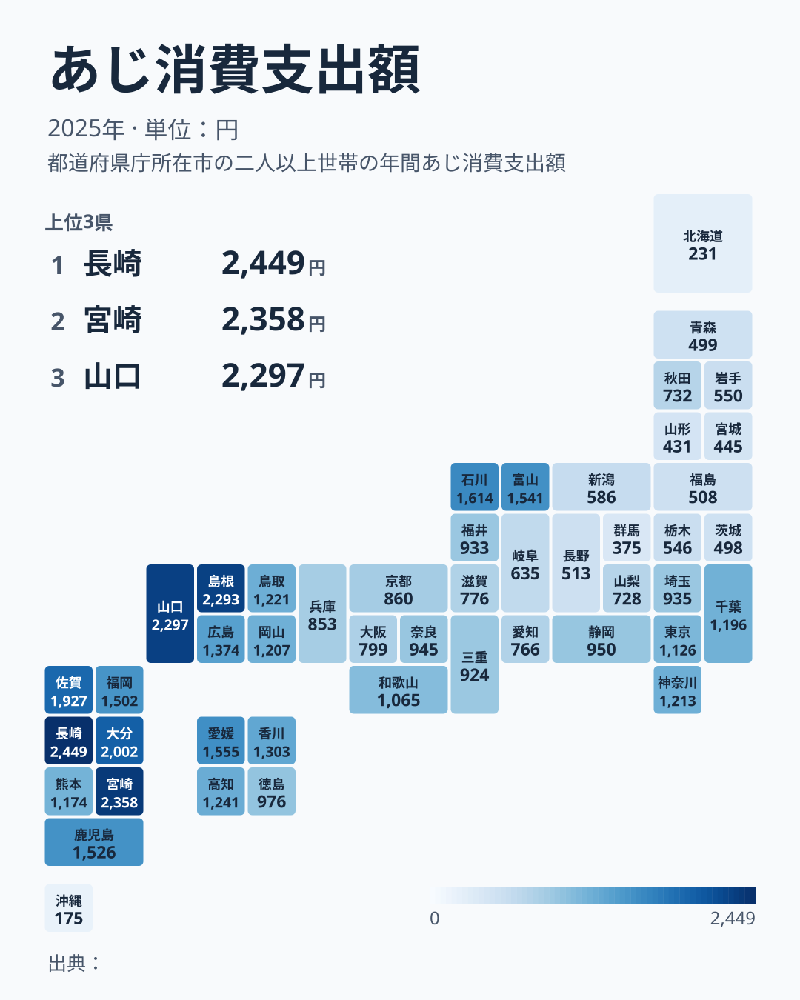

あじは焼いても揚げても刺身でもおいしい、日本の食卓で最もなじみ深い青魚のひとつです。総務省の家計調査（品目別）によると、都道府県庁所在市の二人以上世帯が2025年に支出したあじの年間消費支出額は、1位の長崎県が2,449円、最下位の沖縄県が175円で、約14倍の差がありました。47都道府県の中央値は24位の奈良県の945円なので、長崎県はその約2.6倍にあたります。前年は山口県が首位だったため、2025年に順位の入れ替わりがありました。

この記事では、高い県と低い県が地方別にどう分かれるかを、47県の順位から読み取ります。先に結論を書くと、九州と中国地方で高く、北海道・東北・北関東で低いという傾向は読み取れます。一方で、近畿と東海は中位から下位、関東南部は中位に並び、「西日本は高く東日本は低い」という単純な線は引けません。理由まではデータだけでは確定できないため、背景に触れる部分は推測であることを明記します。

> [!NOTE]
> この指標は県全体の平均ではなく、都道府県庁所在市の二人以上世帯の家計調査サンプルに基づく値です。前橋市（群馬県45位）、宇都宮市（栃木県38位）、長野市（長野県39位）、札幌市（北海道46位）のように、漁港から離れた内陸の市や大都市が県の代表になる場合があり、県の漁業の強さとは別に読む必要があります。長崎県の1位も「長崎市の世帯」の値です。

## 上位と下位

<source-link href="/ranking/horse-mackerel-consumption-expenditure">あじ消費支出額ランキングをもっと見る</source-link>

図の上位5県には、九州の長崎・宮崎・大分と、中国地方の山口・島根が並びます。数字の並びで目を引くのは段差の位置です。1位から4位までは2,293円から2,449円の間（156円、約6%）に収まり、山口県と島根県の差は4円しかありません。続く5位の大分県は2,002円で、4位との間に約290円の段差があります。6位の佐賀県は1,927円で、ここまでの6県が1,900円を超えます。7位の石川県は1,614円で、6位との差は313円と、上位10県の中で最も大きな段差です。つまり、あじへの支出が突出して多いのは6県に限られ、その下は緩やかに下がっていく構図です。

下位は、47位の沖縄県が175円、46位の北海道が231円で、45位の群馬県の375円との間にも144円以上の差があり、この2道県だけが離れて低い水準です。群馬県の上には、山形県が44位の431円、宮城県が43位の445円です。1位の長崎県と47位の沖縄県の差は約14倍ですが、43位から47位までの5県はいずれも500円未満に収まっており、500円に届かない層が下位に固まっています。

長崎県は五島列島や対馬周辺に好漁場を抱える県ですが、この記事のデータは漁獲量ではなく家計の支出額です。あじが手に入りやすい環境が支出を押し上げているのかもしれませんが、漁獲や流通のデータと突き合わせない限り、そこまでは言えません。

## 地方別に見ると、線は西と東では引けない

地図に47県を並べて順位を地方ごとに整理すると、はっきり高いところ、はっきり低いところ、その間に分かれます。

- 九州では、長崎1位、宮崎2位、大分5位、佐賀6位、鹿児島10位、福岡11位と、6県が11位以内に入ります。熊本県だけが19位（1,174円）です。
- 中国地方では、山口3位、島根4位、広島12位、鳥取15位、岡山17位と、5県すべてが17位以内です。
- 四国は、愛媛8位、香川13位、高知14位、徳島22位で、愛媛県がTOP10に入る一方、徳島県は中位に下がります。
- 北陸では、石川7位（1,614円）、富山9位（1,541円）が上位に入りますが、福井26位（933円）、新潟36位（586円）は中位から下位です。
- 近畿の和歌山21位、奈良24位、京都28位、兵庫29位、大阪30位、滋賀31位はいずれも21〜31位、東海の愛知は32位（766円）です。
- 関東南部は、神奈川16位、千葉18位、東京20位、埼玉25位と中位に並びます。
- 北関東は、栃木38位、茨城42位、群馬45位と下位に寄ります。
- 東北は、秋田33位（732円）が最も高く、岩手37位、福島40位、青森41位、宮城43位、山形44位と、37〜44位に集まります。
- 北海道は46位（231円）、沖縄は47位（175円）です。

この整理から言えるのは、九州と中国地方で高く、北海道・東北・北関東で低いという傾向です。反対に、「西日本で高い」とは言い切れません。近畿の和歌山・奈良・京都・兵庫・大阪・滋賀は、神奈川県が16位の1,213円、千葉県が18位の1,196円、東京都が20位の1,126円と並ぶ関東南部の県よりも、いずれも低い値です。また、「東日本で低い」とも言えません。石川県と富山県は東日本の側に入りやすい県ですが、7位と9位で、8位の愛媛県と並ぶ位置にあります。この記事が高低の差を「西高東低」とひとことで呼ばず、地方別に書き分けているのはそのためです。

> [!WARNING]
> 家計調査は品目別の支出額の調査であり、漁獲量や消費量そのものではありません。物価水準や購入頻度の違いも金額に影響するため、「支出額が低い=消費していない」とは読み替えられません。単年の順位は標本の入れ替わりでぶれやすく、2025年の長崎県と山口県の入れ替わりも、この幅の中で起きた可能性があります。

## 背景を読むときの注意

九州・中国地方の上位県に共通する背景として、まず思いつくのは漁場の近さです。日本海や東シナ海、瀬戸内海に面した県が上位に集まっていることは、この順位から確認できます。ただし、この記事が扱った家計調査のデータには、漁獲量、卸売市場の取扱量、料理の習慣といった情報が含まれていません。そのため、漁場の近さが支出額を決めているかどうかは、この記事のデータでは検証できません。

北海道が46位、沖縄県が47位にとどまる点も、同じ制約の中で読むことになります。北海道ではあじ以外の魚介が日常の食卓の中心にある可能性がありますし、沖縄県では本土と違う魚種が好まれている可能性があります。ただし、これらはいずれも順位から直接は読めない仮説であり、確かめるには各県の魚種別の支出額や水揚げ統計との比較が必要です。

地方別の傾向を他の魚種と並べて読むと、魚ごとに高い地域がどう違うかが見えてきます。あじと同じ家計調査の魚介類として、[まぐろの消費量](/blog/tuna-consumption-quantity)、[いかの消費量](/blog/squid-consumption-quantity)、[かつおと牡蠣の東西対比](/blog/bonito-vs-oyster-fish-map)も公開しています。それぞれの記事で上位に並ぶ地方を見比べると、あじの高低と重なる点と重ならない点を確かめられます。

1位の長崎県の地域データは[長崎県の統計](/areas/42000)、ほかの経済指標は[経済カテゴリのランキング](/category/economy)から確認できます。

## まとめ

- 1位は長崎県の2,449円、最下位は沖縄県の175円で、約14倍の差があります。
- 上位は九州と中国地方の県が占め、6位の佐賀県の1,927円までが1,900円を超えます。
- 下位は46位の北海道と47位の沖縄県に加え、東北と北関東の県が中心です。
- 近畿は21〜31位、東海の愛知県は32位で中位から下位、関東南部は16〜25位で中位です。「西高東低」とは言い切れません。
- 理由は、この記事のデータだけでは確定できません。漁獲量や水揚げ統計との比較が必要です。
