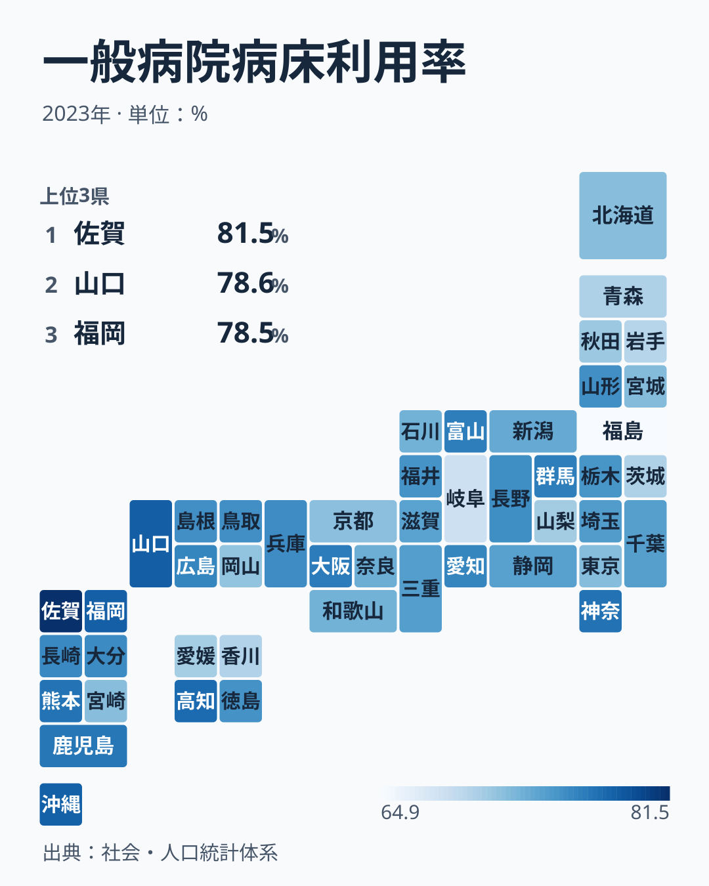
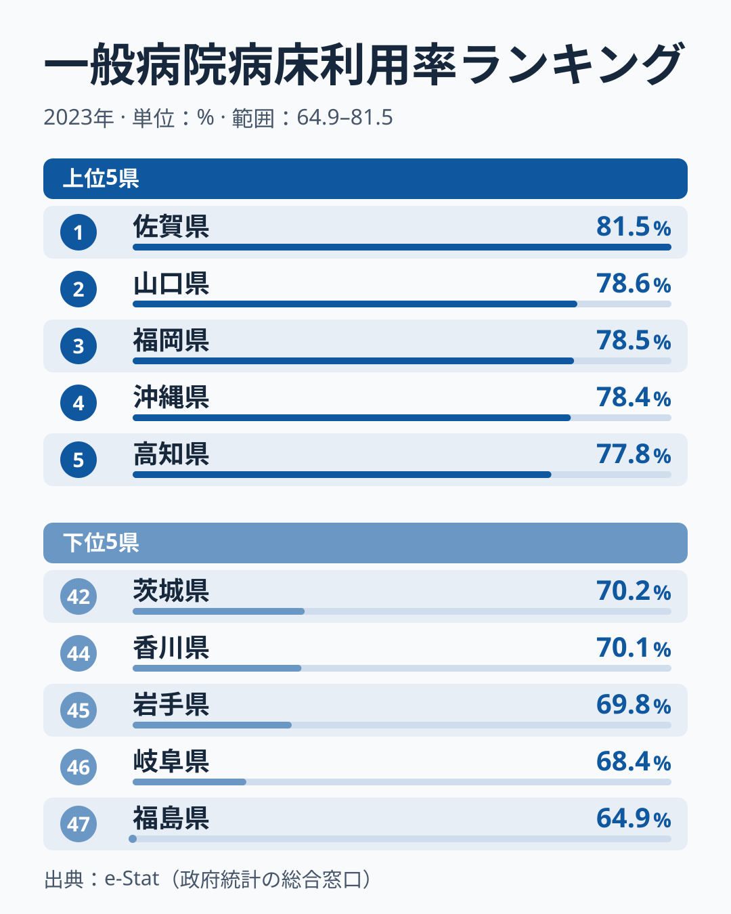
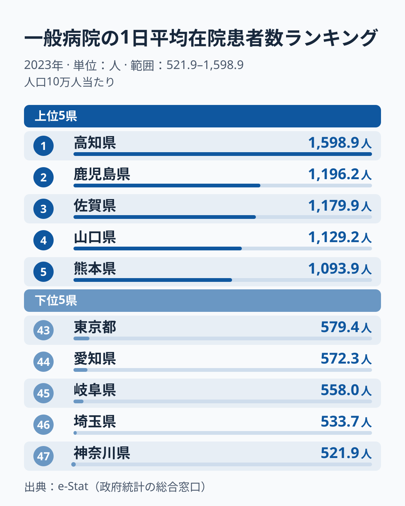

「病床は足りているのか、それとも余っているのか」── 47都道府県の数字を並べると、答えは地域によって大きく異なります。

2023年の一般病院の病床利用率は、1位の**佐賀県が81.5%**で、病床の8割以上が平均して埋まっています。47位の**福島県は64.9%**で、3床に1床近くが空いている計算です。差は**16.6ポイント**ですが、比にすると約1.3倍で、所得や物価のように何倍も開く指標ではありません。47都道府県のほとんどが70%台に収まる狭い幅のなかで、80%を超えるのは佐賀県だけ、65%を下回るのは福島県だけです。

> [!NOTE]
> 一般病院の病床利用率は、精神科病院を除く一般病院について、1日平均の在院患者数を病床数で割った割合 (%) です。総務省「社会・人口統計体系」に収録された2023年 (暦年) の値を使っています。このサイトの「一般病院の1日平均在院患者数 (人口10万人当たり)」を「一般病院病床数 (人口10万人当たり)」で割ると、47都道府県すべてで0.1ポイント未満の差でこの値と一致します。

## 47都道府県の病床利用率マップ──九州・沖縄が濃く、北海道・東北が淡い

色が濃いほど病床利用率が高い県です。九州・沖縄が全体に濃く、北海道・東北は淡い色が目立ちます。地方ごとに47都道府県の値を単純に平均すると、次のようになります。

- 九州・沖縄: 平均77.0% (8県)
- 中国: 平均75.4% (5県)
- 関東: 平均74.3% (7都県)
- 近畿: 平均74.1% (7府県)
- 中部: 平均73.7% (9県)
- 四国: 平均73.4% (4県)
- 北海道・東北: 平均70.8% (7道県)

最も高い九州・沖縄と最も低い北海道・東北の差は6.2ポイントです。そのあいだの5地方は73〜75%台に固まっていて、地域の差は「九州・沖縄が高く、北海道・東北が低い」両端に出ています。47都道府県の中央値は74.5%です。

ただし地方の平均は、地方のなかの差を隠します。四国では高知県が77.8%で5位なのに、香川県は70.1%で44位です。中部でも富山県が76.5%で10位、岐阜県は68.4%で46位と大きく分かれます。

<source-link href="/ranking/general-hospital-bed-occupancy-rate">一般病院病床利用率ランキング</source-link>

## 上位5県・下位5県──80%を超えるのは佐賀だけ

**1位は佐賀県**で81.5%です。2位は山口県で78.6%、3位は福岡県で78.5%、4位は沖縄県で78.4%、5位は高知県で77.8%と続きます。2位の山口県でも80%には届かず、佐賀県だけが2.9ポイント抜けています。上位10県には佐賀・福岡・沖縄・熊本・鹿児島と九州・沖縄の5県が入り、6位には神奈川県が77.3%で入っています。

最下位は**福島県**で64.9%です。46位は岐阜県で68.4%、45位は岩手県で69.8%、44位は香川県で70.1%、42位は青森県と茨城県が同じ70.2%で並びます。福島県は46位の岐阜県よりさらに3.5ポイント低く、下位のなかでも離れています。このサイトに収録された年で見ると、福島県は2011年から2023年まで13年続けて47位です。

下位10県には秋田・青森・岩手・福島と東北の4県が入り、ほかは岡山・山梨・愛媛・茨城・香川・岐阜と、地方がばらけています。上位が九州・沖縄にまとまるのに比べ、下位は東北を除くと特定の地方に固まっていません。

## 分子と分母で比べる──佐賀は患者も病床も多く、高知は病床が最も多い

病床利用率は「在院患者数 ÷ 病床数」なので、同じ利用率でも、分子と分母の大きさは県によって違います。分子にあたる、一般病院の1日平均在院患者数 (人口10万人当たり) を見ます。

1日平均在院患者数の1位は高知県で、人口10万人当たり1,598.9人です。1位の佐賀県と47位の福島県を、利用率・病床数・患者数の3つで並べます。

- 病床利用率: 佐賀県は81.5%、福島県は64.9%で、差は16.6ポイント
- 一般病院の病床数 (人口10万人当たり): 佐賀県は1,447.8床で4位、福島県は1,047.5床で29位
- 1日平均在院患者数 (人口10万人当たり): 佐賀県は1,179.9人で3位、福島県は680.3人で36位

佐賀県は病床数も患者数も全国上位で、そのうえ患者数のほうが病床数に近い県です。福島県は病床数が中位なのに対して患者数が中位より下で、空きが多くなっています。

高知県は分母の大きさが目立つ例です。病床数は人口10万人当たり2,056.3床で47都道府県の1位、患者数も1位ですが、病床数が多いぶん利用率は77.8%で5位にとどまります。利用率だけでは「病床がどれだけあるか」は見えないので、分子と分母を両方見ると県の姿が分かります。

<source-link href="/ranking/avg-daily-inpatients-general-hospital-per-100k">一般病院 1日平均在院患者数ランキング</source-link>

## 入院受療率・医師数との関係──どちらも弱い正の相関

病床がよく埋まっている県は、入院が必要な人の多い県なのでしょうか。2023年の入院受療率 (人口10万人当たり) と病床利用率の相関係数を47都道府県で計算すると約0.35で、入院受療率が高い県ほど利用率もやや高い、弱い正の相関でした。高知県は入院受療率も1,785人で1位、山口県は1,534人で4位と、利用率の上位県には入院受療率の高い県があります。一方、利用率4位の沖縄県は入院受療率が985人で26位と中位で、需要の多さだけでは利用率の高さを説明できません。

医師数でも同じです。2022年の医療施設に従事する医師数 (人口10万人当たり) と病床利用率の相関係数は約0.28で、医師数が多い県ほど利用率もやや高いものの、結びつきは弱いものでした。岡山県は医師数が324.0人で6位と多いのに、利用率は71.6%で38位です。逆に沖縄県は医師数が266.1人で25位なのに、利用率は4位です。医師が多い県で病床が埋まっているとは限りません。

あわせて見る: [入院受療率ランキング](/ranking/inpatient-rate-per-100k) / [医療施設従事医師数ランキング](/ranking/physicians-in-medical-facilities-per-100k)

> [!WARNING]
> 病床利用率が低いことは「医療に余裕がある」ことを、高いことは「医療がひっ迫している」ことを、そのまま意味しません。利用率は病床数という分母の大きさに左右され、病床の種類 (急性期・慢性期など) の違いもこの指標には表れません。入院受療率や医師数との相関も弱いので、利用率の高低の理由を1つの要因に決めることはできません。

## データの読み方と限界

- **一般病院だけが対象**: 精神科病院は含みません。
- **2023年の1年分**: 利用率は年によって動きます。47都道府県の中央値は2019年の79.6%から2023年の74.5%へ下がっており、単年の順位だけで県の性格を決めないほうが安全です。
- **平均値**: 1年の平均なので、季節による混み方の違いや、災害・感染症の流行時の一時的なひっ迫は表れません。
- **県単位の値**: 同じ県のなかでも、都市部と郡部の病院では利用率が違う可能性があります。

各県の医療・福祉の指標は[社会保障カテゴリのランキング](/category/socialsecurity)から横断的に確認できます。佐賀県と福島県の違いは[佐賀県のプロフィール](/areas/41000)と[福島県のプロフィール](/areas/07000)で比べられます。

## まとめ

- 2023年の一般病院の病床利用率は、1位の佐賀県が81.5%、47位の福島県が64.9%で、差は16.6ポイント、比は約1.3倍です。80%を超えるのは佐賀県だけ、65%を下回るのは福島県だけです。
- 地方平均では九州・沖縄が77.0%で最も高く、北海道・東北が70.8%で最も低く、ほかの5地方は73〜75%台に固まります。ただし四国の高知と香川のように、地方のなかでも大きく分かれます。
- 福島県は2011年から2023年まで13年続けて47位です。
- 佐賀県は患者数も病床数も多く、高知県は病床数が全国最多のため利用率は5位にとどまります。利用率は分子と分母を両方見て読む指標です。
- 入院受療率 (相関約0.35)・医師数 (約0.28) との相関はどちらも弱く、利用率の高低を1つの要因では説明できません。
