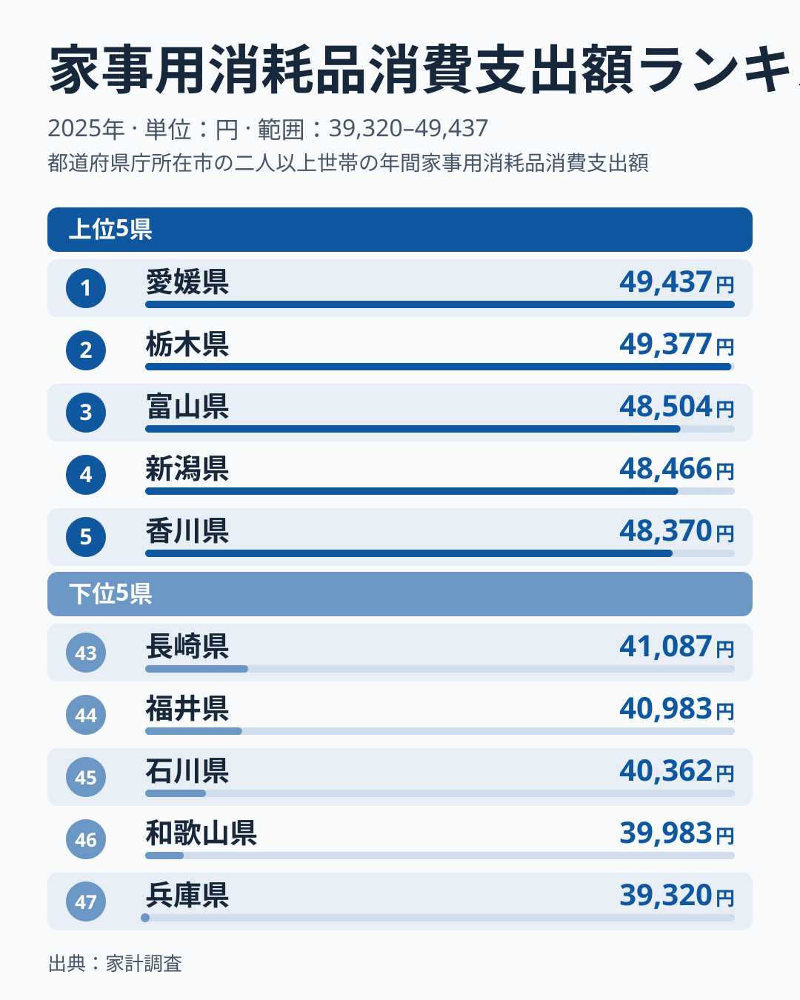
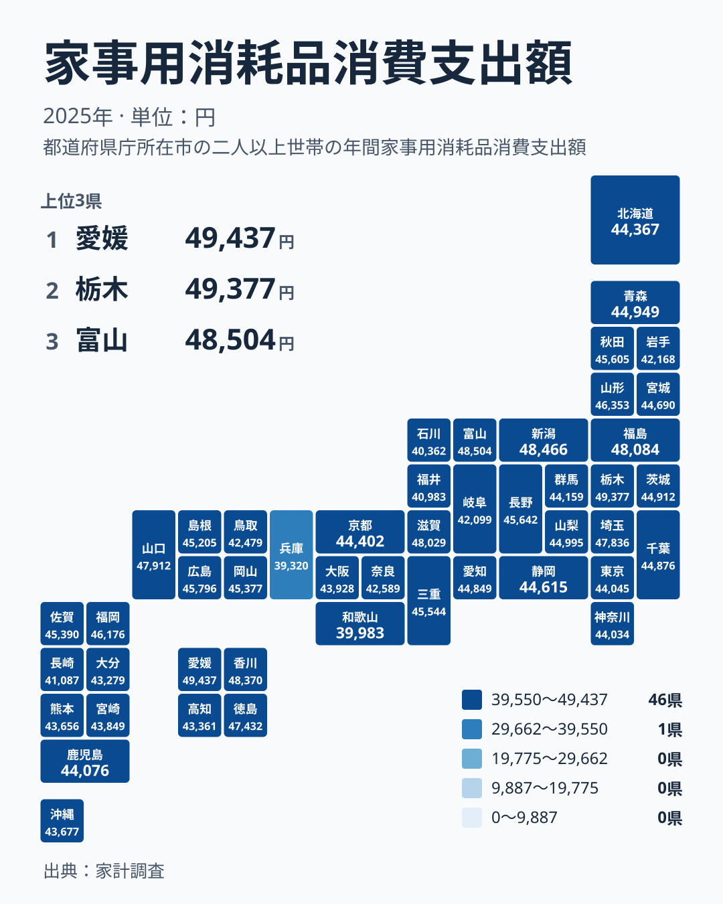

洗剤、トイレットペーパー、ティッシュ、ごみ袋。毎日の暮らしで何気なく使うこれらの品々に、どれだけお金をかけているかは県によって違います。2025年の家計調査では、家事用消耗品への年間支出が最も多かったのは愛媛県で49,437円でした。最も少なかったのは兵庫県で39,320円です。

この記事では、家事用消耗品への支出を都道府県別に並べ、上位と下位の顔ぶれ、地方ごとのばらつき、数字を読むときの注意点を整理します。地味な支出ですが、順位の背景を考えるとデータの読み方のコツが見えてきます。

## 家事用消耗品への支出ランキング

まず上位5県と下位5県を図で確認します。

<source-link href="/ranking/household-consumables-group-consumption-expenditure">家事用消耗品への支出ランキングをもっと見る</source-link>

図を見て最初に気づくのは、上位5県のそろい方です。1位の愛媛県と2位の栃木県の差は60円しかありません。上位5県は49,437円から48,370円の間に収まっていて、この帯の中では順位の違いはほとんど意味を持たないと見たほうが安全です。「1位だから突出している」とは言えない分布です。

下位5県も2,000円弱の幅に収まっていますが、上位と比べると間隔はやや広めです。47位の兵庫県と46位の和歌山県の間には663円の開きがあります。下位では一つ順位が違うだけで、金額にもはっきり差が出ることがあります。

最大の愛媛県は、最小の兵庫県の約1.26倍です。生活費全体から見れば大きな倍率ではありませんが、年間で約1万円の違いは、洗剤や紙類を何か月分もまとめて買えるほどの金額にあたります。

> [!NOTE]
> この指標は家計調査の「家事用消耗品」への年間支出額で、1世帯あたりの金額です。洗剤などの家事用品や、紙製品、ごみ袋といった使い切りの品が対象で、家電や家具のような耐久財は含みません。県の人口規模ではなく世帯あたりの平均なので、人口の多い県が上に来るとは限りません。

同じ分野の別の指標は、[同じカテゴリの統計一覧](/category/economy)から確認できます。

## 上位10県は地方ごとにそろっているのか

ここでは次の地方区分を使います。北海道・東北、関東、中部、近畿、中国、四国、九州・沖縄の7区分です。新潟県と富山県は中部に含めます。

上位10県を区分ごとに数えると、四国が3県、関東が2県、中部が2県、近畿・中国・北海道・東北がそれぞれ1県で、合計7区分のうち6区分に分かれます。九州・沖縄から上位10県に入った県はなく、最上位は12位の福岡県で46,176円でした。

内訳は次のとおりです。

- 四国：1位の愛媛県、5位の香川県、10位の徳島県
- 関東：2位の栃木県、9位の埼玉県
- 中部：3位の富山県、4位の新潟県
- 北海道・東北：6位の福島県
- 近畿：7位の滋賀県
- 中国：8位の山口県

つまり、上位に並ぶ県には「この地方だから」という共通点は見つかりません。四国は3県が入りますが、同じ四国の高知県は37位で43,361円です。同じ地方の中でも順位が大きく分かれるため、地方単位でひとくくりに語ることはできません。

愛媛県の詳しい数字は[愛媛県のデータ](/areas/38000)、栃木県については[栃木県のデータ](/areas/09000)で確認できます。データから言えるのは、上位が地方では説明しにくいという点までです。なぜその県が上位に来るのかは、この指標だけでは分かりません。

## 地理分布を地図で見る

次に、全国の分布をタイルマップで見ます。

地図を眺めると、濃淡は地方ごとにきれいに分かれていません。上位の県は、四国の愛媛県や香川県、関東の栃木県、中部の富山県や新潟県と、複数の地方に点在しています。下位に目を向けると、兵庫県と和歌山県は近畿、石川県と福井県は中部、長崎県は九州・沖縄です。下位5県も3つの区分に分かれています。

大都市圏は中位から下位寄りに固まっています。東京都は31位で44,045円、神奈川県は32位で44,034円、大阪府は33位で43,928円です。3都府県の金額の幅は117円しかありません。愛知県は24位で44,849円でした。人口の多い都市が消耗品に最も多く支出しているわけではないことが分かります。

一方、埼玉県は9位で47,836円と高く、千葉県は23位で44,876円です。同じ首都圏でも順位は大きく異なります。都市かどうかという単純な軸では、この並びを説明できません。

> [!WARNING]
> 家計調査は標本調査で、県ごとの調査世帯数は多くありません。順位が近い県どうしの数百円の差は、誤差の範囲に収まる可能性があります。たとえば24位の愛知県は44,849円、25位の宮城県は44,690円です。順位の上下だけで優劣を断じないでください。

## 暮らしへの含意：数字から言えることと言えないこと

上位から下位までの金額を並べてみると、全体の姿が見えてきます。10位の徳島県は47,432円、11位の山形県は46,353円で、この境目には1,079円の開きがあります。一方、28位の北海道は44,367円、27位の京都府は44,402円、26位の静岡県は44,615円と、中位では1位違うごとの差が数十円から二百円程度にとどまります。

このように、順位の重みは位置によって違います。上位10県は48,000円前後から47,000円台に並び、中位は44,000円台に密集し、下位は39,000円台から41,000円台まで広く散らばります。中位の県は順位が一つ動いても金額はほとんど変わらないのに対し、下位の県は一つ違うだけで数百円変わります。

では、なぜ県によって差が出るのでしょうか。世帯人数や住まいの広さ、買い物の仕方などが関係している可能性は考えられますが、これらはあくまで仮説です。この記事で使ったデータには、世帯人数も店舗の価格も含まれていないため、原因を断定することはできません。実データから確かに言えるのは、支出額が地方ごとにそろっていないこと、上位と下位の幅が約1.26倍であることまでです。

> [!TIP]
> 自分の県の順位を見るときは、順位より金額の幅に注目すると読み違えにくくなります。たとえば山形県は11位で46,353円、福岡県は12位で46,176円、広島県は13位で45,796円で、この3県の間は600円未満です。順位が違っても、実際の支出の差はごくわずかです。

## 自分の県の位置を確かめるために

自分の住む県の位置を知るには、まず上位、中位、下位のどこにあたるかを大づかみに捉えるのが有効です。ここでは1〜10位を上位、11〜37位前後を中位、38位以下を下位とおおまかに見ておきます。

差が小さい例として、35位の沖縄県は43,677円、36位の熊本県は43,656円です。この2県は順位が一つ違っても差が21円しかありません。さらに、38位の大分県は43,279円で、37位の高知県は43,361円です。この付近では順位の入れ替わりを重く見る必要はありません。

消耗品は暮らしの基本の支出なので、少なければ良い、多ければ悪いというものではありません。家族の人数や暮らし方に合っているかが基準になります。他の指標との比較は、[同じカテゴリの統計一覧](/category/economy)から探せます。

## データについて

この記事で使った数値は、家計調査による2025年の家事用消耗品消費支出額です。単位は円で、1世帯あたりの年間支出を表します。順位は金額の大きい順につけています。

家計調査は都道府県庁所在地と政令指定都市を中心に調査している点に留意が必要です。そのため、県全体の平均というより、調査対象となった都市部の世帯の姿を映している面があります。同じ県でも、郡部や町村部の世帯の消耗品の買い方はこの数字に十分に反映されていない可能性があります。県の特徴を語るときは、この前提を踏まえて数字を読んでください。

また、家事用消耗品の分類には境界があります。洗剤や紙類のような使い切りの品は含まれますが、家具や家電は含みません。調査での区分に従った金額なので、日用品の買い物の総額とは一致しない場合があります。
