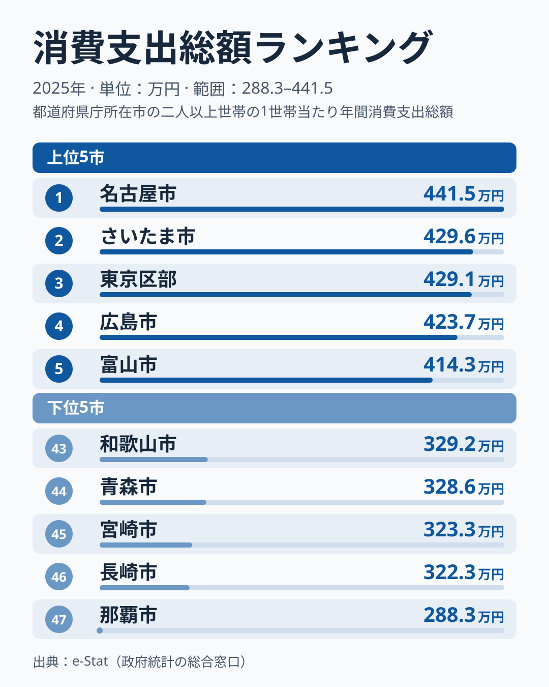

「生活費が高い県」と聞くと、多くの人が家賃の高い都市部を思い浮かべるかもしれません。総務省の家計調査（2025年）で二人以上世帯の年間消費支出総額を都道府県庁所在市別に比べると、1位の愛知県は441万4,664円、最下位の沖縄県は288万3,185円で、その差は約1.5倍でした。

1位は年ごとに入れ替わり、2025年に首位となった愛知県も、前年は47都道府県の中ほどにいました。一方で沖縄県は、2007年から2025年までの19年間、毎年45位から47位の間にいます。この記事では、消費支出総額の上位・下位の顔ぶれと、年をまたいで変わらない部分を、47都道府県のデータから確認していきます。

## 消費支出総額の上位と下位

まず全体像を見てみましょう。

<source-link href="/ranking/consumption-expenditure-total">消費支出総額ランキングをもっと見る</source-link>

2025年の1位は愛知県で441万4,664円、2位は埼玉県で429万6,371円、3位は東京都で429万1,357円でした。4位は広島県で423万7,397円、5位は富山県で414万3,469円です。

愛知県の1位は、この指標の揺れの大きさを示す例でもあります。愛知県は2024年に20位、2021年に38位、2012年には44位でした。4位の広島県も2024年は26位です。1年で20位以上動く県があるため、単年の順位をその県の生活費の高さと読むのは早計です。

それに対して、順位があまり動かない県もあります。2007年から2025年までの19年間で10位以内に入った回数を数えると、埼玉県と東京都が18回、富山県が16回、石川県が15回、神奈川県と奈良県が12回でした。埼玉県は2022年から2024年まで3年続けて1位、石川県も2017年から2019年まで3年続けて1位になっています。富山県は2007年・2008年・2014年に1位でした。上位の常連には首都圏の都県と北陸の2県が並び、都市圏だけが上位に来るわけではありません。

2025年の上位10県を地域で見ると、首都圏の4都県（埼玉・東京・千葉・神奈川）、中部の3県（愛知・富山・長野）、広島県・山形県・滋賀県でした。

> [!NOTE]
> 本ランキングの対象は「二人以上世帯」の家計調査（総務省）です。単身世帯は含まれず、都道府県単位ではなく**都道府県庁所在市**の調査世帯が対象になります。本文の県名は、その県の県庁所在市の値を指します。

## 下位に残る県

下位を見ると、47位が沖縄県で288万3,185円、46位が長崎県で322万3,355円、45位が宮崎県で323万3,499円、44位が青森県で328万6,261円、43位が和歌山県で329万2,482円でした。46位の長崎県と47位の沖縄県の間には約34万円の開きがあり、沖縄県だけが大きく離れています。

沖縄県の位置は19年間ほとんど変わりません。2007年から2025年まで毎年45位から47位の間にあり、47位になったのは10回です。上位の顔ぶれが入れ替わるのとは対照的に、最下位の側は沖縄県でほぼ固定されています。下位10位以内に入った回数では、沖縄県と青森県が19年すべて、和歌山県が18回、宮崎県と長崎県が16回、愛媛県と大阪府が15回でした。大都市を抱える大阪府が下位の常連に入っている点も目を引きます。2025年の下位10県は、九州・沖縄の4県（大分・宮崎・長崎・沖縄）、東北の2県（秋田・青森）、近畿の2県（兵庫・和歌山）、愛媛県・新潟県でした。

[仮説] 支出総額は世帯の所得や世帯人数に左右されると考えられ、沖縄県が毎年下位にいるのは、こうした条件の違いが続いているためかもしれません。ただし、この記事のデータは支出の合計だけで、所得や費目の内訳は含んでいません。沖縄県は離島で物価が高いという印象を持たれることもありますが、物価の高さは支出額のデータでは確かめられず、物価地域差指数のような価格の指標と合わせて見る必要があります。費目ごとの支出額は[食料費](/ranking/food-expenditure-total)などのランキングで確かめられます。

> [!WARNING]
> 消費支出総額が低い＝生活水準が低い、と短絡的に読むのは危険です。名目の支出額には、物価の地域差も世帯人数の違いも混ざっています。実質的な暮らし向きを比べるには、物価地域差指数など他の指標と合わせて見る必要があります。

## 1位と最下位の差は19年間1.3〜1.7倍

2025年の1位と最下位の比は1.53倍でした。2007年以降の19年間を通して見ても、この比は1.33倍から1.69倍の間にとどまっています。どの年も、最も多い県が最も少ない県の2倍に届いたことはありません。

[仮説] 差が小さくとどまる要因として、消費支出には食料・光熱・住居といった生活に欠かせない支出が土台にあり、どの地域でも一定の水準を下回りにくいことが考えられます。所得が高い地域ほど娯楽や外食に多く回す一方、基礎的な支出は地域で大きく変わらないとすれば、合計の差は所得の差ほどには開きません。この仮説を確かめるには、消費支出の内訳を県別に分け、どの費目が差を縮めているかを見る必要があります。

支出の中身を見るには、[エンゲル係数](/ranking/engel-coefficient)（消費支出に占める食料費の割合）のランキングが使えます。支出の合計が近い県どうしでも、食料費の割合が違えば、何にお金を使っているかの構成が違うことになります。

あわせて見る: [エンゲル係数ランキング](/ranking/engel-coefficient)

> [!TIP]
> このランキングを読み解くコツは、1年の順位ではなく、何年も同じ位置にいるかを見ることです。沖縄県と青森県の下位、19年のうち18年10位以内に入った東京都と埼玉県の上位のように、長く続く位置は、1年だけの1位よりも地域の傾向を映していると考えられます。

## まとめ

- 2025年の消費支出総額は愛知県が441万4,664円で1位、埼玉県が429万6,371円で2位、東京都が429万1,357円で3位
- 最下位は沖縄県で288万3,185円、46位の長崎県とは約34万円離れている
- 1位と最下位の比は1.53倍で、19年間を通して1.33〜1.69倍の範囲にとどまる
- 愛知県は前年の中位から首位に上がり、首位は年ごとに入れ替わる。東京都は2008年を除き毎年9位以内
- 沖縄県は19年間毎年45〜47位にあり、47位は10回。理由は所得や費目の内訳と合わせて確かめる必要がある
