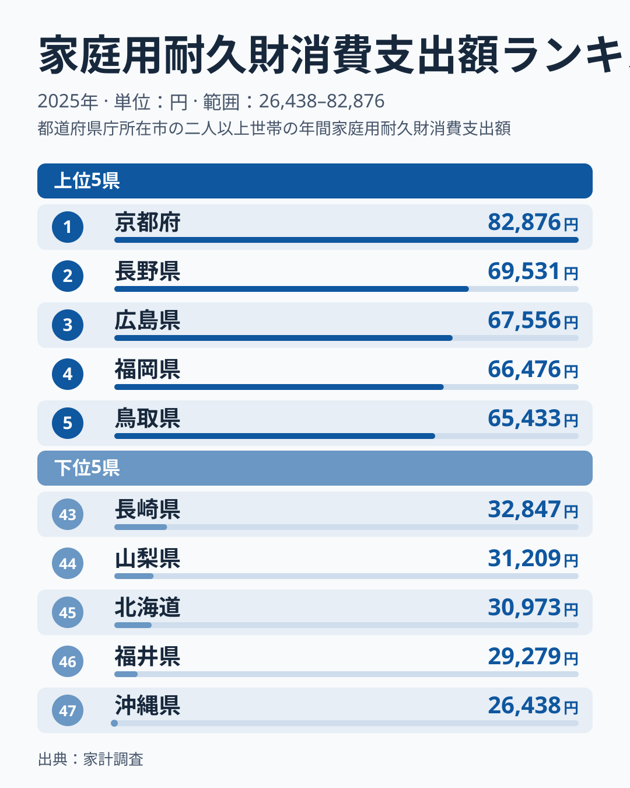
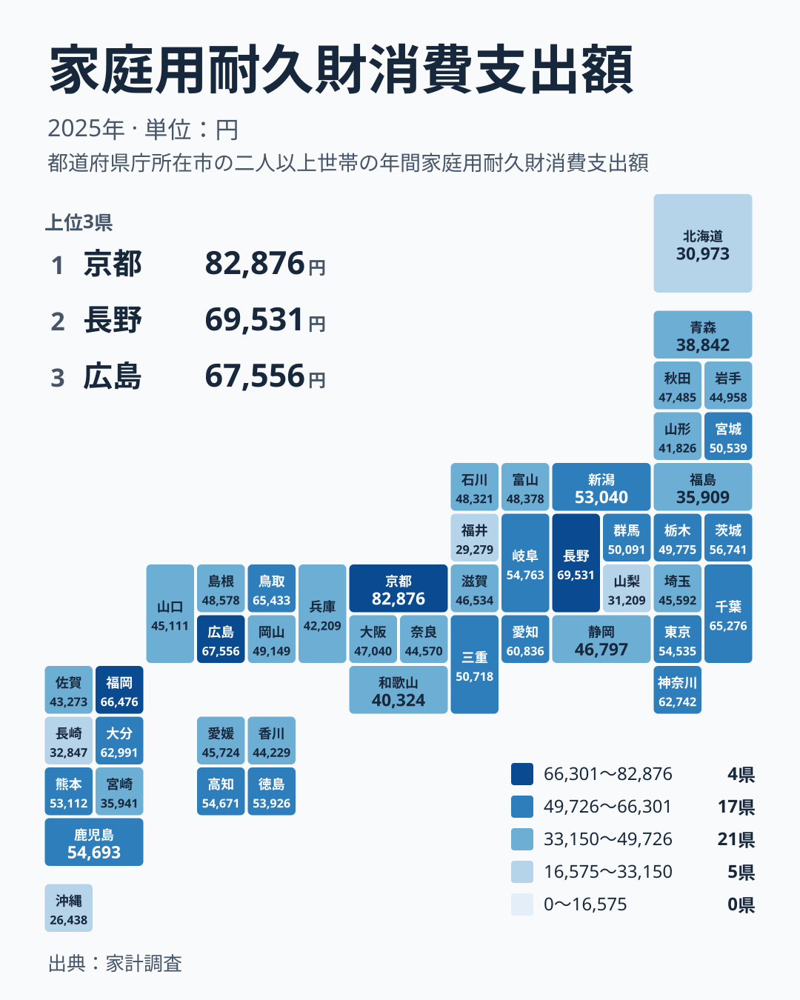

冷蔵庫、エアコン、ソファ、タンスなど、長く使う家庭用の品への支出は、毎月の食費や光熱費と違い、買う年と買わない年の波が大きい項目です。それでも都道府県ごとに並べると、はっきりした差が見えてきます。2025年の家計調査では、家庭用耐久財への支出が最も多かったのは京都府で、82,876円でした。最も少なかったのは沖縄県で、26,438円です。

この記事では、都道府県単位の並びを確かめたうえで、順位の読み方を考えます。住宅や所得のデータは今回扱っていないため、背景に触れる箇所は仮説として書きます。

## 上位と下位の顔ぶれ

まず全体の並びを確認します。次の図は、上位5位と下位5位を並べたものです。

<source-link href="/ranking/household-durables-group-consumption-expenditure">家庭用耐久財への支出ランキングをもっと見る</source-link>

1位は京都府の82,876円で、2位は長野県の69,531円です。3位は広島県の67,556円、4位は福岡県の66,476円、5位は鳥取県の65,433円と続きます。2位から5位までは65,433円から69,531円の範囲に収まっていて、そこへ京都府だけが82,876円で上に離れています。上位集団の中でも、京都府は一段高い位置にいます。

下位側は、47位の沖縄県が26,438円、46位の福井県が29,279円、45位の北海道が30,973円、44位の山梨県が31,209円、43位の長崎県が32,847円です。1位の京都府82,876円と47位の沖縄県26,438円を比べると、約3倍の開きがあります。実データの最大と最小の比で見ると、京都府は沖縄県の3倍をわずかに超える水準です。

注目したいのは、東京都が14位で54,535円にとどまることです。人口の多い大都市を抱える都が、上位に入っていません。大都市であることと耐久財への支出の多さは、少なくともこの数字では単純に結びつきません。一方で、長野県が2位、鳥取県が5位に入っています。理由は今回のデータだけでは分かりません。住まいの広さや買い替えの時期が関わっている可能性はありますが、あくまで仮説です。

> [!NOTE]
> 家庭用耐久財とは、冷蔵庫やエアコンなどの家電、家具、寝具のように、長期間使うことを前提とした家庭用の品を指します。ここでの金額は、1世帯あたりの年間支出額です。個人ではなく世帯単位の数字なので、1人あたりの支出とは読み替えられません。

## 地方で切り直すと見えること

次に、地理的な広がりを確認します。地図で見ると、高い県と低い県がどこに分かれているかが分かります。

同じ地方の中でも、順位はかなり割れています。関東では、千葉県が6位で65,276円、神奈川県が8位で62,742円、茨城県が10位で56,741円と、上位10位以内に3県が入っています。一方で、東京都は14位、埼玉県は31位で45,592円です。関東の7都県のうち、順位が最も高い千葉県と最も低い埼玉県で、25ほどの順位差があります。

中部は、長野県が2位、愛知県が9位で60,836円と高く、岐阜県も11位で54,763円です。その一方で、山梨県が44位、福井県が46位です。近畿は京都府が1位ですが、大阪府は27位で47,040円、兵庫県は37位で42,209円、和歌山県は39位で40,324円です。同じ近畿でも、1位と39位が同居しています。

中国では、広島県が3位、鳥取県が5位と上位に並ぶ一方、岡山県は22位で49,149円、島根県は23位で48,578円、山口県は32位で45,111円です。九州・沖縄では、福岡県が4位、大分県が7位で62,991円と上位に入り、長崎県は43位、宮崎県は41位で35,941円、沖縄県は47位です。

北海道・東北は、上位10位以内に入る道県がありません。宮城県が19位で50,539円、秋田県が26位で47,485円と中位にとどまり、青森県は40位で38,842円、福島県は42位で35,909円、北海道は45位です。四国では高知県の13位、徳島県の15位が目立ち、愛媛県は30位、香川県は35位です。

どの地方にも順位の高い県と低い県がいて、地方という単位でひとくくりに語るのは難しいと分かります。

> [!WARNING]
> 家計調査は標本調査で、都道府県別の数字は調査対象となった世帯の数が限られます。耐久財は購入の頻度が低いため、高額な買い物をした世帯が含まれるかどうかで、県の平均が大きく動くことがあります。1年分の順位を、その県の恒常的な性格として断定するのは避けてください。

## 京都府と長野県の位置づけ

上位2府県を、もう少し詳しく見ます。京都府の動きは[京都府のデータ](/areas/26000)、長野県は[長野県のデータ](/areas/20000)で確認できます。

京都府は82,876円で、2位の長野県69,531円との間に、数字の上で大きな段差があります。2位から5位までが近い水準でひしめくなか、京都府だけが離れているため、1位という順位以上に「突き抜けた値」と読めます。同じ近畿の大阪府は27位、兵庫県は37位、和歌山県は39位で、府内の事情が反映されている可能性があります。ただし、観光客の消費ではなく府内に住む世帯の支出である点は押さえておきたい前提です。

長野県は中部で最も高く、全国でも2位です。隣り合う山梨県は44位と低く、地理的に近くても水準は揃いません。理由として住宅事情などを想像することはできますが、今回の数字からは裏づけられません。

大切なのは、上位の県を「豊かだから」と決めつけないことです。耐久財の支出は、買い替えの時期や世帯の事情など複数の要素が重なって決まり、順位は結果にすぎません。原因は別のデータで確かめる必要があります。

> [!TIP]
> 近い順位の県同士は、金額の差が小さく、入れ替わりやすいものです。たとえば4位の福岡県66,476円と5位の鳥取県65,433円のように、1,000円ほどの差で順位が分かれます。順位の上下よりも、全体の中での位置や、上位集団・下位集団という塊で読むのがコツです。

## 順位を読むときの注意点

ここまでの数字から、読者の生活に引き寄せて言えることを整理します。

まず、順位が高いことは、暮らしが豊かなことを直接には意味しません。耐久財は、必要になったときにまとまって出る費用です。1年分の数字が高い県は、たまたま買い替えが重なった年だった可能性もあります。逆に、順位が低い県は、その年に買い替えが少なかっただけかもしれません。データからは、どちらかを断定できません。

次に、自分の県の位置を見るときは、順位だけでなく金額も確かめてください。たとえば東京都は14位で54,535円、徳島県は15位で53,926円、新潟県は17位で53,040円と、中位の県は金額が近く並びます。中位の県同士の差は小さく、順位が数位違っても家計の実感としてはほとんど変わりません。

最後に、下位の県を「遅れている」と読むのは誤りです。長く大切に使う、中古品や譲り受けた品を使うといった暮らし方でも、支出は小さくなります。ただし、今回の数字にはそうした内訳は含まれていないため、あくまで読み方の一例です。

同じカテゴリの他の指標は、[同じカテゴリの統計一覧](/category/economy)から見られます。耐久財の支出を他の費目と並べて見ると、その県の家計の特徴がより立体的に分かります。

## データについて

この記事で使った指標は、家計調査の家庭用耐久財消費支出額です。2025年の1世帯あたりの年間支出額を、円単位で示しています。順位は金額の高い順です。

家庭用耐久財は、家電や家具などの長く使う品への支出です。数値は標本調査にもとづくため、小さな差は誤差の範囲に収まることがあります。

まとめると、1位の京都府は82,876円で、2位の長野県69,531円から離れており、47位の沖縄県26,438円とは約3倍の開きがあります。一方で、どの地方にも順位の高い県と低い県が入り混じっています。背景は今回のデータだけでは分からないため、順位は一年分の結果として、金額と合わせて読むことをおすすめします。
