家計調査（全国・二人以上の世帯）で、2000年と2025年の1世帯あたり年間消費支出を比べると、名目では3,807,937円から3,768,007円へと1.0%減っただけです。この25年に物価は約18%上がっているので、物価の変化を除いた実質では16%減（2000年を100として83.7）になります。ただし、この減少の中身は「買い物」だけではありません。こづかい・交際費・仕送り金という、買い物というより現金の移転に近い支出が、合わせて596,767円から246,250円へ減っています。これを除いた財・サービスへの支出に限ると、名目は9.7%増、実質は7.3%減です。世帯人員で割った1人あたりの実質は、人数で単純に割ると約7%増、世帯人員の平方根で割る等価尺度（生活費は人数に比例しないという考え方）では99.6でほぼ横ばいです。

問いは「何を買わなくなり、何を買うようになったか」です。先に答えを書きます。買わなくなったのは、被服（実質で48.5%減）、魚介類（実質で59%減）、固定電話でした。買い物ではありませんが、使い道の決まっていないこづかいや交際費も大きく減っています。買うようになったのは、鶏肉・豚肉・チーズ・コーヒー、エアコンのような家電、携帯電話の通信料と保健医療です。数量で見ると、いかの購入量は25年で5分の1（19%）に、鶏肉は1.6倍になっています。ただし、これらは1世帯あたりの数量で、1人あたりに直すと、いかは22%、鶏肉は約1.85倍です。

世帯のほうもこの25年で変わりました。人数が減り、年齢が上がり、持ち家が増えています。世帯主が70歳以上の世帯は12.8%から34.5%へ増えました。そこで、世帯主の年齢構成を2000年のままにそろえた試算で、変化のどこまでが世帯主の年齢構成の変化で説明でき、どこからが年齢構成だけでは説明できない変化かを分けました。結果として、家賃や教育費の減少の大半は年齢構成で説明できる一方、魚介類や被服の減少は、年齢構成をそろえても残りました。

この記事では、まず全体の大きさを名目・実質・1人あたりで見て、世帯の変化を確かめ、年齢構成をそろえた試算を挟んだうえで、費目、食卓、数量、金額の分解の順に、買い方の変化を読んでいきます。対象は全国の二人以上の世帯（農林漁家世帯を含む）で、都道府県別の値とは混ぜません。

## 名目は横ばい、実質は16%減、1人あたりの財・サービスは横ばいから7%増

まず家計全体の大きさです。図は、消費支出の名目値、物価、物価で割った実質値を、2000年を100とした指数で並べています。さらに、消費支出からこづかい・交際費・仕送り金を除いた「財・サービス支出」の実質と、それを世帯人員で割った1人あたりの値も加えました。物価には、家計調査の消費支出に持家の帰属家賃が含まれないことに合わせて、消費者物価指数の「持家の帰属家賃を除く総合」を使いました。

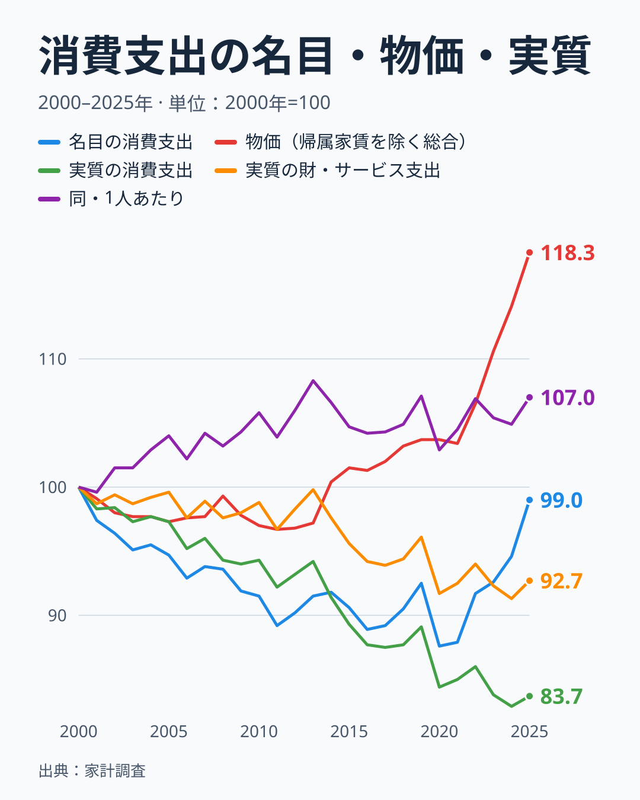

名目の消費支出は、2000年代に下がり続け、2010年に91.5、2015年に90.6、2019年に92.5と、9割前後で長く横ばいになりました。2020年は87.6まで落ち、その後は物価の上昇に押し上げられるように94.6（2024年）、99.0（2025年）と戻っています。2025年の名目が2000年の水準近くに戻ったように見えるのは、家計が元に戻ったからではありません。物価が同じ期間に118.3まで上がったので、同じ金額で買える量が減っているのです。実質の消費支出は、2024年に82.9、2025年に83.7で、2000年より16%ほど低い位置にいます。

ここで一つ注意が要ります。実質は「名目支出を物価指数で割った概算」であって、購入量そのものではありません。物価指数は同じ品質の商品の値段を追うので、安い商品への乗り換えがあれば、実際の購入量の減りは実質の減り方より小さく出ます。あくまで「物価が指数どおりに上がった世界で、家計がどれだけ使ったか」の目安として読んでください。

実質の消費支出が16%減っているうち、大きな部分を占めるのが、こづかい（使途不明）、交際費、仕送り金です。この3項目は、2000年の消費支出の15.7%を占めていましたが、2025年は6.5%です。消費支出からこの3項目を除いたものが、家計調査の「財・サービス支出計」にあたり、名目では3,211,169円から3,521,756円へ9.7%増えています。物価で割った実質は92.7（7.3%減）で、世帯人員で割った1人あたりでは107.0です。世帯人員の平方根で割る等価尺度で見ると、92.7÷0.931（0.867の平方根）で99.6になります。1人あたりの財・サービスの実質は、2000年から2019年まで99.6から108.3（最大は2013年）の間で動き、2019年は107.1でした。2020年に102.9へ落ち、2025年は107.0まで戻っています。

つまり、買い物（財・サービス）に限れば、1人あたりの実質は、人数で単純に割ると25年前より約7%多く、等価尺度で割ると同じ水準です。こづかいの一部が他の品目に記録し直された可能性もあり、その場合は財・サービスの伸びが実際より大きく出るので、下限は0%を下回りうるとも読めます。1人あたりの伸びは「0〜7%を目安とした幅」で読むのが安全です。消費支出の実質16%減は、こづかい・交際費・仕送り金の減少（83.7から92.7へ、約9ポイント）と、世帯人員の減少で、ほとんどが説明できます。ただし、財・サービスの内訳は大きく入れ替わっていて、増えた品目と減った品目が打ち消し合っています。次の節から、その入れ替えを見ていきます。

> [!NOTE]
> 2020年は新型コロナウイルスの感染が広がった年で、外食や旅行が大きく落ちました。1人あたりの財・サービスの実質は、2019年の107.1から2020年の102.9へ下がり、その後に戻りましたが、被服など一部の費目は戻っていません。どの費目が感染症の影響で、どの費目が別の要因かは、この記事のデータだけでは切り分けられません。

## 調査される世帯が、25年で小さく、高齢に、持ち家に変わった

家計調査は、世帯の家計簿を毎月集計する標本調査です。二人以上の世帯の集計世帯数は、年次表で2000年が7,921世帯、2025年が7,261世帯でした。集計世帯数はほぼ同じ規模でも、描かれる「平均的な二人以上世帯」の顔ぶれは、日本社会の変化に合わせてゆっくり変わっていきます。

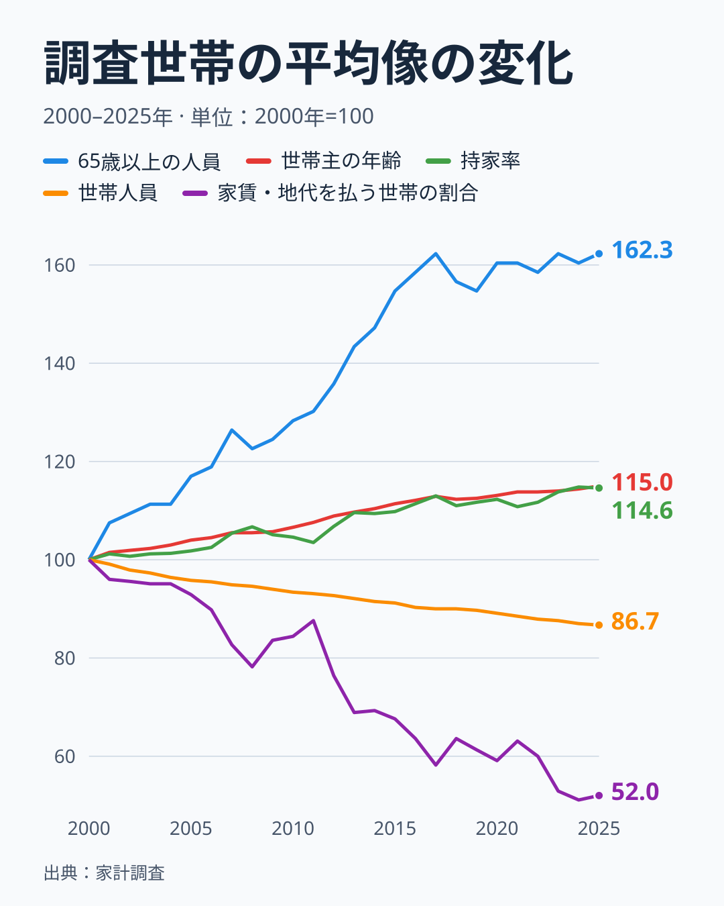

2000年と2025年を比べると、世帯人員は3.31人から2.87人へと13.3%減りました。18歳未満の人員は0.74人から0.52人へ、有業人員は1.52人から1.34人へ減っています。反対に、65歳以上の人員は0.53人から0.86人へと62%増え、世帯主の年齢は52.8歳から60.7歳へと上がりました。持ち家率は76.2%から87.3%へ上がり、家賃・地代を支払っている世帯の割合は22.5%から11.7%へほぼ半分（52.0）になっています。

この変化は、そのまま買い物の中身に響きます。たとえば家賃地代は、1世帯あたり138,445円から97,134円へ30%も減っています。ここで起きているのは「家賃の水準が下がった」ことではなく、「家賃を払う世帯の割合が、二人以上世帯の推計で半分に減った」ことです。持ち家の世帯は家賃を払いませんから、家賃を払わない世帯の割合が増えれば、全体の平均は自然に下がります。教育費も同じで、18歳未満の人員が3割減れば、授業料や補習教育の平均は下がります。

この図が示すのは「二人以上世帯の平均像がどう変わったか」であって、同じ人が25年かけて買わなくなったという話ではありません。

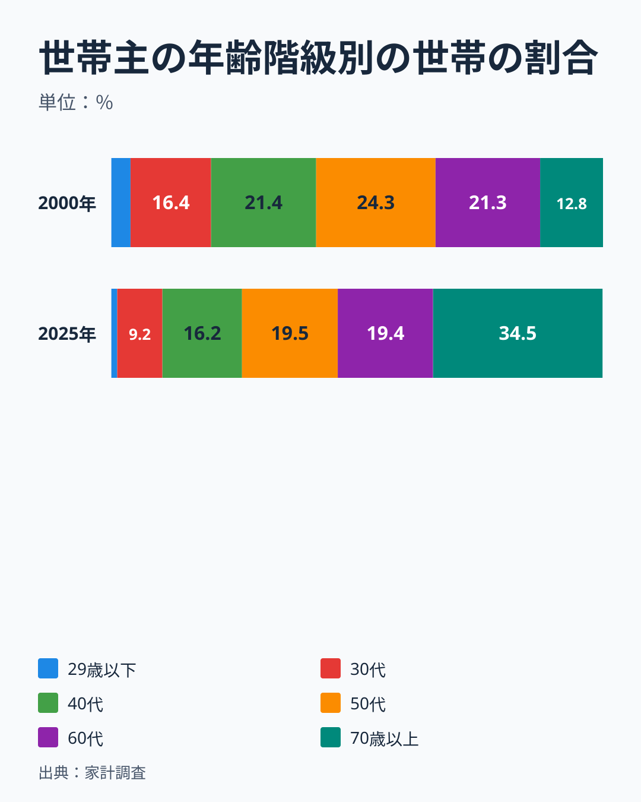

世帯主の年齢階級別に世帯の割合を見ると、変化はもっと極端です。2000年は、30代が16.4%、40代が21.4%、50代が24.3%、60代が21.3%、70歳以上が12.8%（29歳以下は3.9%）と、働き盛りの世帯が中心でした。2025年は、70歳以上が34.5%と最大の階級になり、30代は9.2%、40代は16.2%、50代は19.5%、60代は19.4%、29歳以下は1.2%まで縮んでいます。二人以上の世帯の3分の1以上を、世帯主が70歳以上の世帯が占める調査になった、ということです。

この割合は、抽出率の違いを調整した二人以上の世帯の推計で、日本全体の世帯の年齢分布そのものではありません。二人以上の世帯に限っているため、若い単身世帯は含まれず、単身世帯の増加はこの図に現れていません。29歳以下（1.2%）のように集計世帯数が少ない階級は、推計の誤差も大きくなります。この記事の数字は、いずれも「その年の二人以上世帯の平均」です。

> [!WARNING]
> 世帯の平均像が変わっているため、「25年前の家計」と「いまの家計」の差には、買い方の変化と世帯の構成の変化が混ざっています。この記事では、1人あたりに直した数字と、世帯主の年齢構成をそろえた試算で、混ざりを部分的にほどきます。

## 年齢構成を2000年のままにそろえると、見え方が変わる

世帯主の年齢階級別の平均支出（6階級）が手に入るので、次の試算をしました。2025年の階級別の平均支出に、2000年の世帯の割合（階級ごとの重み）を掛けて合算します。これは「世帯主の年齢構成が2000年のままだったら、2025年の家計はどうなっていたか」を表します。この値を、実際の2025年と比べれば、年齢構成の変化による差が分かります。数値はすべて名目で、2000年の合算値を100とした指数です。試算に入れた8項目は、全体の消費支出、食料、この記事で取り上げる魚介類と被服、世帯の変化の影響が出そうな家賃地代・教育・外食・保健医療です。8項目の選び方に決まった基準はありません。自動車等関係費、肉類、こづかい類は、本文で別に触れます。

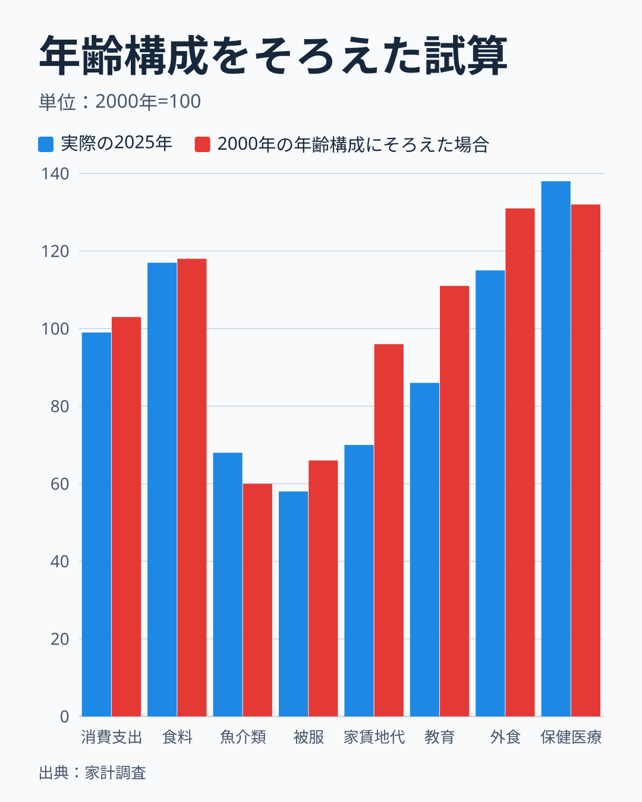

消費支出は、実際の2025年が2000年比で99.0です。2000年の年齢構成にそろえると103.2で、約4ポイント高くなります。高齢化は、家計全体の支出を4ポイントほど押し下げた計算です。階級別に見ると、2000年から2025年の消費支出は、29歳以下が103、30代が105、40代が98、50代が100、60代が109、70歳以上が110と、どの階級もほぼ横ばいか微増でした。それなのに全体が99.0へ下がるのは、支出の多い40代や50代の世帯が減り、支出の少ない70歳以上の世帯が増えたためです。70歳以上の2025年の平均は3,171,989円で、50代の4,411,710円より3割近く少なくなっています。

差がはっきり出るのは、家賃地代、教育、外食です。家賃地代は、実際が70.1、年齢構成をそろえると96.0で、30ポイント減ったうち26ポイントは年齢構成で説明できます。教育は、実際が85.6、そろえると110.8で、年齢構成が同じなら増えていたはずの支出が、世帯主の高齢化で減って見えています。外食は実際が114.6、そろえると131.0です。自動車等関係費も、実際が141、そろえると157でした。これらは「買わなくなった」というより「その費目にお金を使う年代の世帯が減った」費目と読めます。

食料の金額は、実際が117.0、そろえると117.5で、ほとんど差がありません。ただし、消費支出に占める割合は別です。年齢構成を2000年にそろえると、食料の割合は29.1%（実際は30.2%）で、2000年の25.6%からの上昇4.6ポイントのうち、約1.1ポイント（約4分の1）が年齢構成の効果で、残りは別の要因です。名目の食料費が増えた主な要因は、食料の物価上昇（25年で約44%）と読めます。基準年を逆にして、2000年の階級別平均に2025年の割合を掛けた試算（年齢構成だけが2025年に変わった場合）でも、消費支出は94.6、食料は98.3、家賃地代は74.2、教育は76.6で、向きは同じでした。基準年を入れ替えても、結論は変わりません。

反対に、魚介類は、実際が68.1、年齢構成をそろえると59.8で、そろえたほうが減少が大きくなります。2025年は70歳以上が魚介類への支出が最も多い階級（96,317円）で、高齢化はむしろ魚介類の支出を支えていた側にあたります。年齢別に見ても、魚介類の1世帯あたり年間支出は、どの階級でも減りました。括弧内は2000年を100とした2025年の値です。29歳以下は37,814円から30,640円へ（81）、30代は60,149円から43,812円へ（73）、40代は102,469円から58,268円へ（57）、50代は134,979円から65,799円へ（49）、60代は135,736円から80,353円へ（59）、70歳以上は124,270円から96,317円へ（78）です。最も減ったのは40代と50代で、半分近くになっています。

被服も同じ向きです。実際が58.4、そろえると66.1で、年齢構成で説明できるのは8ポイント程度です。残る34ポイントは、同じ年齢階級の中で服への支出が減った分ですが、この中には世帯人員の減少が含まれます。1人あたりに直すと、被服の名目支出は62,460円から42,077円へ、2000年を100として67です（1世帯では58）。世帯人員の減少で約9ポイント分が説明できても、1人あたりで3割以上減っていることに変わりはありません。保健医療は、実際が138.2、そろえると132.2で、年齢構成の影響を除いても3割以上増えています。

つまり、被服や魚介類の減少は、世帯主の年齢構成だけでは説明できません。同じ年齢階級の中でも減っているからです。ただし、この試算は6つの年齢階級だけで構成をそろえたもので、世帯人員、持ち家率、価格、世代交代（同じ70歳以上でも、2025年と2000年では生まれた世代が違う）は調整していません。「買い方そのものが変わった」と言い切るには、世帯人員や世代まで分けた分析が必要で、ここでは「年齢構成では説明できない部分が残る」と読むのが安全です。

## 費目別の実質を見ると、被服は半減、交通・通信と保健医療は2割5分増

10大費目それぞれの年間支出を、対応する消費者物価指数の年平均で割って、実質の指数にしました。食料は食料の物価、被服及び履物は被服及び履物の物価、というように対応させています。住居は持家の帰属家賃を除く住居の物価を使いました。

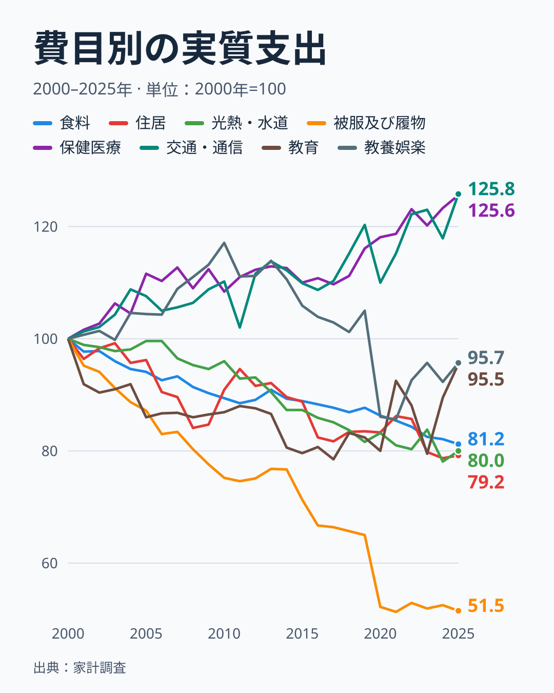

2025年の実質は、交通・通信が125.8、保健医療が125.6と、2割5分ほど増えました。一方、被服及び履物は51.5とほぼ半分です。食料は81.2、光熱・水道は80.0、住居は79.2で、いずれも2割ほど減っています。教養娯楽（95.7）と教育（95.5）は、ほぼ横ばいに近い位置です。この図に載せていない家具・家事用品は、実質で125.5と増えました。家具・家事用品の物価が25年で約1割下がっている（2020年基準で135.4から121.6）ためで、名目の12.7%増に対して、価格の低下が購入量の増加を支えた形です。

食料の動きは少し複雑です。名目の食料支出は973,680円から1,138,736円へ17%増えていますが、食料の物価はそれ以上に、約44%（2020年基準で87.3から125.8）上がりました。名目では増えて見える食料費が、実質では19%減っているのは、物価に押し上げられた分を除いたからです。光熱・水道も同じ構図で、名目の13.5%増に対して、光熱・水道の物価が約42%上がっています。

教育は、図の右端に注意してください。2023年に79.5まで下がっていた実質の線が、2024年に89.5、2025年に95.5へ上がっています。2025年については、支出が増えたことに加えて、教育の物価指数が2024年の101.6から2025年の97.1へ下がったことで、割り算の結果が持ち上がった面があります。物価指数が下がった理由は、この記事では確かめていません。教育の最後の数点は、割り算の相手（物価）の動きを含んだ値として読んでください。

変化がいつ起きたかも、この図から読み取れます。食料の実質は、2010年に89、2019年に88と、2010年代にはほとんど動かず、2025年の81へ下がったのは、物価が急に上がった2020年代です。被服及び履物は2010年に75、2019年に65と、ゆっくり下がってきましたが、2020年に52へ1年で13ポイントも落ち、その後も戻っていません。保健医療は2010年の108、2019年の116、2025年の126と、10年ごとに少しずつ増えています。交通・通信は2019年の120から2020年に110へ下がり、2025年に126へ戻りました。教養娯楽は2010年に117と最も高く、2019年の105、2020年の86を経て、2025年は96です。全体の実質消費支出は、2010年の94、2015年の89と下がったあと、2019年の89から2020年の84へもう一段落ち、そのまま2025年の84に至っています。

つまり、この25年の実質の目減りは、2000年代と2010年代前半にゆっくり進んだ分と、2020年の1年に起きた段差、そして物価が上がった2020年代の分に分けられます。2020年の段差は被服や外食、教養娯楽に集中していて、感染症の拡大による外出の減少と重なります。ただ、同じ年の落ち込みから、被服がほとんど戻っていないことは、一時的な外出の減少だけでは説明しにくい点です。[仮説]として、在宅勤務の広がりや服装の自由化といった働き方の変化が、被服への支出を恒久的に引き下げた可能性があります。検証するには、世帯主の勤め先の規模や職業別の被服支出を比べる必要があります。

もう一つ、図に載せなかったのが「その他の消費支出」です。こづかい、交際費、仕送り金を含むこの費目は、名目で835,862円から565,120円へ、32%も減りました。対応する物価指数が無いため実質化はしていませんが、この動きは後の節で品目ごとに詳しく見ます。

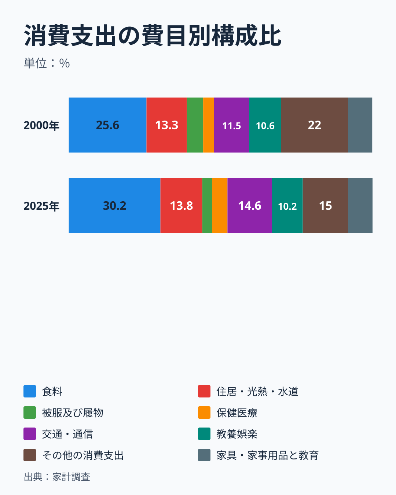

構成比で見ると、最も変わったのは食料です。2000年の25.6%から、2025年は30.2%へ上がりました。ここで使っているのは品目分類の食料で、公表されているエンゲル係数（用途分類の食料÷消費支出）とは範囲が違います。用途分類では、食料は2000年に月平均73,954円で消費支出の23.3%、2025年に89,754円で28.6%です。差の内訳はこの記事では確かめていないので、ここでは「品目分類の食料の構成比」と呼びます。上がっている向きは同じです。先の実質の図が示すように、食料の購入量が増えたからというより、物価が上がった分、同じ量を買うのにかかる金額が増えて、消費支出に占める割合が上がったと読めます。食料の割合の上昇には、世帯の高齢化も約4分の1ほど効いています。被服及び履物は5.4%から3.2%へ、その他の消費支出は22.0%から15.0%へ縮み、交通・通信は11.5%から14.6%へ、保健医療は3.6%から5.1%へ広がりました。教養娯楽は10.6%から10.2%で、ほとんど動いていません。

構成比は名目で計算しているため、物価の動きを含みます。名目と実質のどちらで見るかで、「食料が増えた」「食料は減った」と正反対の印象になりうる点は、この記事の全体を通して気を付ける必要があります。家計の暮らし向きを語るときは、金額の比率と、物価を除いた量の変化を、必ず分けて読みます。公表されているエンゲル係数の推移は[エンゲル係数の上昇と家計の苦しさ](/blog/engel-coefficient-rise-hardship-2025)で、2019年と2024年の10品目を比べた変化は[物価高前後の品目別の変化](/blog/household-spending-before-after-inflation)で読めます。この記事は、2000年からの25年間と、世帯主の年齢構成を分けた見方に絞っています。

## 食卓では、魚介類が実質で6割減り、調理食品と飲料が増えた

食料の中身に目を向けます。まず、食料の12の中分類について、年間支出を対応する消費者物価指数で割り、2025年が2000年の何％かを並べました。

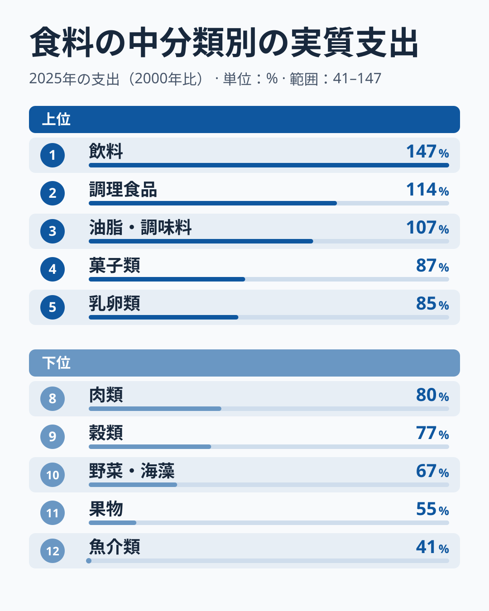

実質で最も増えたのは飲料の147%で、調理食品の114%、油脂・調味料の107%が続きます。逆に最も減ったのは魚介類の41%で、果物（55%）、野菜・海藻（67%）、穀類（77%）、肉類（80%）も2割から5割近く減っています（図は上位5・下位5だけを表示しています。ほかに酒類が84%、外食が85%、乳卵類が85%、菓子類が87%です）。飲料が増えた背景には、ミネラルウォーターや茶飲料のようなペットボトル飲料の広がりがありそうですが、これは[仮説]で、品目別の内訳は確かめていません。

魚介類が41%まで落ちた理由の大きな部分は、物価です。魚介類の消費者物価指数は25年で67%上がりました。名目の支出は68.1%と、3割強減っただけですが、同じ金額で買える量が値上がりで目減りした分を除くと、実質は4割強にまで落ちます。果物（物価82.5%上昇）や野菜・海藻（物価54.7%上昇）も、名目はほぼ横ばい（果物100.2%、野菜・海藻103.9%）ですが、物価の上昇で実質は大きく減っています。一方、飲料の物価はこの25年で3%しか上がっていません。

次の図は、魚介類・肉類・調理食品・外食への年間支出（名目・円）の推移です。

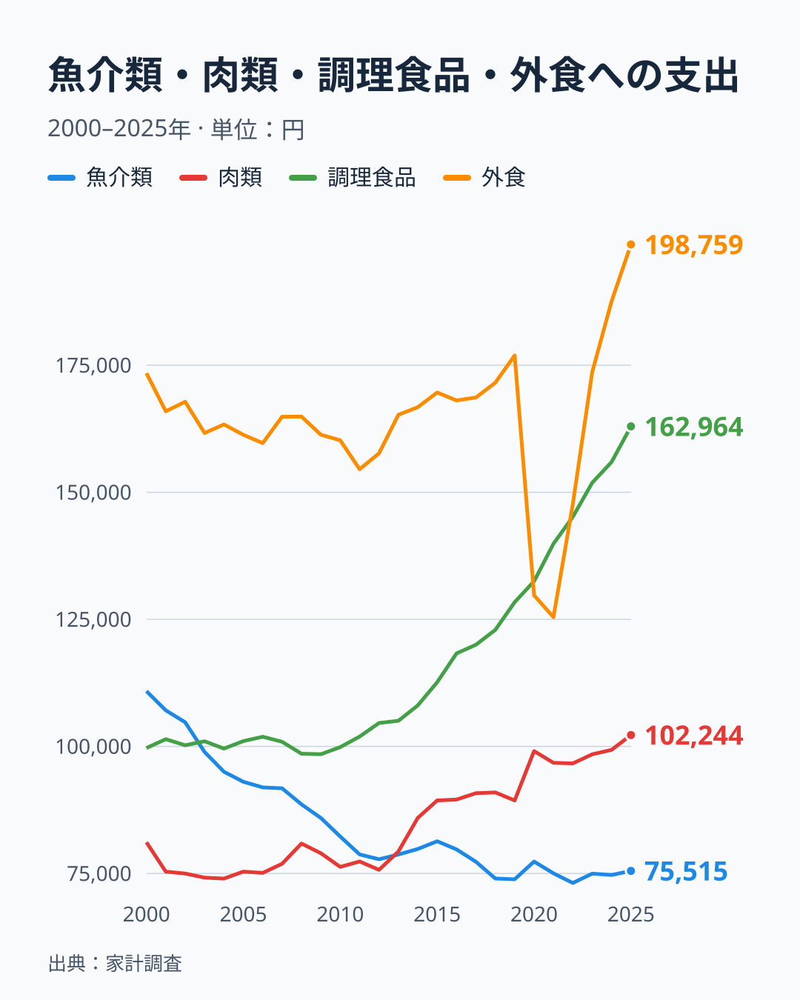

魚介類への支出は、2000年の110,868円から、2022年の73,136円まで低下し、2025年は75,515円でした。25年で32%の減少です。肉類は同じ期間に81,140円から102,244円へ26%増え、2013年に肉類（79,327円）が魚介類（78,739円）を初めて上回りました。この年を境に、魚と肉の支出の関係は入れ替わり、その後は差が開き続けています。調理食品（総菜や弁当、冷凍食品など）は、2000年の99,691円から2025年の162,964円へ63%増えました。魚介類を上回ったのは2003年です。

ここで注意したいのは、名目と実質で肉類の見え方が変わる点です。名目の肉類は26%増えましたが、肉類の物価が58%上がったため、実質では80%、つまり2割減になります。けれども、後の節で見るように、鶏肉と豚肉の購入グラム数は増えています。これは、物価指数が追う「同じ商品の値上がり」と、家計が実際に払った購入単価の上がり方が違うためで、肉類では購入単価の上昇のほうがずっと小さく出ています（後述）。実質の数字を、そのまま「量が2割減った」と読むのは危険です。

世帯の人数が減ったことの影響を取り除いても、傾向は残ります。1世帯の支出を世帯人員で割ると、魚介類は1人あたり33,495円から26,312円へ21%減り、肉類は24,514円から35,625円へ45%増えました。人数が減った分を差し引いても、魚は減り、肉は増えています。年齢別に見ても、肉類の支出はどの階級でも増えました（29歳以下143%、30代141%、40代127%、50代120%、60代133%、70歳以上149%）。魚から肉への入れ替わりは、特定の世代の話ではなく、世代を問わず進んだ変化です。背景として、調理のしやすさや保存性が考えられますが、[仮説]として扱います。

外食は、2019年の176,917円から、2020年に129,726円、2021年に125,423円へ大きく落ち込みました。これはコロナ禍の外出制限の影響が大きい期間で、2023年に173,639円と2000年の173,430円の水準まで戻り、2024年に187,598円、2025年に198,759円と、その水準を超えました。外食の戻りには、実際の来店回数だけでなく、外食の価格上昇が含まれている点に注意してください。外食の物価は25年で35%上がっており、実質では85%です。

## 数量で見ると、いか・スーツ・みかんが3分の1に

金額は物価の影響を受けますが、購入数量は物価に左右されません。家計調査には、品目ごとの1世帯あたり年間購入数量（グラム、リットル、台、枚など）の表があります。数量表の末端品目185のうち、2000年から2025年まで26年分の数量がそろうのは176品目で、さらに2000年と2025年の支出額がどちらも1,000円以上のものが136品目あります。ここから、「その他」を含む名称の品目、家賃、名称に年次の接続注記が付く品目、2010年に範囲が変わった発泡酒の計19品目を除いた117品目を比べ、2025年の数量が2000年の何％かを計算しました。つまり、図の順位は「2000年から2025年まで接続できた117品目の中での順位」です。2025年の分類改定で分割・統合された品目や、2025年に数量や金額が欠ける品目（ネクタイや婦人用ストッキングなど）は、この比較に入りません。

数量はすべて1世帯あたりです。世帯人員が13.3%減っているので、1人あたりに直すと「減った」側は小さく、「増えた」側は大きく見えます。主な品目の1人あたりの値は本文で併記します。

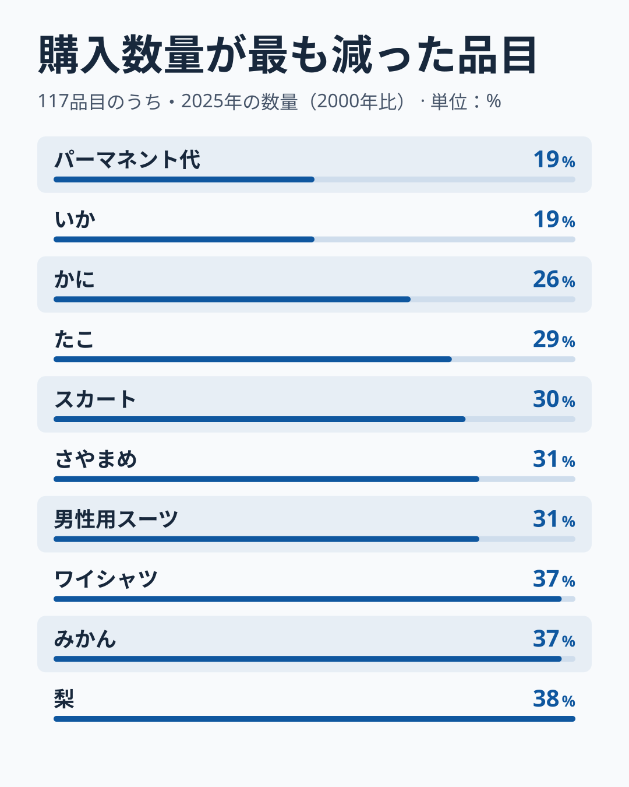

最も減ったのは、パーマネント代（19%）といか（19%）で、1世帯あたりでは25年で5分の1です。かに（26%）、たこ（29%）が続きます。魚介類では、このほかにあさり（13%）、あじ、いわし、さんま、さばといった身近な魚も、27%から35%に下がっています（これらは2025年の支出額が1,000円を下回る品目があり、図には載っていません）。被服では、スカート（30%）、男性用スーツ（31%）、ワイシャツ（37%）が3分の1前後です。さやまめ（31%）、みかん（37%）、梨（38%）のように、季節の果物や野菜も減りました。1人あたりに直すと、いかは22%、男性用スーツは36%で、減少が世帯人員の減少だけでは説明できないことは変わりません。

パーマネント代が5分の1になった一方で、カット代は1.94回から2.24回へ16%増えています。美容院に行く回数は減っていないのに、パーマをかける回数だけが大きく減った、という入れ替わりが見えます。

端の年だけの偶然ではないかも確かめました。2000〜2002年の平均と2023〜2025年の平均で同じ比を作ると、いかは21%、かには28%、男性用スーツは37%、みかんは38%で、図の値と大きくは変わりません。真ん中の2010〜2014年平均は、いかが60%、スーツが66%で、減少が25年かけて少しずつ進んだことも分かります。ただし、スーツ・ワイシャツ・スカートは、2020年の1年だけで、それぞれ前年から34%、30%、27%ほど下がっています。この3品目の大幅な落ち込みには、2020年の働き方・外出の変化が重なっている可能性があります。

被服の数字は、ネクタイの8割減を扱った[ネクタイ・ストッキングの市場縮小の記事](/blog/necktie-stockings-market-shrink)と、同じ向きの変化です。ネクタイ・ストッキングは2025年の分類改定で接続できない品目なので、この記事の比較には入れず、そちらの記事に委ねます。装いの変化が背景にある可能性はありますが、このデータだけで原因を断定することはできません。

次の「いか消費量」ランキングは県庁所在市の値で、本文の全国値とは別の数字です。

<source-link href="/ranking/squid-consumption-quantity">いか消費量ランキングをもっと見る</source-link>

## 数量で見ると、エアコン・鶏肉・チーズ・コーヒーが増えた

反対側、数量が増えた品目も同じ117品目の条件で並べます。

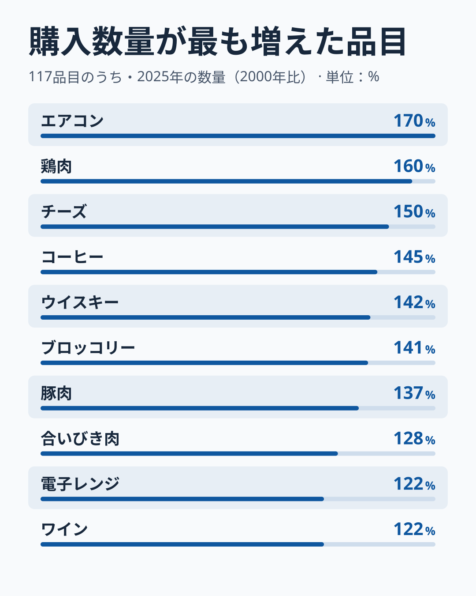

最も増えたのはエアコンで、1世帯あたり年0.064台から0.109台へ、170%になりました（1人あたりでは約196%）。2025年の購入数量は0.109台、およそ9世帯に1台のペースです。次いで鶏肉が160%、チーズが150%、コーヒーが145%、ウイスキーが142%、ブロッコリーが141%、豚肉が137%、合いびき肉が128%、電子レンジとワインがともに122%です。

食品では、肉と乳製品、そしてコーヒーと洋酒が共通して増えています。鶏肉は1世帯あたり11,697グラムから18,659グラムへ（1人あたりでは約185%）、豚肉は16,217グラムから22,142グラムへ増えました。同じ肉でも牛肉は10,134グラムから5,401グラムへ、53%に減っています（1人あたりでも約61%）。肉が全体として増えたのではなく、鶏肉と豚肉が増え、牛肉は減ったという入れ替わりです。牛肉は支出額が80、数量が53、1グラムあたりの購入単価が150で、値段の上昇と数量の減少が重なっています。

コーヒーは、1,713グラムから2,481グラムへ増え、緑茶（1,213グラムから593グラムへ49%）とは反対の動きでした。ウイスキーとワインの増加は、ビール（50.39リットルから25.11リットルへ、ほぼ半分）や清酒（50%）の減少と対になっています。酒類全体の中で、何を飲むかが入れ替わったことを示しています。

増えた品目の中にエアコンと電子レンジがあることにも注意が要ります。エアコンは2009年の0.069台から2010年の0.102台へ48%も跳ね上がった年があり、年ごとのばらつきが大きい品目です。2000〜2002年平均と2023〜2025年平均で比べても151%で、増加の向きは変わりません。耐久財は、1世帯が毎年買うものではなく、買い替えの時期にまとめて購入するため、標本の中での偶然の影響を受けやすい点には注意してください。

2010年の発泡酒は、この図から外した品目です。発泡酒の購入数量は、2009年の18.13リットルから2010年の27.38リットルへ、1年で51%も増えました。同じ年に「他の酒」の支出額は5,004円から2,703円へほぼ半減し、2つの合計は2009年が11,142円、2010年が11,486円とほぼ連続しています。飲み方が急に変わったというより、品目の範囲が変わった可能性が高い、というのが[仮説]です。総務省統計局の[2023年の検討資料](https://www.stat.go.jp/info/kenkyu/skenkyu/pdf/20231120_01.pdf)は、発泡酒の品目名が「発泡酒・ビール風アルコール飲料」であったことを示していますが、2010年の変化の理由は書いていません。2010年1月の品目分類の改定内容との照合は、この記事では未検証です。

「鶏肉消費量」ランキングも県庁所在市の値です。

<source-link href="/ranking/chicken-consumption-quantity">鶏肉消費量ランキングをもっと見る</source-link>

## 金額が増えたのは、量が増えたのか、値段が上がったのか

最後に、金額の動きを「数量」と「単価」に分けて見ます。単価は、年間支出額を年間購入数量で割った平均的な購入単価です。次の図は、6品目について、2025年の金額・数量・単価を、2000年を100として並べました。数量は1世帯あたりです。

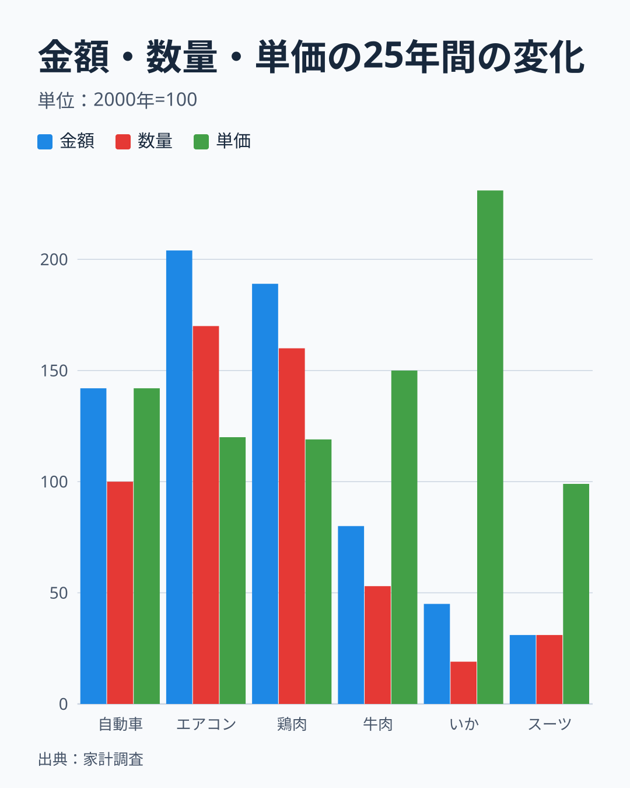

自動車購入は、金額が142で、数量は100とほとんど変わっていません。1世帯あたりの購入台数は、2000年も2025年も0.056台ほどです（18世帯に1台）。世帯人員が減った分を考えると、1人あたりの台数は約15%増えた計算です。金額が4割増えたのは、1台あたりの購入価格が上がったためで、台数が増えたからではありません。エアコンは金額が204、数量が170、単価が120で、増加の大半は台数の増加です。鶏肉も金額189に対して数量160、単価119と、量の増加が主役です。

牛肉は金額が80、数量が53、単価が150でした。単価が5割上がり、購入量は半分近くまで減っています。いかは単価が231と2.3倍になり、数量が19まで落ちています。魚介類の減少は、好みの変化だけでなく、単価の上昇と重なっています。ただし、この表だけでは、需要が減ったから量が減ったのか、不漁などの供給の事情で値段が上がったから量が減ったのかは分けられません。男性用スーツは単価がほぼ同じ（99）で、数量が31まで下がり、金額も31です。値段が高くなったのではなく、買う頻度そのものが減った品目として、牛肉・いかとは区別できます。

同じ見方で、2025年の米を確かめると、米は購入数量が99.24キログラムから61.31キログラムへ減り、62%になっています。1キログラムあたりの購入単価は、2000年の406円から、2010年に345円、2020年に371円、2023年に360円と300円台後半で推移したあと、2024年に452円、2025年に697円へ上がりました。2025年の米の支出額（42,739円）が2000年の40,256円とほぼ同じなのは、量が減って値段が上がった結果で、同じ金額で買えるお米が6割強になったことになります。米の価格上昇の理由は、この記事では確かめていません。

ここで、物価指数と購入単価の違いにも触れておきます。4品目で比べると、鶏肉は消費者物価指数が25年で51%上がり、購入単価の上昇は19%です。米は物価指数が90%、購入単価が72%、いかは物価指数が168%、購入単価が131%でした。豚肉は、物価指数の対象が国産品に限られ（69%上昇）、購入単価（19%上昇）は国産と輸入を合わせた平均なので対象が違いますが、向きは同じです。この4品目では、家計が実際に払った平均単価の上昇は、物価指数の上昇より小さく出ています。物価指数は、銘柄や容量をそろえた同じ商品の値段を追います。購入単価は、その年に家計が実際に選んだ商品の平均です。安い部位や大容量、特売品への乗り換えがあれば、購入単価の上昇は物価指数より小さくなります。[仮説]として、家計は値上がりに対して、買う量を減らすだけでなく、安い商品へ切り替えることで対応していた可能性があります。ほかの品目に一般化できるかは確かめていません。検証するには、同じ品目の価格帯別の購入や購入先別の表が必要です。

この違いは、最初に示した「実質で16%減」の読み方にも響きます。物価指数どおりに値上がりした商品を買い続けた場合の換算が実質16%減であって、安い商品への乗り換えが進んでいれば、実際の購入量の減り方はこれより小さい可能性があります。

数量の表の記録は、小数点以下3桁の台数など、小さい値を丸めたものです。台数の比較は±1%程度の丸めの幅を含むので、自動車購入の数量が「ちょうど100」であることは、「ほぼ同じ」と読むのが安全です。

「エアコン購入数量」ランキングも県庁所在市の値です。

<source-link href="/ranking/air-conditioner-consumption-quantity">エアコン購入数量ランキングをもっと見る</source-link>

## 固定電話から携帯電話へ、新聞と書籍は3分の2に

数量が測れない通信とメディアの支出を、金額で見ます。

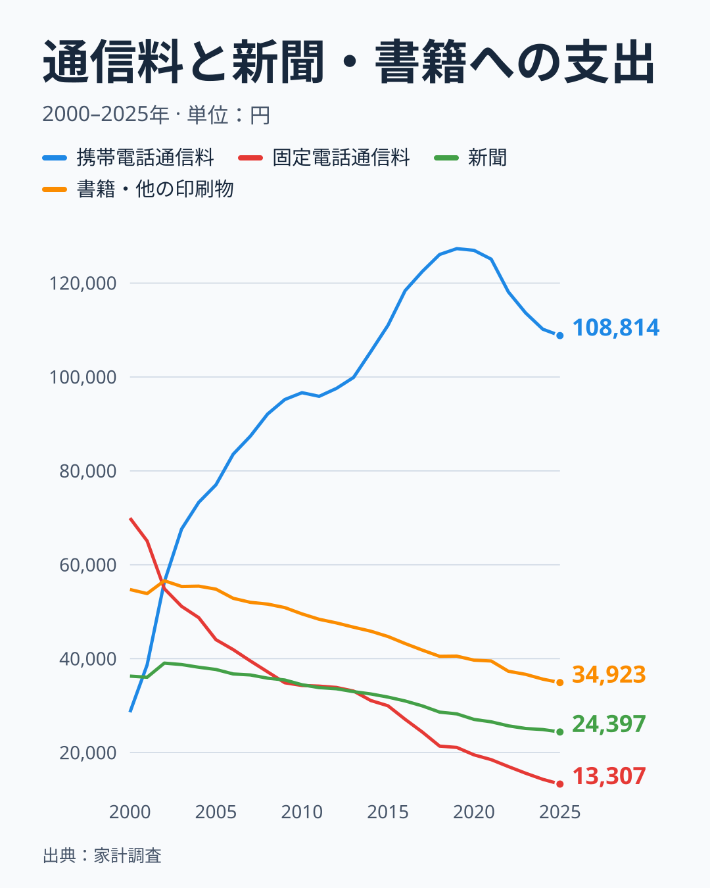

固定電話の通信料は、2000年の69,956円から2025年の13,307円へ、81%減りました。携帯電話の通信料は、同じ期間に28,598円から2019年の127,336円まで増えました。2002年前後で、携帯電話が固定電話を追い抜いています。その後、携帯電話は2019年をピークに下がり、2025年は108,814円（2024年は110,180円）です。2つの合計は、98,554円から122,121円へ24%増えていて、通信という費目の支出（114,393円から140,068円へ22%増）の増加を説明します。

先に費目別の図で、交通・通信の実質が約25%増えたと示しました。交通・通信の物価指数は2000年の100.6から2025年の100.0とほぼ横ばいなので、実質の増加は名目の増加（25.1%増）にほぼ等しくなります。中身は、通信の増加（114,393円から140,068円へ）と、自動車等関係費の増加（240,842円から340,255円へ41%増。うち自動車購入は台数がほぼ同じで金額が4割増）に分かれます。「通信が増えた」とは言えますが、交通・通信の実質の増加を、通信だけの増加と読むのは正確ではありません。

携帯電話の通信料が2019年以降に下がった理由は、この記事のデータからは分かりません。料金プランの変更や乗り換えなどが考えられますが、検証していない[仮説]です。確かめるなら、同じ時期の通信料に関する消費者物価指数の動きと、世帯の契約状況を別の調査で照合する必要があります。

新聞は36,288円から24,397円へ33%減り、書籍・他の印刷物は54,742円から34,923円へ36%減りました。印刷された情報への支出は、25年で3分の2ほどに縮んでいます。通信とメディアをあわせて見ると、通信は増え、紙は減るという入れ替えが起きています。ただし、インターネット接続料や動画配信などの支出は、別の費目に入る部分があり、「紙から電子へ」の移行を正確に測るには、それらの品目を別に見る必要があります。インターネット接続料は2025年の分類で見ると35,447円ですが、2000年から続く系列としては24年分しか値がそろわないため、ここでは図に入れていません。

「携帯電話通信料消費支出額」ランキングも県庁所在市の値です。

<source-link href="/ranking/mobile-phone-bill-consumption-expenditure">携帯電話通信料消費支出額ランキングをもっと見る</source-link>

## こづかい・交際費・仕送り金は、25年で6割近く減った

最後に、「その他の消費支出」が最も縮んでいたことの中身です。

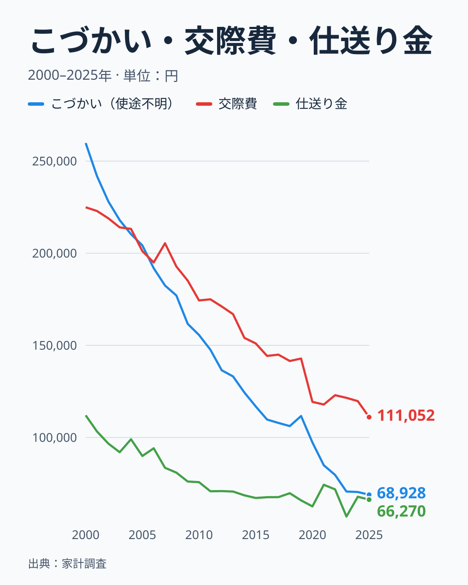

こづかい（使途不明）は259,812円から68,928円へ73%減りました。交際費は224,907円から111,052円へ51%減り、仕送り金は112,048円から66,270円へ41%減りました。3つを合わせると、1世帯あたり年間596,767円から246,250円へ、350,517円（59%）減っています。この減少額は、消費支出の名目の変化（39,930円減）より、はるかに大きい値です。つまり、家計全体の名目が横ばいだったのは、これらの支出の減少を、他の費目の増加（食料や通信、医療、自動車関係費など）が埋め合わせたためです。消費支出に占める割合では、この3つは15.7%から6.5%へ縮みました。

この3つは、食品や衣服のように品物を買う支出ではありません。こづかいは使い道を記録しない現金、交際費は贈答や会食など人づきあいの費用、仕送り金は別世帯への送金です。そのため、「買わなくなったもの」の一覧とは分けて読む必要があります。最初に示した「財・サービス支出」は、この3つを除いた支出のことです。

減った理由は、このデータからは分かりません。こづかいの減少には、使い道を記録する世帯が増えた可能性や、実際に自由に使える現金が減った可能性などが考えられますが、どちらも確かめていません。確かめるには、調査方法の変更の有無を統計局の資料で照合する必要があります。交際費は、会食や贈答にかかる支出が減ったのか、世帯主の人づきあいの範囲が縮んだのかを、この表では切り分けられません。

仕送り金のうち国内遊学仕送り金（大学生などへの仕送り）は、96,512円から49,155円へ減りました。この減少を世帯の構成の変化と結びつけるには、仕送りをしている世帯の割合などが必要で、この記事では確かめていません。

## まとめ: 買わなくなったもの・買うようになったもの

問いへの答えを整理します。

- **全体**: 名目の消費支出は25年で1.0%減（3,807,937円から3,768,007円）で、物価は約18%上がっているため、実質では16%減です。ただし、こづかい・交際費・仕送り金を除く財・サービスの支出に限ると、名目は9.7%増、実質は7.3%減、世帯人員で単純に割った1人あたりの実質は約7%増（等価尺度では横ばい）です。実質は物価指数どおりの値上がりを前提にした換算で、安い商品への乗り換えがあれば、実際の購入量の減りはこれより小さい可能性があります。
- **世帯主の年齢構成で説明できるもの**: 名目の家賃地代の減少30ポイントのうち26ポイント、教育費の減少は、世帯主を2000年の年齢構成にそろえると説明できます。外食や自動車等関係費の伸び悩みも同じです。これらは買い方の変化というより、その費目にお金を使う年代の世帯が減った変化と読めます。
- **買わなくなったもの（年齢構成だけでは説明できない）**: 被服及び履物（実質で48.5%減。名目では年齢構成をそろえても34ポイント減）、魚介類（実質で59%減。名目ではどの年齢階級でも減少）、固定電話（名目で81%減）。数量（1世帯あたり）では、いかが19%（1人あたり22%）、パーマが19%、スーツが31%、みかんが37%、米が62%まで縮みました。
- **買うようになったもの**: 保健医療（実質で約25%増）、携帯電話を中心にした通信、調理食品（実質で14%増）、飲料（実質で47%増）、鶏肉（数量160%、1人あたり約185%）、豚肉（137%）、チーズ（150%）、コーヒー（145%）、エアコン（170%）。交通・通信の実質の増加には、台数が変わらないのに1台の価格が上がった自動車関係費が含まれます。
- **買い物ではない支出の減少**: こづかい・交際費・仕送り金は合計で59%減りました。購入の変化とは分けて読みます。
- **読むときの限定**: 世帯人員が13%減り、65歳以上の人員が62%増え、家賃を払う世帯の割合が半分になるなど、二人以上世帯の平均像自体が変わっています。年齢構成をそろえた試算は6階級だけの調整で、世帯人員や持ち家、世代の違いは調整していません。数量の順位は、2025年の分類改定を含めて2000年から接続できた117品目の中のものです。

次に確かめたいのは、同じ年齢階級の中での、世帯人員や持ち家の有無による違いです。年収階級別の表と組み合わせれば、「所得が増えない中での取捨選択」と「世帯の変化」の切り分けがさらに進みます。家計調査の食費の全体像は、[食費・家計消費のテーマ](/themes/household-food-spending)でも確かめられます。

## データについて

出典は総務省統計局の「家計調査」家計収支編の、二人以上の世帯（農林漁家世帯を含む）・全国・年次の品目分類別の金額と数量です。2000年から2025年の暦年を使いました。品目分類は2025年1月に改定されており、統計局が2024年以前の値を新分類へ接続しています。この記事の図は、すべてその新分類の表の値から作りました。本文に出てくる、図に入っていない値（年齢階級別の平均、物価指数、3年平均、米の単価、集計世帯数など）は、補助値の一覧として図のデータとあわせて控えてあります。

世帯主の年齢階級別の試算には、同じ調査の世帯主の年齢階級別の金額表と数量表を使いました。年齢階級は、29歳以下、30〜39歳、40〜49歳、50〜59歳、60〜69歳、70歳以上の6区分で、世帯の割合は「世帯数分布（抽出率調整）」の値で、二人以上世帯全体の推計です。6階級の割合で合算した2000年の平均は、全体の平均と数百円以内（消費支出で424円）の差で一致しており、試算の計算に使える精度です。

実質化には、消費者物価指数（2020年基準・全国）の年平均を使いました。消費支出と財・サービス支出には「持家の帰属家賃を除く総合」、10大費目には食料・住居（持家の帰属家賃を除く）・光熱・水道・家具・家事用品・被服及び履物・保健医療・交通・通信・教育・教養娯楽のそれぞれの指数、食料の中分類には穀類・魚介類・肉類・乳卵類・野菜・海藻・果物・油脂・調味料・菓子類・調理食品・飲料・酒類・外食のそれぞれの指数を使っています。「その他の消費支出」には対応する物価指数が無いため、実質化していません。財・サービス支出は、家計調査が「財・サービス支出計」として表章している、消費支出からこづかい・交際費・仕送り金を除いた値です。

購入数量の比較は、数量表の末端品目185のうち、2000年から2025年の26年分がそろう176品目、その中で2000年と2025年の年間支出額がどちらも1,000円以上の136品目から、「その他」を含む名称、家賃、名称に年次の接続注記が付く品目、2010年に範囲が変わった発泡酒の19品目を除いた117品目です。単価は、年間支出額を年間購入数量で割った値で、物価指数とは異なります。

年報は暦年の合計です。標本の誤差があるため、小さい品目の数量では年ごとの動きが大きくなります。2000年と2025年の2点比較は端の年の偶然に左右されるので、主な品目では2000〜2002年と2023〜2025年の3年平均でも確かめました。
