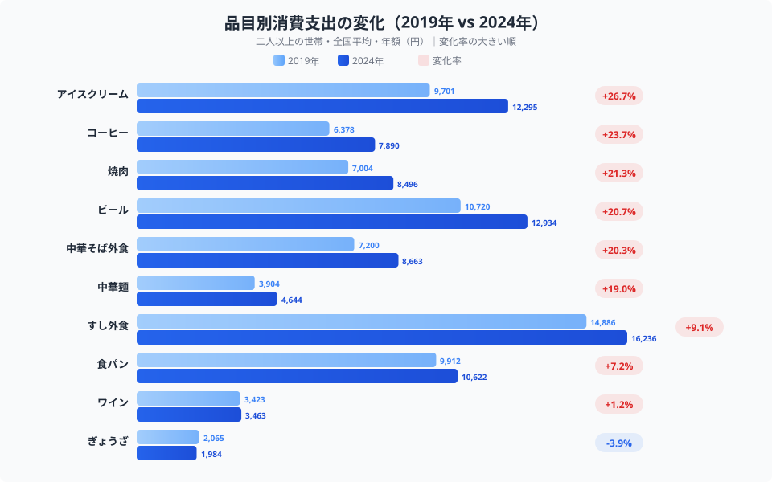
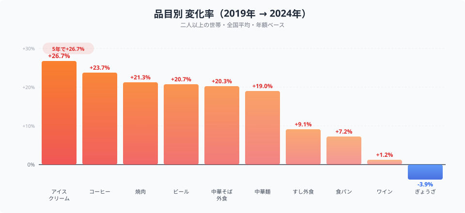
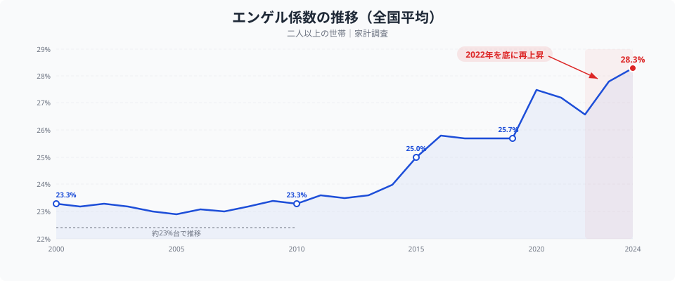

「給料は増えたのに、なぜか楽にならない」──多くの人が感じているこの違和感には、データの裏付けがあります。

2025年の名目消費支出は前年比+4.6%と増えていますが、**実質ベースではわずか+0.9%**。支出額の増加のほとんどは物価上昇に食われています。実質賃金は2年連続で減少し、4人家族の負担増は年間**約15.3万円**に達したとの試算もあります。

しかし、物価高は「全品目が一律に値上がりした」わけではありません。2019年と2024年を10品目で比べると、**9品目が増加した一方でぎょうざだけが3.9%減少**していました。品目ごとに増減が分かれており、支出額が減ったのはこの1品目だけでした。

> [!NOTE]
> データは総務省「家計調査」の二人以上の世帯・全国平均・年額です。2019年はコロナ前の「平時」、2024年は物価高が定着した直近年として比較しています。品目ごとの消費額には数量変化と価格変化の両方が含まれます。品目名は家計調査の収支項目分類によります。「中華そば外食」はラーメン・焼きそば・皿うどんなどの外食、「ぎょうざ」は生を含み冷凍品を含まない品目です（冷凍ぎょうざは「冷凍調理食品」に入るため、この記事の数値には含まれません）。値は e-Stat 統計表ID 0004023605（品目分類 2025年改定・年次・金額）から取得しました。

## 品目別にみる5年間の変化

<data-source url="https://www.stat.go.jp/data/kakei/" label="総務省 家計調査" note="二人以上の世帯・全国平均・年額"></data-source>

10品目中9品目が増加。減少したのは**ぎょうざだけ**です。

増加幅が最も大きいのは**アイスクリーム**（9,701円→12,295円、+26.7%）。次いで**コーヒー**（6,378円→7,890円、+23.7%）、**焼肉**（7,004円→8,496円、+21.3%）と、嗜好品・外食が上位を占めます。

金額ベースで最も増えたのは**アイスクリーム**の+2,594円で、次いで**ビール**が+2,214円（+20.7%）と、年間ベースでは無視できない増加です。**すし外食**は+1,350円（+9.1%）と変化率は控えめですが、もともとの金額が大きく、2024年の16,236円は10品目で最高額です。

外食と、近い自炊側の品目を並べてみます。中華そば外食は+20.3%で中華麺の+19.0%、すし外食は+9.1%で食パンの+7.2%でした。外食の伸びは自炊側をわずかに上回りますが、差は1〜2ポイント程度で、外食だけが突出して増えたとは言えません。品目の中身が違うため厳密な比較ではなく、外食が自炊より大きく上がったという結論は、このデータからは出せません。

## 変化率ランキング：最も値上がりした品目は？

<data-source url="https://www.stat.go.jp/data/kakei/" label="総務省 家計調査" note="二人以上の世帯・全国平均・年額ベース"></data-source>

**トップのアイスクリーム（+26.7%）は、ワイン（+1.2%）と約25ポイントの差**がついています。上位5品目（アイスクリーム・コーヒー・焼肉・ビール・中華そば外食）はいずれも+20%超です。[仮説] 上位の品目に共通するのは**原材料の輸入依存度が高い**ことかもしれませんが、本記事のデータでは検証していません。

- **アイスクリーム**: 乳製品・砂糖・植物油脂の国際価格高騰
- **コーヒー**: コーヒー豆の国際相場が2019年比で約2倍に上昇
- **焼肉**: 輸入牛肉・豚肉の価格上昇と円安のダブルパンチ
- **中華そば外食**: 小麦・食用油・人件費のトリプル上昇

一方、ワイン（+1.2%）がほぼ横ばいなのは、[仮説] 低価格帯のチリワイン・オーストラリアワインへのシフトが進んだ影響かもしれません。この点も本記事のデータでは検証していません。

> [!TIP]
> 輸入依存度の高い品目ほど円安の影響を直接受けます。1ドル=150円台が続く環境では、同じ数量を輸入するだけで支払いが増える構造です。[仮説] 「嗜好品が高くなった」という体感には、円安と輸入物価の上昇が重なった影響が含まれている可能性があります。この記事のデータでは、品目ごとの輸入依存度との関係は確かめていません。

<ad-slot></ad-slot>

## エンゲル係数の推移が示す構造変化

<data-source url="https://www.stat.go.jp/data/kakei/" label="総務省 家計調査" note="二人以上の世帯・全国平均"></data-source>

品目別の変化を「家計全体」に引き上げると、**エンゲル係数の推移**が構造変化を物語っています。

エンゲル係数（消費支出に占める食料費の割合）は、2000年代から2010年代前半まで**約23%台で安定**していました。ところが2013年頃から上昇に転じ、2019年には**25.7%**に。2020年に**27.5%**まで跳ね上がったあと、2022年の26.6%から物価高の中で再び上昇し、2024年には**28.3%**に達しました（家計調査・二人以上の世帯・全国、e-Stat統計表ID 0002070003）。

この約5ポイントの上昇が意味するもの。年間消費支出300万円の世帯であれば、食料費が23%（69万円）から28.3%（84.9万円）へ、**年間15.9万円の増加**に相当します。

> [!WARNING]
> エンゲル係数の上昇は「生活水準の低下」を直接意味するわけではありません。高齢化による外食増加や食の高付加価値化も一因です。ただし、実質賃金が下がる中でのエンゲル係数上昇は、**食費以外の支出を圧縮せざるを得ない状況**を示唆しています。

エンゲル係数の上昇が続く背景には、2つの構造要因があります。

**1つ目は「食料品の値上げ頻度」の変化**。2022年以降、食品メーカーの値上げは年間2万品目を超えるペースが常態化しています。かつて「価格改定は数年に一度」だった日本の食品市場は、半年〜1年サイクルの値上げが当たり前になりました。

**2つ目は「食費の下方硬直性」**。家賃や通信費と異なり、食費は完全にゼロにはできません。節約には限界があり、物価上昇分をそのまま吸収せざるを得ないのです。

## ぎょうざだけが減ったのはなぜか

10品目の中で唯一マイナスだった**ぎょうざ（-3.9%）**は、2,065円から1,984円への減少です。他の9品目が+1.2%〜+26.7%だったのと比べると逆向きですが、減少幅そのものは小さい点には注意が必要です。

家計調査の「ぎょうざ」は生を含み、冷凍品は含みません（冷凍ぎょうざは「冷凍調理食品」に分類されます）。つまり、この数値だけで「冷凍ぎょうざが売れなくなった」とは言えません。また、この表には数量の集計がなく、金額の減少が買う量の減少なのか単価の低下なのかは区別できません。

考えられる要因は、データからは確かめていない次の2つです。

**1. [仮説] 冷凍品など別の形への移行**。ぎょうざの冷凍品はこの項目の外にあるため、家庭で冷凍品へ切り替えた分は、ここでは減少として現れます。検証するには「冷凍調理食品」の金額と合わせて見る必要があります。

**2. [仮説] 外食回帰**。コロナ禍で自宅での食事が増えた反動で、ぎょうざ専門店などの外食を選ぶ機会が戻った可能性があります。ただし、外食側の品目別の金額はこの記事では扱っていません。

唯一のマイナスという事実から言えるのは、すべてを一律に切り詰めるのではなく、品目ごとに増減が分かれたということまでです。「手作りできるものは手作り」「譲れないものには投資」といった行動の説明は、このデータからは引き出せません。

> [!NOTE]
> 本記事で比較した「消費支出額の変化」は、数量変化と価格変化の両方を含んでいます。「金額が増えた=価格が上がった」ではなく、「買う量が増えた可能性」も含む点に注意が必要です。ぎょうざのように金額が減った品目でも、価格と数量のどちらが動いたかはこのデータだけでは分かりません。

<ad-slot></ad-slot>

## 都道府県別に見ると──物価高の地域差

物価高の影響は全国均一ではありません。消費支出は都道府県によっても異なり、食料費割合（エンゲル係数に近い指標）が高い県と低い県では、物価高の体感も異なります。

住む地域の消費構造を知ることで、物価高への対応策もより具体的になります。

あわせて見る: [消費支出ランキング](/ranking/consumption-expenditure-multi-person-households-per-month) / [食料費割合ランキング](/ranking/food-expenditure-ratio-multi-person-households) / [平均消費性向ランキング](/ranking/avg-propensity-to-consume-worker-households)

## まとめ

2019年と2024年の家計支出を10品目で比較した結果、物価高の「前と後」で明確な構造変化が確認できました。

- **9品目が増加、唯一の減少はぎょうざ（-3.9%）**。品目ごとに増減が分かれている
- **外食も軒並み増加**。焼肉+21.3%・中華そば外食+20.3%は上位に入る一方、自炊側の中華麺（+19.0%）との差は小さい
- **アイスクリーム+26.7%が最大**。上位は輸入原料に頼る品目が多い（[仮説]・未検証）
- **エンゲル係数は23%台→28.3%へ上昇**。食費以外の支出が圧迫される構造に変化

名目消費支出が増えても、実質賃金が追いつかなければ生活は楽になりません。「何が上がっているか」を品目単位で把握し、代替可能な支出から見直すことが、物価高時代の家計防衛の出発点です。
