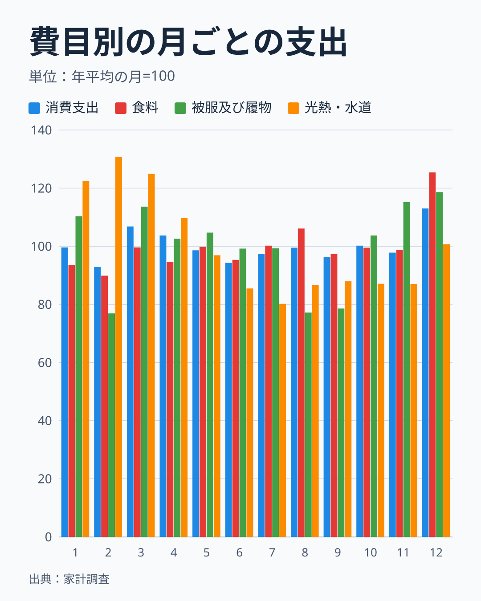
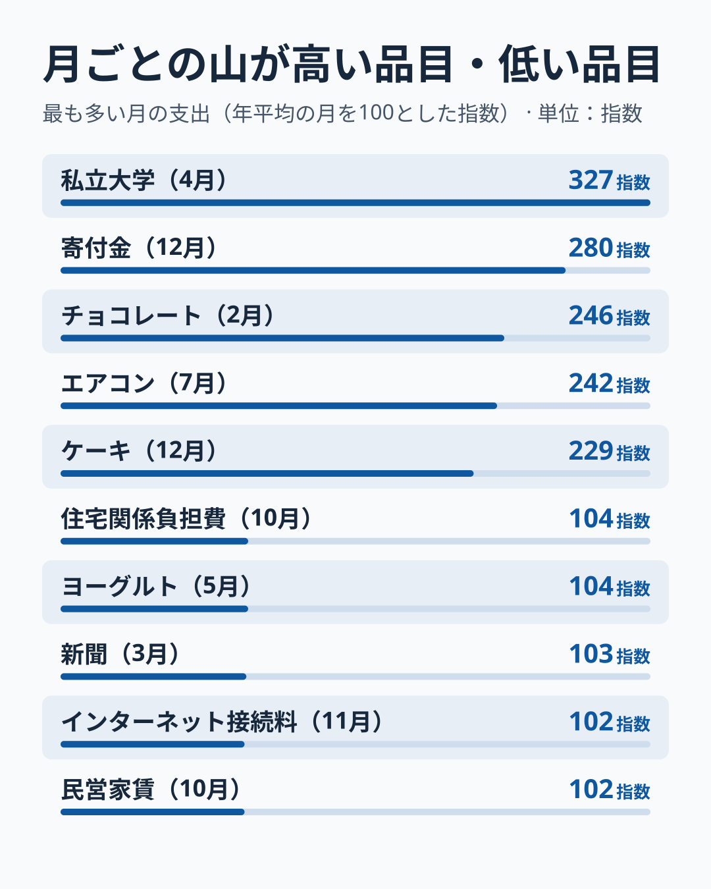
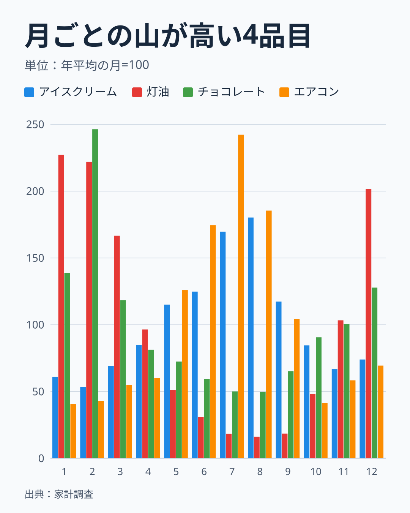
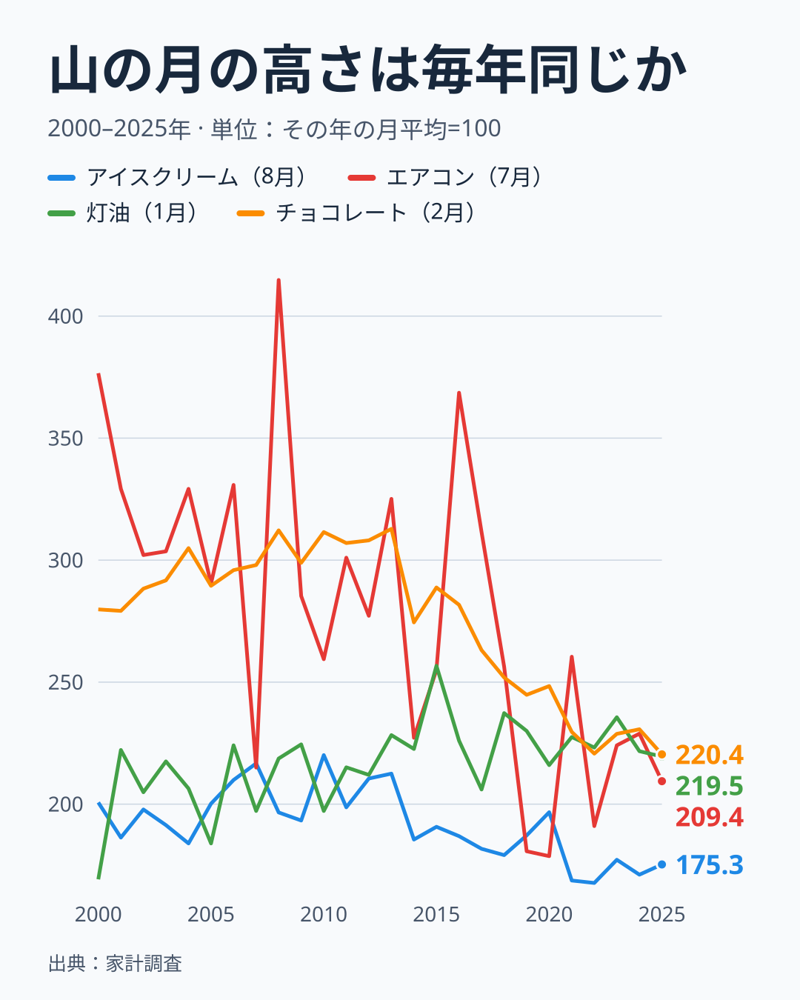
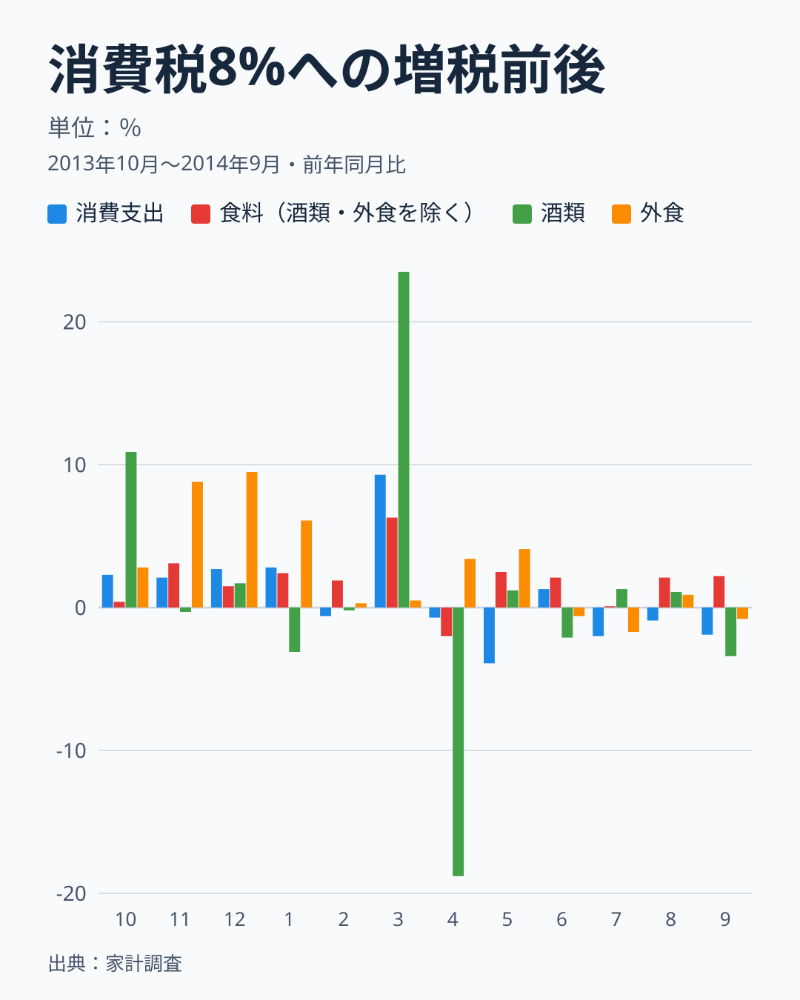
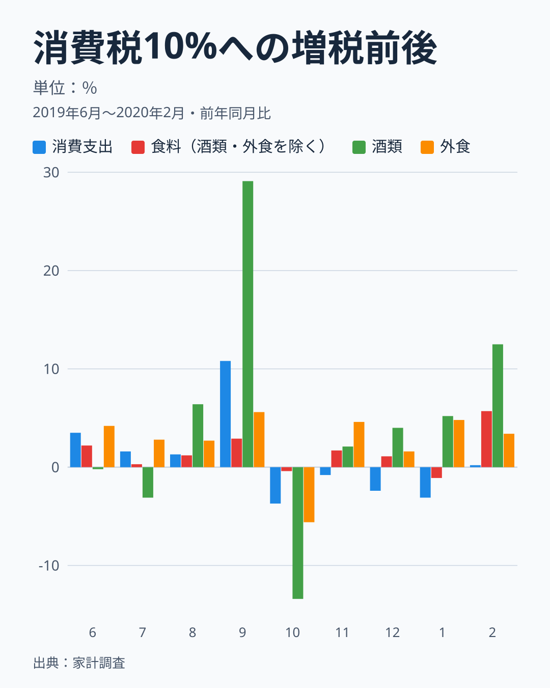
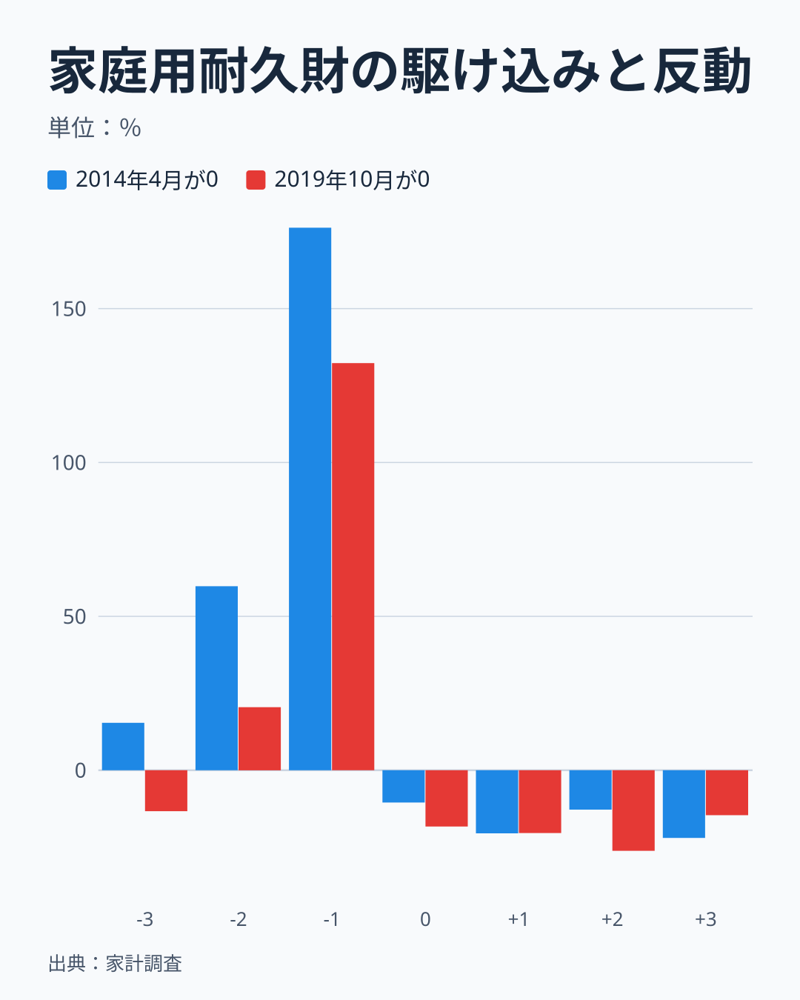
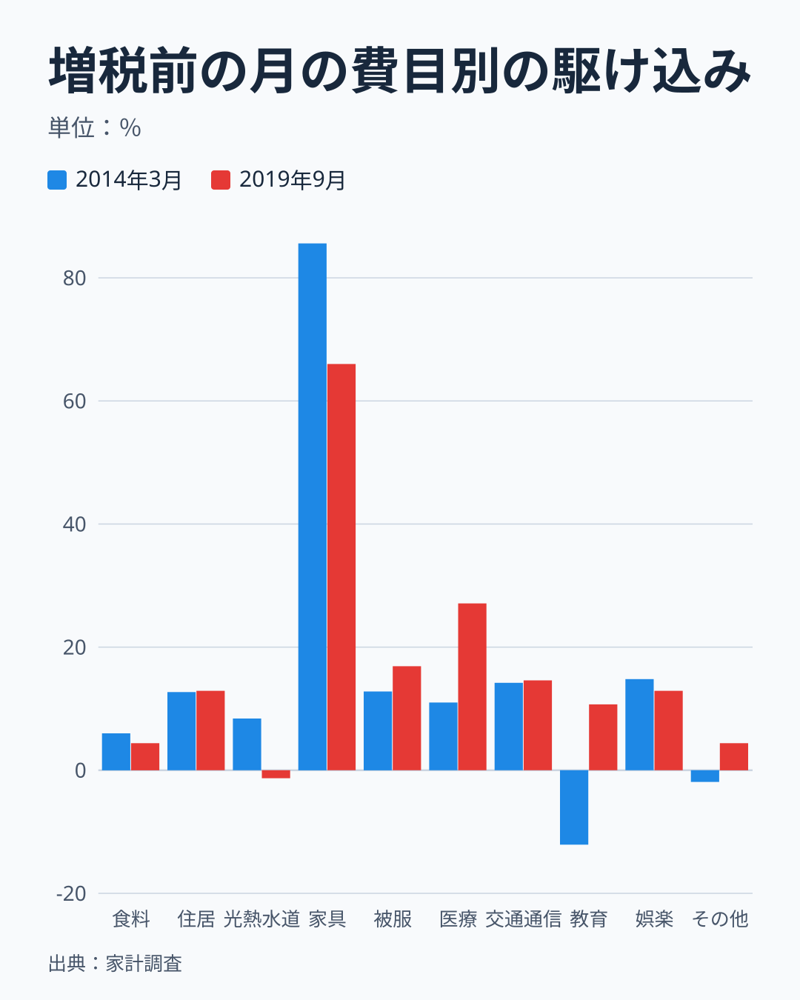
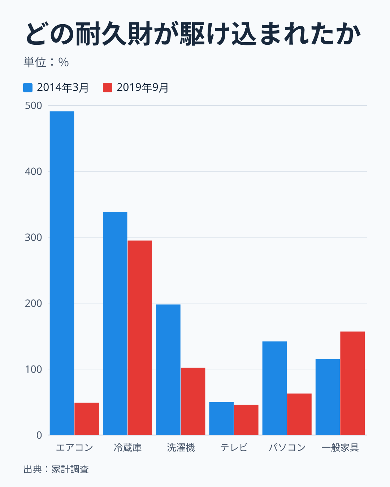
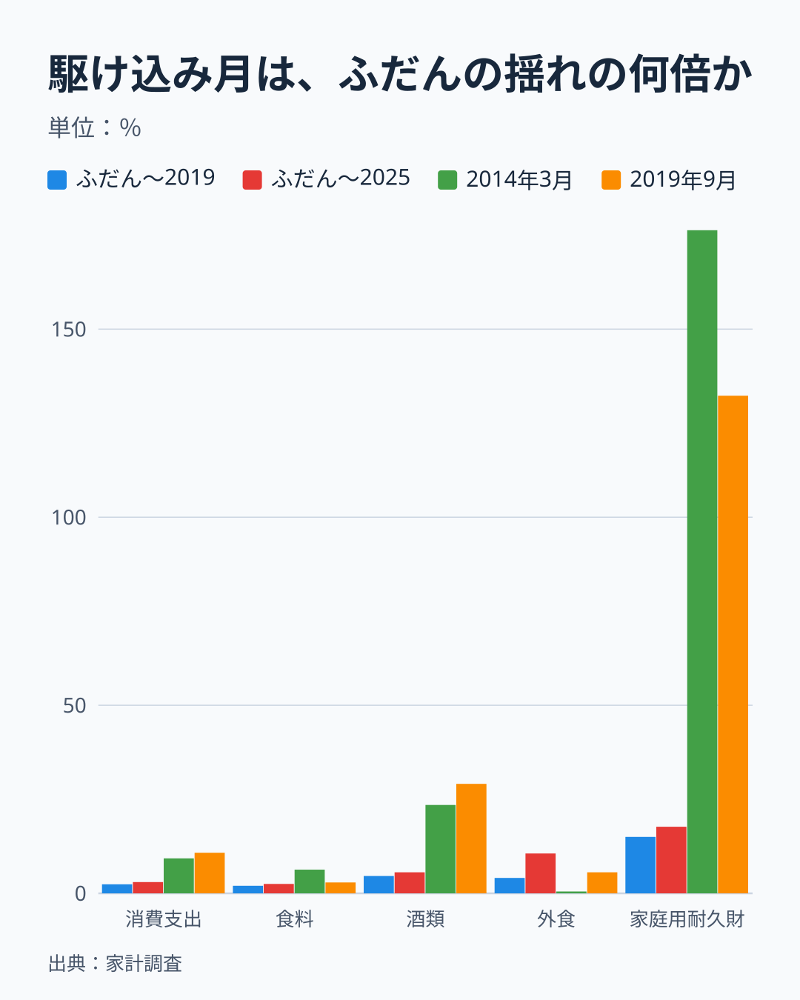

家計調査（全国・二人以上の世帯）の月次データで測ると、季節の揺れは、消費支出全体で、年平均の月を100として2月が92.8、12月が113.0です。12月は2月の1.22倍にあたり、毎年ほぼ同じ形で繰り返します。品目に分けると、チョコレートは2月が246、エアコンは7月が242、灯油は1月が227と、山の高さは2倍から2.5倍に達します。

一方、増税の揺れは、一度きりで、形が違います。消費税率が5%から8%に上がる前の2014年3月は、消費支出が前年同月より9.3%増え、ふだんの月の前年同月比のばらつき（標準偏差）の3倍から4倍でした。家庭用耐久財は176.3%増（前年同月の2.8倍）、酒類は23.5%増です。翌4月以降は反動で、家庭用耐久財は2014年4月から12月まで9か月続けて前年を下回り、7月は22.0%減、10月は35.1%減でした。ただし、消費支出全体では、前後半年の合計が2013年10月から2014年3月で3.2%増、2014年4月から9月で1.4%減となり、12か月の合計では1.0%増にとどまりました。家庭用耐久財は、12か月の合計でも11.8%増が残っています。

問いは「季節や増税で、家庭の買い方はどれだけ動くのか」です。答えをまとめると、季節は消費支出全体で約2割、品目で2〜3倍動きます。増税は、消費支出全体で前年同月比の1割弱、ふだんの揺れの3〜4倍で、家庭用耐久財では前年同月の2.8倍まで動きました。ただし、この数字には限定があります。家計調査の支出は税込みの名目額なので、増税後の月は同じ購入量でも金額が税率の分だけ高く出て、反動が浅く見えます。月次の値は標本の誤差が大きく、天候など同じ月の別の要因とも切り分けられません。数字はすべて全国・二人以上の世帯（農林漁家世帯を含む）で、2025年の分類改定にあわせて統計局が接続した値です。都道府県別の値とは混ぜません。

## 季節だけで、消費支出は月ごとに2割動く

まず、季節の形を、費目ごとに測ります。2015年から2025年の11年について、月ごとの支出を、その年の12か月の平均で割って100倍し、11年で平均しました。年平均の月が100です。この11年には、2019年の増税と、2020年の新型コロナの影響を含む年が入っています。2019年を除く10年で作り直しても、消費支出・食料・被服・光熱・水道・酒類・外食・家庭用耐久財の山と谷の月は変わらず、値の差は最大でも、消費支出が0.6ポイント、食料が0.3ポイント、光熱・水道が0.9ポイント、外食が1.2ポイント、被服が1.5ポイント、酒類が1.8ポイントでした。家庭用耐久財だけは最大7.4ポイント（9月、増税前の駆け込みの影響）の差があります。

消費支出は、12月が113.0、3月が106.8、4月が103.7と高く、2月が92.8、6月が94.3、9月が96.3と低い形です。12月はボーナスや年末年始の準備で支出が膨らみ、2月は日数が少ないことが背景にあると考えられますが、これらは[仮説]で、この記事では確かめていません。食料は12月が125.4で、年末の食材や正月料理の準備を反映している可能性があり、品目別の内訳は次の節で見ます。食料の2月は89.9、1月は93.6で、12月の次に高いのは8月の106.1です。

被服及び履物は、2月が76.9、8月が77.2、9月が78.6と大きく落ち込み、12月が118.6、11月が115.2、3月が113.6、1月が110.3と高い形です。冬物のバーゲンが1月から2月に集中する品目の動きは、[婦人用コートの店頭価格と購入単価の記事](/blog/winter-coat-bargain-purchase-price)で別に詳しく見ています。光熱・水道は、冬に高く夏に低い形で、2月が130.8、3月が124.9、1月が122.5、7月が80.2です。冬に高い理由は、暖房用の灯油やガスの使用が冬に集中するためと考えられますが、[仮説]で、光熱・水道の内訳は確かめていません。

この記事の後半で増税の揺れを見る費目の季節の形も、先に確かめておきます。同じ方法で、家庭用耐久財は7月が148.1と最も高く、2月が70.4、4月が74.2と低い形です。酒類は12月が139.3で突出し、1月と2月は82.9と83.3まで下がります。外食は8月が115.5、12月が112.1と高く、2月が85.9です。「消費税率が上がる前の月」の3月や9月は、費目ごとに季節の位置が違います。そのため、増税前後の動きは前年の同じ月と比べる必要があります。

費目によって山と谷の月は違い、光熱・水道は2月、食料は12月、被服は11月から3月に山があります。消費支出全体の山が12月と3月に出るのは、費目の山が重なる月だからです。山と谷がずれる月は、全体では打ち消し合って目立ちません。5月から11月は、消費支出が94.3から100.2の範囲に収まり、年平均の月から6%以内でした。年間の合計で見れば、この季節の揺れは足し引きでゼロになります。しかし、月の値を見て「今月は支出が多い」「少ない」と判断するときには、この季節の分を引いて読む必要があります。前年の同じ月と比べる前年同月比は、季節の分を最初から除いた比べ方です。

## 山が高い品目と、ほとんど動かない品目

費目より細かい品目で、季節の山の高さを比べます。末端品目のうち、2015〜2025年の年平均支出が5,000円以上（円/年）で、名称に「その他」「他の」「年までは」を含まない112品目について、月ごとの平均パターンの最大値を求めました。上位5品目と下位5品目を並べます。

最も山が高いのは私立大学（4月）の327で、入学金や授業料の納付が4月に集中していると考えられます。次いで寄付金（12月）が280、チョコレート（2月）が246、エアコン（7月）が242、ケーキ（12月）が229です。山が高いこれらの品目は、年中行事（入学、年末の寄付、バレンタインデー、夏の暑さ、クリスマス）と結びついていると考えられます。反対に、最も動かないのは民営家賃（10月）の102、インターネット接続料（11月）の102、新聞（3月）の103、ヨーグルト（5月）の104、住宅関係負担費（10月）の104で、毎月ほぼ同じ額を払う支出や、通年で買う食品が並びます。

112品目全体では、山の高さが150以上の品目が27、130以上が46、120未満が44でした。約4割の品目は、最も多い月でも年平均の月の1.2倍未満で、季節の影響が小さい側にあります。山の月の分布は、12月が36品目で最も多く、8月が19品目、3月が17品目、1月が6品目、4月と5月がそれぞれ7品目です。12月に山がある36品目のうち、山の高さが150以上のものは12品目です。夏（7〜8月）の山には、エアコンのほか、外国パック旅行費（194）、アイスクリーム・シャーベット（180）、冷蔵庫（154）が並びます。

最大値で順位を付けると、標本の小さい品目ほど、偶然の大きい月が山に選ばれやすく、実際より上振れします。2019年を除く10年で作り直すと、上位6品目の順位がエアコン（248）とチョコレート（246）で入れ替わり、112品目のうち9品目は山の月が変わります。上位の顔ぶれは同じです。

次の「チョコレート消費支出額」ランキングは県庁所在市の値で、本文の全国値とは別の数字です。

<source-link href="/ranking/chocolate-consumption-expenditure">チョコレート消費支出額ランキングをもっと見る</source-link>

## 山の形は品目ごとに違い、高さは毎年ぶれる

山の高い品目のうち、アイスクリーム・シャーベット、灯油、チョコレート、エアコンの4つについて、月ごとの形を並べます。2015〜2025年の平均です。

灯油は1月が227.2、2月が221.9、12月が201.6と、冬に集中し、7月から9月は16.1から18.5まで落ちます。最も多い月と最も少ない月の差は14倍です。チョコレートは2月が246.3と突出し、1月が138.8、12月が127.8で、7月と8月は50前後に下がります。エアコンは7月が242.2、8月が185.4、6月が174.4で、1月は40.6です。アイスクリーム・シャーベットは8月が180.2、7月が169.6、6月が124.7で、2月が53.2です。

灯油とエアコンは、気温に反応する品目と考えられ、年によって山の高さが動く可能性があります。[仮説] チョコレートとアイスクリームは、年中行事と気温のどちらにも結びつく品目かもしれません。次の図は山の月を固定して、その月の高さだけを年ごとに並べたもので、山の高さは年によって変わります。

各年の山の月の支出を、その年の12か月の平均で割った値を、2000年から2025年の26年について並べました。チョコレート（2月）は220.4から312.8の間で、アイスクリーム（8月）は167.7から220.1、灯油（1月）は169.2から256.7、エアコン（7月）は178.7から414.8の間を動きます。エアコンは、最小と最大の差が2.3倍もあります。1つの年の「7月のエアコン支出」だけを見て、季節の山が平年より大きい、小さいと言うのは、標本の誤差と年ごとのばらつきの中で、ほとんど意味を持たないことになります。

山の高さには、時間的な傾向もあります。チョコレートの山は、2000〜2004年の平均が288.8でしたが、2021〜2025年の平均は226.0へ下がりました。エアコンは328.1から222.8へ、灯油は204.0から225.5へ動いています。アイスクリームは192.0から172.0へ下がりましたが、これは年ごとの範囲（167.7〜220.1）の内側で、傾向とは言いにくい動きです。チョコレートとエアコンの山が低くなっているのは、「その月に集中して買う」から「年を通して買う」へ変わってきたためかもしれません。これは[仮説]で、確かめるには、世帯の購入頻度や購入先の変化を見る必要があります。

## 年の途中の月で年間を読むと、どれだけ外れるか

月次の数字を使うときに最もよくある誤りは、特定の月や、年の途中までの月を、そのまま年間の代わりにすることです。季節の形から、どれだけ外れるかを計算できます。以下は2015〜2025年の11年の合計で計算した比率です。

12月の支出を12倍して年間にすると、消費支出では年間の113%、食料では125%、被服では118%になり、年間を1〜2割過大に見積もります。2月を12倍すると、消費支出は93%、食料は90%、被服は77%になって、過小になります。灯油は、12月を12倍すると年間の201%、2月を12倍すると223%で、7月を12倍すると年間の18%にしかなりません。

年の途中まで（1〜8月）を年間の代わりにすることも同じです。1〜8月の合計は、年間の消費支出の66.1%、食料の64.9%、被服の65.4%です。8か月は1年の66.7%にあたるので、消費支出ではほぼ釣り合います。しかし、光熱・水道は69.8%、灯油は69.1%、アイスクリーム・シャーベットは71.4%、エアコンは77.1%で、品目によって比率が違います。月次のデータは、2026年8月分まで e-Stat に登録されています（2026年11月9日に確認）。2026年の1〜8月を単純に1.5倍して「2026年の年間」とすれば、エアコンなら年間を約16%、アイスクリーム・シャーベットなら約7%過大に見ることになります。

> [!WARNING]
> 家計調査の月次値は、1か月あたり約7,300〜7,800世帯の家計簿から作られる標本調査の値です（月次表の集計世帯数は、2013年3月が7,770世帯、2014年3月が7,810世帯、2025年3月が7,263世帯）。年次値に比べて標本の誤差が大きく、特に購入頻度の低い品目（家電や自動車など）は、1か月の値が数十世帯の購入で決まります。月次の増減を、天候や景気、制度の変化と結びつけて説明できるのは、数年にわたって同じ向きの変化が続くときや、複数の年で再現するときだけです。

## 増税の前に買い、増税のあとに控える

次に、増税の揺れです。消費税率は、2014年4月に5%から8%へ、2019年10月に8%から10%へ引き上げられました（財務省[「消費税を知ろう」](https://www.mof.go.jp/tax_policy/publication/brochure/zeisei0507/05.htm)）。2019年10月には同時に軽減税率が始まり、飲食料品（酒類・外食を除く）と新聞は8%のままでした（財務省[消費税率引上げについて](https://www.mof.go.jp/tax_policy/summary/consumption/consumption_tax/index.html)）。家計調査の「食料」には酒類と外食が含まれ、この2つは2019年に10%になっています。そのため、以下の「食料（酒類・外食を除く）」は、食料から酒類と外食を引いた、2019年も8%のままだった食品の値です。

増税の前後を、前年の同じ月と比べた増減率（前年同月比）で、消費支出、食料（酒類・外食を除く）、酒類、外食の4つについて見ます。まず2014年です。

消費支出は、2013年10月から2014年2月まで前年同月比がプラス2.1%から2.8%（2月だけは0.6%減）でした。増税前の3月に9.3%増へ跳ね上がり、4月は0.7%減、5月は3.9%減になっています。6月は1.3%増に戻り、7月から9月は0.9%減から2.0%減の間でした。食料（酒類・外食を除く）は3月に6.3%増、4月に2.0%減です。酒類は3月に23.5%増、4月に18.8%減と、最も振れ幅が大きい費目です。外食は3月が0.5%増、4月が3.4%増で、ほとんど反応していません。

駆け込みは、増税前の3月に集中しました。酒類のように貯蔵できるものは、まとめ買いで前倒しになり、4月にその分が反動で落ちます。一方、外食は、その場で消費するため、前倒しで買う（食べる）ことができません。同じ税率の変更でも、品目の性質によって、駆け込みの有無がまったく違います。

次に、2019年です。

消費支出は、2019年9月に10.8%増と、2014年3月の9.3%増と同じ程度に跳ね上がりました。10月は3.7%減、11月は0.8%減、12月は2.4%減、2020年1月は3.1%減です。税率が8%のままだった食料（酒類・外食を除く）は、9月が2.9%増、10月が0.4%減で、2014年の動き（3月に6.3%増、4月に2.0%減）より小さい山でした。10%に上がった酒類は9月に29.1%増、10月に13.4%減です。外食は、9月が5.6%増、10月が5.6%減でした。

2019年の食料（酒類・外食を除く）の山が2014年より小さい点は、軽減税率で税率が上がらなかったことと整合しますが、[仮説]です。2つの年の食料の動きは、天候や日数、景気の違いなどの別の要因も含み、この図から税率の違いだけを切り分けることはできません。税率が上がった酒類は、2019年のほうが2014年より大きく動いていますが（29.1%増と23.5%増）、その差（5.6ポイント）は、酒類のふだんの揺れ（標準偏差4.6〜5.6ポイント）と同じ大きさで、2つの年の駆け込みの大小は比べられません。

月ごとの動きを増税の影響と読む根拠は、3つあります。1つめは、同じ形（直前の月に大きく増え、翌月以降に減る）が、2014年と2019年の2回再現していること。2つめは、貯蔵できる耐久財や酒類で大きく、その場で消費する外食でほとんど出ないという、税の仕組みと整合する品目の違いが出ていること。3つめは、税が課されない費目（後の節で見る教育や家賃）には同じ動きが見られないことです。ただし、どれも状況証拠で、単月の値に天候や台風、日数、他の制度の変更が重なる余地は残ります。

## 耐久財は駆け込みで平均の月の2倍、反動は9か月続いた

増税の駆け込みが最も大きく出る家庭用耐久財（冷蔵庫、エアコン、洗濯機、家具などの大きな買い物）の動きを、税率が上がった月を0として前後3か月で見ます。

家庭用耐久財の前年同月比は、2014年に、3か月前（1月）が15.4%増、2か月前（2月）が59.8%増、1か月前（3月）が176.3%増と、増税に近づくほど急に大きくなりました。税率が上がった4月は10.5%減、5月は20.5%減、6月は12.8%減、7月は22.0%減、8月は9.0%減、9月は16.7%減、10月は35.1%減、11月は4.5%減、12月は4.0%減と、9か月続けて前年を下回りました。2019年も同じ形で、9月が132.3%増、10月が18.3%減、11月が20.4%減、12月が26.2%減、2020年1月が14.6%減、2月が2.7%減と、2020年2月まで5か月続けて前年を下回っています（3月の10.2%減はコロナ期に入るので数えません）。

増税の揺れと季節の揺れを、同じ基準で比べます。前年同月比の2.8倍（2014年3月）は、前年の同じ月が基準で、季節の山（7月が年平均の月の1.48倍）は、その年の平均の月が基準です。そのため、数字を直接比べられません。同じ基準にそろえると、2014年3月の家庭用耐久財は、2014年の平均の月の2.02倍、2019年9月は2019年の平均の月の1.74倍でした。7月の季節の山（1.48倍）と比べると、2014年3月は約1.4倍、2019年9月は約1.2倍の高さで、耐久財にとっては、増税前の月が、夏の山を上回る程度の大きさでした。「季節の揺れよりはるかに大きい」とまでは言えません。

2014年は、増税の半年前の2013年10月から前年同月比が9.2%増、11月が10.3%増、12月が29.5%増と、すでにプラスが続き、増税に近づくほど大きくなりました。2019年は、直前の9月に集中しています。この違いには、増税の決定から実施までの期間や、事前の周知の仕方が関係している可能性がありますが、[仮説]で、このデータからは確かめられません。

反動の長さは、半年を超えます。家庭用耐久財の2013年10月から2014年3月の前年同期比の合計は46.3%増ですが、2014年4月から9月は15.6%減でした。12か月の合計では11.8%増で、駆け込みの増加分を反動の減少分が全部は打ち消していません。2019年は、2019年6月から9月が28.1%増、10月から2020年2月が17.8%減です。2020年3月以降は、新型コロナの影響が強く入るため、反動の続く期間は測れません。

名目値の限界にも触れておきます。家計調査の支出は税込みの金額なので、同じ数量を買っても、増税後の金額は、2014年なら約2.9%（1.08÷1.05）、2019年に10%になった品目なら約1.9%（1.10÷1.08）高く出ます。反動の減少は、この分だけ浅く見えます。増税後の下落幅は、実際の購入量の減少より小さく出ていると読む必要があります。

## 費目別には、家具・家事用品が最も駆け込まれた

増税前の月に、どの費目が前年同月比で大きく増えたかを、10大費目で比べます。2014年3月と2019年9月です。食料は、酒類と外食を含む費目全体の値です。

最も大きいのは、家具・家事用品で、2014年3月が85.6%増、2019年9月が66.0%増です。費目ごとのふだんの揺れ（2015年6月〜2019年8月の標準偏差）は6.5ポイントなので、それぞれ13.1倍と10.1倍にあたります。ほかの費目は、2014年3月が住居12.7%増、交通・通信14.2%増、教養娯楽14.8%増、被服12.8%増、保健医療11.0%増、光熱・水道8.4%増、食料6.0%増で、1割前後の増加にとどまります。ふだんの揺れとの比で見ると、教養娯楽が3.8倍、被服が2.2倍、交通・通信が2.1倍、保健医療が1.9倍で、住居は1.1倍、光熱・水道は1.2倍と、ふだんの揺れの範囲に近い費目もあります。

2019年9月は、保健医療が27.1%増（4.6倍）、被服が16.9%増（2.9倍）、交通・通信が14.6%増（2.1倍）、教養娯楽が12.9%増（3.3倍）、住居が12.9%増（1.1倍）、教育が10.7%増（1.0倍）、食料が4.4%増でした。家具・家事用品の駆け込みが突出するのは、冷蔵庫、洗濯機、エアコン、家具のような、価格が高く、買い替えの時期を前倒しできる耐久財を含むからです。

税が課されない費目は、駆け込みの対象になりにくいはずです。国税庁によると、学校教育の授業料や入学金、社会保険医療の給付（市販医薬品などは除く）、住宅の貸付け（家賃）は消費税の非課税です（国税庁[タックスアンサー](https://www.nta.go.jp/taxes/shiraberu/taxanswer/shohi/6201.htm)）。教育は、2014年3月が12.1%減、2019年9月が10.7%増と向きが逆で、ふだんの揺れ（11.0ポイント）の1倍前後なので、増税の影響は読み取れません。2019年10月と11月は、それぞれ21.6%減と23.1%減で、ふだんの揺れの2倍前後ですが、増税の影響とは考えにくく、別の要因の可能性があります。保健医療は、市販医薬品や保健医療用品が課税の対象で、2019年9月の27.1%増はその駆け込みの可能性がありますが、[仮説]で、内訳は確かめていません。

増税の翌月以降の反動も、費目で違います。家具・家事用品は、2014年4月が13.3%減、5月が10.8%減、2019年10月が11.8%減、11月が9.3%減と、2か月続けて1割前後の減少でした。住居は、2014年4月が11.6%増のあと、5月が24.9%減と1か月遅れて反動が出ています。住居は、住宅の設備修繕・維持など課税の工事費を含みますが、ふだんの揺れが11.3ポイントと大きく、2014年の動きだけでは増税の影響とは言えません。財・サービス支出計（消費支出からこづかい・交際費・仕送り金を除いたもの）は、2014年3月が12.6%増、4月が0.0%、5月が3.9%減、2019年9月が11.7%増、10月が5.1%減、11月が0.2%減です。

## 耐久財の個別の品目は、標本が小さい

家庭用耐久財の中で、どの品目が駆け込まれたかを、前年同月比で比べます。

2014年3月の前年同月比は、エアコンが491%増、冷蔵庫が338%増、洗濯機が198%増、パソコンが142%増、一般家具が115%増、テレビが50%増でした。2019年9月は、冷蔵庫が295%増、一般家具が157%増、洗濯機が102%増、パソコンが63%増、エアコンが49%増、テレビが46%増です。冷蔵庫は両年とも約4倍に増え、テレビは両年とも約5割増と、品目ごとに同じ程度の駆け込みが出ました。一方で、エアコンは2014年に約6倍に増え、2019年は5割増にとどまり、年による違いが非常に大きい品目です。

エアコンの違いは、標本の小ささで読めます。購入数量の月次表で、エアコンの1世帯あたり購入台数は、2013年3月が0.002台、2014年3月が0.012台でした。集計世帯数（2013年3月が7,770世帯、2014年3月が7,810世帯）に掛けると、十数台と90台前後に当たります。前年同月比の491%増は、標本の中で十数台が90台前後に増えた結果です。冷蔵庫は0.005台から0.011台（120%増）、洗濯機は0.008台から0.016台（100%増）、テレビは0.008台から0.009台（13%増）でした。台数は小数点以下3桁で丸められているため、これらの比は1割以上の丸めの幅を含みます。

金額の伸びが台数の伸びより大きい品目もあります。冷蔵庫は金額が338%増、台数が120%増で、1台あたりの金額が前年より高かった可能性があります。ただし、台数の丸めの幅が大きく、機種の高級化や、増税前に高い機種を選んだことの根拠にはなりません。月次で個別の品目を見るときは、前年同月比の大きさより、「両方の年で同じ向きに動いたか」を手がかりにするほうが安全です。冷蔵庫、テレビ、一般家具は、両年とも金額が前年の約1.5倍以上に増えており、駆け込みがあったことは、品目の月次でも確かめられます。

## ふだんの揺れの何倍か

前年同月比で9.3%増という数字が大きいのか小さいのかは、ふだんの前年同月比がどれだけ揺れるかが分からないと判断できません。ふだんの揺れとして、前年同月比の標準偏差を2通りで計算しました。1つは、増税もコロナもない2015年6月から2019年8月の51か月です。もう1つは、この51か月に、2021年6月から2025年12月の55か月を足した106か月です。2019年9月から2021年5月の21か月は、増税とコロナの時期として除きました。後者は、2021年と2022年の前年同月比が、コロナで落ち込んだ前年を基準にしているため、特に外食と家庭用耐久財の揺れが大きく出ます。

ふだんの揺れは、コロナ前の51か月で、消費支出が2.4ポイント、食料（酒類・外食を除く）が2.0ポイント、酒類が4.6ポイント、外食が4.1ポイント、家庭用耐久財が15.0ポイントです。106か月では、それぞれ3.0、2.5、5.6、10.6、17.7ポイントになります。2014年3月の前年同月比は、消費支出が9.3%増で、ふだんの揺れの3.1倍（106か月）から3.9倍（51か月）、食料（酒類・外食を除く）が6.3%増で2.5倍から3.2倍、酒類が23.5%増で4.2倍から5.1倍、家庭用耐久財が176.3%増で10.0倍から11.7倍でした。2019年9月は、消費支出が10.8%増で3.6倍から4.5倍、食料（酒類・外食を除く）が2.9%増で1.1倍から1.5倍、酒類が29.1%増で5.2倍から6.3倍、家庭用耐久財が132.3%増で7.5倍から8.8倍です。外食は、2014年3月が0.5%増で約0.1倍、2019年9月が5.6%増で0.5倍から1.4倍で、ふだんの揺れの範囲に収まっています。

2つの年の食料（酒類・外食を除く）を比べると、税率が5%から8%に上がった2014年3月は、ふだんの揺れの2.5〜3.2倍でしたが、税率が8%のまま据え置かれた2019年9月は1.1〜1.5倍で、ふだんの揺れとほとんど区別できません。これは軽減税率で据え置かれた食品の駆け込みが小さかったことと整合しますが、2年分の比較で、因果の証拠とまでは言えません。

これで、駆け込みの大きさは、消費支出全体では「ふだんの揺れの3〜4倍強」で、ふだんの揺れを明らかに超えます。耐久財と酒類では、それをさらに大きく超えます。外食では、駆け込みがあったとは言えません。

> [!NOTE]
> 前年同月比は、前年の同じ月が基準です。前年が駆け込みで高かった月は、翌年の前年同月比が反対向きに出ます。2015年3月の消費支出は8.1%減、家庭用耐久財は53.0%減、酒類は22.0%減で、翌4月は酒類が19.7%増、家庭用耐久財が17.9%増でした。2014年3月の駆け込みの裏返しです。増税の1年後の前年同月比を、「その月の景気」として読むと誤ります。

## 月次の数字を読む手順

ここまでの数字から、月次の家計調査を読むときの手順を整理します。業務で月次の支出を追う人が、この順に確かめれば、季節や増税の揺れを「変化」と取り違えにくくなります。

- **1. 季節の分を除く**: 前年の同じ月と比べる前年同月比を使います。月ごとの値をそのまま前月と比べると、12月の13%高、2月の7%低のような季節の差が、そのまま「増減」に見えます。
- **2. 増税の月と、その翌年の同じ月を別にする**: 税率が上がる前の月は前年同月比が大きくプラスに、翌月以降はマイナスになり、1年後の同じ月は逆向きに出ます。2015年3月の消費支出の8.1%減は、景気の悪化ではなく、2014年3月の駆け込みの裏返しです。
- **3. ふだんの揺れと比べる**: 前年同月比の標準偏差は、消費支出で2.4〜3.0ポイント、酒類で4.6〜5.6ポイント、家庭用耐久財で15.0〜17.7ポイントでした。品目の月次は、この数倍の動きがあるかを見ます。
- **4. 年の途中の月を年計に使わない**: 12月を12倍すると年間の消費支出を13%過大に、2月を12倍すると7%過小に見積もります。
- **5. 小さな品目は複数の年で確かめる**: 家電や自動車のように月の購入が数十台の品目は、1か月の前年同月比が数倍になることがあります。両方の年で同じ向きに動くかを手がかりにします。

この手順は、データの揺れを測った記事の範囲で、因果を確かめる方法ではありません。天候や景気、価格の変化と、増税の影響を切り分けるには、別の分析が要ります。

## まとめ: 季節は山谷で2割、増税は前年同月比で1割弱、耐久財は平均の月の2倍

問いへの答えを整理します。

- **季節**: 消費支出は、年平均の月に対して2月が92.8、12月が113.0（2015〜2025年平均）。食料は12月が125.4、被服は2月が76.9、光熱・水道は2月が130.8です。品目では、チョコレート（2月）が246、エアコン（7月）が242、灯油（1月）が227。112品目のうち山の高さが150以上のものは27品目、山が12月にある品目が最も多く36品目です。山の月の高さは年によって大きく動き、エアコン（7月）は26年で178.7から414.8の間でした。1年分の月次値だけで季節の山を判断しないようにします。
- **増税**: 消費支出の前年同月比は、2014年3月が9.3%増、2019年9月が10.8%増で、ふだんの揺れの3〜4倍強。家庭用耐久財は176.3%増・132.3%増で、2014年は平均の月の2.02倍、夏の季節の山の約1.4倍でした。酒類は23.5%増・29.1%増、外食は反応しませんでした。消費支出全体の反動は小さく、2014年の12か月の合計は1.0%増でしたが、家庭用耐久財は11.8%増が残りました。
- **税率の違い**: 税率が上がらなかった2019年の食料（酒類・外食を除く）は、駆け込みがふだんの揺れの1.1〜1.5倍でした。2014年の2.5〜3.2倍より小さく、軽減税率と整合しますが、2回の比較で[仮説]の範囲です。
- **限定**: 家計調査の支出は税込みの名目額で、増税後の反動は実際より浅く見えます。月次の標本誤差は大きく、天候や景気など同じ月の別の要因と、税率の影響を、このデータだけで切り分けることはできません。2024年以前の値は、統計局が2025年改定の分類へ接続したものです。

次に確かめたいのは、駆け込みの大きさが、世帯の年収や世帯主の年齢で違うかどうかです。年収階級別や世帯主年齢別の品目表を月次で使えれば、増税の揺れを世帯の属性ごとに比べられます。家計調査の食費の全体像は、[食費・家計消費のテーマ](/themes/household-food-spending)でも確かめられます。ビールの山の月が夏から冬へ動いた経緯は[ビールの支出が7月から12月に動いた記事](/blog/beer-peak-month-july-to-december)で、県別のビールと発泡酒の違いは[ビールと発泡酒の県別の記事](/blog/beer-vs-happoshu-shift)で読めます。

## データについて

出典は総務省統計局の「家計調査」家計収支編の、二人以上の世帯（農林漁家世帯を含む）・全国・月次の品目分類別の支出額と、一部の品目の購入数量です。2025年改定の品目分類で、2000年1月から2025年12月までの月次値を使い、2024年以前の値は統計局が新分類に接続した値です。2026年の月は、年の途中なので季節の平均にも前年同月比の基準にも使っていません。

季節の形は、2015〜2025年の各年について、月ごとの支出を、その年の12か月の平均で割って100倍し、11年で平均した値です。山の高さの比較は、末端品目のうち、2015〜2025年の年平均支出が5,000円以上（円/年）で、名称に「その他」「他の」「年までは」を含まない112品目です。山の高さのぶれは、2000〜2025年の各年の山の月の支出を、その年の12か月の平均で割った値です。

増税前後の前年同月比は、2013年10月〜2014年9月と2019年6月〜2020年2月の月別支出額を、前年の同じ月と比べた増減率です。「食料（酒類・外食を除く）」は、食料の支出額から酒類と外食の支出額を引いた値です。ふだんの揺れは、2015年6月〜2019年8月の51か月と、これに2021年6月〜2025年12月を加えた106か月の前年同月比の標準偏差で、2019年9月〜2021年5月の21か月は除いています。値はすべて名目（税込み）で、物価の変化は除いていません。税率の引き上げ時期と軽減税率の対象は、財務省の公表資料に基づき、非課税取引は国税庁の資料に基づきます。本文に出てくる、図に入っていない値（山の月の分布、年の途中の月の比率、累計、前年同月比の個別の値、ふだんの揺れとの比、品目の購入数量など）は、補助値の一覧として図のデータとあわせて控えてあります。
