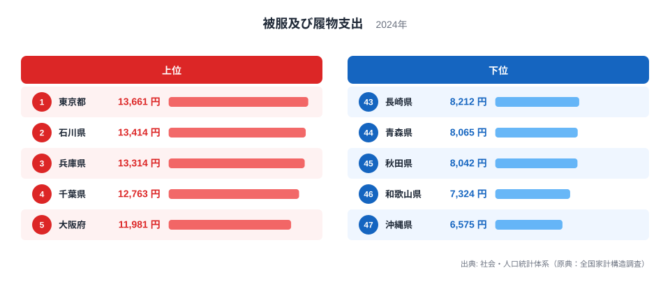
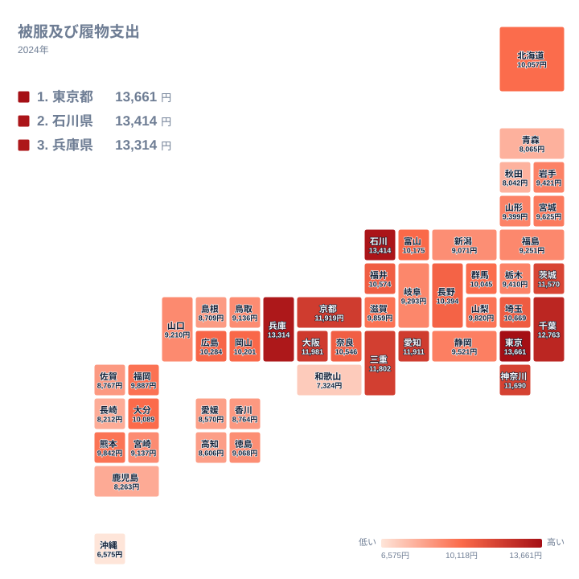

## 衣料と靴への支出、1位は東京都

洋服や靴にいくら使うかは、住む場所によって意外なほど違います。2024年のデータで最も多かったのは東京都で、13,661円でした。2位は石川県の13,414円、3位は兵庫県の13,314円です。首都圏の都市部だけでなく、北陸や関西の県が肩を並べているところに、この指標の面白さがあります。

一方、最も少なかったのは沖縄県の6,575円です。46位の和歌山県が7,324円、45位の秋田県が8,042円で、下位には暖かい地域と寒い地域の両方が混在しています。単純に「寒いから衣料費がかさむ」「暖かいから安く済む」とは言えない結果です。

この記事では、衣料と靴への支出を食文化ならぬ「装いの文化」「気候」「産地」「商業環境」といった切り口で眺めます。そのうえで、同じ家計のなかで比べられる食費や住居費のような品目との違いにも触れます。

> [!NOTE]
> ここで扱う数値は、社会・人口統計体系（原典：全国家計構造調査）の「被服及び履物支出」で、2024年の単位は円です。衣料や靴の購入にかけた家計の支出額を示す指標で、都道府県ごとの値を並べて比べられます。人口の多さではなく、支出の水準を見るものです。

## 上位と下位の顔ぶれを見る

まず、上位5県と下位5県を並べた図を見てください。

<source-link href="/ranking/household-survey-clothing-footwear-expenditure">被服及び履物支出ランキングをもっと見る</source-link>

上位5県は、東京都の13,661円、石川県の13,414円、兵庫県の13,314円、千葉県の12,763円、大阪府の11,981円です。関東の東京都と千葉県、中部の石川県、近畿の兵庫県と大阪府が並びます。大都市圏を中心にしつつも、石川県のように大都市ではない県が2位に入っている点が目を引きます。

下位5県は、沖縄県の6,575円、和歌山県の7,324円、秋田県の8,042円、青森県の8,065円、長崎県の8,212円です。九州・沖縄の沖縄県と長崎県、近畿の和歌山県、北海道・東北の秋田県と青森県が顔を出します。1位の東京都と最下位の沖縄県を比べると、13,661円と6,575円で、2倍を超える開きがあります。

上位と下位のあいだには、10,000円前後の層が厚く広がっています。北海道は10,057円で19位、群馬県は10,045円で20位、福岡県は9,887円で21位です。つまり、極端に高い県と低い県が両端にあり、多くの県はその中間にまとまっているのが実態です。

> [!TIP]
> ランキングを読むときは、順位の並びだけでなく円の値に注目してください。中位では数百円の違いで順位が数位動くことがあります。たとえば19位の北海道は10,057円、20位の群馬県は10,045円で、ほぼ同じ水準です。順位の1つ2つの差を、実力差と読まないのが読み解きのコツです。

## 地理分布で見える地域差

次に、全国の分布をタイルマップで確認します。

地図にすると、濃い色の県が関東から近畿にかけて帯のように連なっている様子が見えます。上位10県をみると、関東は東京都、千葉県、神奈川県、茨城県の4県です。近畿は兵庫県、大阪府、京都府、三重県の4県です。中部は石川県と愛知県の2県で、合わせて10県が関東・中部・近畿に収まっています。

地方別の顔ぶれの差は、下位に目を移すといっそう際立ちます。北海道・東北では秋田県が8,042円で45位、青森県が8,065円で44位です。九州・沖縄では沖縄県が47位、長崎県が43位で、鹿児島県も8,263円で42位に入っています。四国は高知県が8,606円で40位、愛媛県が8,570円で41位と、いずれも下位寄りです。

中国地方は、岡山県が10,201円で16位、広島県が10,284円で15位と中位に近い位置にあります。いっぽう島根県は8,709円で39位、鳥取県は9,136円で34位、山口県は9,210円で32位と、県ごとに差があります。同じ地方でも一括りにはできないことが、この分布からわかります。

> [!WARNING]
> この指標は家計調査に基づく平均的な支出額で、調査対象となった世帯の消費行動を映したものです。県ごとの世帯構成や年齢層、通販での購入、旅行先での買い物は、居住地の統計に正確には反映されません。県内に店が少ないから支出が低い、とは直接言えない点に注意してください。

## 気候・産地・暮らし方から考える

気候の影響は、確かにありそうです。沖縄県が最下位なのは、一年を通して暖かく、厚手の上着やコート、ブーツなどを買い足す機会が少ないことと無関係ではないでしょう。ただし、寒冷地の秋田県が45位、青森県が44位であることからわかるように、寒さが支出を押し上げるとは限りません。防寒着は一度買えば長く着るため、毎年の購入額はむしろ抑えられることがあります。

商業環境と通勤スタイルも効いていそうです。東京都や大阪府のような大都市圏では、百貨店や専門店が多く、通勤や会合でスーツやオフィスウェアを使う機会が多くあります。服装が仕事や人づきあいと結びつくため、季節ごとに買い替える習慣が根づきやすい環境です。千葉県が12,763円で4位、神奈川県が11,690円で9位、埼玉県が10,669円で11位と、首都圏の県がまとまって高めに並ぶのも、この見方と整合します。

ここで興味深いのは石川県です。2位の13,414円は、東京都に迫る水準です。石川県は北陸の中部地方に含まれ、近隣の福井県も10,574円で12位、富山県も10,175円で17位と、いずれも上位から中位に入っています。繊維産業の産地の歴史を持つ地域であることや、装いにこだわる地域文化が背景にある可能性はありますが、この統計だけでは理由を断定できません。ここは、地域の個性が数字に表れたと受け止めておくのが穏当です。

近畿では兵庫県が3位、大阪府が5位、京都府が6位です。京都府は11,919円で、和装と洋装の両方の文化が根づいた土地柄です。着物の文化を持つ土地は、衣料に対する関心が高い傾向があるのかもしれません。ただし和歌山県は7,324円で46位と、同じ近畿でも大きく離れています。近畿の中だけで見ても、都市部と周辺部で差が開いていることがわかります。

## 食費や住居費との違い

食費は、地域の食文化や産地の影響を強く受ける支出です。魚介や米、麺類のように、土地ごとに消費の中身がはっきり分かれます。これに対して衣料と靴は、全国どこでも似た商品が売られ、地域の産物で決まる部分が小さい支出です。そのぶん、都市の規模や就業のスタイル、気候といった暮らし方の違いが、より素直に数字に出やすいと考えられます。

住居費は、家賃や住宅の持ち家率といった土地の事情に左右される部分が大きい項目です。衣料と靴の支出は、必要に迫られて払う色合いが比較的弱く、裁量の余地があります。「今年は買わずに済ませる」ことができるため、世帯の景気感や気分も表れやすい支出です。上位と下位で2倍を超える開きがあるのも、この裁量の大きさを映しているのでしょう。

また、衣料と靴は食費のように毎日買うものではなく、購入頻度が低いのも特徴です。調査期間のなかで大きな買い物が重なったかどうかで、平均値が動くことがあります。県単位で見るときは、1年だけの数字で優劣をつけず、地域の傾向としてゆるやかに眺めるのが適切です。

## データについて

この記事で使っているのは、社会・人口統計体系（原典：全国家計構造調査）にある「被服及び履物支出」の2024年の値です。単位は円で、全国の都道府県が対象になっています。ここでの順位は、支出額が大きい順に付けたものです。

実データに載っていない数値や順位は、この記事では扱っていません。気候や産地、文化との結びつきは、数字を解釈するための仮説であり、統計から因果関係を証明するものではない点にご留意ください。

## 数字をどう受け止めるか

東京都、石川県、兵庫県が上位に並ぶ一方で、沖縄県、和歌山県、秋田県が下位に並ぶ構図は、単純な「都会と地方」の対立では説明しきれません。石川県のように大都市ではない県が上位に入り、寒冷地の秋田県や青森県が下位にある事実は、衣料への支出が気候だけでは決まらないことを示しています。

自分の県の位置を知るには、[東京都のデータ](/areas/13000)や[石川県のデータ](/areas/17000)を手がかりに、地域ごとの違いを比べてみてください。家計全体の中での位置づけを知りたいときは、[同じカテゴリの統計一覧](/category/economy)から、食費や住居費など他の項目もあわせて見ると、各県の暮らしぶりが立体的に見えてきます。

衣料と靴への支出は、その土地の気候、仕事、街の姿を映す鏡のような指標です。1位の東京都が13,661円、47位の沖縄県が6,575円という数字の背後には、それぞれの県の日常があります。順位の上下に一喜一憂するよりも、なぜその値になるのかを、暮らしに引きつけて考えてみることが、この統計の楽しみ方だと言えます。
