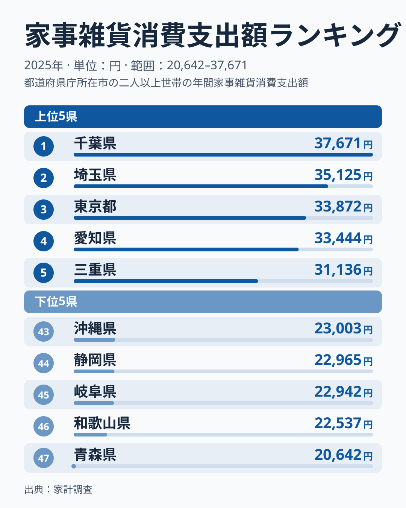
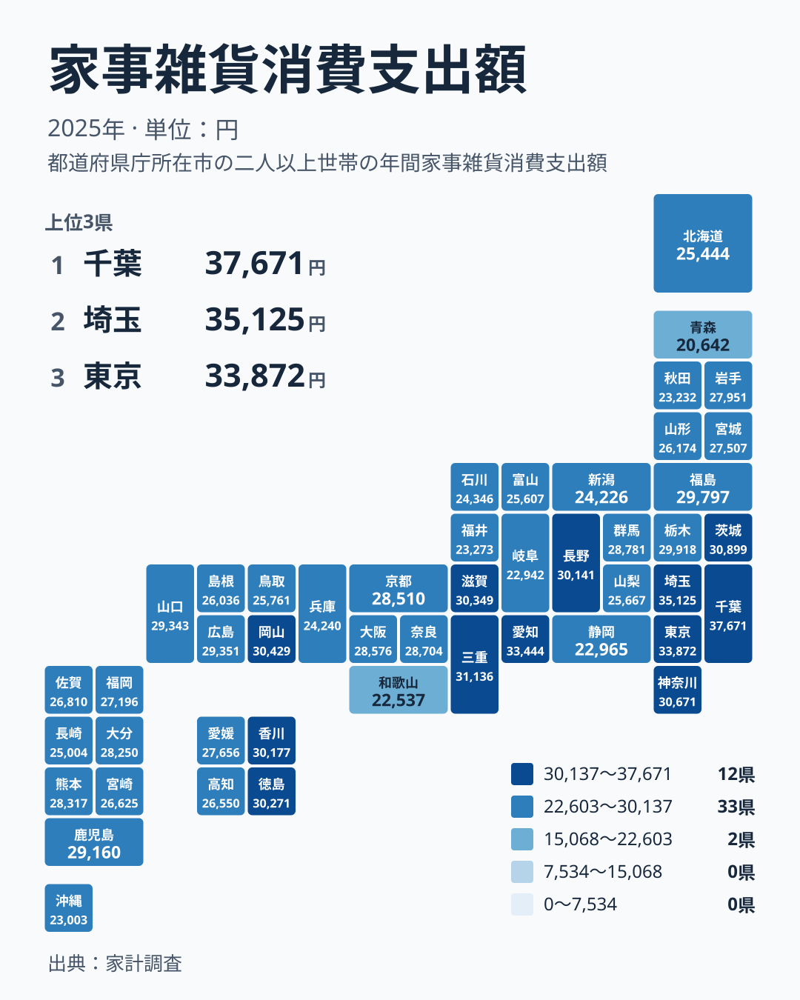

台所用品、掃除用具、日用雑貨など、暮らしを支える小さな道具は、一つひとつの金額こそ小さいものです。それでも一年を通じて買い続けると、家計の中で無視できない支出になります。2025年の家計調査によると、この家事雑貨への支出が最も多いのは千葉県で、37,671円でした。一方、最も少ない青森県は20,642円です。

最大と最小の差は、1位と47位の間に確かにあります。ただ、この差を「千葉県の人は雑貨好き」「青森県の人は節約家」と受け取るのは早計です。この記事では、順位の並びから見える地域の傾向を整理し、住まいや暮らしの条件という別の切り口で、差の背景を仮説として考えます。

## 上位と下位の顔ぶれを確認する

まず、上位5県と下位5県を並べた図を見てください。

<source-link href="/ranking/household-utensils-group-consumption-expenditure">家事雑貨への支出ランキングをもっと見る</source-link>

上位には、1位の千葉県が37,671円、2位の埼玉県が35,125円、3位の東京都が33,872円、4位の愛知県が33,444円、5位の三重県が31,136円と並びます。首都圏の3都県が上位3位までを占め、そこに愛知県と三重県が続く形です。上位5県のなかでも、千葉県の37,671円は2位の埼玉県の35,125円を引き離しています。

下位に目を移すと、47位が青森県の20,642円、46位が和歌山県の22,537円、45位が岐阜県の22,942円、44位が静岡県の22,965円、43位が沖縄県の23,003円です。下位5県は22,000円台から23,000円台前半にほぼ固まっており、47位の青森県だけが20,000円台前半まで下がっています。最大と最小を比べると、千葉県の37,671円は青森県の20,642円のおよそ1.8倍にあたります。

注目したいのは、上位が大都市圏の周辺に集まる一方で、下位は東北の青森県、近畿の和歌山県、中部の岐阜県と静岡県、そして沖縄県と、地域がばらばらな点です。下位に共通する地方のような単純なまとめ方はできません。県ごとに別々の事情が働いていると考えるほうが自然です。

> [!NOTE]
> ここでの家事雑貨は、家計調査で台所用品や掃除用具、日用雑貨にあたる費目です。洗剤やごみ袋のような家事用消耗品とは別に区分されています。金額は二人以上の世帯が一年間に支出した額で、一人暮らしの世帯は含まれません。単身世帯の多い都市部と数字を直接重ねると、読み違えるおそれがあります。

## 地図で見ると関東の存在感が際立つ

次に、47都道府県の分布をタイルマップで確かめます。

関東の7都県を確かめると、千葉県が1位、埼玉県が2位、東京都が3位、茨城県が6位、神奈川県が7位、栃木県が13位、群馬県が18位です。7都県のうち5つが7位以内に入っており、地方としてのまとまりの強さが目立ちます。栃木県と群馬県は13位と18位にとどまるため、関東のなかでも差がある点は押さえておきたいところです。

近畿では、滋賀県が9位と上位に入る一方、奈良県が19位、大阪府が20位、京都府が21位、兵庫県が39位、和歌山県が46位と、順位に大きなばらつきがあります。大阪府は大都市ですが、支出額は28,576円で20位にとどまり、都市の規模だけでは説明しきれないことがわかります。なお愛知県の4位と三重県の5位は、上位に入る例として別に押さえておきます。

中国地方では、岡山県が8位の30,429円、広島県が15位、山口県が16位、島根県が32位、鳥取県が33位です。四国でも、徳島県が10位の30,271円、香川県が11位の30,177円と上位に近い一方、愛媛県が25位、高知県が30位です。同じ地方のなかでも、順位が大きく離れる県があることが、このデータの特徴といえます。

> [!TIP]
> 地図で濃淡を読むときは、地方単位の印象よりも、隣り合う県の差に注目すると見通しがよくなります。たとえば兵庫県は39位ですが、隣の大阪府は20位、岡山県は8位です。県境をまたいで順位が大きく動く場所には、住宅事情や買い物環境といった地域固有の要因が隠れている可能性があります。

## 住まいの条件から考える仮説

では、なぜ首都圏の周辺で支出が膨らむのでしょうか。ここでは「住まいの広さと買い替えの頻度」という切り口で、あくまで仮説として考えます。家事雑貨は、収納用品、掃除用具、キッチン用品など、住まいの手入れに直接かかわる支出です。住宅が広い、あるいは新しく入居した世帯が多い地域ほど、収納用品や掃除道具を買いそろえる機会が増えるかもしれません。

千葉県や埼玉県は、東京都心に通う世帯が郊外に住まいを構えやすい地域といわれます。新居への入居や住み替えのたびに、家事雑貨をまとめて購入する需要が生まれやすいという見方もできます。ただし、住宅の種類や築年数に関する数値は今回の実データに含まれていません。これは順位の並びから導いた読み解きの一方向にすぎず、千葉県が1位になる理由を証明するものではありません。

愛知県は4位、三重県は5位と、中部の愛知県と近畿の三重県を含む地域が上位に入っています。ただし、同じ中部の静岡県が44位、岐阜県が45位であることを考えると、隣り合う県でも支出は一様ではありません。産業や地域の共通点だけで説明するのは難しく、暮らし方や買い物の場所の違いも関わっていそうですが、データからは確かめられません。

> [!WARNING]
> 家計調査は標本調査であり、調査世帯の回答から都道府県の値をまとめています。調査世帯の数には限りがあるため、順位が近い県どうしの差は、実際の生活の違いというより、標本のぶれで生じている可能性があります。たとえば9位の滋賀県は30,349円、10位の徳島県は30,271円とわずかな差で並んでおり、この程度の差で優劣を語るのは避けてください。

## 暮らしにどう生かすか

読者の生活に引き寄せて考えると、このデータが示すのは「家事雑貨の支出に標準額はない」という点です。上位の千葉県と下位の青森県で開きがある以上、自分の世帯の支出が平均より多いか少ないかだけで、家計の良し悪しを判断する必要はありません。

もし自分の支出が気になるなら、まず住まいの状況と照らしてみてください。入居や引っ越しの直後は、収納用品や掃除道具が一時的に増えやすいでしょう。逆に、何年も同じ住まいで暮らしている世帯は、必要な道具がすでにそろっているので、支出が抑えられる場合もあります。数字の差には、節約意識の差だけでなく、買いそろえる時期の違いを映している面もありえますが、今回のデータだけでは断定できません。

地域ごとの数字を詳しく見たい方は、[千葉県のデータ](/areas/12000)や[埼玉県のデータ](/areas/11000)で、他の統計との組み合わせも確かめられます。住居や食料など他の費目と並べると、家事雑貨だけが突出しているのか、全体的に支出が高い地域なのかが見えてきます。ほかの暮らしの統計をまとめて見たい場合は、[同じカテゴリの統計一覧](/category/economy)も役立ちます。

## 順位の差をどう受け止めるか

最後に、今回の結果をまとめます。2025年の家事雑貨への支出は、1位の千葉県が37,671円、2位の埼玉県が35,125円、3位の東京都が33,872円と、首都圏が上位を占めました。下位は、47位の青森県が20,642円、46位の和歌山県が22,537円、45位の岐阜県が22,942円でした。最大と最小の比はおよそ1.8倍です。

ただし、この差を「豊かさの差」や「意識の差」と読むのは適切ではありません。住まいの条件、世帯の構成、買い物の場所、調査の標本数など、複数の要因が重なって数字をつくっていると考えられます。順位は、地域の暮らしを考える入り口として使い、断定の材料にはしないのが安全です。

今回の結果で印象的なのは、大阪府が20位、兵庫県が39位、岡山県が8位というように、隣り合う県で順位が大きく変わる点でした。地域の平均像を一括りにせず、県ごとの事情に目を向けることが、数字を正しく読む近道です。

## データについて

この記事で使った家事雑貨消費支出額は、家計調査の2025年の結果で、単位は円です。二人以上の世帯が一年間に家事雑貨へ支出した額を、都道府県別に並べた値を使っています。表示している金額と順位は、すべて実データの値をそのまま用いており、独自の補正や平均化はしていません。
