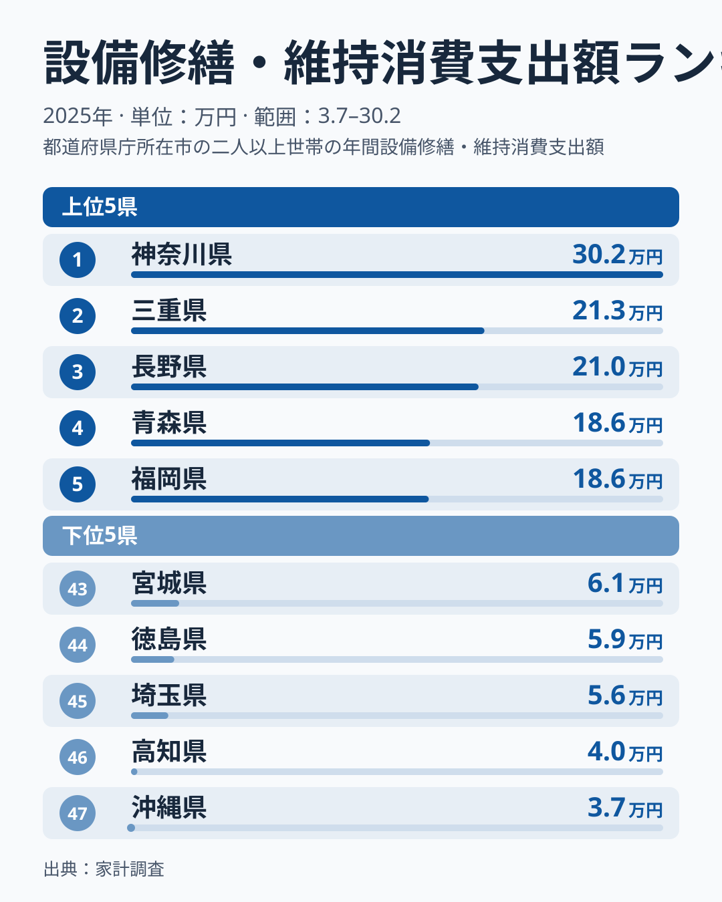
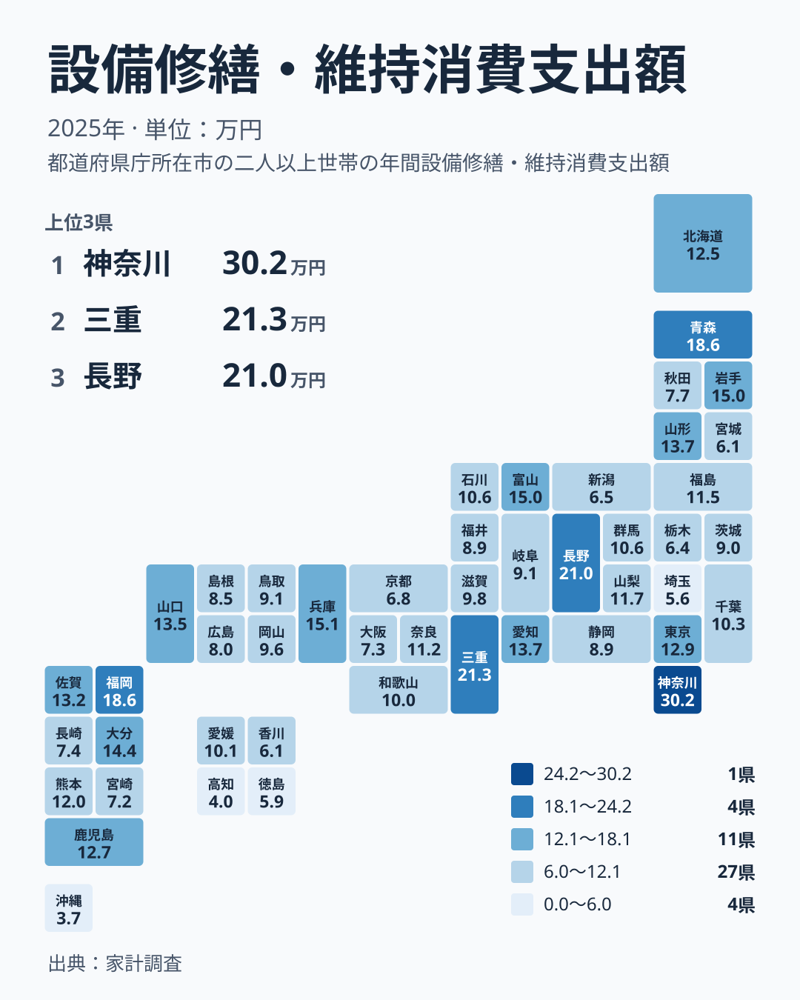

2025年の家計調査で都道府県の数字を並べると、1位の神奈川県は302,325円、最下位の沖縄県は37,094円でした。同じ日本の中で、住まいの手入れにかける金額がここまで違います。

この記事では、設備修繕・維持への支出の都道府県差を、読者の生活にどう関わるかという視点で読み解きます。単純な「多い・少ない」の比較にとどめず、平均値の性格や、数字を読むときの注意点まで掘り下げます。このデータから分かることと、分からないことを分けて書きます。なお、地方の区分は北海道・東北、関東、中部、近畿、中国、四国、九州・沖縄の7つで統一します。三重県は近畿に含めます。

## 上位と下位をまず見る

最初に、上位5県と下位5県を図で確認します。

<source-link href="/ranking/housing-repairs-group-consumption-expenditure">設備修繕・維持への支出ランキングをもっと見る</source-link>

図で注目したいのは、上位の並び方です。1位の神奈川県は302,325円で、2位の三重県は213,243円、3位の長野県は210,322円です。2位と3位はほぼ並んでいるのに対し、神奈川県だけが大きく離れています。4位の青森県は186,117円、5位の福岡県は185,512円で、この2県も肩を並べています。

つまり上位の顔ぶれは、「神奈川県が突出し、その後ろに三重県と長野県が並び、青森県と福岡県が続く」という段差のある構造です。1位の値が全体の傾向を代表しているとは限りません。1県だけの特殊な事情が反映されている可能性も頭に置いておきたいところです。

下位は、最下位の沖縄県が37,094円、46位の高知県が40,253円で、この2県が特に低くなっています。45位の埼玉県は55,681円、44位の徳島県は58,651円、43位の宮城県は61,093円でした。上位5県の中で最も低い福岡県の185,512円と、下位5県の中で最も高い宮城県の61,093円を比べても、大きな隔たりがあります。

上位5県は、神奈川県が関東、三重県が近畿、長野県が中部、青森県が北海道・東北、福岡県が九州・沖縄で、5つの異なる地方にまたがります。下位5県は、沖縄県が九州・沖縄、高知県と徳島県が四国、埼玉県が関東、宮城県が北海道・東北です。上位にも下位にも、特定の地方がまとまって並ぶ傾向は見られません。

> [!NOTE]
> この指標は、1世帯あたりの年間の修繕・維持の支出です。屋根や外壁の工事のように数年に一度まとまってかかる費用も、毎年の平均の中に入ります。そのため、金額は「その年に大きな工事があったか」の影響を強く受けます。

## 地理分布で見える偏り

次に、47都道府県の分布をタイルマップで確認します。

地図にすると、きれいな東高西低や南北の傾きは見えにくく、色の濃淡がまだらに散らばっています。この指標は、気候や地域の特性だけでは説明しにくい性格を持っています。標本の偏りや年ごとの変動が含まれている可能性もあり、読み方には慎重さが必要です。

同じ地方の中でも、ばらつきは目立ちます。関東では、神奈川県が302,325円で1位ですが、埼玉県は55,681円で45位です。隣り合う県でも、順位は大きく離れています。九州・沖縄でも、福岡県は185,512円で5位、沖縄県は37,094円で47位と、上位と最下位が同じ地方に入っています。「関東は多い」「九州・沖縄は少ない」といった地方単位の一言では、実態をとらえきれません。

最大の神奈川県302,325円と最小の沖縄県37,094円を比べると、開きは約8倍に見えますが、これは1年分の標本調査の値同士の比較です。県の恒常的な差と受け取らないことが大切です。

> [!WARNING]
> 家計調査は限られた標本世帯への調査です。修繕は数年に一度の大きな工事が支出を押し上げやすく、たまたま大規模な工事をした世帯が標本に入ると、県の値が大きく動きます。1年分の順位を、その県の恒常的な傾向と受け取らないよう注意が必要です。

## 考えられる背景と、分からないこと

修繕費は、毎月の食費のように一定額が続く支出ではありません。屋根の葺き替えや外壁塗装、給排水設備の入れ替えなどは、まとまった金額が一度にかかります。つまり県の平均値は、「大きな工事をした世帯がどれだけ含まれていたか」に左右されやすい数字です。

この性格を踏まえると、神奈川県の302,325円は、単純に「修繕に熱心な県」という意味とは限りません。大きな工事をした世帯が標本に含まれていた影響が出ているのかもしれません。ただし、これは仮説です。このデータには築年数や持ち家かどうかの情報がなく、神奈川県と沖縄県の違いの理由までは確かめられません。

住居費の地域差については、地価や世帯構造、交通の利便性などが関わるとされています。ただ、それが修繕費の県差にどこまで効いているかは、この記事のデータからは言えません。分かるのは、県ごとの金額と順位に大きな開きがあることまでです。

> [!TIP]
> 順位の近い県同士は、標本の事情で入れ替わることがあります。たとえば4位の青森県は186,117円、5位の福岡県は185,512円で、ほとんど差がありません。順位より金額の開きに注目し、大きな差があるところだけを意味のある違いとして読むのがコツです。

## 暮らしへの含意: 修繕費は「備える」支出

では、この数字は私たちの生活に何を示すのでしょうか。大切なのは、修繕費が「いつか必ずかかる、時期の読めない支出」だという点です。持ち家に住む世帯にとっては、住宅ローンを払い終えても、維持のための費用はその後も続きます。

雪の多い地域を例にすると、順位の幅の広さが分かります。青森県は186,117円で4位ですが、秋田県は77,243円で35位、新潟県は64,820円で40位です。同じ雪国でも、修繕費の水準は大きく分かれています。気候だけで修繕費が決まるわけではないことが、ここからもうかがえます。

実際の暮らしでは、次のような備えが役立ちます。

- 築年数を確認し、屋根・外壁・給排水の更新時期を見通しておくこと
- 毎月の家計とは別に、修繕用の積立を用意しておくこと
- 一度に大きな工事が重ならないよう、時期をずらして計画すること

神奈川県のくわしい数字は[神奈川県のデータ](/areas/14000)、三重県は[三重県のデータ](/areas/24000)で、ほかの指標と合わせて確認できます。住宅や家計に関わるほかの指標は、[同じカテゴリの統計一覧](/category/economy)から探せます。

## 順位が低いことをどう受け止めるか

下位の県は「修繕をしていない」と考えがちですが、そう単純ではありません。支出が少ないのは、工事がたまたま少なかった年だったのかもしれません。その理由は、このデータだけでは判断できません。

たとえば四国では、愛媛県は100,943円で24位ですが、高知県は40,253円で46位、徳島県は58,651円で44位です。同じ四国でも順位は大きく分かれており、順位が低いからといって、住まいの手入れが足りないと決めつけることはできません。

反対に、上位の県は住まいをしっかり維持している面があると見ることもできます。ただし、それが家計の負担感の大きさと同じ意味かどうかは、このデータだけでは分かりません。支出が多いことは、住まいを大切に使っている結果である可能性と、まとまった負担を抱えている可能性の、両方を含んでいます。

## データについて

この記事の数値は、家計調査の2025年の「設備修繕・維持消費支出額」です。単位は円で、1世帯あたりの年間支出額にあたります。全47都道府県の値が公表されており、1位は神奈川県の302,325円、47位は沖縄県の37,094円です。

標本調査であるため、年ごとの変動が大きく出ることがあります。県間の比較には、順位だけでなく金額の開きも合わせて見ることをおすすめします。

## まとめ

設備修繕・維持への支出は、神奈川県の302,325円から沖縄県の37,094円まで、大きな開きがありました。上位にも下位にも特定の地方が固まらず、同じ地方の中でも順位が大きく分かれています。

この開きの理由は、1年分の標本調査からは断定できません。大規模な工事の有無などが影響している可能性はありますが、仮説の域を出ません。自分の住まいの状況に引き寄せて読むと、修繕費への備えを考えるきっかけになります。
