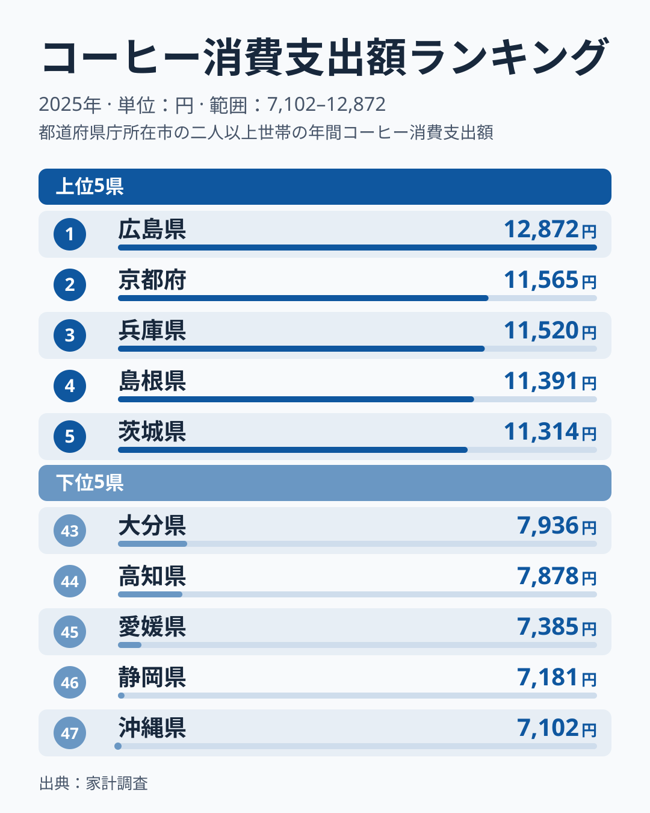
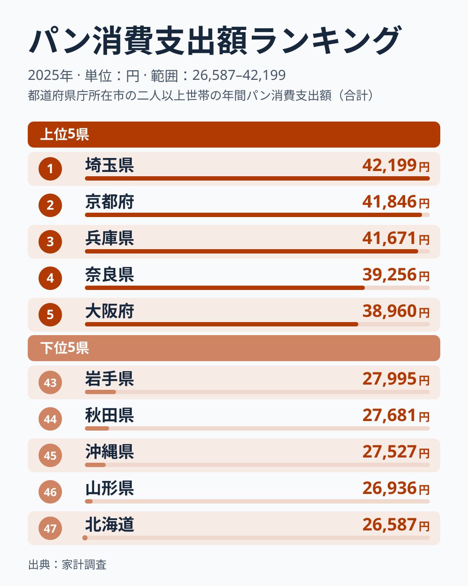
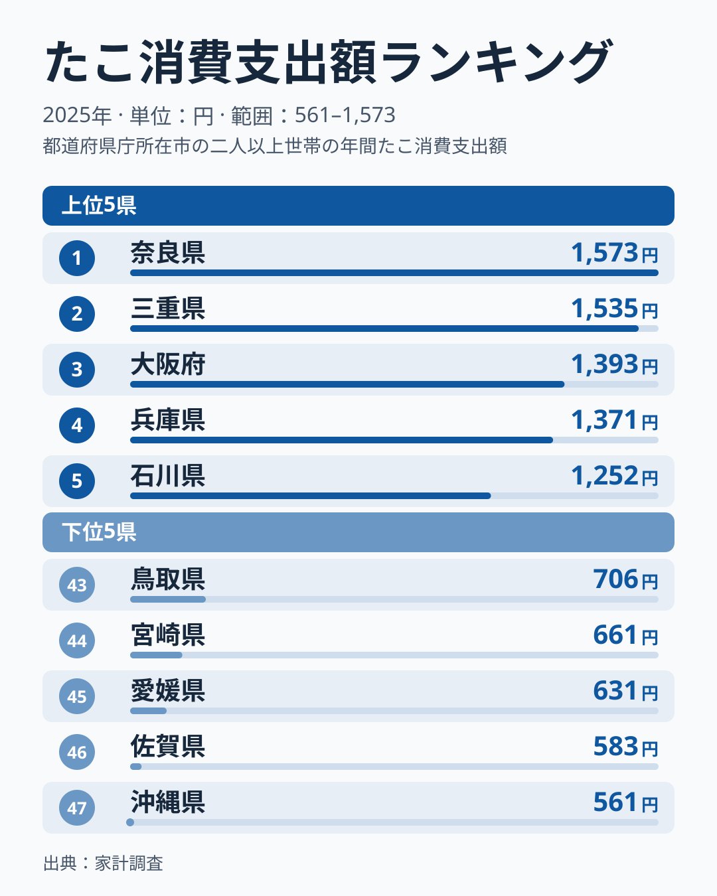
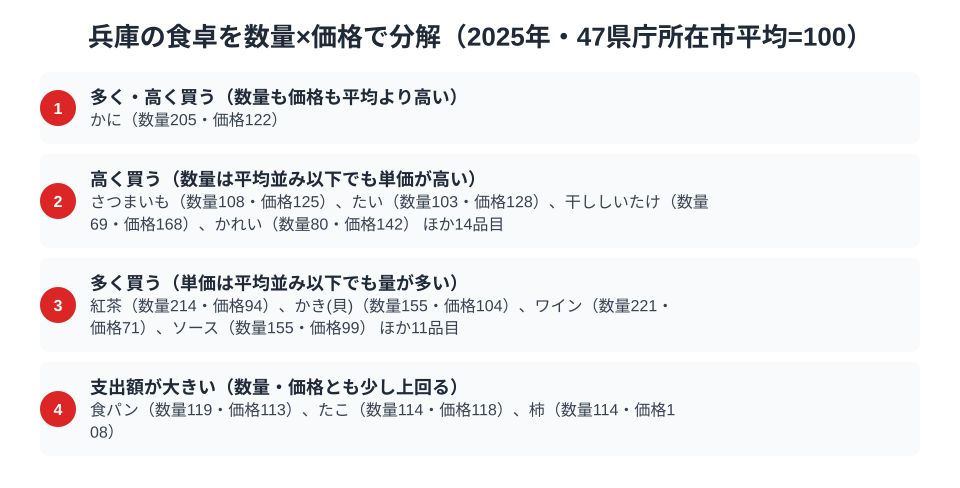

コーヒー、パン、たこ。一見バラバラに見える3品目で、兵庫県はそろって消費支出額の上位に入っています。総務省「家計調査」の品目別データ（2025年、都道府県庁所在市）では、コーヒーが3位、パンが3位、たこが4位です。3品目すべてで4位以内に入る県は、47都道府県のうち兵庫だけです。前年（2024年）の同じ集計では3品目とも1位だったため、単年の順位は入れ替わりやすい一方、兵庫が3品目とも上位に並ぶ点は変わっていません。

この記事では、コーヒー消費支出額11,520円（全国3位）、パン消費支出額41,671円（全国3位）、たこ消費支出額1,371円（全国4位）という3つの数字から、兵庫がなぜコーヒー・パン・たこのすべてで上位に入るのかを、データにもとづいて読み解きます。理由の部分は、データで直接確かめられない推測を[仮説]と明記して書きます。

> [!NOTE]
> 本記事の数値はすべて総務省「家計調査（品目別支出額）」2025年の都道府県庁所在市・二人以上世帯データです。兵庫県は神戸市の家計簿から集計されており、県全域の平均ではなく神戸市民の消費行動を反映しています。市別の値は単年のぶれが大きく、1位と3位の差も数百円にとどまるため、順位の入れ替わりを構造の変化とは読まないでください。

## コーヒー消費支出額 — 全国3位11,520円、1位の広島とは約1割差

<source-link href="/ranking/coffee-consumption-expenditure">コーヒー消費支出額ランキングをもっと見る</source-link>

兵庫県のコーヒー消費支出額は11,520円で全国3位です。1位は広島県で12,872円、2位は京都府で11,565円で、兵庫は2位の京都府とほぼ並んでいます。4位は島根県で11,391円、5位は茨城県で11,314円と続き、上位は僅差で並んでいます。最下位は沖縄県で7,102円、1位の広島との差は約1.8倍です。

[仮説]として、神戸は1868年の開港以来、外国人居留地を通じて西洋の食文化がいち早く流入した街で、喫茶店文化が早くから根づいたことが、家庭でのコーヒー消費にも残っている可能性があります。ただし、この記事で使うのは年間の支出額だけで、歴史的な背景そのものはデータから確かめられません。1位が広島、2位が京都、6位が東京都と、港町に限らず都市部や観光地の県庁所在市が上位に並んでいる点は、開港の歴史だけでは説明しきれない部分です。検証するには、喫茶店の事業所数や外食のコーヒー支出との突き合わせが必要です。

## パン消費支出額 — 全国3位41,671円、上位3県が僅差

<source-link href="/ranking/bread-consumption-expenditure">パン消費支出額ランキングをもっと見る</source-link>

パン消費支出額も兵庫県が41,671円で全国3位です。1位は埼玉県で42,199円、2位は京都府で41,846円で、兵庫と1位の差は約1.3%しかありません。4位は奈良県で39,256円、5位は大阪府で38,960円と、近畿の県庁所在市が上位に集まっています。最下位は北海道で26,587円、1位の埼玉との差は約1.6倍です。

[仮説]として、神戸は開港とともに西洋式のパン食が持ち込まれた土地で、朝食にパンを選ぶ家庭が多いことが数字に表れている可能性があります。近畿の4県（兵庫・京都・奈良・大阪）が上位5位以内に入っていることは、この仮説と矛盾しません。ただし、パンは購入先や品種を問わない広い区分の支出額で、パンの種類まで分けた集計ではないため、神戸のパン屋のブランドが効いているかどうかまでは言い切れません。

## たこ消費支出額 — 全国4位1,371円、明石の海を持つ県が近畿勢の一角に

<source-link href="/ranking/octopus-consumption-expenditure">たこ消費支出額ランキングをもっと見る</source-link>

たこ消費支出額は兵庫県が1,371円で全国4位です。1位は奈良県で1,573円、2位は三重県で1,535円、3位は大阪府で1,393円と続き、兵庫は3位の大阪府とほぼ並んでいます。最下位は沖縄県で561円、1位の奈良との差は約2.8倍にのぼり、3品目の中で最も地域差が大きい数字です。

[仮説]として、兵庫のたこ消費を支えているのは明石海峡の存在かもしれません。明石だこは潮流にもまれて身が締まることで知られ、地元では「たこ飯」や「明石焼き（玉子焼き）」として食卓に上ると言われています。ただし、1位の奈良県と2位の三重県はいずれも明石ほどの産地として知られておらず、たこの支出額は産地の近さだけでは決まらないこともデータは示しています。コーヒーやパンが「洋食の広がり」と結びつけて考えられるのに対し、たこは「地元の海の幸」や、粉もの文化といった別の理由で上位に入っている可能性があります。

> [!WARNING]
> 家計調査の数値は「支出額」であり「消費量」ではありません。物価水準や購入頻度の違いも反映されるため、明石だこの漁獲量自体を直接示す数字ではない点に注意が必要です。また明石焼き（玉子焼き）は「その他の外食」など別区分に計上される場合があり、たことそのものの購入額だけでは兵庫の食文化の全体像を測りきれない面もあります。

## 兵庫の食卓を貫くもの

コーヒー・パン・たこという一見無関係な3品目で、兵庫の順位は3位・3位・4位です。3品目すべてで上位4位以内に入る県は兵庫以外になく、上位10位以内まで広げても、コーヒー1位・パン8位・たこ7位の広島県と兵庫の2県だけです。1位の県は品目ごとに広島・埼玉・奈良と分かれており、3品目をそろって上位に保つ点が兵庫の特徴といえます。

[仮説]として、この安定は「開港都市・神戸」と「漁港・明石」という2つの顔を持つ兵庫の地理的な多様性によるものかもしれません。洋食型の朝食習慣がコーヒーとパンに、明石海峡の海産物がたこに結びつくという読み方です。[和歌山の食卓](/blog/wakayama-food-culture)がみかん産地としての農産物依存を示すのに対し、兵庫は「輸入された食文化」と「地元の海産物」という二重構造に見えます。ただし、これは単年の順位から導いた読み方で、複数年で同じ傾向が続くかどうかは、今後の家計調査で確かめる必要があります。

> [!TIP]
> 順位を1位かどうかだけで見ると、2024年は3品目すべて1位、2025年は3位・3位・4位と、まるで順位が大きく下がったように見えます。しかし金額の差で見ると、1位との差はコーヒーが約1割、パンが約1.3%、たこが約13%で、品目内の上位は僅差の競り合いです。1年ごとの順位より「3品目とも上位集団にいるか」で読む方が、市別の家計調査には向いています。

## 数量×価格で分解する神戸市の食卓

<source-link href="/ranking/octopus-consumption-quantity">たこ消費量ランキングをもっと見る</source-link>

ここまで見てきたコーヒー・パン・たこの支出額は、「数量」と「価格」という別々の要素が積み重なった結果です。総務省「家計調査」は品目ごとに消費量（数量）と消費支出額の両方を公表しているため、支出額を数量で割れば単価に近い指標が計算できます。47都道府県庁所在市の平均をそれぞれ100とした指数で比べると、コーヒーは数量指数137.0・価格指数88.6で、単価は平均を下回るのに数量が多く、それで支出額が平均の約1.2倍（支出指数121.4）になっています。たこ消費量は数量指数114.0・価格指数117.7、食パンは数量指数119.3・価格指数112.6で、どちらも数量と価格の両方が平均を少し上回る形です。神戸市の家庭はコーヒーを特別高い値段で買っているのではなく、単純に消費量そのものが多いのです。

一方で、品目によって「支出額が大きい」理由の中身は異なります。かには数量指数205.0・価格指数121.8で、量も単価も平均を上回り、支出額指数は249.6と平均の約2.5倍、47市で3位です。紅茶（数量指数214.2・価格指数94.2）は単価が平均より低いまま量が多く、消費支出額は47市で1位です。かき（貝）は数量指数155.2・価格指数103.7、ワインは数量指数220.8・価格指数71.2で、いずれも単価より購入量が支出額を押し上げています。逆に干ししいたけ（数量指数69.1・価格指数168.3）は購入量が少ないのに単価が高く、質の良いものを選んで買うパターンです。「たくさん買う」「高いものを選ぶ」「その両方」という3通りの理由が、同じ「支出額が大きい」という結果の裏に隠れていることが、この分解から見えてきます。

支出額の順位だけを見ると「兵庫は高級品を買っている」と誤解しがちですが、コーヒーは価格指数が平均を下回り、数量指数だけが突出しています。品目を数量指数と価格指数に分けて読むと、「たくさん買っている県」なのか「高いものを選んでいる県」なのかを区別できます。

> [!NOTE]
> ここでの指数は「47都道府県庁所在市の単純平均＝100」を基準にした相対値で、家計調査が公表する全国平均とは一致しません。価格指数は支出額を数量で割った単価の相対値であり、購入している品種やブランドの違いも含むため、純粋な物価水準を示すものではない点にも注意が必要です。対象は二人以上世帯・神戸市の年間データ（2025年）です。

## まとめ

- コーヒー消費支出額は兵庫県が11,520円で全国3位、1位は広島県の12,872円、2位は京都府の11,565円
- パン消費支出額は兵庫県が41,671円で全国3位、1位は埼玉県の42,199円で差は約1.3%
- たこ消費支出額は兵庫県が1,371円で全国4位、最下位は沖縄県で561円、1位の奈良県とは約2.8倍の開き
- 3品目すべてで4位以内に入る県は兵庫だけで、前年の3品目1位から順位は動いたものの、上位集団に残る点は同じ

兵庫県の地域プロフィールは[兵庫県のページ](/areas/28000)で他の指標もあわせて確認できます。家計調査にもとづく他の経済指標は[経済カテゴリ一覧](/category/economy)からご覧いただけます。

## データについて

総務省統計局「家計調査（品目別支出額）」2025年、都道府県庁所在市・二人以上世帯のデータを使用。e-Stat（政府統計の総合窓口）経由で取得・集計しています。
