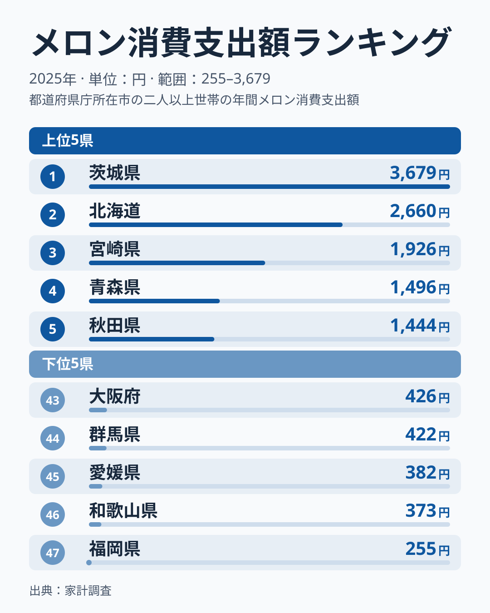
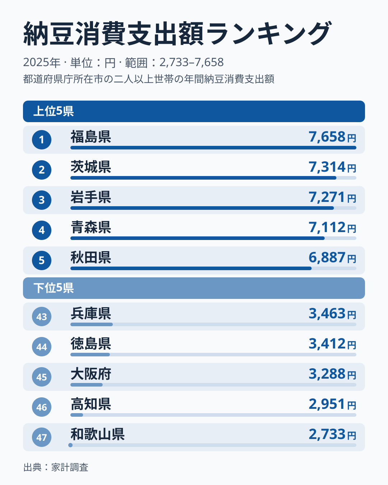
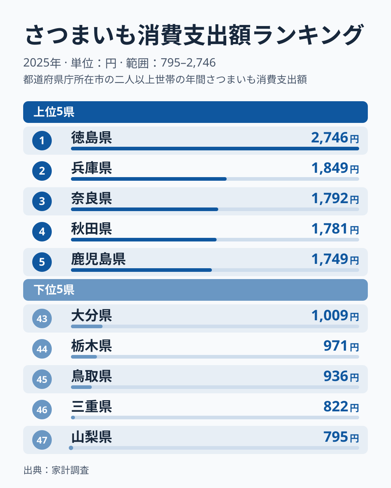
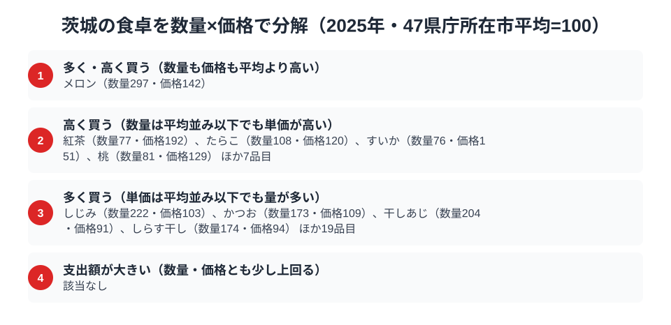

茨城と聞いて食卓を思い浮かべるなら、まず出てくるのは「メロン」と「納豆」ではないでしょうか。実際に家計調査のデータを見ると、[茨城県](/areas/08000)の県庁所在市（水戸市）はメロンの消費支出額で47市中1位という結果が出ています。年間3,679円、2位の北海道2,660円を大きく引き離しています。

もう一方の代名詞である納豆は2位で、1位には届きませんでした。さらに、さつまいもは47市中41位と下位にとどまっています。この記事では、家計調査（品目別）の実データから、メロン・納豆・さつまいもの3品目を通して茨城の食卓の内訳を掘り下げます。なお、家計調査は県庁所在市の二人以上世帯の値で、県全体の値ではありません。以下で「茨城県」と書いた値も、水戸市の家計の値を指します。

> [!NOTE]
> 水戸市1市の標本から作る値のため、年ごとのぶれが出やすい点に注意してください。納豆の1位との344円差や3位との43円差が、順位が入れ替わる程度の差なのか、実質的な差なのかは、2025年単年のデータでは判断できません。

## メロン — 県庁所在市で最多の3,679円

<source-link href="/ranking/melon-consumption-expenditure">メロン消費支出額ランキングをもっと見る</source-link>

茨城県のメロン消費支出額は3,679円で、47市中1位です。北海道は2,660円で2位、宮崎県は1,926円で3位となっており、茨城は2位の北海道の約1.4倍という水準にあります。

茨城県はメロンの産地として知られています。[仮説] 地元で採れたメロンが身近に出回ることが支出額の多さにつながっている可能性はありますが、本記事のデータは消費支出額のみで、生産量や流通経路は確かめられません。産地と消費の関係は、あくまで仮説にとどまります。なお、メロンが首位に立つ理由は、購入量と単価の分解で読めます。茨城の数量指数は297、価格指数は142で、量でも単価でも平均を上回っています（詳しくは後述の「数量×価格で分解する茨城県の食卓」の節で扱います）。

## 納豆 — 2位7,314円、最多の福島県と344円差

<source-link href="/ranking/natto-consumption-expenditure">納豆消費支出額ランキングをもっと見る</source-link>

茨城県の納豆消費支出額は7,314円で、47市中2位です。福島県は7,658円で1位、岩手県は7,271円で3位、青森県は7,112円で4位、秋田県は6,887円で5位となっており、上位5県のうち茨城以外の4県は、いずれも東北の県です。1位の福島県との差は344円で、茨城の支出額の5%弱にあたります。

では、344円差はどこまで「迫っている」と言えるのでしょうか。3位の岩手県は7,271円で茨城との差は43円しかなく、2位から4位の青森県7,112円までは202円の幅に収まっています。1位との差である344円は、この上位集団の中に収まる程度の開きです。ただし、差が単年のぶれの範囲かどうかは、2025年単年のデータだけでは判断できません。言えるのは「1位との差が344円と小さい」ことと、「上位に東北の県が並ぶ」ことの2点です。

[仮説] 1つ目の可能性は、差が小さいため、家計調査の市別の値にありがちな単年のぶれで順位が入れ替わったという見方です。2つ目は、買う頻度が多いのか、1回あたりの購入額が大きいのかといった買い方の違いが順位に表れている可能性です。本データは年間の支出額だけなので、どちらの見方も確かめられません。検証には複数年の推移や購入頻度のデータが必要です。

## さつまいも — 1位徳島の4割弱、41位の1,051円

<source-link href="/ranking/sweet-potato-consumption-expenditure">さつまいも消費支出額ランキングをもっと見る</source-link>

茨城県のさつまいも消費支出額は1,051円で、47市中41位と下位に位置します。徳島県は2,746円で1位、茨城の1,051円は徳島県の4割弱にとどまります。なお、最下位は山梨県の795円です。

[仮説] 支出額が低い理由として、購入の回数が少ない、単価の低いものを選んでいるといった見方が考えられますが、本記事のデータは年間の支出額だけで、購入回数や等級は確かめられません。この記事から言えるのは、1位の徳島県と茨城県のあいだに2.6倍ほどの開きがあるという事実までです。[徳島の食卓](/blog/tokushima-food-culture)と見比べると、品目ごとの違いがより分かりやすくなります。

> [!WARNING]
> 家計調査の支出額は金額ベースです。金額が大きくても、量が多いのか単価が高いのかは支出額だけでは区別できません。また、単価の高い等級を選んでいるのか、特定の時期に買っているのかも、年間の支出額からは分かりません。この記事の3品目だけで茨城の食卓や農業の全体像を語ることはできない点に注意してください。

## 数量×価格で分解する茨城県の食卓（メロン中心）

<source-link href="/ranking/melon-consumption-quantity">メロン消費量ランキングをもっと見る</source-link>

家計調査の支出額は「金額=数量×価格」という式に分解できます。ここでは、47県庁所在市の平均を100とした指数を使います。前半の節と同じく、茨城県（水戸市）の2025年・二人以上世帯の値です。図の分類は、指数が120以上なら「多い・高い」、80以下なら「少ない・安い」という基準で分けています。なお、この図で指数が示されているのはメロン、しじみ、紅茶などの品目で、納豆とさつまいもの数量・価格指数は図にないため分解できません。この節は、3品目のうちメロンを中心にした分解です。

メロンの数量指数は297に達し、価格指数も142と高めです。量と単価の両方が平均を大きく上回る点で、メロンは図の中でも特に目立つ品目です。単に高いメロンを少しだけ買っているのではなく、たっぷり買ったうえで、単価もやや上のものを選んでいる構図がうかがえます。

対照的に、しじみは数量指数222と平均の2倍以上ですが、価格指数は103で平均並みです。量で買うタイプの代表といえます。反対に紅茶は数量指数77と購入量は平均を下回るのに、価格指数は192と平均の2倍近くあり、単価で買うタイプの代表です。これ以外の品目の指数は図に任せ、ここではメロンとの対比に絞ります。

[仮説] 量で買う品目（図ではしじみ・かつお・干しあじ・しらす干し）は、いずれも魚介の品目で、日常の食卓で繰り返し買われる食材という共通点があります。一方、単価で買う品目（紅茶・すいか・桃）は、毎日大量に買うというより、選んで買う嗜好品や季節の品目に近い性格です。この見方は図の品目の並びからの推測で、購入頻度や買い方のデータで確かめたものではありません。

数量指数と価格指数に分解すると、同じ食卓の中でも品目によって「量で買う」「単価で買う」という性格が違うことが見えてきます。

> [!NOTE]
> ここでの指数は「47都道府県庁所在市の単純平均=100」を基準にした相対値です。価格指数は支出額と数量から求めた単価の比べ方なので、同じ品目でも安い等級を多く買うか高い等級を少し買うかで数字が変わり、純粋な価格水準を測るものではありません。

## まとめ

- メロン消費支出額は3,679円で47市中1位、2位北海道の2,660円を大きく引き離す
- 納豆消費支出額は7,314円で2位、1位の福島県は7,658円で差は344円。3位の岩手県とは43円差で、理由は単年のデータでは特定できない
- さつまいも消費支出額は1,051円で41位、1位徳島県の2,746円の4割弱
- メロンは数量指数297・価格指数142で、量も単価も平均を大きく上回る
- 品目によって「量で買う」「単価で買う」の性格が異なり、支出額の順位だけでは見えない

詳しくは[経済カテゴリ一覧](/category/economy)から他の食品ランキングもあわせてご覧ください。
