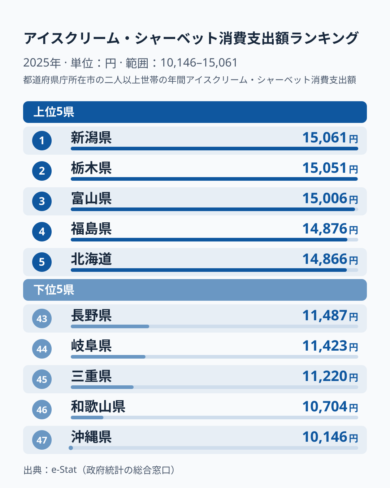

「夏に暑い県ほどアイスをよく買う」——そう思っていませんか。2025年の家計調査を見ると、1位は**新潟県で15,061円**、2位は栃木県で15,051円、3位は富山県で15,006円と、上位は気候では割り切れない顔ぶれです。一方で最下位の**沖縄県は10,146円**にとどまり、2007年以降の19年間では9回も最下位になっています。年ごとに順位が入れ替わる県が多いなかで、沖縄は低さが続いており、和歌山も下位に偏る県です。

2025年の47都道府県の消費支出データでは、1位の新潟県は15,061円、最下位の沖縄県は10,146円で、その差は**約1.5倍**、絶対額で4,915円です。ただし1位と最下位の比較は47の値の両端を取るため、標本の小さな家計調査ではぶれが最も拾われやすい組み合わせです。この記事では、2025年の上位・下位の事実を先に示し、複数年で見えるパターンと、理由として考えられる仮説を分けて整理します。

> [!NOTE]
> 本データは総務省「家計調査」の都道府県庁所在市の二人以上世帯の年間支出額です。世帯全体のアイスクリーム・シャーベットへの支出を集計したもので、個人の消費量や県全体の平均とは異なります。標本が小さいため順位は年ごとに大きく動き、隣り合う年の順位は1県あたり平均で約11位入れ替わります。

## アイスクリーム消費支出の上位・下位（2025年）

2025年のアイスクリーム・シャーベット消費支出額ランキングで、上位5県と下位5県は以下のとおりです。

<source-link href="/ranking/icecream-consumption-expenditure">アイスクリーム・シャーベット消費支出額ランキングをすべて見る</source-link>

上位5県は**新潟が15,061円、栃木が15,051円、富山が15,006円、福島が14,876円、北海道が14,866円**で、1位と5位の差はわずか195円の大接戦です。一方、下位5県は**沖縄が10,146円、和歌山が10,704円、三重が11,220円、岐阜が11,423円、長野が11,487円**となっています。

上位10県まで広げると、北陸の新潟・富山・石川、東北の福島、関東の栃木、北海道に加えて、香川が6位、山口が8位、高知が9位と西日本の県も入っています。寒い地域だけが上位に来るわけではなく、2025年の順位は「寒冷地が多い、暑い県が少ない」という単純な二分法では説明できません。東北でも上位10に入ったのは福島だけで、秋田は42位、青森は31位です。

## 複数年で見ると、北陸が強く沖縄が低い

年ごとの入れ替わりを均して見ると、変わらない傾向もあります。2007年から2025年の19年間で首位になった県を数えると、石川が9回、福島が3回、富山が2回、山形が2回、新潟・埼玉・佐賀が各1回で、19回のうち12回を北陸の石川・富山・新潟が、5回を東北の福島・山形が占めています。2025年の新潟は2024年の28位から1位へ上がったので、北陸が毎年強いというより、北陸の県が代わる代わる首位に立つ形です。

石川県は2008年・2011〜2012年・2014〜2015年・2017年・2019〜2020年・2022年と計9回首位を獲得しており、北陸の代名詞的な存在です。ただし2024年は14位、2025年は7位で、同じ県が毎年首位を保つわけではありません。福島県は2009〜2010年・2023年、山形県は2018年・2024年、富山県は2013年・2016年に首位に立ちました。首位の顔ぶれには、2021年の埼玉県や2007年の佐賀県も入っており、共通する気候条件は読み取れません。

下位側で目立つのは沖縄県です。19年のうち最下位が9回、46位以下が14回に上ります。和歌山県も19年のうち11回が下から3番目以内で、最下位も3回あり、低い側に偏っています。2020年の35位と2022年の25位のように中位まで上がった年もあるため常に最下位ではありませんが、他の県より低い位置に偏っていることは、単年のぶれでは説明しにくい特徴です。

## 上位に来る要因の仮説

上位に北陸や福島が多い理由を、データから断定することはできません。ここでは考えられる仮説を、確かめ方とあわせて整理します。

**[仮説] 冬が長い地域では、夏との季節差がアイスの需要に効いている。** 新潟・富山・石川・福島は夏の暑さと冬の寒さの差が大きい地域として知られます。確かめるには、各県庁所在市の月別のアイス支出と気温を突き合わせる必要があり、この記事では測っていません。北海道や、暖かい香川・山口・高知が上位に入る年があることは、この仮説だけでは説明できません。

**[仮説] 世帯の人数が多い地域では、家族分のアイスをまとめて買う分、世帯あたりの支出が増える。** 家計調査は「二人以上の世帯」が対象で、世帯人員が多い県庁所在市ほど購入額が増えやすい構造があります。確かめるには、家計調査が公表する世帯人員を県ごとに並べ、アイス支出との関係を見る必要があります。

**[仮説] 地元のご当地アイスや、スーパー・直売所で買える地域の素材を使ったスイーツが、購入のきっかけになっている。** 出典となる販売額の統計が手元にないため、現時点では推測にとどまります。

## 下位の沖縄と、年ごとに入れ替わる県

**沖縄県は最下位で10,146円**です。温暖な気候から「アイス消費が多そう」という印象を持ちやすい県ですが、家計調査のデータでは長く下位に位置しています。その理由として考えられるのは、沖縄独自の食文化です。沖縄では暑さをしのぐ飲み物・食べ物として、**さんぴん茶（ジャスミン茶）やフルーツ、かき氷（ぜんざい）など**の代替品が発展してきました。アイスクリームよりもかき氷や地元スイーツで暑さを和らげる文化が定着しているため、スーパーで購入するアイスの支出額が相対的に低くなると考えられます。[仮説] ただしアイスだけの低さなのか、家計全体の支出水準が低いことの反映なのかは、この記事のデータでは切り分けられません。

沖縄以外の下位は、**和歌山県が46位で10,704円、三重県が45位で11,220円、岐阜県が44位で11,423円、長野県が43位で11,487円**で、近畿南部・東海・甲信と特定の気候帯には偏っていません。和歌山県は上のとおり長く低い側にいる県です。三重・岐阜・長野の3県は2024年にいずれも中位から上位にいたため、2025年の下位は共通の理由があるというより、年ごとのぶれの可能性があります。2025年の下位は共通の理由があるというより、年ごとのぶれの可能性が高いと考えられます。

順位が大きく動いた県は、ほかにもあります。香川県は2024年に45位（10,958円）でしたが、2025年は6位（14,799円）に急上昇し、2024年に最下位だった兵庫県も41位（11,729円）に上がりました。山形県は2024年に首位でしたが、2025年は12位です。1年の順位だけで、県の食習慣を語ることは避けた方が安全です。

> [!WARNING]
> 家計調査は「都道府県庁所在市」の世帯データを基準としており、県全体の購買行動を完全に代表するわけではありません。また、コンビニや外食でのアイス購入は家計調査に反映されにくい（家計簿に記録しにくい小額支出）ため、実際の消費量とは乖離がある可能性があります。

## 長い期間で見た支出額の変化

2007年と2025年の47県の中央値を比べると、7,571円から13,026円へ約72%増えています。平均も7,308円から13,063円へ約79%の増加です。これは名目の支出額で、価格の上昇を含みます。アイスの消費量が増えたのか単価が上がったのかは、この指標だけでは分けられません。

[仮説] アイスが「夏の贅沢品」から「年間を通じて買う日常の食品」へと位置づけが変わったことも、増加の背景にある可能性があります。確かめるには、月別の購入額で冬の支出がどれだけ増えたかを見る必要があります。

## まとめ

- **1位は新潟県の15,061円**、最下位は沖縄県の10,146円で約1.5倍の格差（2025年）
- 上位5県は195円差の大接戦で、東北では福島だけが上位10に入った。香川・山口・高知など西日本の県も上位に入っており、寒暖では割り切れない
- 2007〜2025年の19年では、首位の12回を北陸の石川・富山・新潟が、5回を東北の福島・山形が占めた
- 沖縄は19年のうち9回が最下位、和歌山も11回が下から3番目以内と、年ごとの入れ替わりが大きい中で低い側に偏る
- 47県の中央値は2007年比で約72%増加した。名目の支出額で、価格の上昇を含む

アイスの消費行動は、暑さだけでなく**世帯構成・食文化・地域の嗜好品傾向**が複合的に絡み合う指標です。ただし家計調査の県庁所在市は標本が小さく、1年の順位より複数年で一貫する傾向の方が信頼できます。新潟が1位、沖縄が最下位で、年間4,915円の差があるという2025年の事実を出発点に、自分の県の過去の順位も確かめてみてください。

首位を何度も取っている[石川県の地域プロフィール](/areas/17000)や、2025年に首位の[新潟県の地域プロフィール](/areas/15000)では、農業・食文化を中心とした指標を横断的に確認できます。食費・消費支出に関する他の統計は[経済カテゴリ](/category/economy)からご覧いただけます。
