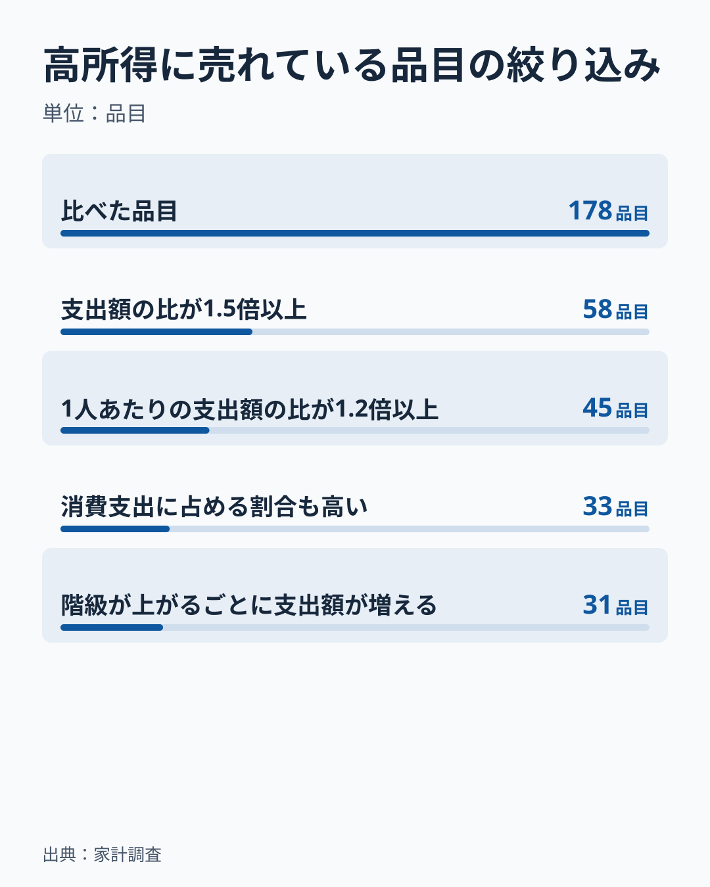
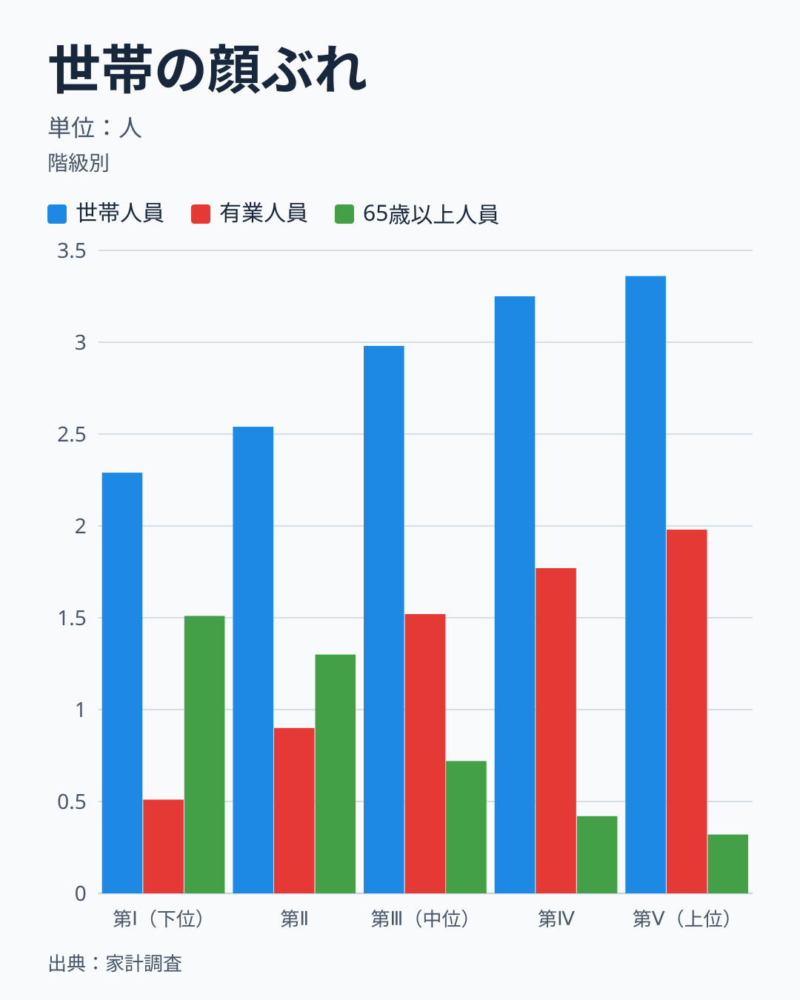
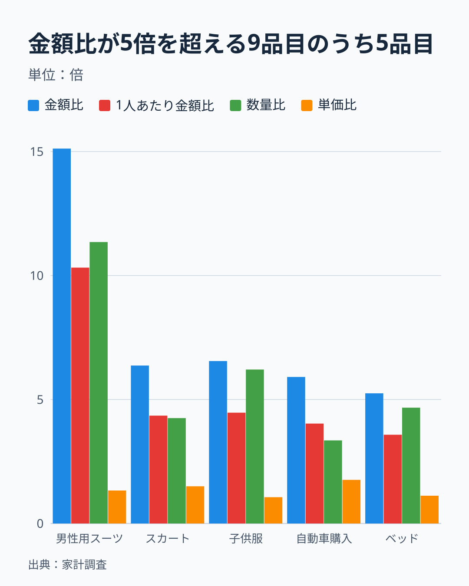
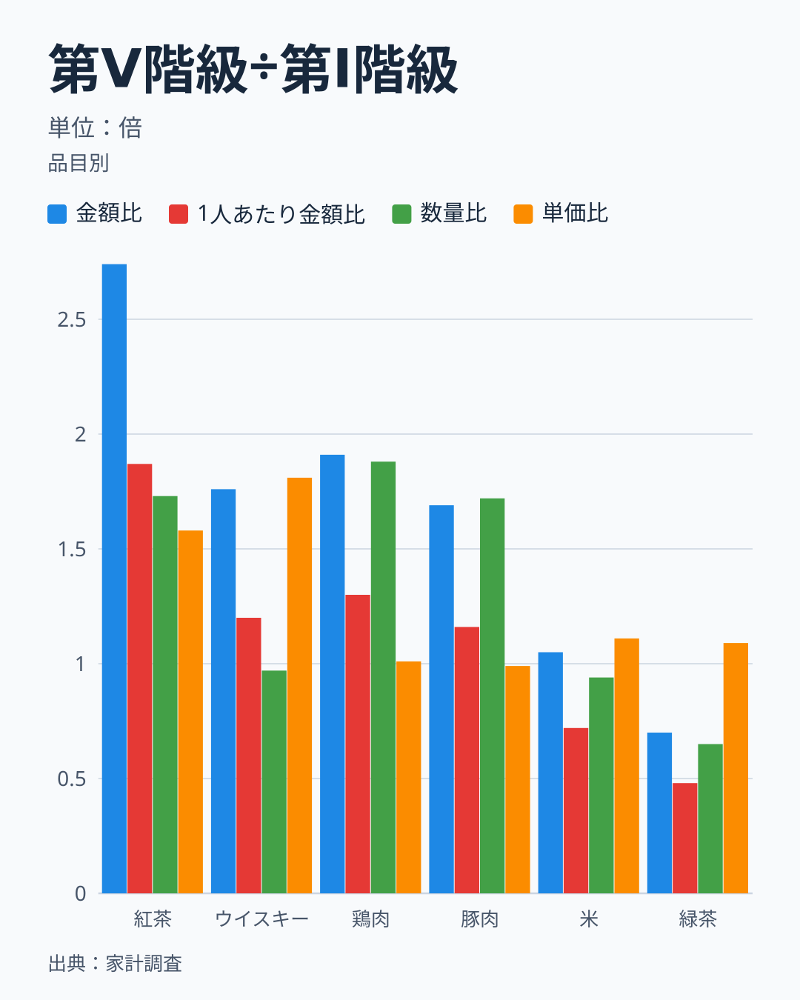
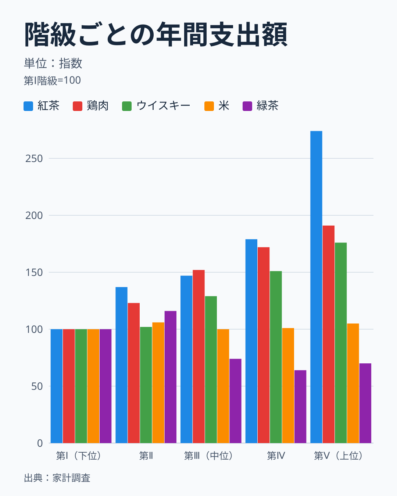
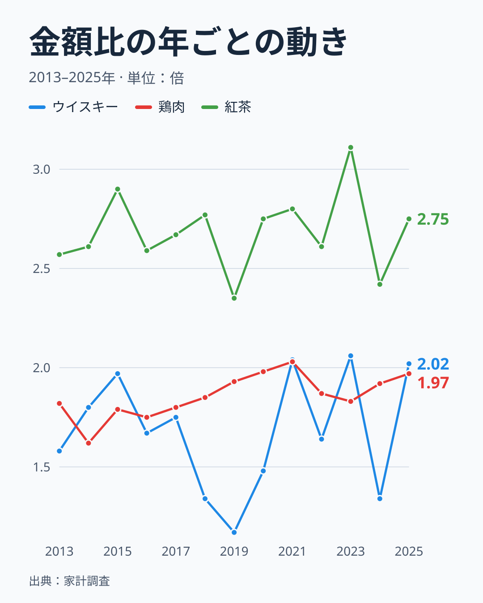
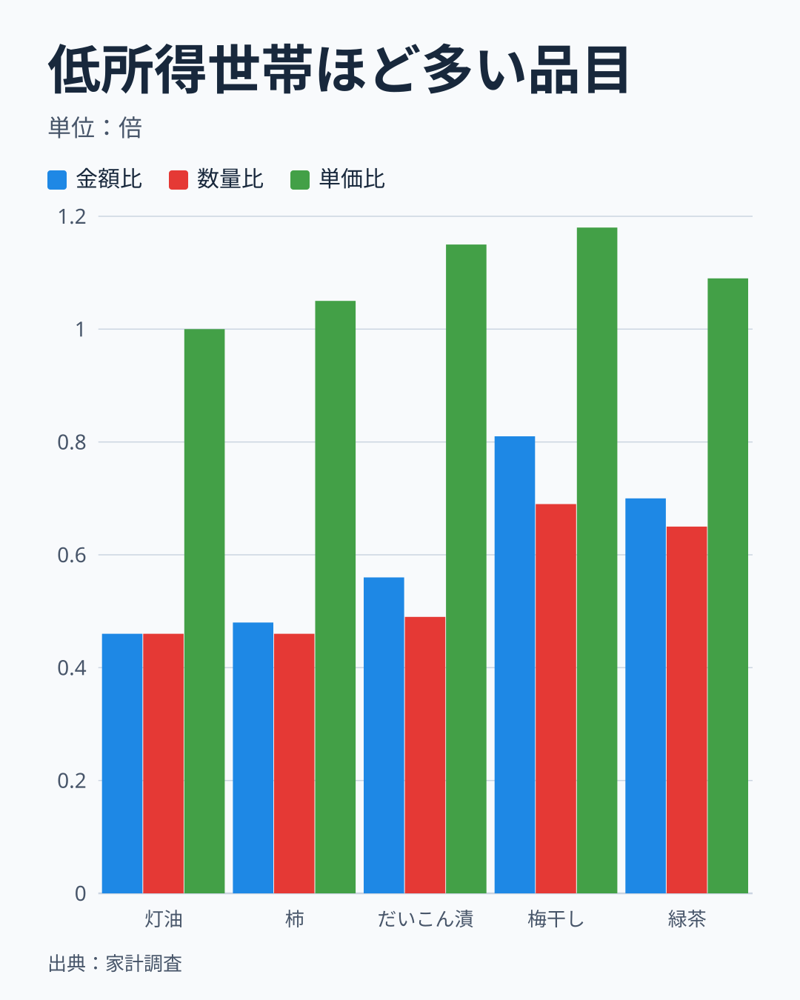

家計調査を年収階級別に読むとき、何を見れば「高所得世帯に売れている」と言えるのでしょうか。答えは、支出額だけでは言えない、です。数量表に載る品目のうち、第Ⅰ階級と第Ⅴ階級の両方で年間支出額が500円以上の178品目を、2023年から2025年の3年平均で比べました。第Ⅴ階級（上位20%）が第Ⅰ階級（下位20%）の1.5倍以上を支出する品目は58ありました。ここから1人あたりの金額、消費支出全体に占める割合、階級が上がるごとの増え方を順に確かめると、31品目まで減ります。さらに、数量と単価（金額を数量で割った値）に分けると、金額差の大きな部分は単価ではなく数量の差でした。

この記事は、品目ごとの結論ではなく、確かめる順番を示します。結論は階級間で世帯の顔ぶれが違うことを前提にして読む必要があります。第Ⅰ階級と第Ⅴ階級の差を、収入だけの効果と書くことはできません。

> [!NOTE]
> 使うのは総務省統計局「家計調査（家計収支編）」の品目分類（2025年改定）の年間収入五分位階級別の表で、全国の二人以上の世帯です。金額は1世帯あたりの年間支出額、数量は年間購入数量です。都市別の列はなく、地域ごとの比較には使えません。品目によって、数量は個数、重さ、容量、回数、畳数などで表されています。単価は金額を数量で割った値で、家計調査の平均価格と同様に購入品の金額と数量から求める算出値です。

## 金額だけを見ると、ほとんどの品目が高所得世帯寄りに見える

最初の確認は、金額の比較です。第Ⅴ階級の年間支出額を第Ⅰ階級で割った金額比を、178品目について計算しました。金額比の中央値は1.20倍で、4分の1の品目が1.03倍以下、4分の3の位置が1.75倍（品目を小さい順に並べて線形補間した値）、上位1割が3.59倍以上です。1.0倍以上の品目は136と、全体の4分の3にのぼります。単純に金額で並べると、ほとんどの品目が高所得世帯に多く売れているように見えます。

この見方には、基準が抜けています。消費支出全体は、第Ⅰ階級が年に約248万円、第Ⅴ階級が約522万円で、2.1倍の差があります。品目の金額比が1.5倍であっても、消費支出全体の2.1倍より小さければ、その品目は高所得世帯にとって相対的に小さな支出です。金額比が消費支出全体の比を下回るなら、消費支出に占める割合は第Ⅰ階級のほうが大きくなります。次の図は、確認を重ねるごとに残る品目の数です。なお、178品目には小計の行（生鮮肉、パン、麺類など）も、子の品目と並んで含まれています。

比べた178品目のうち、金額比が1.5倍以上は58、そこから世帯人員で割った1人あたりの金額比も1.2倍以上は45、さらに消費支出に占める割合も第Ⅴ階級のほうが高い品目は33、階級が上がるごとに金額が増え続ける品目は31でした。最初の58から数えると、残るのは半分強です。食料品に限ると、比べた178品目のうち134品目が食料で、金額比が1.5倍以上は21にとどまり、1.0倍を下回って低所得世帯のほうが多い品目が39ありました。食料は、高所得世帯に売れているという言い方が最も当てはまりにくい分野です。

最後まで残った31品目の内訳は、被服及び履物が19、家具・家事用品が5、食料が4、住居、交通・通信、その他の消費支出が1品目ずつです。被服では男性用スーツ、女性用上着、スカート、靴など、家具・家事用品では電子レンジ、ベッド、鍋・やかん、食料では紅茶、ワイン、チューハイ・カクテル、合いびき肉が入っています。住居は民営家賃、交通・通信は自動車購入、その他の消費支出はハンドバッグです。

## 世帯人員と世帯の顔ぶれをそろえる

2つ目の確認は、世帯の人数です。階級の間で、世帯人員の違いがあります。

世帯人員は、第Ⅰ階級が2.29人、第Ⅴ階級が3.36人で、1.5倍近い差があります。有業人員は0.51人と1.98人で3.9倍、65歳以上の世帯員数は第Ⅰ階級が1.51人、第Ⅴ階級が0.32人と、高齢者は低い階級に集まっています。金額が1.5倍でも、世帯人員の差を除くと、1人あたりの差は1.0倍程度になります。世帯主の平均年齢も、3年平均で第Ⅰ階級が72.4歳、第Ⅴ階級が52.7歳と、約20歳違います。1人あたりに直した金額比が1.2倍に届かなくなったのは、金額比1.5倍以上の58品目のうち13品目です。豚肉の金額比は1.69倍でしたが、1人あたりでは1.16倍になります。他にもカット代、ソーセージ、ベーコン、バター、冷蔵庫が、金額では高所得寄りでも、人数をそろえると差が小さくなる品目でした。

人数の差の影響は、品目によって違います。鶏肉は金額比1.91倍に対して、1人あたりでも1.30倍の差が残ります。豚肉は金額比1.69倍が、1人あたりでは1.16倍まで縮みます。同じ食肉でも、人数をそろえたあとに残る差の大きさは違うため、金額比だけでは「人数が多いから増えた」のか判断できません。

次の図は、178品目のうち金額比が5倍を超える9品目から、代表の5品目を選んだものです。残る4品目は、ハンドバッグ、女性用スーツ・ワンピース、子供用シャツ・セーター類、女性用上着です。

男性用スーツは金額比が15.12倍、数量比が11.35倍、単価比が1.33倍です。スカートは6.37倍、4.25倍、1.50倍、子供服は6.55倍、6.21倍、1.06倍、ベッドは5.25倍、4.67倍、1.12倍でした。自動車購入は5.91倍、3.35倍、1.76倍で、単価の差が比較的大きい品目です。ほとんどの品目で、金額の差の大部分は数量の差で、単価の差は1.1倍から1.8倍にとどまります。売れているのは高価な商品というより、1世帯あたりの購入数の差と読めます。世帯人員で割った1人あたりの金額比は、スーツが10.32倍、スカートが4.35倍、子供服が4.47倍、自動車購入が4.03倍、ベッドが3.58倍で、人数をそろえても3.5倍以上の差が残ります。子供服は、子どものいる世帯かどうかの影響が大きい品目で、世帯の顔ぶれの違いが金額に表れる典型です。

スーツは、勤め先に着ていく人がいるかどうかで買う量が変わります。第Ⅰ階級の有業人員は0.51人で、第Ⅴ階級の1.98人の4分の1ほどです。有業人員の比の3.9倍だけでは、スーツの数量比11.35倍は説明しきれませんが、働く人がいる世帯かどうかが関わっている可能性があります。[仮説] スーツの数量差は、勤め先で着る人の有無と、年収の違いによる買い替えの頻度の両方で生まれています。検証は、勤労者世帯に絞った年収五分位別の表で、有業人員の差を小さくした数量比を見ることでできます。確認は2026年分の公表後に行います。勤労者世帯の数量比が5倍以下に下がれば有業人員の効果が大きいと読み、10倍前後のままなら年収の効果が大きいと読みます。年収の効果と、世帯の顔ぶれの効果は、この表では分けられません。

> [!WARNING]
> 数量比が極端に大きい品目は、金額比も極端に大きくなります。金額が小さい品目は標本のぶれが大きいため、この記事では第Ⅰ階級か第Ⅴ階級の年間支出額が500円未満の品目を除きました。それでも、金額が小さく年ごとにぶれやすい品目の比は、年によって数倍動きえます。

## 金額を数量と単価に分ける

3つ目の確認は、金額の差が数量の差なのか、単価の差なのかです。金額は数量と単価の積なので、金額比は数量比と単価比の積になります。紅茶は金額比が2.74倍で、数量比1.73倍と単価比1.58倍の積です。

図の6品目は、3つのパターンを表します。一つ目は、数量も単価も高い品目で、紅茶が当てはまります。金額比2.74倍、1人あたり1.87倍で、数量比も単価比も1.5倍を超えています。二つ目は、数量だけが高い品目で、鶏肉と豚肉です。鶏肉は金額比1.91倍、数量比1.88倍、単価比1.01倍で、単価はほとんど変わりません。豚肉も金額比1.69倍、数量比1.72倍、単価比0.99倍です。三つ目は、単価だけが高い品目で、ウイスキーが当てはまります。金額比1.76倍、数量比0.97倍、単価比1.81倍で、購入する量は変わらず、1単位あたりに払う金額が1.8倍です。

178品目のうち金額比が1.5倍以上の58品目で分けると、数量と単価がどちらも1.2倍以上は29、数量だけが1.2倍以上は28、単価だけが1.2倍以上はウイスキーの1品目でした。金額比の対数のうち、数量比の対数が占める割合は、平均が0.78、中央値が0.79です。高所得世帯の支出額が大きい理由は、単価の高い商品を選ぶより、多く買うことのほうが大きいといえます。

ただし、単価の差は品質や銘柄の違いだけを表すものではありません。購入するお店、買い方、包装単位の違いも含みます。単価だけが高い品目は、消費支出に占める割合の確認で脱落しました。ウイスキーは金額比1.76倍で、消費支出全体の2.1倍を下回るため、消費支出に占める割合は第Ⅰ階級のほうが大きい品目です。単価が高いことは、「高所得世帯に売れている」ことの証拠にはなりません。

## 階級が上がるごとに増えるかを見る

4つ目の確認は、階級を通した並びです。第Ⅰ階級と第Ⅴ階級だけを比べると、間の3つの階級の動きを見落とします。5つの階級を通して、金額がどう並ぶかを確かめます。

紅茶は、第Ⅰ階級を100とすると、第Ⅱ階級が137、第Ⅲ階級が147、第Ⅳ階級が179、第Ⅴ階級が274で、階級が上がるごとに増えています。鶏肉は100、123、152、172、191で、紅茶より緩やかですが、同じく右肩上がりです。ウイスキーも100、102、129、151、176と、増え方は途中まで小さいものの、順に増えます。この3品目は、階級が上がるごとに増えるという確認を通ります。

米は100、106、100、101、105で、どの階級でもほぼ同じです。第Ⅰ階級と第Ⅴ階級の金額比が1.05倍と小さいだけでなく、間の階級も横ばいなので、世帯全体の支出額は収入によらずほぼ同じです。ただし第Ⅴ階級は世帯人員が多いため、1人あたりでは0.72倍と、第Ⅰ階級より少なくなります。緑茶は、100、116、74、64、70と、第Ⅱ階級で上がったあと第Ⅲ階級で大きく下がり、第Ⅴ階級でも70にとどまります。高所得になるほど増えるのではなく、第Ⅰ階級と第Ⅱ階級に多い品目です。第Ⅰ階級と第Ⅴ階級だけを見ると、緑茶は0.70倍で、低所得に多い品目として読めますが、実際には年収の順とは一致せず、年齢や世帯構成など年収以外の要因が絡んでいる可能性があります。

階級を通した確認が必要なのは、端の2階級だけの比が、途中の階級の動きを隠すためです。この確認で、金額比が1.5倍以上の58品目のうち9品目が、階級が上がるごとに増えない品目でした。最終の絞り込みでは、消費支出に占める割合を通過した33品目から、布団とブラウスの2品目が外れます。なお、階級が上がるごとに増えることは、支出が収入に比例して増えることを意味しません。紅茶は第Ⅴ階級で274まで増えましたが、鶏肉は191、ウイスキーは176で、増え方の大きさは品目によって違います。

## 年ごとのぶれをどう扱うか

5つ目の確認は、年ごとのぶれです。この記事は2023年から2025年の3年平均を使いましたが、品目によっては、単年の金額比が大きく動きます。

ウイスキーの金額比は、2019年の1.17倍から2023年の2.06倍まで、年によって1.8倍ほど動いています。2024年は1.34倍に下がり、2025年は2.02倍に上がりました。鶏肉は1.62倍から2.03倍の範囲で、2025年は1.97倍です。紅茶は2.35倍から3.11倍で、2025年は2.75倍でした。同じ品目でも、金額比の年ごとのぶれは品目によって大きく違います。ウイスキーのように金額が小さく年ごとにぶれやすい品目は、1年の値だけでは「高所得世帯に売れている」とも「そうでない」とも言えません。

実務では、直近1年の値を使いたくなります。そのときは、少なくとも3年分を平均するか、過去の年の動きを並べて確かめます。単年の金額比を比べて「去年より高所得世帯に売れるようになった」と言うには、ぶれの範囲を超える変化かどうかを確かめる必要があります。この確認は、品目の売上や販売数量などの自社データがある場合に、家計調査の傾向と照合するうえでも役に立ちます。

## 低所得世帯のほうが多い品目

最後の確認は、逆の動きの品目です。178品目のうち、金額比が1.0倍を下回り、第Ⅰ階級のほうが多く支出する品目は42ありました。

灯油は金額比0.46倍、数量比0.46倍、単価比1.00倍です。柿は0.48倍、0.46倍、1.05倍、だいこん漬は0.56倍、0.49倍、1.15倍でした。緑茶は0.70倍、0.65倍、1.09倍、梅干しは0.81倍、0.69倍、1.18倍で、この2品目は単価が少し高い品目です。どの品目も、数量の差が金額の差の大部分を占めます。第Ⅰ階級は65歳以上の世帯員が1.51人と多いので、年齢や世帯構成の影響を考える必要があります。[仮説] これらの品目は高齢の世帯が日常的に買う品目で、収入の差ではなく年齢の差が、金額比を1.0倍より下げています。検証は、世帯主の年齢別の品目表で、年齢をそろえて第Ⅰ階級と第Ⅴ階級を比べることでできます。年齢をそろえると金額比が1.0倍に近づけば支持し、0.5倍前後のままなら棄却します。確認は2026年分の公表後に行います。

この結果は、年収階級別の表を「高所得世帯に売れている」ことの証拠として読む場合にも、そのまま当てはまります。高所得世帯に売れているように見える品目も、世帯の顔ぶれの違いで説明できる部分があります。収入だけの効果とするには、世帯主の年齢と有業人員をそろえた比較が必要です。

## 確認の手順

次の順に確かめれば、「高所得世帯に売れている」と言える範囲が絞れます。

- 金額比を計算し、消費支出全体の比（この記事では2.1倍）と比べます。
- 世帯人員で割った1人あたりの金額比を見ます。
- 消費支出に占める割合が、第Ⅴ階級のほうで大きいかを見ます。
- 階級が上がるごとに金額が増え続けるかを見ます。
- 金額比を数量比と単価比に分け、どちらが差を生んでいるかを見ます。
- 3年以上の平均で、年ごとのぶれが比の向きを変えていないかを確かめます。

## データについて

使った表は、e-Statの「家計調査 家計収支編 二人以上の世帯 品目分類（2025年改定）年間収入五分位階級」の金額表と数量表（二人以上の世帯）、および用途分類の年間収入五分位階級別の表（世帯人員・有業人員・65歳以上人員・世帯主の年齢）で、どちらもe-Statで公開されています。2025年1月の品目分類の改定で品目の分割や統合がありましたが、この記事の2023〜2025年の値はすべて改定後の表から取りました。金額表と数量表の両方にある品目だけを比べています。小計の行（生鮮肉、パン、麺類など）も、子の品目と並んで含めました。「1人あたり」は金額を階級ごとの世帯人員（第Ⅰ階級2.29人、第Ⅴ階級3.36人）で割った値、「3年平均」は2023年から2025年の年間支出額の単純平均、「階級が上がるごとに増える」は第Ⅰ階級から第Ⅴ階級まで前の階級の金額を上回ることです。数量表に載る214品目のうち、世帯人員などの属性行と、第Ⅰ階級か第Ⅴ階級の年間支出額が500円未満の品目を除き、178品目になりました。

この記事で書けるのは、全国の二人以上の世帯の中での、階級間の比です。県別・都市別の結論は書けません。階級間の差は、世帯主の年齢、世帯人員、有業人員などの違いを含み、収入だけの効果ではありません。購入世帯の割合と購入1回あたりの量は、この表からは分けられません。年収階級と消費の関係を品目ごとに見るなら、[年収で消費支出はどこまで変わるのか](/blog/income-quintile-overview)と[腕時計だけ格差が突出するのはなぜ?](/blog/income-quintile-luxury-ranking)、低所得世帯ほど多い品目は[低所得ほど払う品目があるのはなぜ?](/blog/income-quintile-regressive)にあります。食料の中身は[同じ食卓でも中身が違う理由とは](/blog/income-quintile-food-gap)で見られます。家計調査の調査ハブは[家計調査のページ](/survey/kakei-chousa)、経済カテゴリの一覧は[経済のデータ](/category/economy)から見られます。

## まとめ

- 第Ⅴ階級が第Ⅰ階級の1.5倍以上を支出する品目は、178品目のうち58でした。
- 1人あたりでも1.2倍以上は45、消費支出に占める割合も高いのは33、階級が上がるごとに増えるのは31でした。
- 金額比の大きな品目は、数量の差が大半です。単価だけが高い品目は、割合の確認で脱落しました。
- 金額比は年によって大きく動く品目があり、3年以上の平均で見る必要があります。
- 低所得世帯のほうが多い品目は42あり、高齢の世帯が多いことと関わっている可能性があります。
