家計調査の年収五分位で、1990年代から2010年代にかけて取り分は動いたでしょうか。結論から言うと、両端の動きは小さく、一方向でもありませんでした。年間収入全体のうち、上位2割の世帯が受け取る取り分は1990年代の平均で38.3%、2010年代の平均で38.7%です。下位2割は8.2%から8.5%になりました。差は0.4ポイント前後で、相対では上位2割が1%、下位2割が4%の増加にとどまります。しかも2020年から2025年の平均は、上位2割が38.5%と2010年代とほぼ同じで、下位2割は8.2%と1990年代と同じ水準に戻っています。2025年単年は上位2割が38.6%で、下位2割は8.0%と、40年間で最も低い水準に並びます。

1990年代の平均と2010年代の平均の差は、5つの階級のうち4つで0.35ポイントから0.41ポイントと、ほぼ同じ大きさです。上位2割が0.35ポイント、下位2割が0.36ポイント増え、第Ⅱ階級は13.1%から12.7%へ0.38ポイント、第Ⅲ階級は17.5%から17.1%へ0.41ポイント減りました。両端がやや増えて真ん中がやや減る形です。一方向に動き続けたのは第Ⅱ階級だけで、1985年の13.4%から2025年の12.3%へ、ほぼ一貫して下がっています。

ただし「取り分が動かなかった」ことから、35年のあいだ所得の分布そのものが変わらなかったと結論づけることはできません。この記事で使う統計は、全国の二人以上の世帯を年収の順に5等分した階級の平均値です。階級の中身は同じ顔ぶれではなく、特に下位の階級では高齢の世帯が急速に増えています。勤労者世帯の実収入で測り直すと、年間収入で上位2割に入る世帯の実収入の取り分は1990年代の平均31.5%から2020年から2025年の平均33.0%へ上がっていて、動かなかったのは年間収入という物差しに限った話です。数字の安定と、その裏で起きている入れ替わりを分けて読むのがこの記事の目的です。

> [!NOTE]
> 使うのは総務省統計局「家計調査（家計収支編）」の「年間収入五分位階級別」の表です。対象は二人以上の世帯で、一人暮らしの世帯は含みません。年間収入は過去1年間の収入で、勤め先の収入のほか年金などの社会保障給付も含みます。税や社会保険料を引く前の金額で、所得（収入から必要経費を引いた額）や可処分所得とは違います。取り分は、各階級の平均年間収入を5つの階級の平均の合計で割って求めました。集計の際は各階級が世帯全体のちょうど2割になるよう調整されているので、この割り算は階級全体の年間収入の取り分と同じ意味になります。

## 取り分の推移を1985年から2025年まで見る

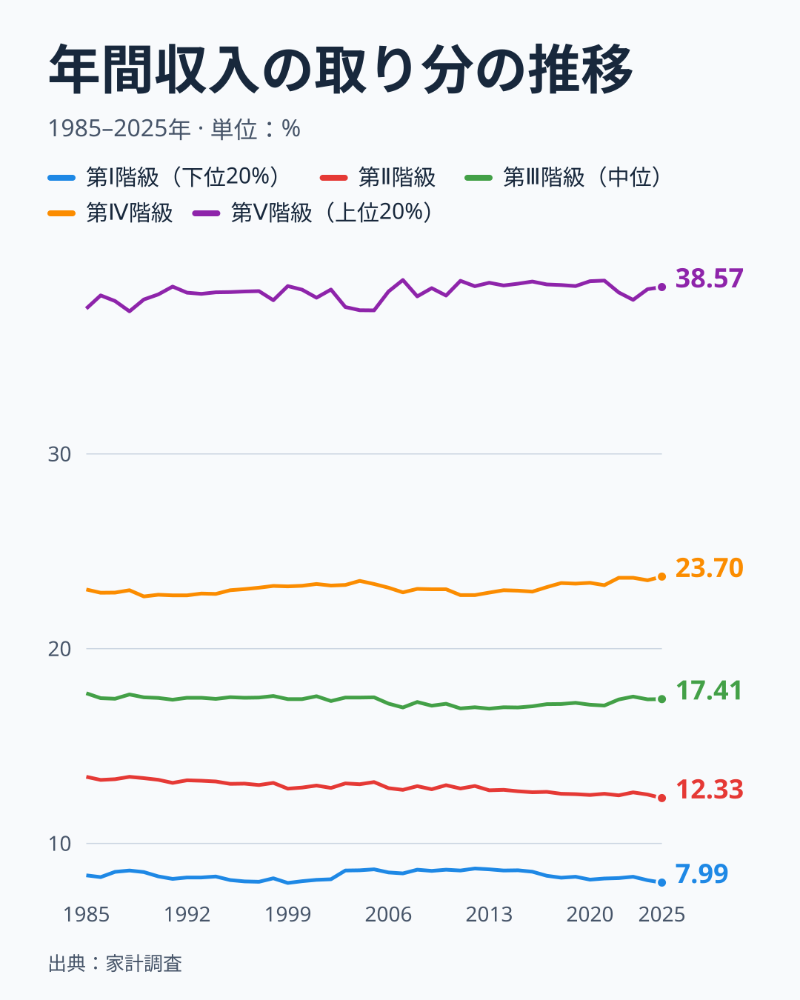

図は第Ⅰ階級（下位20%）から第Ⅴ階級（上位20%）までの取り分を、1985年から2025年まで重ねたものです。目を引くのは、5本の線がほとんど水平に並んでいることです。第Ⅴ階級は37%台前半から39%近くまでの狭い幅で上下し、最も低かったのは1988年の37.3%、最も高かったのは2007年の38.9%でした。第Ⅰ階級は1999年の8.0%から2012年の8.7%までの幅に収まっています。40年間で最大でも1.6ポイントしか動いていません。

水平ではないのは第Ⅱ階級です。1985年の13.4%から2025年の12.3%へ、ゆるやかに下がり続けています。年代ごとに見ると1990年代の13.1%から2010年代の12.7%、2020年から2025年の12.5%と、他の階級より方向がそろっています。第Ⅲ階級は2010年代前半に17%を割り込んだあと2025年には17.4%まで戻り、第Ⅳ階級は22.7%から23.7%の範囲で推移しています。1990年代の平均と2020年から2025年の平均を比べると、第Ⅱ階級が0.6ポイント下がった分は、第Ⅳ階級の0.6ポイントの上昇とほぼ釣り合っています。第Ⅱ階級は、世帯主の年齢が最も上がった階級（後の節で見ます）でもあります。

この図は名目の金額から計算した取り分です。取り分は割合なので、物価が上がっても下がっても影響を受けません。そのため、取り分が動かなかったことは、各階級の年間収入の水準が動かなかったことを意味しません。次の図で、同じ表の平均年間収入そのものを見ます。

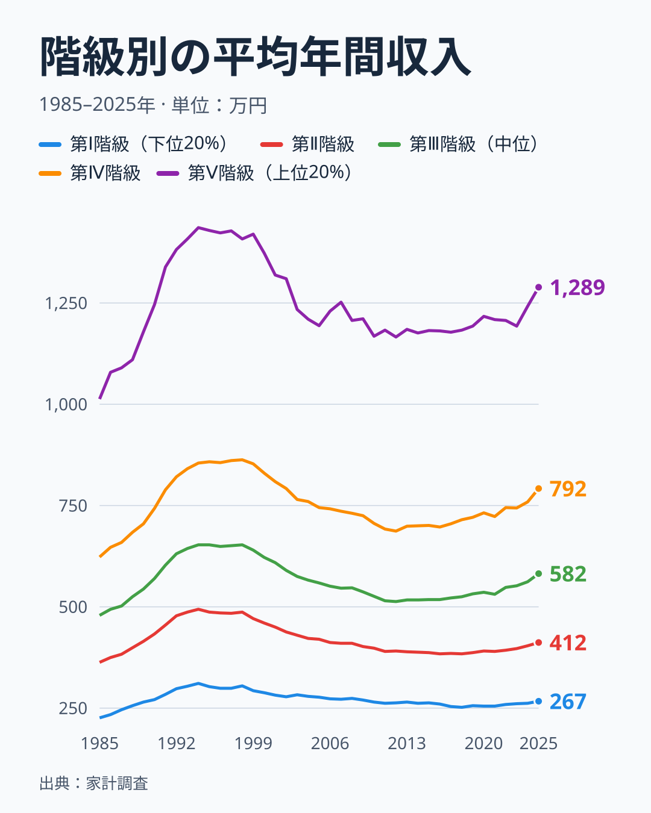

水準は大きく動いています。第Ⅴ階級の平均年間収入は、1985年の1,013万円から1994年の1,436万円まで上がり、2012年の1,166万円まで下がったあと、2025年は1,289万円になりました。第Ⅰ階級も1985年の226万円から1994年の311万円へ上がり、2018年の252万円まで下がり、2025年は267万円です。ピークの1994年と比べると、2025年は第Ⅴ階級で約10%、第Ⅰ階級で約14%低い水準です。ただし、これは名目の値で、物価の変化は除いていません。1990年と2025年だけを比べると、第Ⅴ階級は1,246万円から1,289万円、第Ⅰ階級は271万円から267万円で、あまり変わっていません。

つまり、取り分が安定していたのは、水準が動かなかったからではありません。各階級の年間収入が、1990年代前半までの上昇、その後の長い下落、近年の回復を、ほぼ同じ割合で経験したことを意味します。取り分が分配の形を、水準が景気や物価を表すと考えると、1990年代以降は「分配の形は変わらないまま、全体の水準が上下した」と読めます。

## 1990年代と2010年代を年代平均で比べる

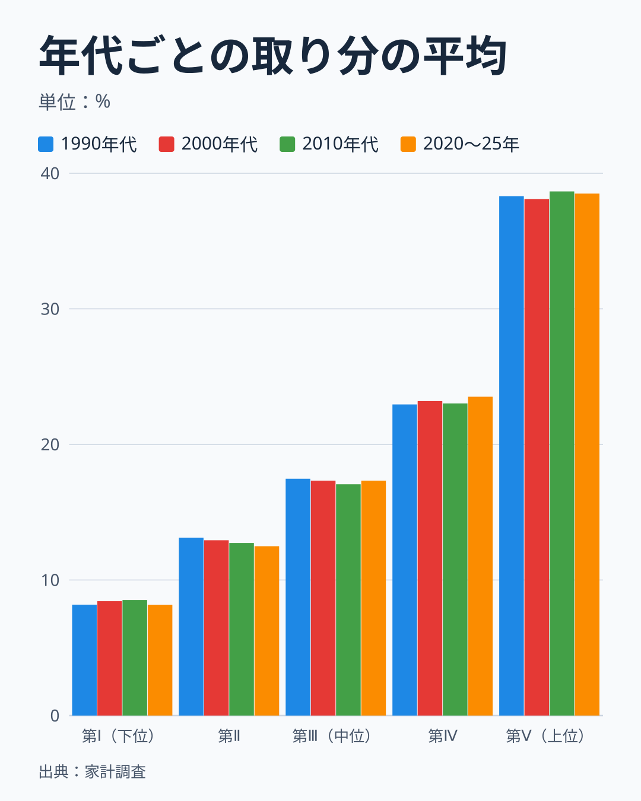

問いに直接答えるために、各年の取り分を年代ごとに平均しました。第Ⅴ階級は1990年代が38.31%、2000年代が38.10%、2010年代が38.66%、2020年から2025年の6年間が38.50%です。第Ⅰ階級は8.17%、8.44%、8.53%、8.16%と並びます。1990年代と2010年代を比べると、第Ⅴ階級は0.35ポイント高く、第Ⅰ階級は0.36ポイント高くなっています。減った側は第Ⅱ階級の0.38ポイントと第Ⅲ階級の0.41ポイントです。

この差の大きさは、3通りの目安で測れます。一つ目は相対的な大きさです。第Ⅴ階級の0.35ポイントは38.31%の約0.9%、第Ⅰ階級の0.36ポイントは8.17%の約4%で、どちらも小さな変化です。二つ目は向きです。第Ⅰ階級の取り分は2020年から2025年に8.16%と1990年代の水準へ戻り、第Ⅴ階級も2000年代の38.10%から2010年代の38.66%へ上がったあと38.50%です。10年ごとに上がったり下がったりしていて、一方向の変化ではありません。

三つ目は、変化の起き方です。下位2割の年代平均の差は、ゆるやかな変化ではなく、2003年に起きた段差の影響を大きく受けています。第Ⅰ階級は、1990年代は7.97%から8.31%、2000年から2002年は8.06%から8.16%で、2003年に8.61%へ0.45ポイント上がり、2016年まで8.46%から8.71%の範囲にとどまりました。第Ⅴ階級は2002年の38.44%から2003年の37.54%へ0.9ポイント下がり、2005年まで37.4%から37.5%の水準が続いてから、2006年に38.34%、2007年に38.93%へ戻っています。第Ⅰ階級と第Ⅴ階級が同じ年に動いていて、段差は農林漁家世帯を含む系列と除く系列の両方に現れるため、集計対象の違いが原因ではありません。1990年代と2010年代の第Ⅰ階級の差0.36ポイントは、この2003年から2016年の水準の違いと言い換えられます。段差の原因は、この表だけでは分かりません。手がかりはあります。総務省統計局の家計調査年報の調査の概要を見ると、標本設計の資料は、2002年版が平成7年国勢調査、2003年版が平成12年国勢調査と書かれていて、2003年に標本の基になる調査区が入れ替わっています。[仮説] 2003年の段差は、世帯の所得分布の実際の変化ではなく、この標本の入れ替えによるものです。検証は、標本設計の資料が変わった他の年にも、同じ規模の段差が出ているかを見ることでできます。出ていれば支持し、2003年だけなら棄却します。この記事では、他の年の確認はまだ行っていません。

年ごとのぶれとの関係も確かめておきます。同じ年代の中で、年ごとの取り分がどのくらいぶれるかを標準偏差で測ると、第Ⅴ階級は1990年代が0.20ポイント、2010年代が0.21ポイント、2000年代が0.53ポイント、2020年から2025年が0.37ポイントでした。第Ⅰ階級は0.12ポイント、0.17ポイント、0.24ポイント、0.10ポイントです。第Ⅰ階級の年代平均の差0.36ポイントは、同じ年代の中の標準偏差の2倍を超えていて、単年のぶれでは説明できません。ただし、この上昇は2003年の段差に由来し、次の期間には元へ戻っています。

向きにも注意が必要です。1990年代から2010年代にかけて、第Ⅴ階級と第Ⅰ階級はどちらも取り分が増え、第Ⅱ階級と第Ⅲ階級が減っています。両端が増えて真ん中が減る形で、これは「上位が下位から奪った」という図式には当てはまりません。[仮説] 中間層の世帯の一部が、世帯主の退職などで下位の階級へ、共働きなどで上位の階級へ入れ替わった可能性があります。検証は、世帯主の年齢と年間収入が両方そろった表（年収階級別の表と世帯主年齢別の表）で、同じ年齢の世帯が年ごとにどの階級に入っているかを比べることでできます。この表は年ごとの断面なので、世帯ごとの入れ替わりそのものは追えず、この仮説は支持も棄却もできません。検証できるのは、各階級の年齢構成の変化までです。

> [!WARNING]
> 五分位は世帯数で5等分した区分なので、階級の境目の年収は年ごとに変わります。ある年の第Ⅰ階級と別の年の第Ⅰ階級は「同じ年収の人たち」ではなく「その年に下から2割に入った世帯」です。この記事の取り分は、その年の分布に対する相対的な位置を比べるものです。境目の年収そのものは、総務省統計局が「五分位・十分位の境界値」として別に公表しています。

## 年ごとのぶれと、1999年と2000年の継ぎ目

家計調査の年間収入は、1999年までと2000年からで、集計する世帯の範囲が違います。1985年から2007年は農林漁家世帯を除いた二人以上の世帯の系列があり、2000年から2025年は農林漁家世帯を含む二人以上の世帯の系列があります。図の推移は、1999年までを前者、2000年からを後者でつないでいます。つなぎ目で数字が段差を作っていないかを確かめるため、両方の系列がそろう2000年から2007年について、同じ計算で取り分を比べました。

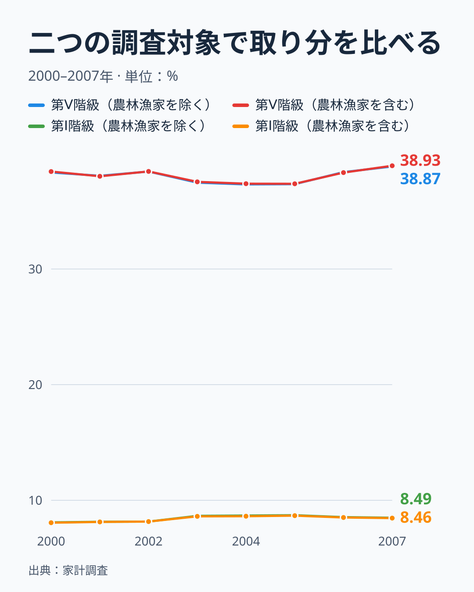

2000年から2007年の8年間で、二つの対象の取り分の差は、第Ⅴ階級で最大0.08ポイント、第Ⅰ階級で最大0.06ポイントでした。図では第Ⅴ階級の2本の線と第Ⅰ階級の2本の線がほぼ重なって見えます。農林漁家世帯を含めても含めなくても、取り分の計算結果はほとんど変わりません。したがって1999年と2000年の間にある小さな動きを、調査対象の違いが生んだ段差と読む必要はありません。

もう一つ、年ごとのぶれの大きさにも触れておきます。家計調査は標本調査で、階級ごとの集計世帯数は年によって変わります。図に示します。

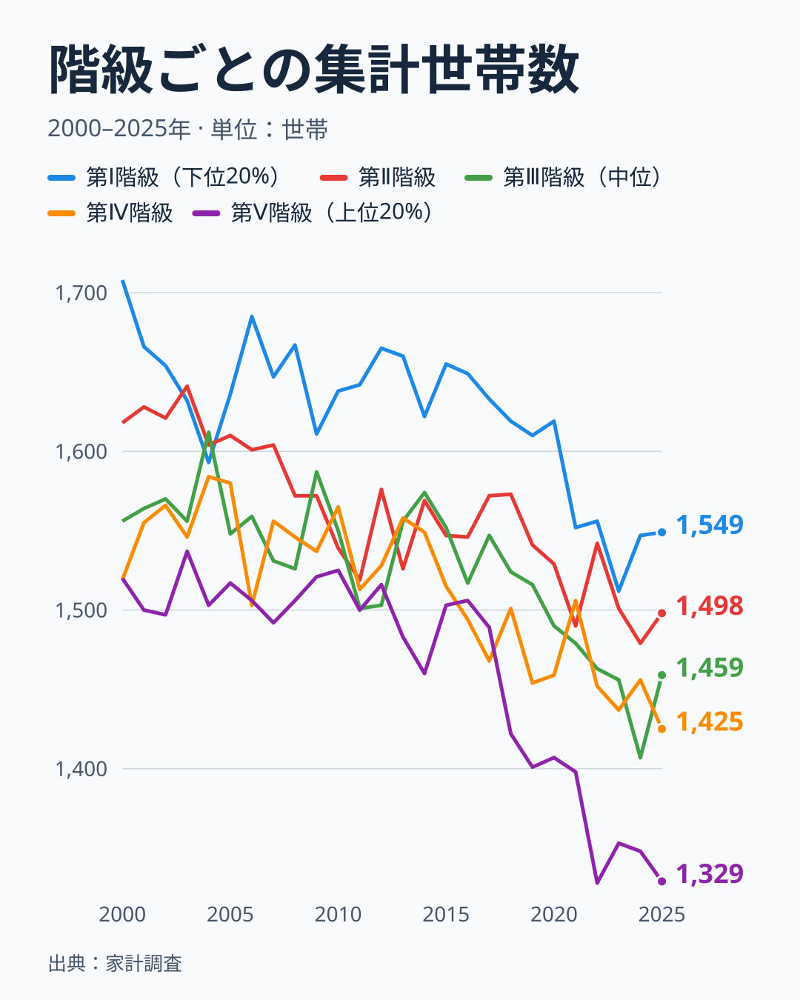

2000年は階級ごとに1,519世帯から1,708世帯、2025年は1,329世帯から1,549世帯でした。どの階級も2000年より2025年のほうが少なくなっています。第Ⅴ階級は1,520世帯から1,329世帯で、図の中でも最も少ない階級になりました。世帯数が減ると、標本のぶれは大きくなる方向に働きます。ただし、世帯数の減り方は第Ⅴ階級でも13%で、第Ⅴ階級の取り分の標準偏差は1990年代が0.20ポイント、2010年代が0.21ポイントとほとんど変わりません。2000年代の0.53ポイントは、2003年の段差を含んでいるため、純粋なぶれより大きく出ています。2020年から2025年は標準偏差が0.37ポイントとやや大きくなりますが、6年分なので判断できません。世帯数の減少がぶれを大きくしたとまでは、この表からは言えません。この記事が年代平均を使うのは、単年のぶれを均すためです。

## 第Ⅴ階級は第Ⅰ階級の何倍か

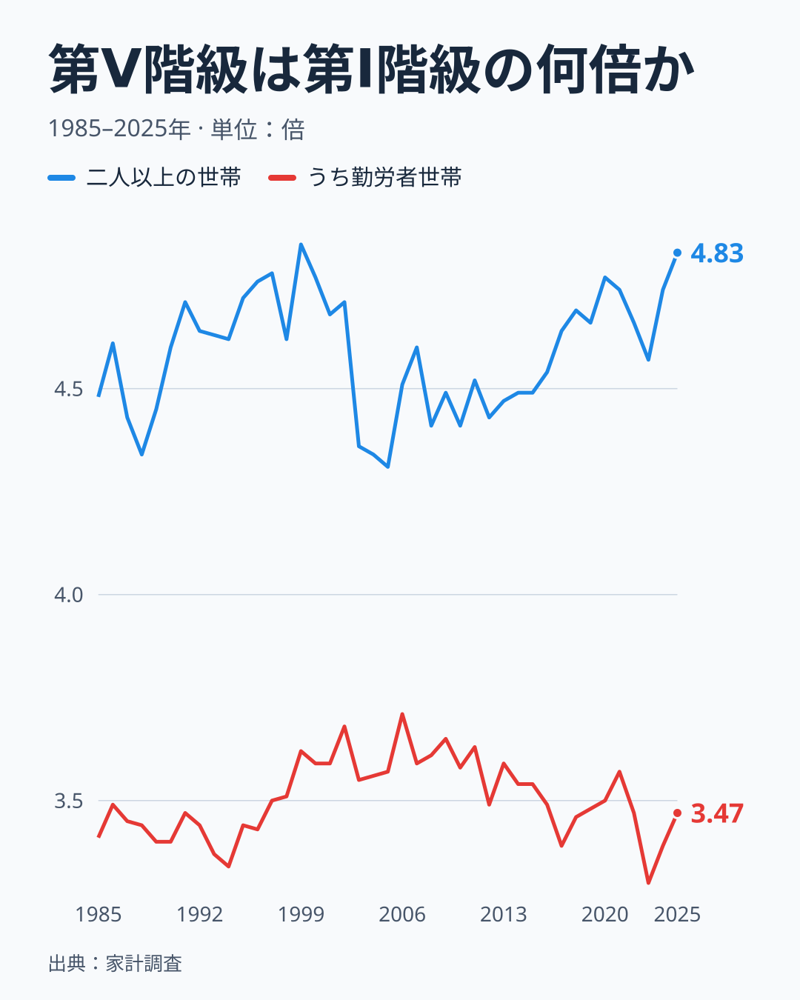

取り分の代わりに、第Ⅴ階級の平均年間収入を第Ⅰ階級の平均年間収入で割った倍率を見ても、結論は変わりません。二人以上の世帯全体では、倍率は最も低かった2005年の4.31倍から、最も高かった1999年の4.85倍までの範囲を行き来しています。2025年は4.83倍で、1999年の水準にほぼ並びました。年代平均の取り分から求めた倍率は、1990年代が4.7倍、2000年代が4.5倍、2010年代が4.5倍、2020年から2025年が4.7倍です。単年の端点では2025年が高く見えますが、年代平均では4.5倍から4.7倍の範囲を行き来していて、一方向に広がり続けているとは言えません。

勤労者世帯だけで見ると、倍率の水準が低くなります。勤労者世帯の倍率は3.3倍から3.7倍の範囲で、最も高かったのは2006年の3.71倍、最も低かったのは2023年の3.30倍、2025年は3.47倍です。勤労者世帯は世帯主が勤め先に雇われている世帯で、無職の高齢世帯は含まれません。このことが、第Ⅰ階級の平均年間収入を二人以上の世帯全体より高くし、倍率を低くする一因と考えられますが、この表では分けられません。

世帯の人数をそろえるとどうなるでしょうか。世帯人員は、階級ごとに大きく違います。

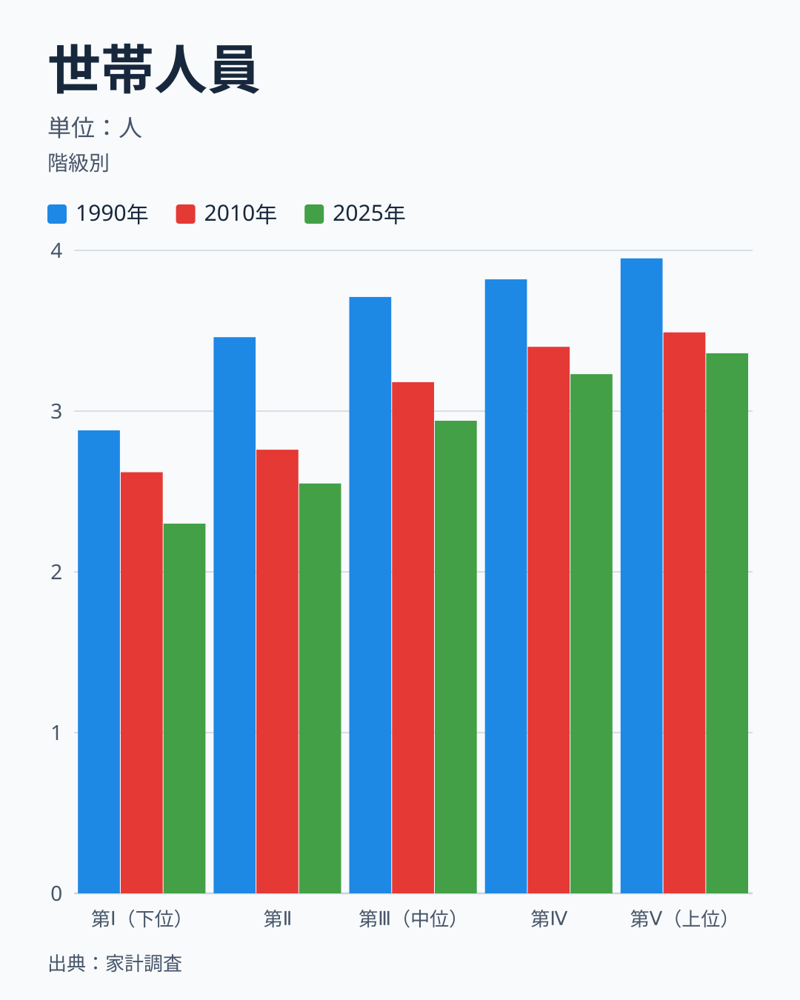

第Ⅰ階級の世帯人員は1990年の2.88人から2010年の2.62人、2025年の2.30人へ、第Ⅴ階級は3.95人から3.49人、3.36人へ減っています。第Ⅴ階級の平均年間収入を平均世帯人員で割り、第Ⅰ階級の同じ値で割ると、1990年は3.35倍、2010年は3.31倍、2025年は3.30倍でした。1人あたりに直した倍率は35年間ほとんど動かず、世帯全体の4.4倍から4.8倍という倍率のうち、1.4倍前後は世帯の人数の違いに対応しています。ただし階級は世帯の合計年収で分けているので、これは「1人あたり所得の分布」ではなく、あくまで階級ごとの平均を人数で割った目安です。

## 実収入と可処分所得で測り直す

ここまでは、階級を分ける基準でもある年間収入の取り分を見てきました。年間収入は世帯が答えた過去1年間の収入で、階級はこの値で決まります。同じ表には、家計簿から集計される実収入と、税や社会保険料を引いた可処分所得も、勤労者世帯について載っています。この2つで、年間収入で第Ⅴ階級に入る世帯の取り分を計算し直すと、結論に重要な但し書きがつきます。

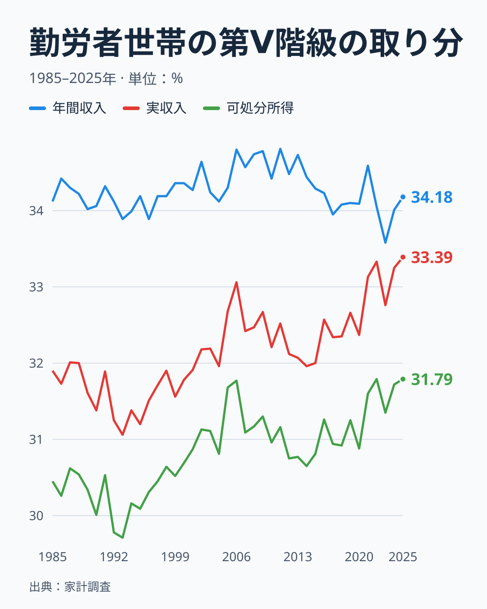

勤労者世帯の第Ⅴ階級の年間収入の取り分は、1990年代の平均が34.1%、2010年代が34.4%、2020年から2025年が34.1%で、図の青い線は33.6%から34.8%の間を行き来しています。ところが同じ世帯の実収入で計算した取り分は、1990年代の平均31.5%から2000年代の32.3%へ上がり、2010年代は32.3%でほぼ横ばい、2020年から2025年は33.0%へ再び上がりました。1990年代から2010年代では0.8ポイント、2020年から2025年までで1.6ポイントの上昇です。可処分所得の取り分も30.2%から31.0%、31.5%へと、1.3ポイント上がりました。図で赤い線と緑の線は、細かく上下しながら40年かけて右上がりになっています。単年の端点で比べると、実収入は1990年の31.4%から2025年の33.4%で、上昇幅は2ポイントです。

この差は2つの読み方ができます。一つは、実際に年間収入の高い勤労者世帯の収入が、相対的に増えたという読み方です。もう一つは、階級の分け方が影響しているという読み方です。年間収入で階級を分けても、同じ階級の世帯の実収入にはばらつきがあります。年間収入の取り分は、分ける基準そのものを集計した値なので、このばらつきの影響を受けません。実収入の取り分は、基準が違うために階級の境目の世帯が入れ替わるだけでも変わります。1990年代には年間収入の取り分が実収入の取り分より2.6ポイント高く、2020年から2025年は1.0ポイントでした。年間収入と実収入のずれが小さくなったことは、確かです。

どちらの読み方が正しいかは、この表だけでは決められません。[仮説] 年間収入の高い勤労者世帯で共働きや副収入が増え、年間収入では測れない実収入の差が広がった可能性があります。検証は、世帯の収入を勤め先収入と事業収入などに分けた表で、第Ⅴ階級の内訳の推移を見ることでできます。勤め先収入以外の割合が1990年代から2020年代にかけて上がっていれば支持し、変わらなければ棄却します。確認は2026年分の公表後に行います。この記事の結論は次のとおりです。年間収入の取り分は動かなかったと言えますが、収入の物差しを変えると、年間収入で上位2割に入る勤労者世帯の取り分は1.3〜1.6ポイント上がっていました。可処分所得の取り分が実収入より低いのは、税や社会保険料などの非消費支出を引いた分で、その差は年代平均で1.2ポイントから1.5ポイントでした。

## 階級の顔ぶれはどう変わったのか

取り分が動かなかった間に、階級に入る世帯の中身は大きく変わりました。次の図は、階級別の世帯主の平均年齢を1990年、2010年、2025年で並べたものです。

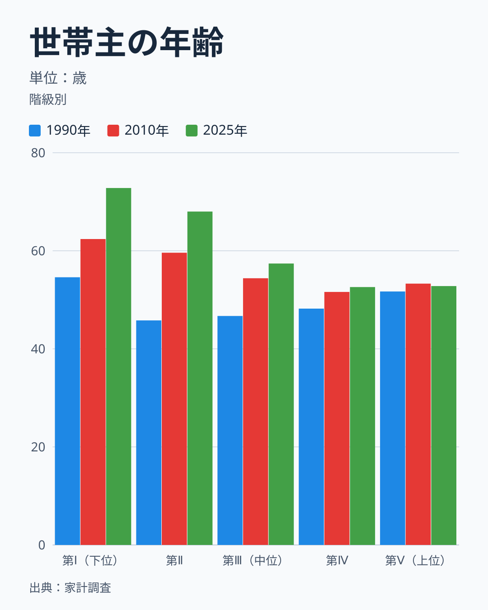

第Ⅰ階級の世帯主の平均年齢は、1990年の54.6歳から2010年の62.4歳、2025年の72.8歳へ、35年で18歳以上高くなりました。第Ⅱ階級も45.8歳から59.6歳、68.0歳へと上がっています。第Ⅲ階級も46.7歳から54.4歳、57.4歳へ10歳以上高くなりました。一方、第Ⅳ階級は48.2歳から51.6歳、52.6歳、第Ⅴ階級は51.7歳から53.3歳、52.8歳と、上がり方が小さくなっています。年齢の上がり方が最も大きいのは第Ⅱ階級の22.2歳で、第Ⅰ階級の18.2歳、第Ⅲ階級の10.7歳が続きます。

階級ごとの年齢の並び方も変わりました。1990年は第Ⅱ階級の45.8歳から第Ⅴ階級の51.7歳まで、年収が高い階級ほど世帯主の年齢も高くなっていました。2025年は第Ⅱ階級の68.0歳から第Ⅳ階級の52.6歳まで、年収が高い階級ほど世帯主は若く、第Ⅴ階級は52.8歳です。年齢と年収の結びつき方が、35年で入れ替わっています。

高齢化の中身を、働いている世帯員と65歳以上の世帯員の数で確かめます。

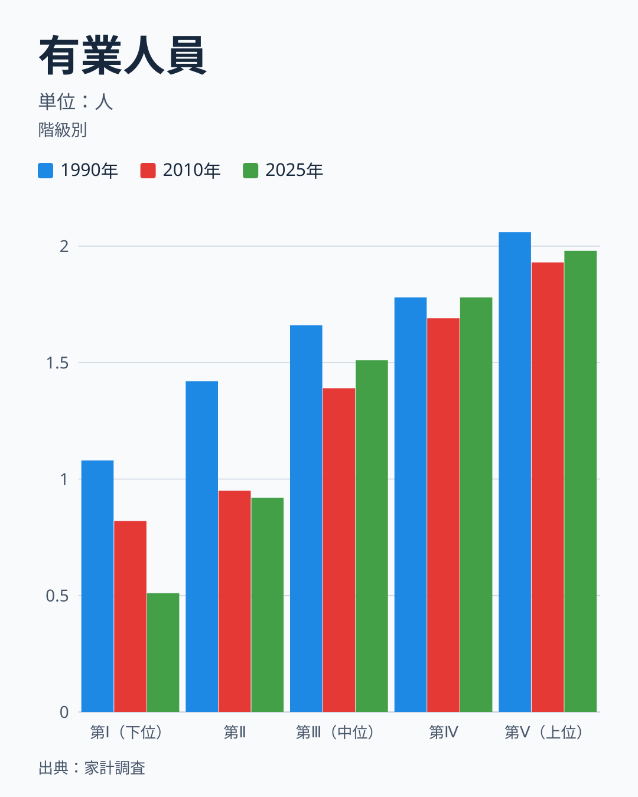

第Ⅰ階級の有業人員は、1990年の1.08人から2010年の0.82人、2025年の0.51人まで減りました。平均では1世帯に0.5人しか働いておらず、2世帯に1人の割合です。第Ⅴ階級は2.06人から1.93人、1.98人で、ほぼ2人が働いています。第Ⅲ階級と第Ⅳ階級も1.4人から1.8人の範囲で、1990年と2025年を比べると第Ⅲ階級は1.66人から1.51人、第Ⅳ階級は変わらず1.78人です。働く人が半分以下に減ったにもかかわらず、第Ⅰ階級の平均年間収入は1990年の271万円から2025年の267万円とほとんど変わっていません。年間収入には年金などの給付も含まれます。この表では、収入の内訳までは分けられません。

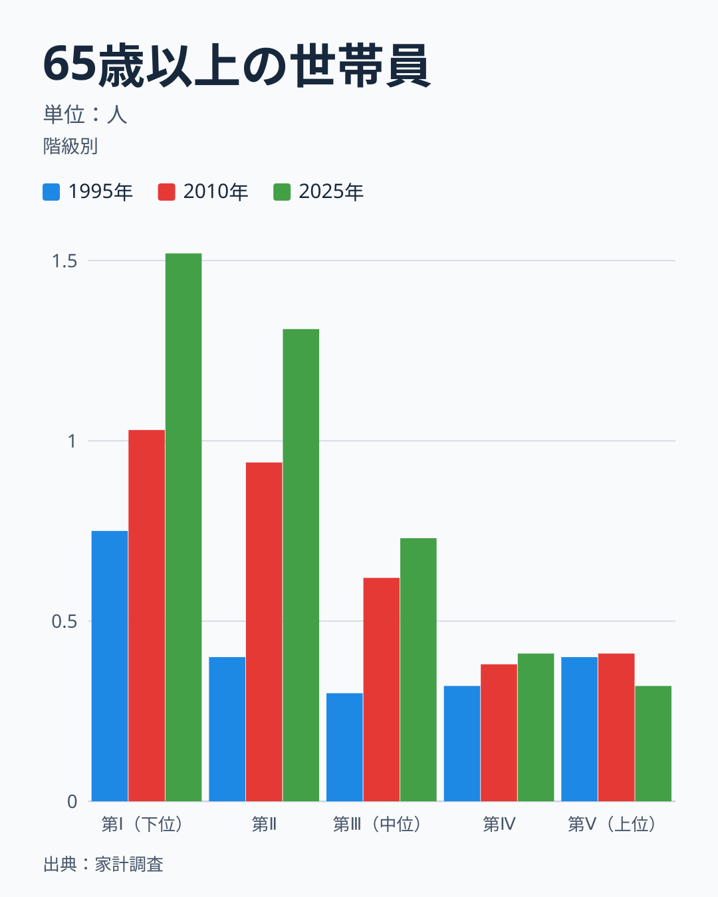

65歳以上の世帯員数も同じ方向です。第Ⅰ階級は1995年の0.75人から2010年の1.03人、2025年の1.52人に、第Ⅱ階級は0.40人から0.94人、1.31人に増えました。第Ⅴ階級は0.40人から0.41人、0.32人でほとんど変わっていません。第Ⅰ階級は1世帯に平均1.5人の高齢者がいて、働く人は半人しかいない世帯になっています。

この観察から、次の仮説が浮かびます。[仮説] 第Ⅰ階級の取り分が1990年代から大きく下がらなかったのは、高齢世帯の年金収入が一定の水準を保っていたためで、現役世代の下位層の収入が変わらなかったことを意味しません。一方、世帯主の年齢が最も上がった第Ⅱ階級（45.8歳から68.0歳）は、取り分が一方向に下がった階級でもあり、別の問いとして並べて考える必要があります。検証は、世帯主の年齢階級別に年間収入を比べる表で、65歳以上の世帯主の年間収入が1990年代から2020年代まで大きく下がっていないかを見ることでできます。下がっていなければ支持し、下がっていれば棄却します。確認は2026年分の公表後に行います。

> [!TIP]
> 勤労者世帯は無職の高齢世帯を含まない区分ですが、この記事で世帯主の年齢を示せるのは二人以上の世帯全体だけです。勤労者世帯の中の第Ⅰ階級でも世帯主が高齢化している可能性があり、勤労者に絞っても年齢の影響は取り切れません。

## 収入の取り分と消費の取り分を比べる

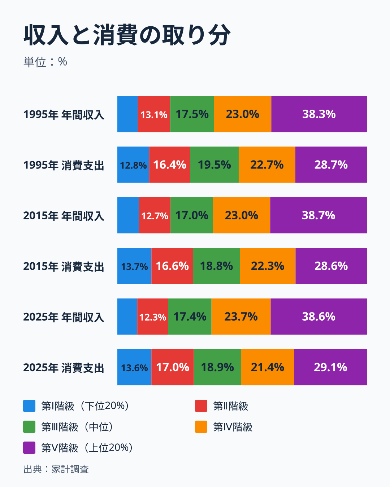

最後に、年間収入の取り分と消費支出の取り分を並べました。1995年は第Ⅴ階級が年間収入の38.3%を受け取る一方、消費支出の取り分は28.7%です。第Ⅰ階級は年間収入の8.1%に対して、消費支出の12.8%を占めています。収入より消費のほうが平らで、上位の階級は収入の取り分ほどには消費していません。

この形は2015年と2025年でも変わりません。2015年は第Ⅴ階級が収入の38.7%、消費の28.6%、第Ⅰ階級が収入の8.6%、消費の13.7%です。2025年は第Ⅴ階級が38.6%と29.1%、第Ⅰ階級が8.0%と13.6%でした。収入の差に比べて消費の差が小さいことは、30年間安定した関係です。ここでも世帯の人数が関わっています。第Ⅰ階級の世帯人員は2025年に2.30人で、第Ⅴ階級の3.36人より少ないので、人数の違いだけで消費の取り分は第Ⅴ階級のほうが大きくなる方向に働きます。それでも階級間の消費の差は、収入の差より小さくなっています。

[仮説] 第Ⅰ階級では世帯主が高齢になり、貯蓄の取り崩しなどで収入を超えて消費する世帯が増えたことが、消費の取り分を押し上げている可能性があります。検証は、貯蓄・負債編の年収五分位別の表で、第Ⅰ階級の貯蓄現在高が1990年代から減っているかを見ることでできます。減っていれば支持し、増えていれば棄却します。確認は2026年分の公表後に行います。生活の格差を見るときは、年間収入、消費支出、貯蓄・負債の3つを別々に見る必要があります。食料費が消費に占める割合が階級ごとにどう違うかは、[年収で消費支出はどこまで変わるのか](/blog/income-quintile-overview)で品目別に見ています。食費の割合を県別に見るなら[エンゲル係数の都道府県ランキング](/blog/engel-coefficient-prefecture-ranking)もあわせて見てください。

## データについて

使った表は、家計調査の用途分類（年間収入五分位階級別）の年次表で、e-Statで公開されています。項目は年間収入（万円）、実収入と可処分所得（円・勤労者世帯のみ）、消費支出（円）、世帯人員（人）、世帯主の年齢（歳）、有業人員（人）、65歳以上人員（人）、集計世帯数（世帯）です。1990年代の取り分は「二人以上の世帯（農林漁家世帯を除く）」、2000年以降は「二人以上の世帯（農林漁家世帯を含む）」の値を使いました。両者の差は2000年から2007年の重なる期間で、第Ⅴ階級と第Ⅰ階級について最大0.08ポイントでした。第Ⅱ階級から第Ⅳ階級の継ぎ目は確かめていません。第Ⅱ階級の1999年から2000年の動きは0.06ポイントで、段差は見えません。勤労者世帯の系列も、同じ区分でつないでいます。

この統計には限界が三つあります。一つ目は、一人暮らしの世帯を含まないことです。単身世帯は高齢者と若年層の両端に多いため、全世帯の所得分布を代表しません。二つ目は、標本調査の平均値であり、第Ⅴ階級の内側にいる所得の最も高い層、たとえば上位1%の動きまでは捉えられないことです。三つ目は、年間収入が名目であり、物価の変化を除いていないことです。所得の集中度そのものを知りたいときは、別の統計（所得再分配調査や国民生活基礎調査など）で確かめる必要があります。

この記事が答えられるのは「家計調査の二人以上世帯で、年収の五分位の取り分が動いたか」までです。動いたかどうかは、1990年代から2010年代にかけて1ポイント未満の変化にとどまりました。動かなかった理由と、下位の階級の中身の入れ替わりの影響は、この表だけでは分けられません。年収と教育費の関係は[教育費だけ格差が桁違いなのはなぜ?](/blog/income-quintile-education)、家計調査の調査ハブは[家計調査のページ](/survey/kakei-chousa)、経済カテゴリの一覧は[経済のデータ](/category/economy)から見られます。

## まとめ

- 1990年代の平均で、上位2割の取り分は38.3%、下位2割は8.2%でした。
- 2010年代の平均は、上位2割が38.7%、下位2割が8.5%で、差は0.4ポイント前後です。下位2割の差は2003年の段差を境にした水準の違いで、2020年から2025年は上位2割が38.5%と2010年代とほぼ同じ、下位2割が8.2%と1990年代と同じ水準です。
- 年代平均の差は第Ⅱ階級が0.38ポイント減、第Ⅲ階級が0.41ポイント減で、両端の増加と同じ大きさです。一方向に動き続けたのは第Ⅱ階級だけです。
- 勤労者世帯の実収入で測ると、年間収入で上位2割に入る世帯の取り分は、1990年代の平均31.5%から2020年から2025年の平均33.0%へ1.6ポイント上がっていて、動かなかったのは年間収入に限った結論です。
- 取り分が動かなかった間に、第Ⅰ階級の世帯主の平均年齢は54.6歳から72.8歳へ上がり、有業人員は1.08人から0.51人へ減りました。
