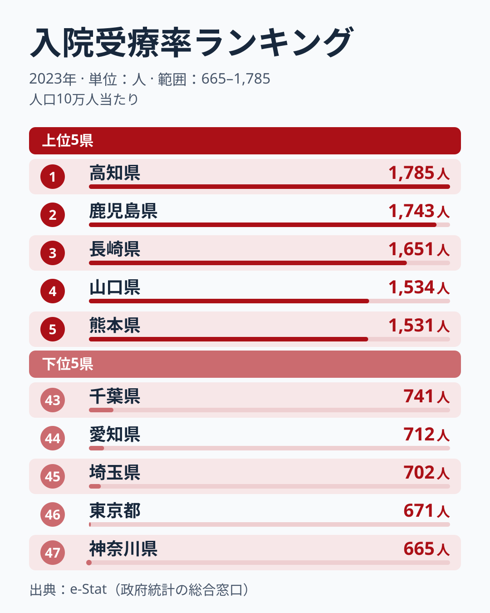
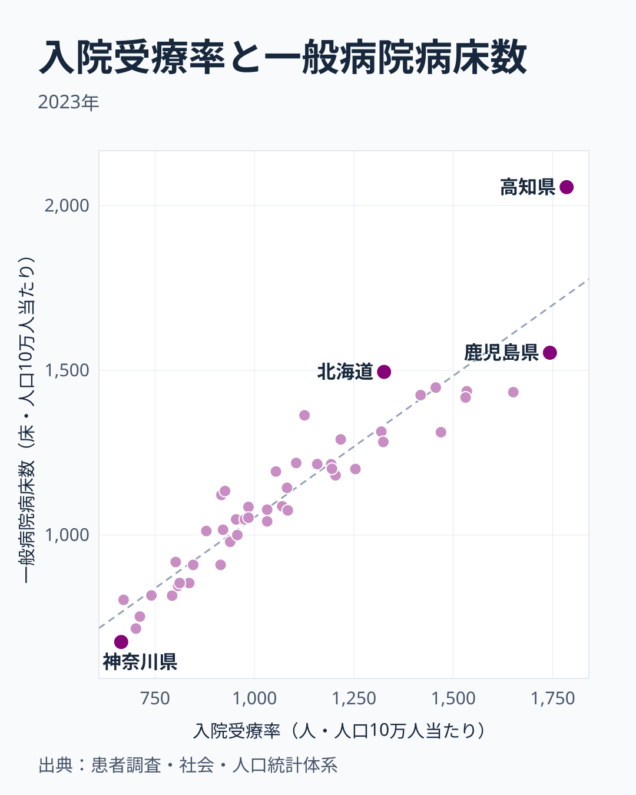

同じ日本でも、入院している人の割合は県によって2.7倍近く違います。厚生労働省「患者調査」(2023年) の入院受療率は、1位の高知県が人口10万人当たり1,785人、最下位の神奈川県が665人で、比は約2.68倍です。上位は九州・四国、下位は首都圏に分かれています。地方ごとに47都道府県の値を単純に平均すると、九州・沖縄が1,435人、四国が1,404人、中国が1,210人、北海道・東北が1,065人、中部が950人、近畿が936人、関東が772人です。高いのは西日本全体ではなく九州・四国・中国で、近畿は北海道・東北より低い地方です。

なぜ九州・四国で入院の多い県が多いのか。この記事では、よく挙げられる2つの説明、「病床が多いから」と「高齢者が多いから」を、同じ年の都道府県データと並べて、どこまで重なり、どこで外れるかを確かめます。

> [!NOTE]
> 入院受療率は、患者調査の調査日に医療機関に入院していた推計患者数を、人口10万人当たりにした値です。年齢構成をそろえていない「粗い」受療率なので、高齢者の多い県ほど高く出やすくなります。年齢構成の違いを除いた「年齢調整受療率」とは別の指標です。

## 入院受療率 上位5・下位5 (2023年)

入院受療率の1位は高知県で、人口10万人当たり1,785人です。続いて鹿児島県が1,743人、長崎県が1,651人、山口県が1,534人、熊本県が1,531人と、九州・四国と中国地方西端の県が上位5県を占めます。6位以下も大分県が1,469人、佐賀県が1,456人、徳島県が1,418人と続き、9位に北海道が1,326人で入ります。上位10県のうち東日本は北海道だけです。

最下位は神奈川県で665人です。続く東京都が671人、埼玉県が702人、愛知県が712人、千葉県が741人で、首都圏4都県と愛知県が下位5県を占めます。神奈川県の値は、1位の高知県の約37%にとどまります。47都道府県の中央値は1,032人です。

<source-link href="/ranking/inpatient-rate-per-100k">入院受療率ランキング (47都道府県) を見る</source-link>

> [!TIP]
> 最下位の神奈川県を「入院できない県」と読むのは早計です。入院受療率の低さが、入院が必要な人の少なさによるのか、受け入れる病床の少なさによるのかは、この数字だけでは分かりません。次の節で見るように、下位の県は病床数も少ない県です。

## 病床数と重ねる──相関0.94、ほぼ同じ順番に並ぶ

入院受療率を、同じ2023年の一般病院の病床数 (人口10万人当たり) と重ねます。

相関係数は約0.94で、病床数が多い県ほど入院受療率も高い、非常に強い正の相関です。病床数は高知県が2,056.3床で47都道府県で最も多く、鹿児島県が1,553.5床で2番目、北海道が1,495.3床で3番目です。反対に、神奈川県の病床数は675.2床で最も少なく、埼玉県は716.0床で46番目、愛知県は752.5床で45番目と、入院受療率の下位県は病床数でも下位に並びます。

点がほぼ一直線に並ぶので、入院受療率の地図は、病床数の地図とほとんど同じだと言えます。ただし、どちらが原因かはこの散布図からは決められません。[仮説] 病床が多い地域では入院という選択が取られやすい (供給が需要を生む) 可能性と、入院が必要な人が多い地域に病床が整えられてきた可能性の両方があり、県単位の1年分のデータでは区別できません。

<source-link href="/ranking/general-hospital-bed-count-per-100k">一般病院病床数ランキング</source-link>

## 高齢化と重ねる──相関0.63、秋田と沖縄が外れる

入院する人の多くは高齢者なので、高齢者の多い県ほど入院受療率は高くなりやすいはずです。2023年の65歳以上人口割合と入院受療率の相関係数を47都道府県で計算すると約0.63で、高齢化が進んだ県ほど入院受療率も高い、正の相関でした。病床数の0.94よりは弱い結びつきです。

重なる県から見ます。65歳以上人口割合は高知県が36.3%で2番目に高く、山口県が35.3%で3番目、長崎県が34.3%で9番目と、入院受療率の上位県の多くは高齢化率でも上位です。反対に、東京都は22.8%で最も低く、愛知県は25.7%で45番目、神奈川県は25.9%で44番目と、入院受療率の下位県は高齢化率でも下位にいます。

外れる県もあります。秋田県は65歳以上人口割合が39.0%で全国で最も高いのに、入院受療率は1,204人で14位です。熊本県は高齢化率が32.3%で23番目と中位ですが、入院受療率は5位です。沖縄県は高齢化率が23.8%で46番目と若い県ですが、入院受療率は985人で26位と中位にいます。高齢化率だけでは、入院受療率の順位は決まりません。

「入院の多い県の地図は高齢化の地図とほぼ重なる」という説明はよく聞かれますが、数字で見ると、高齢化よりも病床数のほうがずっと強く入院受療率と重なっています。なお、高齢化率と病床数のあいだにも、高齢化が進んだ県ほど病床数も多い正の結びつきがあり、3つの数字は互いに絡み合っています。

あわせて見る: [65歳以上人口割合ランキング](/ranking/ratio-65-plus)

> [!WARNING]
> 入院受療率が高い県を「病気が多い県」と単純に読まないでください。入院受療率は病床数と相関0.94で並んでおり、病床の多い県ほど高く出ます。ただし、この記事では住民の健康状態を表す指標と比べていないので、健康状態と病床数のどちらがより強く効いているかは言えません。高齢化の影響を除いて比べたいときは、年齢調整受療率を使います。

## 入院と外来は別の顔ぶれ

同じ患者調査でも、外来受療率 (2023年) が最も高いのは和歌山県で、入院で最も高い高知県は外来では32番目です。「入院が多い県」と「通院が多い県」は顔ぶれが違うので、入院受療率の順位をそのまま「医療にかかる人の多い県」の順位と読むことはできません。外来の地域差は[外来受療率の記事「外来は和歌山が日本一の通院県」](/blog/outpatient-rate-prefecture-gap)で読めます。

あわせて見る: [外来受療率ランキング](/ranking/outpatient-rate-per-100k) / [社会保障カテゴリ](/category/socialsecurity)

## まとめ

- 入院受療率 (2023年・人口10万人当たり) の1位は高知県の1,785人、最下位は神奈川県の665人で、比は約2.68倍です。
- 上位10県のうち東日本は北海道だけで、下位5県は神奈川・東京・埼玉・愛知・千葉と大都市圏が占めます。地方平均では九州・沖縄と四国が高く、関東が最も低く、近畿は北海道・東北より低い地方です。
- 一般病院の病床数との相関は約0.94と非常に強く、入院受療率の地図は病床数の地図とほぼ同じです。どちらが原因かは、このデータでは決められません。
- 65歳以上人口割合との相関は約0.63で、病床数より弱い結びつきです。高齢化率が最も高い秋田県が入院では14位にとどまるなど、高齢化だけでは順位は決まりません。
- 入院で最も高い高知県は外来では32番目で、入院と外来は別の顔ぶれです。
