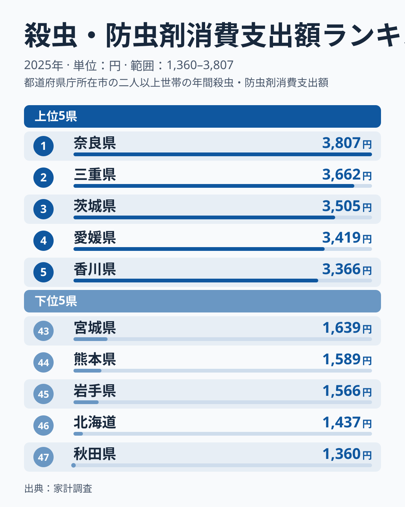
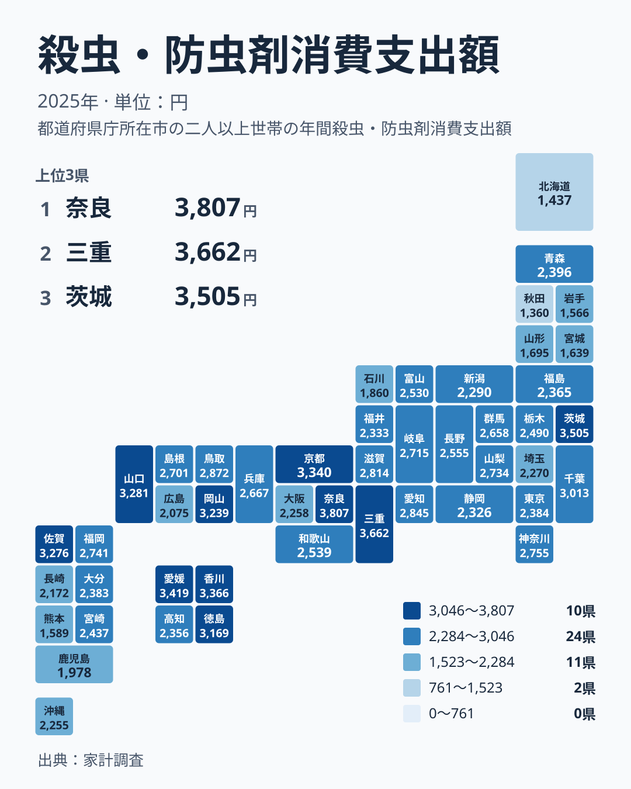

## 殺虫・防虫剤への支出は県でどれほど違うのか

蚊取り線香、ゴキブリ用の薬剤、衣類の防虫剤、押し入れの除湿と防虫を兼ねた製品など、殺虫・防虫剤は多くの家庭で一度は買ったことのある日用品です。1回の買い物は小さな額ですが、1年間で合計すると、県ごとの違いがはっきり表れます。

2025年の家計調査によると、1世帯あたりの年間支出が最も多かったのは奈良県の3,807円でした。2位は三重県の3,662円、3位は茨城県の3,505円と続きます。一方、最も少なかったのは秋田県の1,360円で、46位の北海道は1,437円、45位の岩手県は1,566円でした。

この記事では、単に順位を並べるだけではなく、地方ごとに分けて見たときに何が浮かぶのかを整理します。そのうえで、数字を暮らしの感覚に引き寄せて読むときの注意点を考えます。

> [!NOTE]
> ここでの支出額は、家計調査で集計された殺虫・防虫剤消費支出額です。1世帯あたりの年間の支出額を円で示したもので、人口や世帯の人数をそろえた1人あたりの額ではありません。

## 上位と下位の顔ぶれを見る

まず、上位5県と下位5県を並べた図を見てみましょう。

<source-link href="/ranking/insecticide-consumption-expenditure">殺虫・防虫剤への支出ランキングをもっと見る</source-link>

上位5県は、奈良県、三重県、茨城県、愛媛県、香川県です。4位の愛媛県は3,419円、5位の香川県は3,366円でした。上位の間では差が小さく、3,300円台から3,800円台に密集しています。1位が突出しているというより、複数の県が横並びで高い水準にあると言えます。

下位5県は、秋田県、北海道、岩手県、熊本県、宮城県です。熊本県は44位で1,589円、宮城県は43位で1,639円でした。下位でも1,300円台から1,600円台に収まっており、上位との間には大きな隔たりがあります。

上位に近畿の県と四国の県が複数入り、下位に北海道・東北の県が多く並ぶという構図が、この図からうかがえます。ただし、茨城県が3位に入っていること、九州の熊本県が下位にいることから、単純な「西高東低」では説明できません。次の節で地方ごとに分けて確かめます。

## 地方で分けると何が見えるのか

順位の全体像を地理的にとらえるため、タイルマップを見てみます。

近畿は、上位の常連が目立つ地方です。奈良県が1位、三重県が2位、京都府が6位です。ところが同じ近畿でも、滋賀県は14位、兵庫県は20位、和歌山県は23位、大阪府は36位と、順位に大きな幅があります。近畿全体を一括りにして「防虫剤をよく使う地方」と言い切ることはできません。

四国も上位に偏っています。愛媛県が4位、香川県が5位、徳島県が10位です。ただし高知県は31位で2,356円にとどまり、同じ四国でも差があります。

中国では、山口県が7位、岡山県が9位、鳥取県が12位と上位から中位に並びます。一方、広島県は39位で2,075円でした。

北海道・東北は対照的です。青森県が27位、福島県が30位と中位から下位寄りで、山形県は42位、宮城県は43位、岩手県は45位、北海道は46位、秋田県は47位です。この地方のうち5道県が下位10位以内に入っています。

関東は茨城県が3位、千葉県が11位、神奈川県が15位と上位に位置します。いっぽう東京都は28位、埼玉県は35位で、同じ関東でも内側にばらつきがあります。

九州・沖縄は、佐賀県が8位、福岡県が16位と上位から中位に入る一方、熊本県が44位、鹿児島県が40位、長崎県が38位、沖縄県が37位です。上位に近い県と下位に近い県が共存している地方です。

> [!WARNING]
> 家計調査は標本調査で、県ごとの対象世帯数は多くありません。1年分の平均額は、調査に当たった世帯の顔ぶれによって上下することがあります。順位が近い県どうしの違いは、実力の差というより誤差の範囲かもしれないため、わずかな差を過大に読まないでください。

## 暮らしの視点で読み解く:額の違いは何を映すのか

ここからは、データそのものが語っていない部分を、生活の側から仮説として考えます。以下は確定した因果ではなく、読み解きの一案です。

殺虫・防虫剤の支出には、大きく二つの性質があります。一つは、蚊やゴキブリなど「害虫が出るから使う」夏場中心の支出です。もう一つは、衣類や畳、収納品を守る「虫食いを防ぐために備える」支出です。この二つは別々の動機で、住まいの条件にも左右されます。

たとえば、気温が低く害虫の活動期間が短い地域では、前者の支出が小さくなると考えられます。下位に北海道、秋田県、岩手県、宮城県、山形県が並ぶことは、この見方と矛盾しません。ただし、これだけで説明を終えることはできません。東北でも青森県は27位、福島県は30位で、中位付近にいるからです。

後者の備えの支出は、衣類や着物、寝具などをしまい込む家が多いかどうかとも関係しそうです。戸建て住宅が多く、収納スペースが広い地域ほど、防虫剤を使う機会が増える可能性があります。奈良県や三重県、京都府といった近畿の上位県は、古くからの住宅や衣類の保管の習慣が残る地域と重なって見えます。もっとも、これも仮説にとどまります。

もう一つ見逃せないのは、都市部の順位です。東京都は28位、大阪府は36位、埼玉県は35位でした。集合住宅が多く、収納が限られる都市部では、そもそも防虫剤を置く場所が少ないのかもしれません。人口の多い都市で支出が少ないという事実は、「虫の多さ」だけでは支出が決まらないことを示しています。

> [!TIP]
> 順位を見るときは、「害虫への対処」と「衣類・収納の備え」という二つの動機を頭に置いて読むと、解釈がしやすくなります。気温の高低だけでなく、住まいの広さや収納の習慣も、額に影響している可能性があります。

## 自分の暮らしに引き寄せて考える

では、この数字を家計管理にどう生かせるでしょうか。

自分の県が上位にある場合、周囲の家庭もそれなりの額を支出していることになります。たとえば奈良県の3,807円や三重県の3,662円は、特別に多いというより、地域の標準に近い額と受け止められます。反対に、下位の県では、同じ金額を使うと周囲より多めの支出になる計算です。

ただし、家計に占める割合として見れば、年間数千円の支出です。節約の優先順位としては高くないでしょう。むしろ大事なのは、使い方の無駄を減らすことです。シーズン前にまとめて買って使い切る、収納の広さに合わせた量を選ぶ、効果の持続期間を確認して重ねて買わないといった工夫が、そのまま家計の改善につながります。

また、地域の気候や住まいに合った製品を選ぶことも大切です。害虫が出やすい時期が長い地域なら、予防を中心に置くと結果的に使用量を抑えられます。逆に、虫がほとんど出ない地域では、念のためのまとめ買いを控えるだけで十分な場合もあります。

## 地域差から見える全体のまとめ

最後に、ここまでの要点を整理します。

- 1位は奈良県の3,807円、最下位は秋田県の1,360円で、県による開きは大きいです
- 上位には近畿の奈良県、三重県、京都府と、四国の愛媛県、香川県が入ります
- 下位には北海道・東北の秋田県、北海道、岩手県、宮城県、山形県が並びます
- 同じ地方の中でも順位は大きく割れており、地方単位の単純な傾向づけは危険です
- 東京都は28位、大阪府は36位と、人口の多い都市は中位から下位寄りです

殺虫・防虫剤への支出は、気候だけでなく、住まいの形や収納の習慣、買い物の仕方など、暮らしの細かな違いが積み重なった結果と考えられます。地域のデータは、自分の暮らしを客観的に見直すきっかけになります。

他の県のデータを詳しく知りたい方は、[奈良県のデータ](/areas/29000)や[三重県のデータ](/areas/24000)を開いてみてください。家計に関するほかの指標は、[同じカテゴリの統計一覧](/category/economy)から探せます。

## データについて

この記事で使った数値は、家計調査の2025年の結果で、項目名は殺虫・防虫剤消費支出額です。単位は円で、1世帯あたりの年間の支出額を示しています。順位は、この額が大きい順に並べたものです。

家計調査は、県庁所在地など限られた地点で行われる標本調査の結果を基にしています。そのため、県全体の実態をそのまま映したものではない点に注意が必要です。本文中の解釈のうち、気候や住まいに触れた部分は、データから直接確認できる事実ではなく、読み解きのための仮説です。
