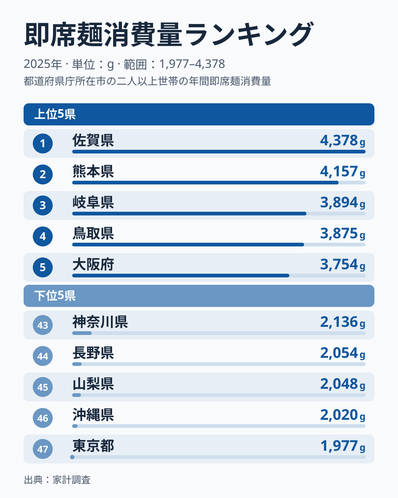
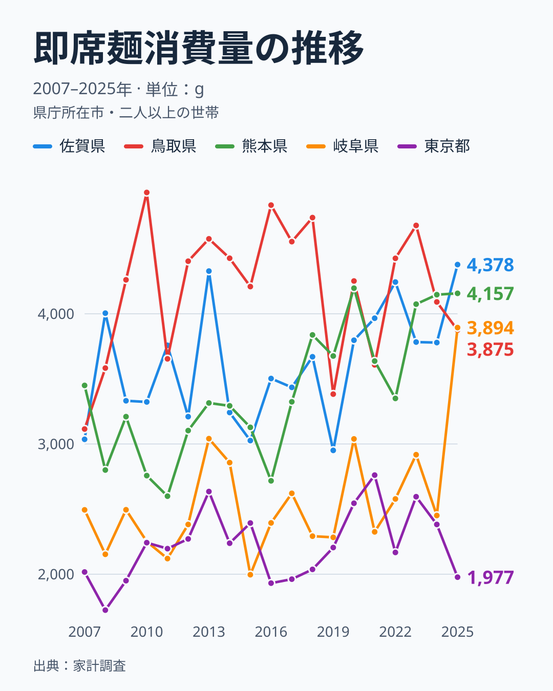

「即席麺をいちばん食べる県は、たぶん九州でしょう」──そう思って2025年の家計調査を開くと、半分は当たっていて、半分は外れます。

即席麺消費量とは、都道府県庁所在市の二人以上世帯が1年間に買う即席麺の重量（家計調査の品目「即席めん」、単位はグラム）です。2025年の最多は[佐賀県](/areas/41000)の4,378g、最少は[東京都](/areas/13000)の1,977gで、その差は約2.2倍になります。たしかにトップには佐賀と熊本の九州勢が並びます。

ところが上位5県を眺めると、3位に岐阜県、4位に鳥取県、5位に大阪府が入り、九州は佐賀と熊本の2県だけです。一方、東京都は最下位の47位で、神奈川県も43位、千葉県も42位です。同じ大都市でも、世帯あたりの即席麺の購入量は東京と大阪で大きく分かれます。この記事では47都道府県の即席麺消費量を並べ、2025年の西に偏った顔ぶれと、首都圏が下位に並ぶ形を、2007年からの推移と合わせて読み解きます。

> [!NOTE]
> 本データは総務省「家計調査」の品目「即席めん」を集計したものです。各都道府県の県庁所在市における二人以上世帯の年間購入量（g）で、世帯員1人あたりではなく1世帯あたりの値です。県全体の平均ではない点に注意してください。

## 即席麺消費量ランキング：上位5県と下位5県

まず2025年の上位5県と下位5県を見てみましょう。

<source-link href="/ranking/instant-noodles-consumption-quantity">即席麺消費量ランキングの全47都道府県を見る</source-link>

上位5県は、1位が佐賀県の4,378g、2位が熊本県の4,157g、3位が岐阜県の3,894g、4位が鳥取県の3,875g、5位が大阪府の3,754gです。1位から4位までは503gの幅に収まっていて、上位の争いは接戦です。6位以降は長崎県の3,568g、京都府の3,461g、香川県の3,432g、愛媛県の3,329g、広島県の3,312gと続きます。

上位10県を地方で数えると、九州が佐賀・熊本・長崎の3県、中国が鳥取・広島の2県、四国が香川・愛媛の2県、近畿が大阪・京都の2県、東海が岐阜の1県です。いずれも東海から九州にかけての県で、関東・東北・北海道は1県も入りません。「九州だけが突出している」のではなく、2025年は西日本の県が全体に強い年でした。

九州で高い理由は、この指標だけでは断定できません。[仮説] 麺をスープで食べる外食文化が根づいた地域で、家庭でも麺食が日常に組み込まれている可能性があります。ただし確かめるには、麺類の外食支出や店舗数など別の指標との突き合わせが必要です。

## 首都圏が下位に並ぶ形

下位5県は、最下位が東京都の1,977g、46位が沖縄県の2,020g、45位が山梨県の2,048g、44位が長野県の2,054g、43位が神奈川県の2,136gです。最下位から5位までの差は159gしかなく、ここも接戦です。東京と46位の沖縄の差は43gなので、最下位が東京になったのは僅差の結果といえます。

下位10位まで広げると、関東では東京・神奈川・千葉・茨城・栃木の5都県が入り、群馬は17位、埼玉は32位です。これに山梨・長野の甲信、山形、北海道、沖縄が加わります。2025年は首都圏と関東甲信の県が下位に集まりました。

関東甲信の山梨・長野・栃木・茨城については、[仮説] 野菜や果物を直売所や家庭菜園で手に入れやすく、手早い加工食品より素材から調理する食卓が相対的に多い可能性があります。ただし消費量のデータだけでは因果を示せず、世帯の調理時間や食料の入手経路の統計と合わせて確かめる必要があります。

沖縄県が46位にとどまる点も目を引きます。九州に近い地理的なイメージとは裏腹に、即席麺の消費は下位で、同じ九州でも福岡県は13位、大分県は20位と一様ではありません。[仮説] 沖縄には沖縄そばという独自の麺文化があり、即席麺が食卓で占める位置が本土と異なる可能性があります。

## 発見1：東京は最下位、でも大阪は5位・京都は7位

即席麺は保存がきき、調理も手軽で、どの都市でも同じように買われていそうに思えます。ところがデータは、大都市の中で正反対の姿を示しています。

- 東京都：47位（1,977g）
- 神奈川県：43位（2,136g）
- 千葉県：42位（2,192g）
- 大阪府：5位（3,754g）
- 京都府：7位（3,461g）

首都圏の東京・神奈川・千葉は下位に並び、近畿の大阪・京都は上位に入ります。同じ近畿でも兵庫県は34位なので、近畿全体が高いわけではありません。大都市圏でこれだけ傾向が割れる理由は、この指標だけではわかりません。[仮説] 首都圏は外食や中食（惣菜・弁当）の選択肢が多く、家庭で即席麺を買う機会が相対的に少ない可能性があります。

> [!WARNING]
> 家計調査の対象は二人以上の世帯です。単身世帯や外食で食べる分は含まれず、単身世帯の多い東京のような地域では、地域全体の購入量と二人以上世帯の値が違う可能性があります。また、県庁所在市の標本世帯から推計する値なので、単年では大きく動きます。1年だけの順位ではなく、複数年の傾向で読むことが大切です。

## 発見2：首位は固定ではない、鳥取11回・佐賀3回

2025年の首位が佐賀県でも、それが定着した姿とは限りません。2007年から2025年の19年間の推移で、首位の変遷を見てみましょう。

この5県の中で首位になった回数は、鳥取県が19年のうち11回、佐賀県が3回、熊本県が2回です。図にない3年は、高知県が2007年と2013年、青森県が2011年に首位でした。鳥取は2009年から2023年にかけて何度も1位に立った常連で、2024年は2位の4,091g、2025年は4位の3,875gでした。熊本県は2024年に4,147gで首位に立ち、2025年は4,157gでほぼ横ばいの2位でした。一方、佐賀県の2025年の4,378gは、2007年以降の19年間で最も高い値でした。

最も大きく動いたのは岐阜県です。2024年は2,451gで36位でしたが、2025年は3,894gの3位に上がり、33位も順位を上げました。3,894gは岐阜の19年で最も高い値です。上位に入った県が1年で入れ替わる一方で、鳥取のように長く上位にいる県もあります。単年の首位は年ごとに入れ替わるので、傾向をつかむには複数年を並べる必要があります。

東京都が最下位になったのは、2008年と2025年の2回です。最下位でなくても、19年のうち16年（最下位の2回を含む）は36位以下で、東京が下位に位置することは長く続く姿といえます。

[仮説] 購入量が年によって大きく動く県は、標本世帯の入れ替わりの影響を受けやすい可能性があります。確かめるには、同じ県の複数年の平均を取り、単年の順位より安定するかを見る必要があります。

## まとめ

- 2025年の即席麺消費量の首位は**佐賀県の4,378g**、最下位は**東京都の1,977g**で、差は約**2.2倍**です
- 2025年の上位10県は東海・近畿・中国・四国・九州に分かれ、関東・東北・北海道は**1県も入らない**西に偏った顔ぶれでした
- 下位は東京・神奈川・千葉・茨城・栃木の関東5都県と、山梨・長野の甲信などが並びます
- 大阪府は5位、京都府は7位と、同じ大都市でも**首都圏とは逆に上位**です
- 首位は年によって動き、鳥取県は19年のうち11回首位ですが、2025年は4位でした。1年だけの順位ではなく複数年で読むことが大切です

詳しい順位は[即席麺消費量ランキング](/ranking/instant-noodles-consumption-quantity)や[経済カテゴリ](/category/economy)で確認できます。
