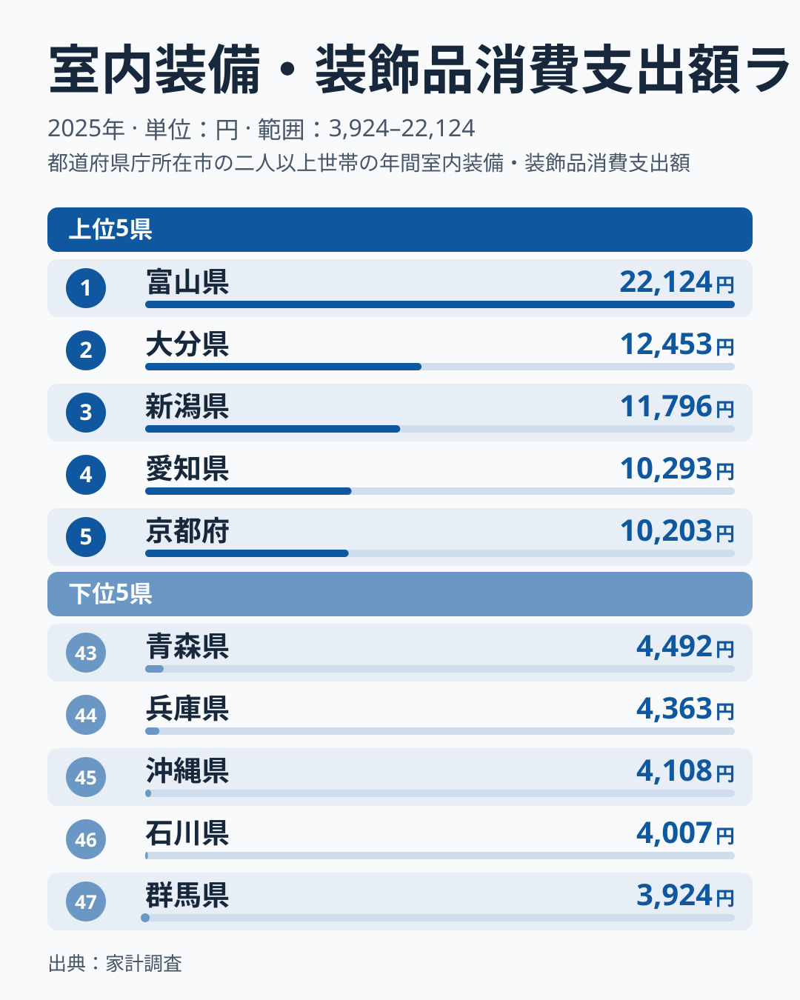
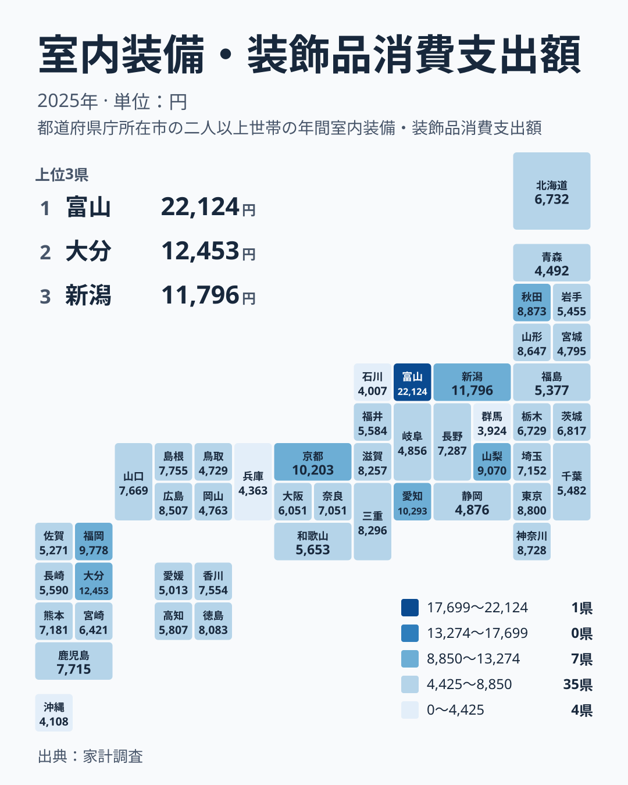

## 室内装備・装飾品への支出に生まれる大きな開き

カーテン、カーペット、照明器具、装飾品といった室内装備・装飾品は、毎月買うものではありません。引っ越しや住み替え、リフォームのときにまとめて買う性格が強く、年ごとの波が出やすい支出です。それでも都道府県を並べてみると、はっきりとした地域差が浮かび上がります。

2025年の家計調査で、この支出が最も多かったのは富山県です。富山県は22,124円で1位でした。一方、最も少なかったのは群馬県で、3,924円の47位です。最大と最小の比は約5.6倍にあたります。

注目したいのは、1位と2位の距離です。2位の大分県は12,453円で、富山県とは大きな差があります。3位の新潟県は11,796円、4位の愛知県は10,293円、5位の京都府は10,203円と続きます。2位以下はなだらかに並ぶのに、富山県だけが飛び抜けているという形です。

この記事では、まず上位と下位の顔ぶれを確認し、次に地理的な分布を見ます。そのうえで、こうした差が生まれる背景を住まいの特徴という別の切り口から仮説として考え、暮らしにどう結びつくのかを整理します。

> [!NOTE]
> ここで扱う指標の正式名は「室内装備・装飾品消費支出額」で、出典は家計調査です。1世帯が1年間に支出した金額を県庁所在市などの単位で集計したもので、人口全体の消費額ではありません。家具や家電とは別の区分である点にも注意してください。

## 上位5県と下位5県の顔ぶれ

<source-link href="/ranking/interior-furnishings-group-consumption-expenditure">室内装備・装飾品への支出ランキングをもっと見る</source-link>

上位は富山県、大分県、新潟県、愛知県、京都府の順です。大都市圏の東京都は8,800円で9位、神奈川県は8,728円で10位にとどまります。人口が多く物価も高い地域が上位を占めるわけではない点が、この指標の面白いところです。

下位は群馬県の3,924円、石川県の4,007円、沖縄県の4,108円、兵庫県の4,363円、青森県の4,492円です。群馬県は関東、石川県は富山県と同じ中部に位置します。富山県が1位であるのに対し、隣り合う石川県は46位で、同じ中部でも結果は大きく違います。

上位の県には、大都市も地方の県も混ざっています。順位だけからは、人口規模や所得水準が支出を決めているとは読み取れません。

> [!WARNING]
> 家計調査は標本調査で、県ごとの対象世帯数は多くありません。室内装備・装飾品は購入頻度が低く、大きな買い物が1件あるだけで年間の平均が動きます。順位の小さな差を、そのまま地域の実力差と読むのは避けてください。

## 地図で見る地理的な分布

地図にすると、上位県が一つの地方に固まっているわけではないことがわかります。中部では富山県が1位、新潟県が3位、愛知県が4位です。近畿では京都府が5位、九州・沖縄では大分県が2位、福岡県が6位に入っています。

同じ地方の中でも差が目立ちます。中部には上位の富山県、新潟県、愛知県がある一方で、石川県は46位です。関東も、東京都の9位と神奈川県の10位に対して、群馬県が47位です。九州・沖縄でも、大分県の2位と福岡県の6位に対し、沖縄県は45位です。

北海道・東北も一様ではありません。秋田県は8,873円で8位、山形県は8,647円で11位と上位から中上位に入る一方、北海道は6,732円で25位、宮城県は4,795円で40位、青森県は43位です。地方というくくりだけでは、支出の水準を説明しきれません。

> [!TIP]
> 地図を読むときは、色の濃い県だけでなく、隣県との落差に注目してください。富山県と石川県のように隣り合う県で順位が大きく離れていても、その理由は本文のデータからは分かりません。順位の差は、理由の手がかりではなく、確かめるべき問いとして受け取るのが安全です。

## 富山県が突出する背景として考えられること

ここからは、順位表の外にある住まいの特徴から仮説を考えます。ただし、住宅の広さや持ち家の状況は今回の実データに含まれていないため、以下は数値で確かめられた結論ではありません。

仮説の一つは、住まいの広さです。カーテンや照明、カーペットは、部屋や窓が多いほど必要な数が増えます。もし富山県や大分県、新潟県に広い住まいが多ければ、購入点数が増えて支出が高くなるという筋道は考えられます。ただし、これを裏づけるデータは本記事にはありません。

もう一つは、住み替えや改装の機会です。東京都は9位、神奈川県は10位と上位に入っています。この背景に住み替えの多さがあるかどうかは、実データからは確認できません。仮に住み替えが多ければ、そのたびに室内装備を買う機会が生まれるという見方はできますが、あくまで仮説の一つです。

下位の群馬県は3,924円、石川県は4,007円です。これらの県では装備を長く使い続けているのかもしれませんが、これも確かめられていません。因果を断定するには、住宅の種類や世帯構成の統計と組み合わせる必要があります。

## 数字を暮らしの判断にどう生かすか

読者の生活にとって大切なのは、この数字を「多いか少ないか」で評価するのではなく、自分の暮らしの目安として使うことです。たとえば、23位の奈良県は7,051円、22位の埼玉県は7,152円です。全国の中ほどの水準は、このあたりだと見ておくことができます。

引っ越しや新築を予定している世帯は、こうした水準を大きく上回る出費になることもあります。カーテン、照明、ラグを一度にそろえれば、年間の平均額は簡単に超えます。平均が低い県に住んでいても、住み替えの年には予算を別枠で用意しておくと安心です。

家計の見直しという点では、この支出は先送りしやすい項目です。食費や光熱費のように毎月かかる支出と違い、買い控えれば翌年に回せます。一方で、富山県のように高い水準が出ている地域では、住まいを整えることを重んじる暮らし方があるのかもしれません。支出の多さは、必ずしも無駄を意味しません。

## データについて

この記事の数値は、2025年の家計調査にもとづく「室内装備・装飾品消費支出額」です。単位は円で、全47都道府県の値を使っています。順位は金額の高い順です。

室内装備・装飾品には、カーテンやカーペット、照明器具、装飾品など、住まいの内部を整える品目が含まれます。最大と最小の比は、富山県の22,124円と群馬県の3,924円の比です。本文中の住まいに関する説明は、実データから直接導けるものではなく、考え方の一例にすぎません。

地域ごとの詳しい数値は、[富山県のデータ](/areas/16000)や[大分県のデータ](/areas/44000)で確認できます。ほかの家計関連の指標とあわせて見たい方は、[同じカテゴリの統計一覧](/category/economy)も参考にしてください。

## まとめ

2025年の室内装備・装飾品への支出は、富山県が22,124円で1位、大分県が12,453円で2位、新潟県が11,796円で3位でした。最下位の群馬県は3,924円で、石川県の4,007円、沖縄県の4,108円が続きます。

地方というくくりでは説明しきれず、同じ地方でも順位が大きく分かれます。そこで、住まいの広さや住み替えの機会といった別の切り口から、背景を仮説として考えました。ただし、実データだけで因果を断定することはできません。

数字は、自分の暮らしを見直すための目安です。引っ越しや新築のような節目には、平均的な水準を上回る出費が起こりうると理解しておくと、家計の計画が立てやすくなります。
