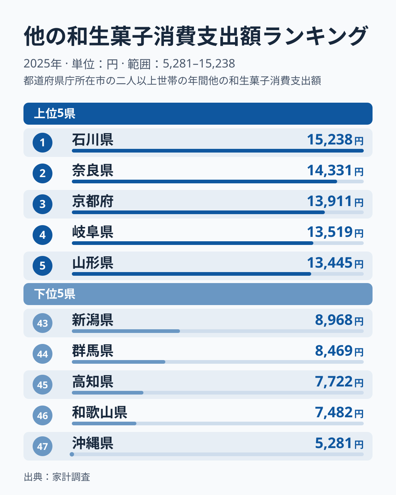
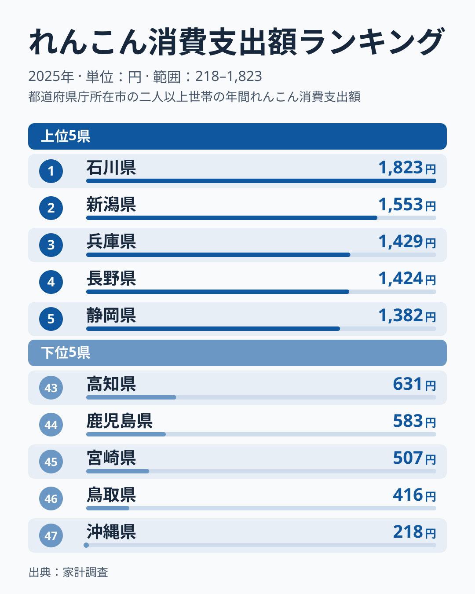
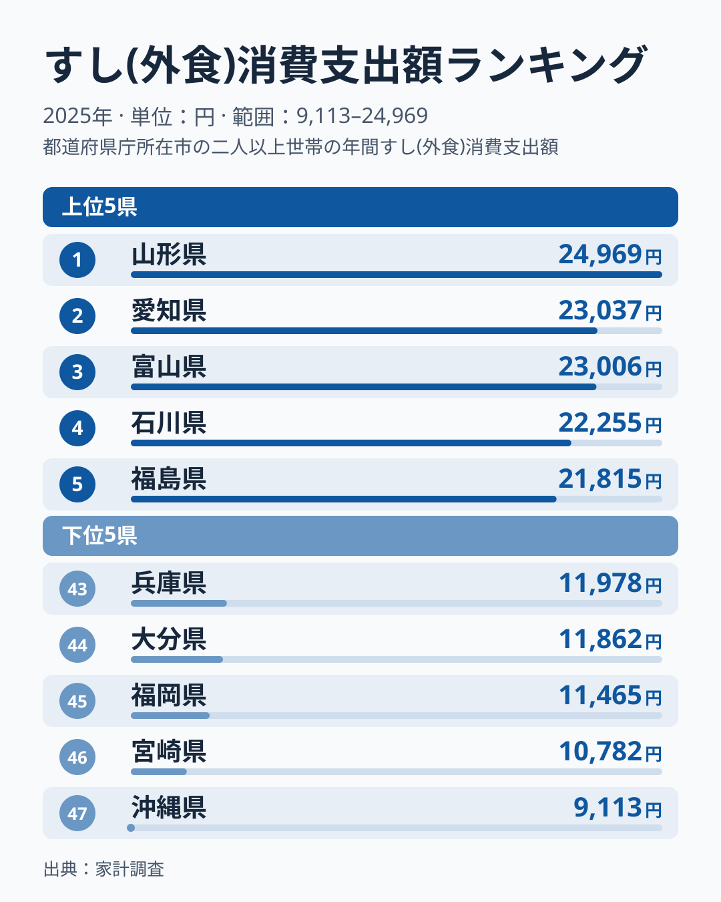
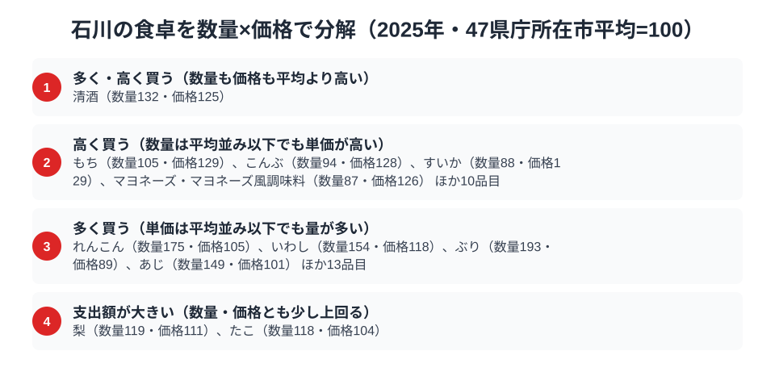

金沢の茶屋街を歩くと、和菓子屋の看板がやけに目につきます。実はこれ、雰囲気だけの話ではありません。総務省「家計調査」2025年のデータを見ると、石川県（金沢市）の和生菓子消費支出額は年間15,238円で全国1位。同じ加賀野菜の代表格である「れんこん」の消費支出額も1,823円で全国1位です。

さらに、すし（外食）の消費支出額は22,255円で全国4位。1位は山形県の24,969円で、石川はこれに届きませんが、3位の富山県は23,006円で、石川と並んで北陸の2県が上位に入っている点が目を引きます。この記事では、この3品目のデータから、石川県民の食卓に流れる一本の軸を探ります。なぜ石川は「甘いもの」と「根菜」と「魚」のいずれでも上位に来るのか。手がかりは、加賀百万石が育てた「手間を惜しまない食文化」にありそうです（市別の家計調査は単年のぶれが大きいため、以下の理由づけは[仮説]として読んでください）。

> [!NOTE]
> 本記事のデータは総務省「家計調査（品目別）」2025年、都道府県庁所在市（石川県は金沢市）の二人以上世帯の年間消費支出額です。世帯単位の支出額であり、消費量そのものではありません。なお「和生菓子」の指標名は正式には「他の和生菓子消費支出額」で、家計調査ではようかんなどが別区分で個別集計されており、それらを除いた残余区分を指します（後述する福井県の「羊羹」は別指標です）。

## 和生菓子 — 全国1位15,238円、2位奈良県との差はわずか

<source-link href="/ranking/other-japanese-sweets-consumption-expenditure">和生菓子消費支出額ランキングをもっと見る</source-link>

石川県の他の和生菓子消費支出額は15,238円で全国1位です（ようかんなど個別集計される品目を除いた残余区分）。2位の奈良県は14,331円で全国2位となっており、石川との差は907円、比率にして1.06倍です。3位の京都府は13,911円、4位の岐阜県は13,519円、5位の山形県は13,445円で、上位5県は1万3千円台半ばから1万5千円台に集中しており、石川の1位は突出しているというより「僅差の首位」という性格が強いデータです。

金沢には江戸時代から続く茶の湯文化があり、加賀藩の茶道奨励策の影響で和菓子文化が発達しました。俳句にも詠まれる「金花糖」や、五色生菓子などの儀礼菓子が今も冠婚葬祭で使われています。日常的にお茶とともに和菓子を口にする習慣が、支出額の高さに表れている、というのが[仮説]です。2位の奈良県、3位の京都府も古くから茶と菓子の文化が根付いた土地ですが、市別の値は年によって入れ替わりやすいため、検証には複数年の推移を見る必要があります。最下位の沖縄県は5,281円で、石川の値はその2.9倍にあたります。

## れんこん — 全国1位1,823円、加賀野菜の代表格

<source-link href="/ranking/lotus-root-consumption-expenditure">れんこん消費支出額ランキングをもっと見る</source-link>

れんこんの消費支出額も石川県が1,823円で全国1位です。2位の新潟県は1,553円で全国2位、石川との差は270円（1.17倍）あり、和生菓子に比べると首位の差がはっきり開いています。3位の兵庫県は1,429円、4位の長野県は1,424円、5位の静岡県は1,382円と続き、上位は北陸から中部・近畿にかけての県が並びます。

石川のれんこんは「加賀れんこん」として知られるブランド野菜です。金沢市小坂・打木地区周辺の粘土質の土壌が、もっちりと粘り気の強いれんこんを育てます。かつては年に一度しか収穫しない栽培法が主流で、いまも「じゅんさい鉢」に盛る郷土料理「はす蒸し」など、れんこんを使った料理が金沢の家庭料理に根付いています。最下位の沖縄県は218円で、石川はその8.4倍の支出です。

## すし(外食) — 全国4位22,255円、富山と並ぶ北陸の上位

<source-link href="/ranking/sushi-dining-consumption-expenditure">すし(外食)消費支出額ランキングをもっと見る</source-link>

すし(外食)消費支出額は石川県が22,255円で全国4位です。1位は山形県の24,969円、2位は愛知県の23,037円、3位は富山県の23,006円で、石川はこれらに次ぐ位置につけています。1位の山形県との差は2,714円、比率で1.12倍で、3位の富山県とは751円差です。

金沢は日本海に面し、金沢港や近隣の漁港から新鮮な魚介が集まる土地です。のどぐろ・ガスエビ（甘えび）・香箱ガニなど、地元で「地物」と呼ばれる高級食材が回転寿司から高級店まで幅広い層に浸透しており、「金沢はどの価格帯でも寿司が旨い」という評判の土台になっています。隣県の富山も同じ日本海の恵みを受ける立地で、富山・石川が3位・4位に並ぶのは地理的な背景があるからだ、というのが[仮説]です。ただし首位は内陸の山形県で、2位は愛知県です。港の近さだけでは説明がつかないため、外食のすしがどれだけ日常に根付いているかなど、別の要因も確かめる必要があります。最下位の沖縄県は9,113円で、石川の値はその2.4倍です。

> [!WARNING]
> 本データは支出額であり、消費量や購入頻度そのものではありません。単価の高い食材ほど支出額が押し上げられるため、「支出額が高い＝食べる量が多い」とは限らない点に注意が必要です。また、加賀野菜のうち「金時草」「打木赤皮甘栗かぼちゃ」など家計調査で個別集計されていない品目は本記事に含まれていません。

## 石川の食卓を貫くもの

和生菓子とれんこんが全国1位、すし外食が4位。この3品目に共通する軸を読むなら、「手間のかかる素材を丁寧に扱う」という一本の線が引けます。和生菓子は茶の湯文化に支えられた儀礼と嗜好、れんこんは粘土質の土壌が育てる希少なブランド野菜、すしは日本海の地物を活かす職人技。加賀百万石が育んだ食への美意識が、現代の家計調査データにも表れている、と読むのが[仮説]です。

隣県の[富山県](/blog/toyama-food-culture)は、ぶり・いか・昆布・餅がいずれも全国1位という「日本海の恵みそのもの」を前面に出す食文化でした。同じ北陸でも、富山が「新鮮な魚介の量」で勝負するのに対し、石川は「素材への手間」で勝負する、という違いが見えます。隣り合う県でも支出構造の性格が異なる点が興味深いところです。同じく[福井県](/blog/fukui-food-culture)は羊羹とふりかけが全国1位で、北陸3県それぞれに異なる強みがあることが見えてきます。

> [!TIP]
> 和生菓子は2位奈良県との差が1.06倍と僅差、れんこんは2位新潟県との差が1.17倍とやや開いています。和生菓子の僅差は「石川だけが突出して食べている」のではなく、「茶の湯文化圏」という広い地域で似た食文化が根付いている可能性を示唆します（[仮説]。単年の値では確かめられません）。石川の食卓データを読むときは、隣接県との差の大きさにも注目すると、その品目が石川固有の文化なのか、地域全体の傾向なのかが見えてきます。

石川県の地域プロフィールは[石川県の地域プロフィール](/areas/17000)で確認できます。他の家計調査データは[経済カテゴリ一覧](/category/economy)からたどれます。

## 数量×価格で分解する金沢市の食卓

<source-link href="/ranking/yellowtail-consumption-quantity">ぶり消費量ランキングをもっと見る</source-link>

和生菓子とれんこんの支出額はいずれも全国1位でしたが、これだけでは「たくさん食べている」のか「高いものを買っている」のかを区別できません。総務省「家計調査」の品目データを数量と価格に分解し、47都道府県庁所在市の平均を100とした指数で見ると、石川の食卓が「量」と「単価」のどちらで動いているかが見えてきます。

数量も価格も平均を上回る品目は、2025年は清酒（数量132・価格125）の1つだけでした。量も単価も上げている品目は少なく、多くの品目は量で勝負するタイプと、単価で勝負するタイプに分かれます。

単価が平均より高い品目には、もち（数量105・価格129）、こんぶ（数量94・価格128）、すいか（数量88・価格129）、マヨネーズ・マヨネーズ風調味料（数量87・価格126）などが並びます。数量は平均並みかそれ以下なのに単価だけが上がっているのは、より上質な素材や銘柄を選んで買っている表れ、というのが[仮説]です。すし外食で見た「地物を活かす職人技」と同じ、素材への手間のかけ方がここにも表れているのかもしれません。

一方、数量が平均より多い品目は、れんこん（数量175・価格105）、いわし（数量154・価格118）、ぶり（数量193・価格89）、あじ（数量149・価格101）などです。単価は平均並みかそれ以下で、日常的に量を消費する食習慣を示しています。れんこんの支出額が全国1位なのは、単価の高さではなく数量指数175という量に支えられたものです。ぶり、いわし、あじと魚が並ぶ点は、金沢の食卓で魚介を日常的に食べていることをうかがわせます。

梨（数量119・価格111）とたこ（数量118・価格104）は、数量・価格のどちらも単独では突出しないまま、両方がわずかに上回ることで支出額指数を押し上げています。

支出額の順位だけを見ていると、たくさん食べているのか、高いものを買っているのかが分かりません。数量指数と価格指数に分解すると、れんこんやぶりのように「量」で支出額を押し上げるタイプと、もちやこんぶのように「単価」で支出額を押し上げるタイプを区別できます。石川の食卓データを読むときは、この2軸で見ると発見が増えます。

> [!NOTE]
> この指数は総務省「家計調査（品目別）」2025年、47都道府県庁所在市の単純平均を100とした相対値であり、家計調査の全国値そのものではありません。価格指数は支出額を数量で割った単価の相対値なので、買っている品種やブランドの違いも含まれており、純粋な地域の物価水準とは限りません。対象は二人以上世帯、金沢市の年間データです。

## まとめ

- 和生菓子消費支出額は15,238円で全国1位。2位の奈良県は14,331円で僅差
- れんこん消費支出額は1,823円で全国1位。2位の新潟県の1.17倍で、数量指数175という量が支えています
- すし(外食)消費支出額は22,255円で全国4位。1位は山形県の24,969円、3位の富山県と並ぶ北陸の上位です
- 3品目に共通するのは「手間のかかる素材を丁寧に扱う」加賀百万石由来の食文化
- 隣県の富山・福井とはそれぞれ異なる強みを持ち、北陸3県の食文化の多様性が見えてきます
