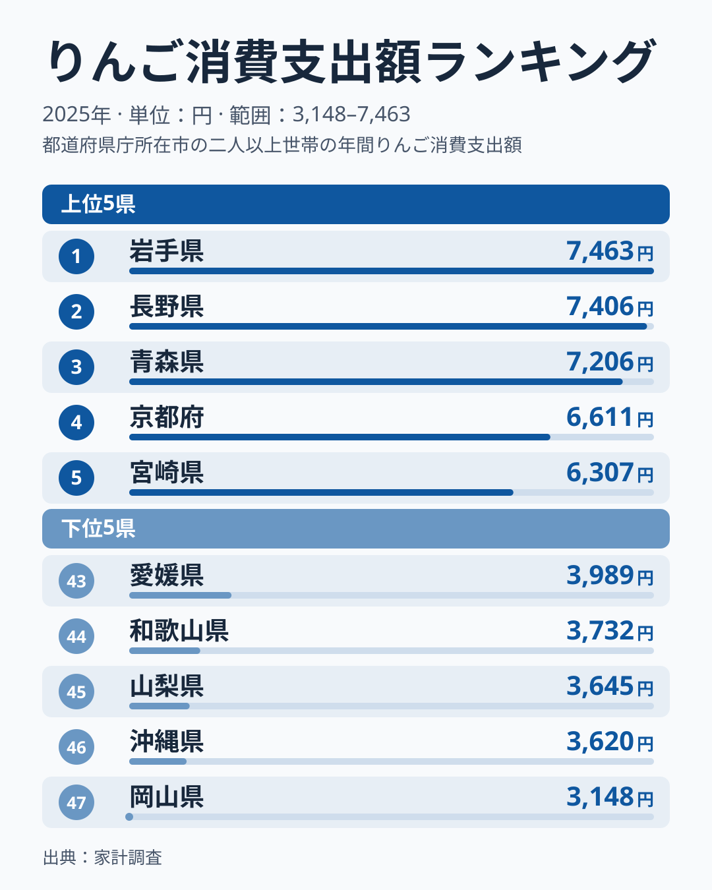
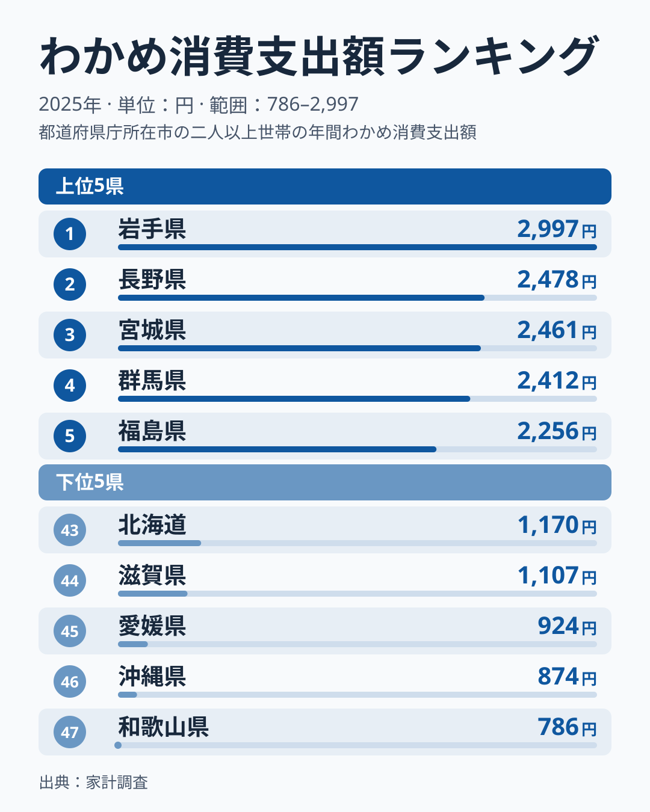
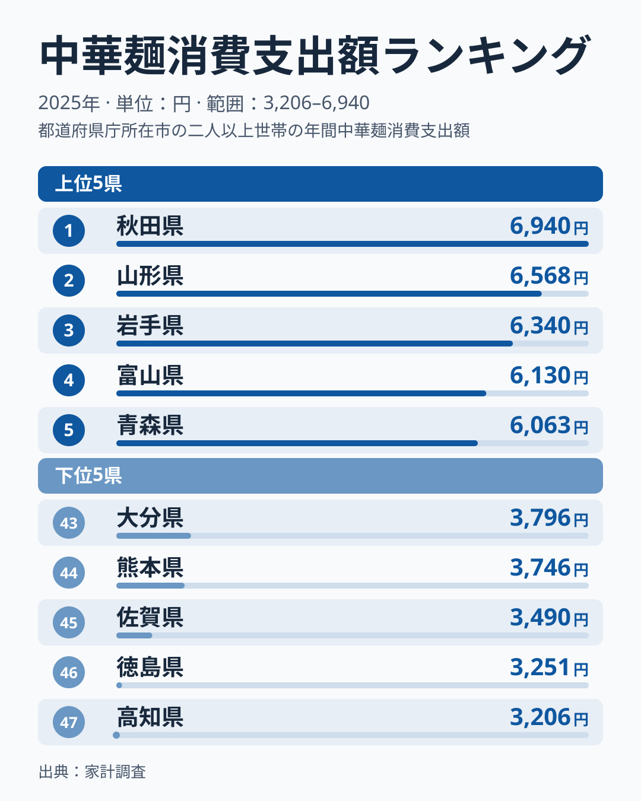
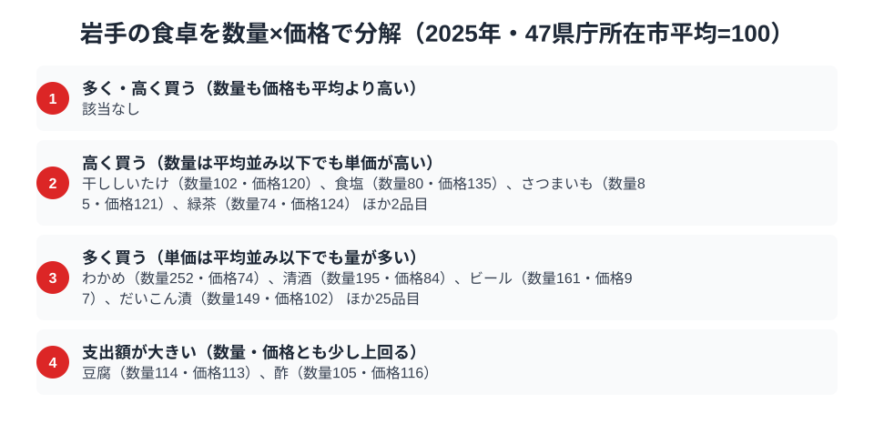

りんごといえば青森、と思われがちですが、家計調査の消費支出額で見ると首位は隣の岩手県です。総務省の家計調査（品目別）で盛岡市の二人以上世帯を見ると、りんごとわかめの2品目で岩手が全国1位に立ち、中華麺も全国3位に入っています。

題の「その中身」に先に答えると、中身は単価ではなく購入量です。47県庁所在市の平均を100とした指数で、盛岡市のりんごは数量指数200・価格指数74。購入数量は47市で最も多く、単価は平均より低く出ています。同じ分解で盛岡市の食卓全体を見ると、わかめ・りんご・清酒・ビールなど29品目を「多く」買い、食塩・緑茶など6品目を「高く」買う食卓でした。この記事では、全国1位の2品目と全国3位の1品目を横断しながら、支出額の背景を数量と価格に分けて読み解きます。

> [!NOTE]
> りんごは1位の岩手県が7,463円、2位の長野県が7,406円と、差は57円です。家計調査は県庁所在市（岩手県は盛岡市）の二人以上世帯が対象で、1市あたりの調査世帯数は限られるため、単年の順位は入れ替わりやすくなります。「岩手が首位」という結果は2025年時点の姿として読んでください。

## りんご — 全国1位7,463円、青森を上回る

<source-link href="/ranking/apple-consumption-expenditure">りんご消費支出額ランキングをもっと見る</source-link>

岩手県のりんご消費支出額は7,463円で全国1位です。2位は長野県の7,406円で、3位は青森県の7,206円です。生産量日本一で知られる青森県が、消費支出額では3位にとどまるという逆転が起きています。岩手も盛岡周辺や県北を中心にりんご栽培が盛んで、地元産のりんごが身近にあることが購入の多さにつながっているのかもしれません[仮説]。

では岩手の首位は、単価の高さによるのでしょうか、購入量の多さによるのでしょうか。47県庁所在市の平均を100とした指数では、盛岡市のりんごは数量指数200・価格指数74です。購入数量は15,195グラムで47市の中で最も多く、平均の約2倍を買っている一方、単価は平均の7割台にとどまります。つまりりんごの支出額1位は、高いりんごを選んで買っているからではなく、たくさん買っていることに支えられています。指数の算出方法は後段の分解節で説明します。

一方、青森が3位にとどまる背景には、[青森県の食卓](/blog/aomori-food-culture)でも2024年のデータで触れたように、産地では自家消費や贈与でお金を払わずに口に入るりんごが多く、家計調査の購入支出額に表れにくい可能性があります[仮説]。ただし、このデータだけでは確かめられません。

## わかめ — 全国1位2,997円、三陸の海の恵み

<source-link href="/ranking/wakame-consumption-expenditure">わかめ消費支出額ランキングをもっと見る</source-link>

海の幸ではわかめで全国トップです。わかめの消費支出額も岩手県が2,997円で全国1位。2位の長野県は2,478円、3位の宮城県は2,461円です。岩手の三陸海岸は、リアス式海岸の漁場で育つ「三陸わかめ」の産地として知られています。

地元でとれたわかめが身近にあることが、全国一の支出額につながっているのかもしれません[仮説]。データ上は、後半で見る数量指数が252、価格指数が74で、購入数量も47市で1位です。平均の2倍を超える量を買っていることが、支出額1位の中身です。

## 中華麺 — 全国3位6,340円、盛岡の麺文化

<source-link href="/ranking/chinese-noodles-consumption-expenditure">中華麺消費支出額ランキングをもっと見る</source-link>

岩手は中華麺（ラーメン用の生めん）の消費支出額でも全国3位（6,340円）に入ります。1位は秋田県の6,940円、2位は山形県の6,568円です。4位は富山県の6,130円、5位は青森県の6,063円で、最下位の高知県は3,206円です。上位5位のうち秋田・山形・岩手・青森の4県を東北が占めており、中華麺の購入は東北に厚く偏っています。

数量と価格に分けると、岩手の中華麺は数量指数131・価格指数100です。購入数量は47市で2位に入る一方、単価は平均並みなので、上位に入る理由は高い麺を買っているからではなく、買う量の多さにあります。

盛岡は「盛岡三大麺」（わんこそば・盛岡冷麺・じゃじゃ麺）で知られる麺文化の街です。こうした麺の文化が、家庭での中華麺の購入にも影響しているのかもしれませんが、盛岡冷麺やじゃじゃ麺が家計調査の「中華麺」に含まれるかは、このデータからは確かめられません[仮説]。寒い地域で温かい麺類の需要が高いことが背景にある可能性もあります[仮説]。

## 岩手の食卓に共通するもの — 量で積み上げる食卓

数量と価格に分けると、りんご・わかめ・中華麺の3品目はいずれも「多く買う」区分に入ります。数量指数はりんご200、わかめ252、中華麺131で、価格指数は74、74、100と平均以下か平均並みです。岩手の食卓の特徴は、高いものを選んで買うことより、身近で手に入る食材を多く買うことにあると読めます。この点は次の分解節で、同じ「多く買う」型に海産物や酒類が並ぶことからも確認できます。

隣県の青森は、りんごで3位、中華麺で5位です。同じ北東北でも、りんごでは岩手が青森を上回りました。ただしりんごの1位と3位の差は257円にとどまり、単年のぶれの範囲かもしれません。この差を県ごとの食文化の違いと断定することはできません[仮説]。

## 数量×価格で分解する盛岡市の食卓

<source-link href="/ranking/apple-consumption-quantity">りんご消費量ランキングをもっと見る</source-link>

支出額のランキングだけを見ても、「たくさん食べているから支出額が多いのか」「単価の高いものを買っているから支出額が多いのか」は判別できません。そこで家計調査のうち数量（consumption-quantity）と支出額（consumption-expenditure）の両方が公表されている食料品目について、47都道府県庁所在市の単純平均を100とした数量指数と価格指数を算出しました。数量指数は購入数量を47市平均で割った値、価格指数は品目1単位あたりの単価（支出額を数量で割った値）を47市平均の単価で割った値です。

区分の基準は次のとおりです。数量指数と価格指数がともに120以上なら「多く・高く買う」、価格指数だけが120以上（120ちょうどを含む）なら「高く買う」、数量指数だけが120以上なら「多く買う」、どちらも120には届かないものの両方が平均を上回っていれば「支出額が大きい」とします。干ししいたけは数量102・価格120で、価格指数が120ちょうどのため「高く買う」に入ります。盛岡市では「多く・高く買う」に入る品目は該当がなく、「多く買う」が29品目、「高く買う」が6品目、「支出額が大きい」が2品目という内訳です。

「多く買う」の代表がわかめとりんごです。わかめの数量指数は252、りんごは200で、価格指数はどちらも74です。わかめは平均の2倍を超え、りんごは約2倍の量を買いながら、単価は平均の7割台にとどまります。りんごは図では「ほか25品目」の中に入っており、数量はりんご消費量ランキングでも確かめられます。冒頭で見た二つの全国1位は、単価の高さではなく購入量の多さに支えられていることになります。

同じ区分には、清酒（数量指数195・価格指数84）、ビール（数量指数161・価格指数97）、だいこん漬（数量指数149・価格指数102）が並びます。わかめ、りんご、清酒、ビール、だいこん漬の5品目は、購入数量がいずれも47市で1位です。数量指数が高い順にはメロン214、こんぶ190、ほたて貝170、さんま164、焼酎147、ごぼう147も続き、メロンとこんぶの価格指数は51と53で、平均の約半分です。果物、海産物、酒類で量が多く、盛岡市の食卓は食材だけでなく飲み物でも量が多い面を持っています。「単価が安いから多く買う」というより「身近で豊富に手に入る食材を量多く買う」という順番で読むほうが自然ですが、これは数字から導いた解釈にとどまり、供給や嗜好との因果は検証していません[仮説]。

一方「高く買う」の6品目は、買う量は平均並みかそれ以下なのに単価が高いという逆の形です。干ししいたけ（数量指数102・価格指数120）、食塩（数量指数80・価格指数135）、さつまいも（数量指数85・価格指数121）、緑茶（数量指数74・価格指数124）がこれにあたり、ほかにも2品目が入ります。特に食塩と緑茶は数量指数が平均を下回りながら価格指数は高く、数量と価格の指数のかい離が目立ちます。

豆腐（数量指数114・価格指数113）と酢（数量指数105・価格指数116）の2品目は、数量・価格がともに平均を上回りつつ120には届かない「支出額が大きい」区分です。わかめのような「多く買う」型とは異なり、量と単価の両方が少しずつ上乗せされて支出額を押し上げています。「多く・高く」の両方が高い品目は1つもなく、盛岡市の食卓は「量で稼ぐ」品目と「単価で稼ぐ」品目にはっきり分かれているのが特徴です。

> [!TIP]
> 食塩や緑茶のように数量指数が平均を下回る品目は、購入した世帯が少なく、少数の購入が単価の指数を大きく動かしている可能性があります。「岩手だから高いものを選ぶ」と読む前に、数量の少なさを割り引いてください。一方、りんごやわかめのように数量指数が高い品目は、支出額の順位がそのまま「たくさん買っている」ことの表れと読めます。

数量指数・価格指数の基準は「47都道府県庁所在市の単純平均=100」であり、家計調査の全国値そのものではありません。価格指数は支出額を数量で割った相対的な単価なので、買っている品種や銘柄の違いも指数に含まれており、純粋な物価水準ではない点にご留意ください。対象はいずれも二人以上世帯・盛岡市の年間データ（2025年）です。

## まとめ

- りんご消費支出額は岩手県が全国1位（7,463円）。2位は長野県、3位は青森県。数量指数200・価格指数74で、中身は購入量
- わかめも全国1位（2,997円）。数量指数252・価格指数74と、平均の2倍を超える量が背景にある
- 中華麺は全国3位（6,340円）。1位は秋田県、2位は山形県。数量指数131・価格指数100で、量が支えている
- 盛岡市の食卓は、わかめ・りんご・清酒・ビールなど29品目の「量で積み上げる」品目と、食塩・緑茶など6品目の「単価が高い」品目に分かれる

岩手県の他の統計は[岩手県の地域プロフィール](/areas/03000)、食品・家計消費の地域差は[経済カテゴリ一覧](/category/economy)からご覧いただけます。
