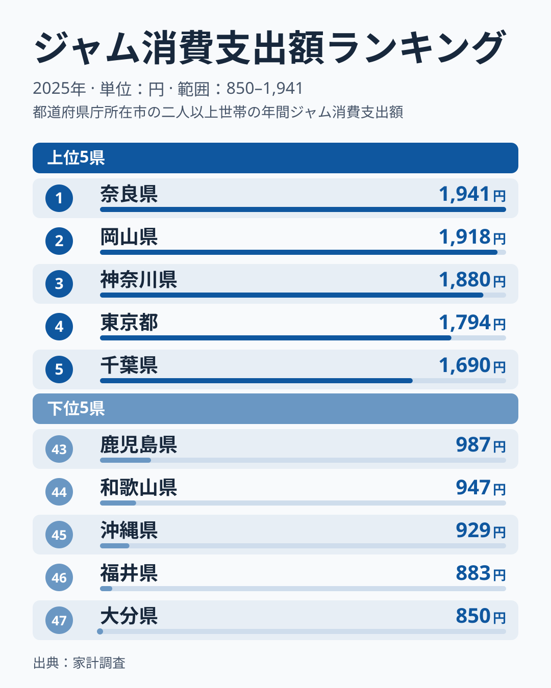
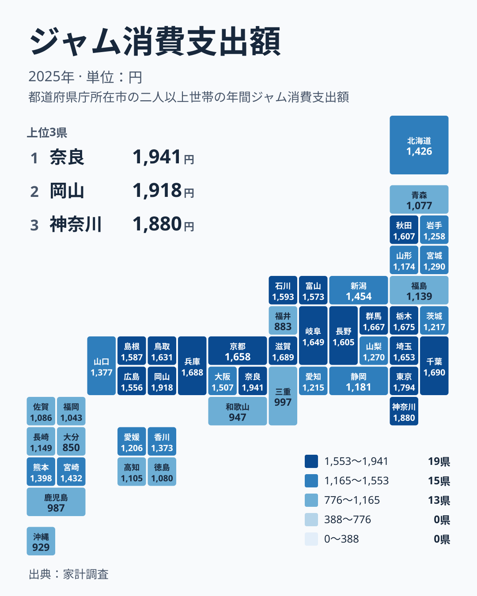

朝のトーストに塗るジャムは、どの家庭にもありそうな品です。しかし、ジャムに使う金額は県ごとにはっきり違います。2025年の家計調査をもとに、支出の多い県と少ない県の並びを確かめ、食文化や暮らし方との結びつきを考えます。

## 1位と47位の開きはどれくらいか

まず、上位5県と下位5県を並べた図を見てください。

<source-link href="/ranking/jam-consumption-expenditure">ジャムへの支出ランキングをもっと見る</source-link>

最も多いのは奈良県の1,941円で、最も少ないのは大分県の850円です。この比は約2.3倍にあたります。ジャムは日々の食卓で少しずつ使う品と考えられますが、それでも倍を超える開きがあります。なお、家庭ごとの必需性の違いについては、このデータでは確かめられません。

上位の並びで目を引くのは、1位と2位の近さです。1位の奈良県が1,941円、2位の岡山県が1,918円で、差は23円と小さいものです。この程度の差であれば、年が変われば順位が入れ替わっても不思議ではありません。一方で、3位の神奈川県は1,880円、4位の東京都は1,794円、5位の千葉県は1,690円と、順位が下がるにつれて間隔は広がっていきます。

下位側は、47位の大分県が850円、46位の福井県が883円、45位の沖縄県が929円、44位の和歌山県が947円、43位の鹿児島県が987円です。上位5県の幅に比べると、下位5県は狭い範囲に収まっています。ただし、最下位の850円は中位の県の水準からは離れています。

> [!NOTE]
> この指標は、家庭で買ったジャムの支出額です。支出額は「買った量」と「選んだ商品の価格」の両方で決まります。そのため、奈良県と大分県の差が、食べる量の差なのか、高めの商品を選ぶ傾向の差なのかは、この数字だけでは区別できません。外食先のジャムや手作り、もらい物は含まれません。

## 地図で見ると、関東と中国に濃い色が集まる

次に、都道府県別の分布を地図で確認します。

地図では、関東の広い範囲と中国地方に、濃い色の県が目立ちます。関東では神奈川県が3位の1,880円、東京都が4位の1,794円、千葉県が5位の1,690円です。栃木県は8位、群馬県は9位、埼玉県は11位と、内陸の県も上位に入っています。ただし茨城県は30位の1,217円で、同じ関東でも位置づけは違います。

中国地方は、5県すべてが25位以内に収まっています。岡山県が2位、鳥取県が13位、島根県が17位、広島県が19位で、山口県は25位の1,377円です。この地方では、全体にジャムの支出が厚い傾向が読み取れます。

岡山県は白桃やマスカットの産地として知られ、果物を身近に感じる土地柄です。それがジャムへの親しみにつながっている可能性はあります。ただし、産地であることと家庭の購入額が結びつくかどうかは、このデータからは確かめられません。詳しくは[岡山県のデータ](/areas/33000)も参照してください。

> [!TIP]
> 順位の近い県どうしは「似たグループ」として読むと見通しが立ちます。たとえば1位の奈良県と2位の岡山県は、差が23円しかありません。この程度の違いは、地域差というより誤差の範囲かもしれません。隣り合う県の色がはっきり違うときに、はじめて地域差として意味を持つと考えてください。

## 地方の中で割れる順位

地方ごとの並びを見ると、同じ地方の中でも割れていることが分かります。

近畿は、その典型です。奈良県が1位の1,941円、滋賀県が6位の1,689円、兵庫県が7位の1,688円、京都府が10位の1,658円と、上位に並びます。一方で、大阪府は20位の1,507円、三重県は42位の997円、和歌山県は44位の947円です。近畿という括りでは、上位から下位近くまで広く散らばっています。近畿全体に共通する習慣だけでは、この散らばりは説明できません。奈良県、滋賀県、兵庫県、京都府に共通する何かがあるのか、それとも別々の事情なのか。仮説を立てる材料として、この割れ方を押さえておく価値があります。奈良県の個別の数字は[奈良県のデータ](/areas/29000)で確認できます。

北海道・東北では、秋田県が14位の1,607円で上位寄りにいます。同じ地方の北海道は23位の1,426円、宮城県は27位の1,290円、岩手県は29位の1,258円です。さらに山形県は34位、福島県は36位、青森県は40位で、秋田県だけが上位寄りです。寒冷地だから多い、という単純な話ではありません。

中部は、県ごとの差が大きい地方です。長野県が15位の1,605円、石川県が16位の1,593円、富山県が18位の1,573円と、上位寄りに並びます。岐阜県も12位です。その一方で、愛知県は31位、静岡県は33位、福井県は46位の883円と、下位寄りの県もあります。長野県には果物の産地という顔がありますが、同じ地方の福井県は全国で2番目に少なく、産地のイメージだけでは並びを読めません。

## 下位に目立つ九州・沖縄と四国

下位側には、九州・沖縄の県が目立ちます。大分県が47位、沖縄県が45位、鹿児島県が43位、福岡県が41位です。佐賀県は38位、長崎県は35位で、ここまでは下位から中位の下の方に並びます。一方で、熊本県は24位の1,398円、宮崎県は22位の1,432円で、中位に位置します。九州・沖縄の内部でも、上と下で差があります。

四国は、香川県が26位の1,373円、愛媛県が32位、高知県が37位、徳島県が39位です。中位から下位にまとまっています。

ジャムへの支出が少ないことは、パンを食べないことを意味しません。朝食に米を選ぶ家庭が多い、パンに合わせるものがジャム以外の食品に偏る、購入先が家計調査で捉えにくい場所に偏るなど、さまざまな可能性があります。どれが当てはまるかは、このデータからは言えません。

> [!WARNING]
> 家計調査は標本調査で、都道府県ごとの調査世帯数は多くありません。1年分の数字では、わずかな世帯の買い方の違いが順位に響きます。中位に密集している県ほど、順位の1つ2つの違いに意味はありません。県の食文化を、この1年の順位だけで断定するのは避けてください。

## 読み取れることと、まだ分からないこと

ここまでの内容を整理します。

- 最多の奈良県と最少の大分県の比は約2.3倍です。
- 1位の奈良県と2位の岡山県の差は23円と小さく、3位以下は間隔が広がります。
- 関東と中国地方では、上位寄りの県が多く見られます。
- 近畿、中部、北海道・東北は、地方の中で順位が大きく割れています。
- 下位には九州・沖縄の県が目立ちますが、熊本県や宮崎県のように中位の県もあります。

地方の傾向は、はっきり読める部分と読めない部分があります。関東や中国は比較的まとまっていますが、近畿や中部は県ごとの事情が強く出ているようです。

ジャムの購入額には、朝食のパン食の広がり、買い物先の違い、果物に親しむ土地柄、贈答や手作りの習慣などが関わっている可能性があります。ただし、これらはあくまで仮説です。この記事のデータはジャムの支出額だけで、パンや他の食品との関係を直接示すものではありません。他の食品の支出と並べる場合は、[同じカテゴリの統計一覧](/category/economy)から関連する指標を探すと、仮説を検証する手がかりになります。

## データについて

使ったのは、家計調査のジャム消費支出額です。調査年は2025年、単位は円で、全国47の都道府県を比較しています。金額は家庭での購入にもとづく支出額で、世帯の構成や購入場所の違いによる影響を含みます。自分の県の位置を知りたいときは、ランキングの全件表示で確認できます。

隣の県との違いを見ながら、自分の暮らしの感覚と照らしてみてください。順位の背景にある理由は、数字だけでは決まりません。数字を入り口にして、地域の食卓を想像するところから始めるのが、この指標の読み方だと考えます。
