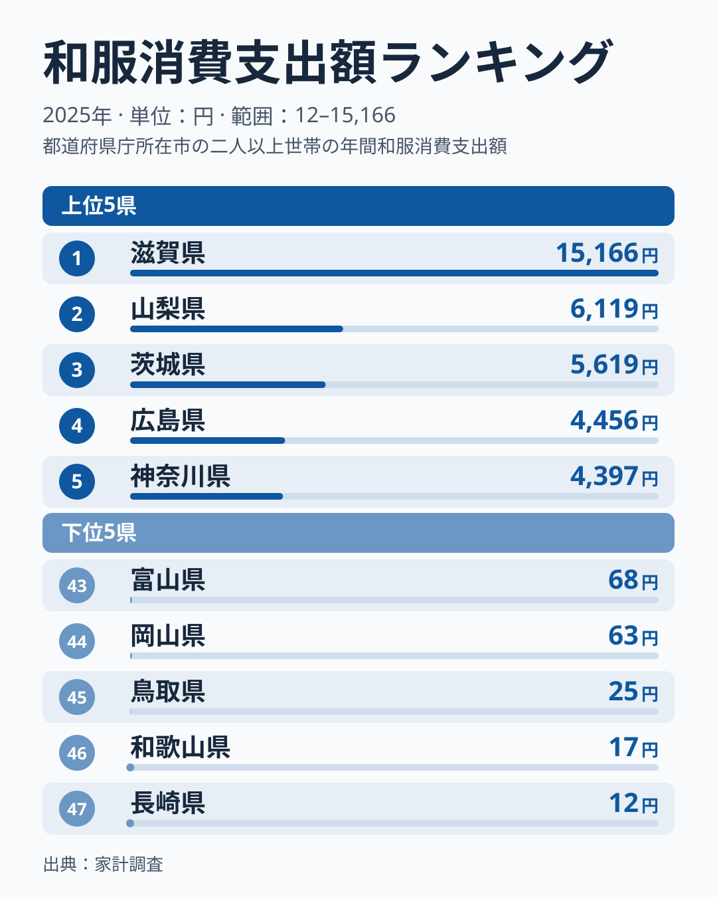
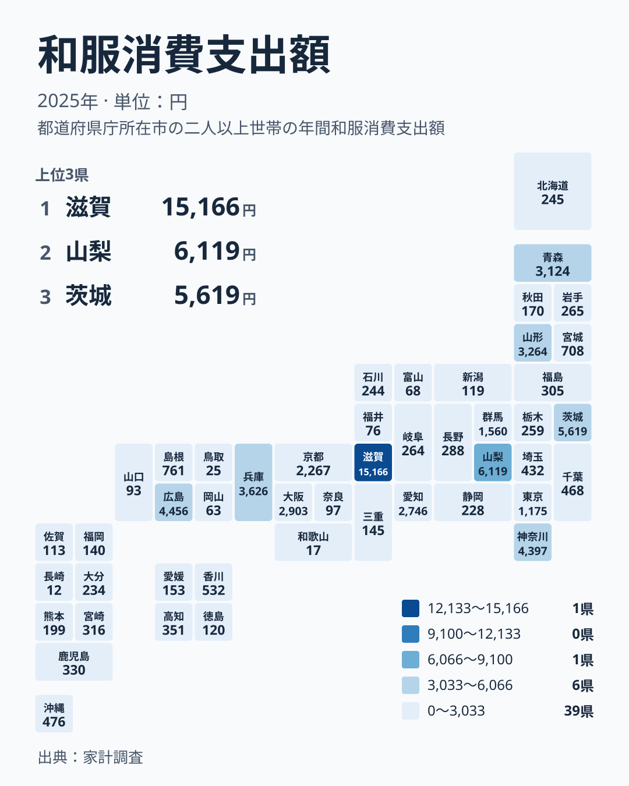

和服への支出は、都道府県によって大きな差があります。2025年の家計調査によると、1位の滋賀県は15,166円で、47位の長崎県は12円です。

ふだん着物を着る機会が多い家庭はごく一部ですから、この数字は「和服が好きかどうか」だけでは説明できません。この記事では、順位の並びを地方ごとに見直し、数字の背後にある生活の事情を考えていきます。

## 和服への支出が多い県と少ない県

まず、上位5県と下位5県の顔ぶれを確認します。

<source-link href="/ranking/japanese-clothing-group-consumption-expenditure">和服への支出ランキングをもっと見る</source-link>

上位は、1位の滋賀県が15,166円、2位の山梨県が6,119円、3位の茨城県が5,619円、4位の広島県が4,456円、5位の神奈川県が4,397円です。下位は、43位の富山県が68円、44位の岡山県が63円、45位の鳥取県が25円、46位の和歌山県が17円、47位の長崎県が12円です。

図で注目したいのは、1位の突出です。滋賀県の15,166円は、2位の山梨県の6,119円を大きく上回っています。2位から5位は4,000円台から6,000円台に収まっており、1位だけが一段上にいる形です。

上位5県と下位5県という端同士を比べると、桁が大きく違います。5位の神奈川県は4,397円で、43位の富山県は68円です。ただし、これは順位が38離れた県どうしの比較です。6位から42位までをたどると、6位の兵庫県が3,626円、9位の大阪府が2,903円、11位の京都府が2,267円、13位の東京都が1,175円、15位の宮城県が708円、18位の千葉県が468円、27位の栃木県が259円、42位の福井県が76円と、3,000円台から70円台まで連続的に下がっていきます。つまり、ランキング全体は二つの集団に割れているのではなく、なだらかな坂を描いています。

実データにある最大と最小の比は、滋賀県の15,166円と長崎県の12円の間にあり、約1264倍です。この両端の開きは極端ですが、それは分布の端を見ているからだと理解してください。

> [!NOTE]
> ここでの和服消費支出額は、家計調査で集計される、1世帯あたりの1年間の和服への支出です。着物や帯、浴衣などの購入にかかった費用が対象で、レンタルや着付けの料金は、購入とは別の扱いになる場合があります。

## 1位だけが飛び抜ける理由を考える

滋賀県を「特別に和服を好む県」と読むのは早計です。和服は1着あたりの価格が高く、購入頻度が低い品目です。そのため、調査対象の世帯が一度高額な着物を買うだけで、県の平均が大きく動く可能性があります。

たとえば成人式の振袖や、冠婚葬祭用の着物を買った世帯が調査に含まれた年は、平均が跳ね上がることがあります。ただし、実際にそうした購入があったかどうかは、このデータからは確かめられません。あくまで、1位の突出を説明しうる仮説の一つです。

> [!WARNING]
> 家計調査は、都道府県別に見ると調査対象の世帯数が限られます。和服のように購入回数が少なく単価が高い品目では、少数の高額な買い物が県の平均を大きく動かします。1年分の順位だけで、県民の気質や文化を断定しないでください。

滋賀県のくわしい数値は、[滋賀県のデータ](/areas/25000)で確認できます。山梨県についても[山梨県のデータ](/areas/19000)で他の指標とあわせて見られます。

## 地理分布から見える地方ごとの傾向

次に、47都道府県の分布を地図の形で見ます。

地図からは、高い県が一か所に固まっているのではなく、あちこちに点在していることがわかります。上位5県も、近畿の滋賀県、中部の山梨県、関東の茨城県と神奈川県、中国の広島県と、東西に分かれています。

ここで、同じ地方の中で順位が大きく離れている例を見てみます。

- 近畿では、滋賀県が1位の15,166円なのに対し、和歌山県は46位の17円です。同じ地方の中に、全国の1位と46位が並んでいます。
- 中部では、山梨県が2位の6,119円で、富山県は43位の68円です。こちらも地方内で40を超える順位差があります。
- 関東では、茨城県が3位の5,619円である一方、栃木県は27位の259円です。隣り合う県でも水準が異なります。
- 東北では、山形県が7位の3,264円、青森県が8位の3,124円ですが、秋田県は33位の170円です。

このように、地方の中に上位と下位の県が混在しています。したがって、和服への支出は「この地方は多い、あの地方は少ない」という地方という括りでは説明しにくい指標です。地域ごとの文化の違いを持ち出す前に、県単位の事情や調査の偏りを疑うほうが、読み違えにくくなります。

> [!TIP]
> 地図を見るときは、色の濃い県だけでなく、その隣の県との落差にも注目してください。隣り合う県で大きく違う場合は、地域の文化よりも、調査対象の偏りや、一度きりの高額購入の影響を疑うと読み違えにくくなります。

## 暮らしへの含意を考える

和服への支出を、生活に引き寄せて考えてみましょう。洋服のように毎シーズン買い替える品物ではないため、この数字は普段の消費というより、人生の節目に発生する支出を映している可能性があります。

成人式、結婚式、七五三、卒業式といった機会に、着物を購入するか、借りるか、家にあるものを使い回すかで、家計への負担は変わります。購入を選ぶ家庭が多い地域では平均値が上がりやすく、レンタルが一般的な地域では同じ行事があっても支出に表れにくい、という仮説が考えられます。ただし、購入とレンタルの割合はこの統計からは確かめられません。

また、大阪府が9位の2,903円、愛知県が10位の2,746円、東京都が13位の1,175円と、大都市圏は中位から上位に入っています。呉服店や着付けの教室が身近にあることが購入の機会を増やすのかもしれませんが、これは推測です。

一方で、下位の県を「和服に関心が薄い」と決めつけることもできません。44位の岡山県が63円、42位の福井県が76円という数字は、その年に調査された世帯で購入が少なかったことを示すにすぎません。

## この指標を読むときの視点

この指標に固有の読み方として、次の3点を意識すると誤読を減らせます。

- 和服は単価が高く購入頻度が低いため、1回の買い物の有無で県の値が大きく変わること
- 購入がなかった世帯が多いと値が0に近くなりやすく、下位の十数円から数十円の差に、意味のある違いを読み取りにくいこと
- 1位の滋賀県と47位の長崎県の差は、生活の違いというより、高額購入が平均に入ったかどうかの違いを含みうること

下位の県どうしの順位は、数円から数十円の差で入れ替わります。順位の上下を細かく論じるより、1位の突出と、6位から42位まで続くなだらかな下り坂という全体の形をつかんだうえで、個々の県の順位は参考程度にとどめて読むほうが、実態に近いと考えられます。経済に関する他の指標は、[同じカテゴリの統計一覧](/category/economy)から探せます。

## データについて

この記事で使った統計は、家計調査の和服消費支出額で、2025年の値を円単位で示したものです。1世帯あたりの年間支出を、都道府県別に並べています。

この数値は標本調査の結果です。県ごとの調査世帯数には限りがあり、購入頻度の低い品目では、年ごとの変動が大きくなります。順位は参考にとどめ、傾向を読み取る材料として活用するのが適切です。
