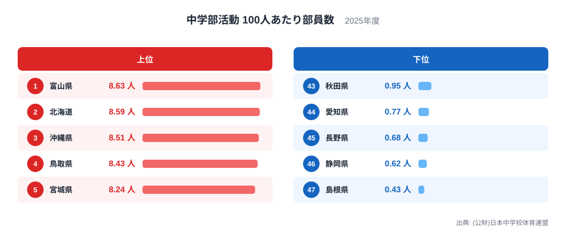
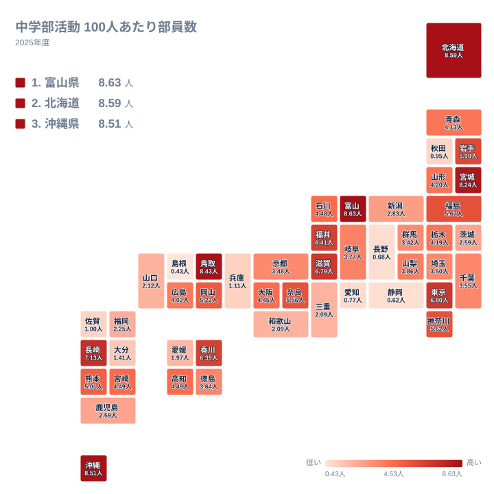

中学部活動100人あたり部員数を2025年の都道府県別に見ると、首位の富山県は8.63人、最下位の島根県は0.43人でした。最大と最小の比はおよそ20倍にあたります。同じ全国の中学校の部活動でも、県によって数字の水準が大きく違います。この記事では、まず差の大きさを順位の並びから確かめ、次に地方という単位では説明しにくい分布を見ていきます。理由については、データに載っていないことを断定せず、仮説として扱います。

## 首位は富山県、北海道と沖縄県が続く

最も多かったのは富山県で8.63人です。2位は北海道の8.59人、3位は沖縄県の8.51人、4位は鳥取県の8.43人、5位は宮城県の8.24人でした。上位5道県は8.2人台から8.6人台にぎっしり収まっています。

一方、下位は島根県の0.43人が47位で、46位は静岡県の0.62人、45位は長野県の0.68人、44位は愛知県の0.77人、43位は秋田県の0.95人です。下位5県はいずれも1人を下回っています。

<source-link href="/ranking/junior-high-club-per100-badminton">中学部活動100人あたり部員数ランキングをもっと見る</source-link>

図から一段踏み込んで読むと、約20倍という開きは、上位と下位の端どうしを比べたときに生じています。5位の宮城県は8.24人、43位の秋田県は0.95人で、この間だけでも大きな落差があります。上位5道県の内部では首位と5位の差が小さく、下位5県の内部でも最も多い秋田県と最も少ない島根県の差は小さい、つまり両端はそれぞれ固まっています。

では、その間の6位から42位はどう並ぶのでしょうか。6位の長崎県は7.13人、42位の佐賀県は1人です。上位から下位へ、段差なく連続的に下っていく形で、特定の順位でまとめて落ちる断絶はありません。開きは、ゆるやかな坂が長く続いた結果として現れています。

> [!NOTE]
> 「中学部活動 100人あたり部員数」は、(公財)日本中学校体育連盟の2025年のデータにもとづく指標で、単位は人です。最大の富山県でも8.63人にとどまるため、100人のうち何人が運動部に入っているかという加入率とは別の尺度と考えるのが安全です。分母や集計の範囲は連盟の定義に従います。他の統計の加入率と水準を直接比べないでください。

## 地理分布に見える偏り

次に、地理的な広がりを見ます。タイルマップでは、近い県が似た色になるかどうかを確かめられます。

マップから分かるのは、東西や南北といった単純な傾きがないことです。上位5道県は、中部の富山県、北海道・東北の北海道と宮城県、中国の鳥取県、九州・沖縄の沖縄県に散らばっています。隣り合う地域がそろって高い、という形にはなっていません。

地方ごとに見ても、同じ地方の中で順位が大きく分かれます。中国では、鳥取県が4位で8.43人、島根県が47位で0.43人と、隣り合う2県が両端に分かれています。中部では、富山県が1位である一方、愛知県が44位、長野県が45位、静岡県が46位です。北海道・東北では、北海道が2位、宮城県が5位なのに対し、秋田県は43位です。

近畿も同様です。大阪府は20位の4.45人、京都府は30位の3.48人、兵庫県は41位の1.11人で、同じ地方の中に20位台から40位台までが含まれます。滋賀県は8位の6.79人、奈良県は14位の5.56人と上位寄りで、三重県と和歌山県はどちらも2.09人で、37位と38位です。地方という単位では、この指標の高低をまとめて説明できません。

> [!TIP]
> 地方単位の傾向を探すより、隣り合う県の差に注目すると読みやすくなります。鳥取県と島根県のように、近い県で順位が大きく離れる組み合わせに、その県固有の事情が表れます。

## 大都市圏を含む中位の県

上位と下位に目が行きがちですが、中位にも特徴があります。6位は長崎県の7.13人、7位は東京都の6.8人、8位は滋賀県の6.79人、9位は福井県の6.41人、10位は香川県の6.39人です。上位5道県の8人台から一段下がって6人台から7人台で、人口規模も地理条件も異なる県が混ざっています。

大都市を抱える県の位置は、そろっていません。東京都は7位の6.8人、神奈川県は13位の5.62人と上位寄りです。大阪府は20位の4.45人、千葉県は28位の3.55人、埼玉県は29位の3.5人と中位から下です。さらに兵庫県は41位の1.11人、愛知県は44位の0.77人と下位に入ります。都市部であることと順位のあいだに、一貫した関係は読み取れません。

このように、県の個性は上位と下位だけでなく、中位の細かな差にも表れています。千葉県と埼玉県のようにほぼ並ぶ組み合わせもあれば、東京都と愛知県のように大きく離れる組み合わせもあります。

## 差の理由を考える

データには理由まで載っていないため、ここでは確認できないことを整理します。以下はいずれも仮説で、検証されたものではありません。

地理や人口との関係では、広い土地に人が点在する北海道が2位、離島を抱える沖縄県が3位に入っています。一方で、島根県や秋田県のように人口が少ない県が下位にも入っています。人口規模や土地の広さで一律に説明することは、この順位からはできません。都市部でも、東京都は上位寄り、愛知県は下位と分かれます。

産業構造との関係は、データの上では共通点を確認できません。下位の愛知県、静岡県、長野県、秋田県、島根県を並べても、産業の面で同じ特徴があるとはいえず、この指標との関連を示す根拠はありません。

歴史や学校文化、近年進む部活動の地域クラブへの移行状況の違いも、可能性としては考えられます。ただし、今回の実データにはそれらを裏づける数字がありません。富山県が首位に立つ理由も、このデータからは分かりません。

> [!WARNING]
> この指標は、日本中学校体育連盟の集計に含まれる部員を数えたものと考えられます。連盟の集計に含まれない活動や、学校外の地域クラブで活動する生徒は数字に入らない可能性があります。数字が低い県が、中学生の運動機会そのものが少ないとは限りません。

## 数字を読むときの注意

この指標は、同じ値の県が複数あります。17位の高知県と18位の宮崎県はどちらも4.49人で、37位の三重県と38位の和歌山県は2.09人です。33位の茨城県と34位の鹿児島県も2.59人です。小数点以下の差で順位が決まる場面があるため、近い順位の差を過大に解釈しないでください。

また、順位が低い県を「部活動に力を入れていない」と読むのは早計です。値が最大でも8.63人にとどまる指標なので、数字の高低は、加入の多さそのものではなく、連盟の集計方法のもとでの相対的な位置を示すものとして受け止めてください。

県ごとの詳しい数字は、[同じカテゴリの統計一覧](/category/educationsports)から他の教育・スポーツ指標と合わせて確認できます。首位の[富山県のデータ](/areas/16000)や、2位の[北海道のデータ](/areas/01000)を見れば、ほかの指標との組み合わせから理由を探るヒントが得られます。

## データについて

使用した統計は、(公財)日本中学校体育連盟による「中学部活動 100人あたり部員数」の2025年の値で、単位は人です。対象は47都道府県すべてです。本文中の順位と値は、この統計に載っている数字をそのまま使っています。同じ値の県が複数ある場合は、統計上の順位をそのまま記載しました。
