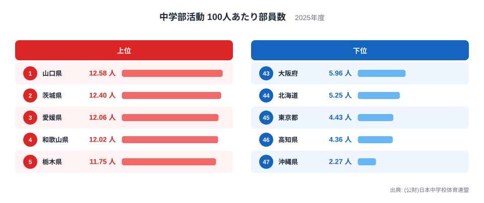
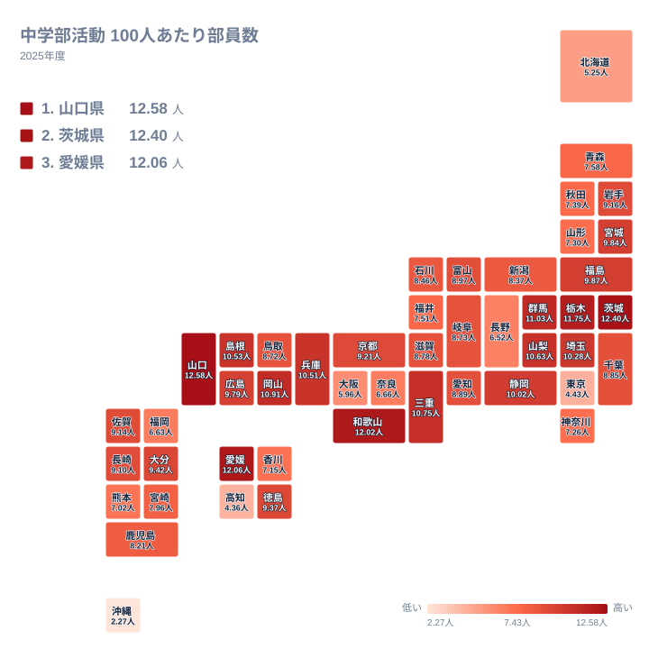

## 部活動の部員の割合は、県でこれほど違います

放課後の中学校の風景は、全国どこでも似ているように見えます。ところが日本中学校体育連盟の2025年の数字を並べると、部員の厚みは県によって大きく違います。

中学部活動100人あたり部員数で1位になったのは山口県の12.58人です。2位は茨城県の12.4人、3位は愛媛県の12.06人でした。反対に最下位の沖縄県は2.27人にとどまります。1位と最下位を比べると、山口県は沖縄県の約5.5倍にあたる水準です。

この記事では、上位と下位がなぜその順になるのかを、地理、産業構造、歴史の面から考えます。統計から言えるのは「どの県が多いか」までです。理由の部分は、統計の外の事情を踏まえた仮説であることをあらかじめお断りします。

> [!NOTE]
> この指標は、日本中学校体育連盟が集計した「中学部活動 100人あたり部員数」です。連盟に登録された競技の部員を数えた値で、校外のクラブチームや、連盟に登録されていない活動は含まれません。「部活動に入っていない生徒が多い県」と読むと、実態とずれることがあります。

## 上位は僅差、下位は沖縄県だけが離れる

まず、上位5県と下位5県を図で確認します。

<source-link href="/ranking/junior-high-club-per100-soft-tennis">中学部活動100人あたり部員数ランキングをもっと見る</source-link>

図から読み取れる構造は二つあります。一つ目は、上位5県が12.58人から11.75人までの狭い幅に収まっていることです。1位の山口県と5位の栃木県の差は、数字の上ではわずかです。順位が一つ違うだけで「活動が盛んだ」と言い切るのは早計です。

二つ目は、下位の形です。47位の沖縄県は2.27人で、46位の高知県は4.36人です。その上の45位は東京都の4.43人、44位は北海道の5.25人、43位は大阪府の5.96人と続きます。高知県から大阪府までは4人台から5人台の範囲に収まっており、沖縄県だけが一段下に切り離されています。上位が団子状で、下位の端だけが大きく離れる形です。

上位5県は、中国の山口県、関東の茨城県と栃木県、四国の愛媛県、近畿の和歌山県です。下位5県は、九州・沖縄の沖縄県、四国の高知県、関東の東京都、北海道地方の北海道、近畿の大阪府です。上位にも下位にも四国、関東、近畿が顔を出しており、地方の名前だけで傾向を語ることはできません。四国には3位の愛媛県と46位の高知県が同居しています。

> [!WARNING]
> 順位の差と、値の差は別のものです。この指標では、上位は僅差で並び、下位は沖縄県だけが大きく離れています。順位が一つ違うだけの県どうしを「優れている」「劣っている」と読むのは避けてください。また、2025年の1時点の値なので、長期の変化は読み取れません。

## 山口県と沖縄県の差をどう読むか

1位の山口県は12.58人、47位の沖縄県は2.27人です。同じ100人の中学生で見ると、部員の数に10人あまりの開きがある計算になります。比で表すと、山口県は沖縄県の約5.5倍です。

この差は、上位5県内の幅と比べると際立ちます。1位から5位までは12.58人から11.75人に収まっていますが、沖縄県と46位の高知県の4.36人との間には、それを上回る開きがあります。つまり沖縄県の低さは、順位が最下位というだけでなく、値そのものが他の下位県からも離れている点に特徴があります。

ただし、この差を「沖縄県の中学生が部活動に消極的」と読むことはできません。指標が数えているのは、連盟に登録された部員だけだからです。登録の対象になる活動の範囲や、登録の仕方に県ごとの違いがあれば、それがそのまま数字の差になります。沖縄県で何が起きているのかは、この統計だけでは確認できません。校外の活動の広がりといった事情が関わる可能性はありますが、あくまで未確認の仮説にとどまります。

山口県についても同じです。高い値は、登録された部員の割合が高いことを示すだけで、生徒の活動の質や満足度までは語りません。山口県のデータは[山口県のデータ](/areas/35000)で、ほかの指標と並べて確認できます。

## 地理分布から見える、関東の二面性

次に、全47都道府県の分布をタイルマップで見ます。

地図で目につくのは、関東の内部での落差です。茨城県は2位、栃木県は5位、群馬県は6位と、北関東は上位に並びます。埼玉県も12位の10.28人です。ところが千葉県は25位の8.85人、神奈川県は37位の7.26人、東京都は45位の4.43人と、都心に近づくほど順位が下がります。

この並びからは、大都市圏ほど部活動以外の選択肢が多いことが背景にある可能性があります。学習塾、習い事、民間のスポーツクラブが身近にあれば、生徒の放課後は学校の部活動だけに集まりません。連盟に登録されない活動に流れる分が多ければ、この指標の値は低く出ます。大阪府が43位の5.96人であることも、同じ文脈で理解できます。

反対に、北関東では学校の部活動が放課後の主な受け皿になっているのかもしれません。ただし、これも統計から確かめた因果ではなく、解釈の一つです。茨城県のデータは[茨城県のデータ](/areas/08000)で確認できます。

> [!TIP]
> 地図を読むときは、色の濃い県そのものよりも、隣り合う県との段差に注目してください。関東のように、近い県どうしで順位が大きく離れる場所には、都市と郊外の違いなど、構造的な理由が隠れていることがあります。

## 下位の県を一括りにしない

下位の事情は、県ごとにかなり違う可能性があります。高知県は4.36人で46位ですが、生徒数や学校規模のデータはここにありません。仮に山間部で小規模な学校が多く、競技ごとに部を維持しにくいとすれば、入れる部の選択肢が限られ、部員の割合が下がることも考えられます。ただし、これは確認できていない仮説です。

北海道の44位5.25人についても、広い面積や気候が関わるかもしれませんが、この統計に根拠はありません。東京都の45位4.43人と大阪府の43位5.96人は、前節で触れた大都市圏の選択肢の多さという仮説と整合しますが、これも証明されたわけではありません。

はっきり言えるのは、下位の県が地方も人口規模もばらばらだという点です。九州・沖縄、四国、関東、北海道、近畿と、5県が5つの異なる地方に分かれます。順位の低さを一つの原因にまとめず、県ごとに事情を見分ける姿勢が大切です。

## データについて

この記事の数値は、日本中学校体育連盟が公表した「中学部活動 100人あたり部員数」の2025年の値です。単位は人で、全47都道府県が対象です。

数値は連盟の加盟登録に基づく集計であるため、競技の種類ごとの内訳や、男女別、学年別の状況は、この指標だけでは分かりません。また、部活動の地域移行が進む地域では、学校の部活動が地域クラブに置き換わり、登録の状況が変わっている場合があります。地域移行の進み方が県によって違えば、数字の差の一部は活動の盛衰ではなく、集計の対象から外れる活動の違いを映している可能性があります。

同じカテゴリの他の指標と合わせて見ると、教育やスポーツの環境をより立体的に捉えられます。気になる方は[同じカテゴリの統計一覧](/category/educationsports)もご覧ください。

## まとめ:順位の裏にある県ごとの事情

2025年の中学部活動100人あたり部員数は、山口県の12.58人が1位、茨城県の12.4人が2位、愛媛県の12.06人が3位でした。最下位は沖縄県の2.27人で、高知県の4.36人、東京都の4.43人が続きます。

上位は僅差で並び、下位は沖縄県が大きく離れるという形が、この年の特徴です。関東の中では、茨城県、栃木県、群馬県が上位に入る一方、東京都は下位に入ります。大都市圏ほど学校外の選択肢が多いという読み方はできますが、あくまで仮説です。

数字は、部活動の「盛んさ」そのものではなく、連盟に登録された活動に参加する生徒の割合です。順位だけで良し悪しを判断せず、その県の事情に目を向けることが、この統計を正しく読むコツです。
