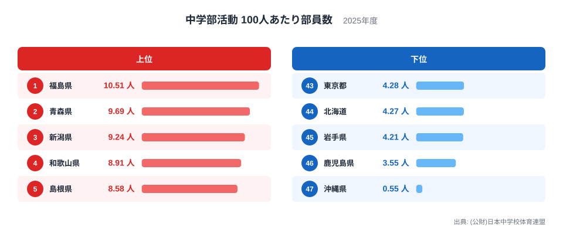
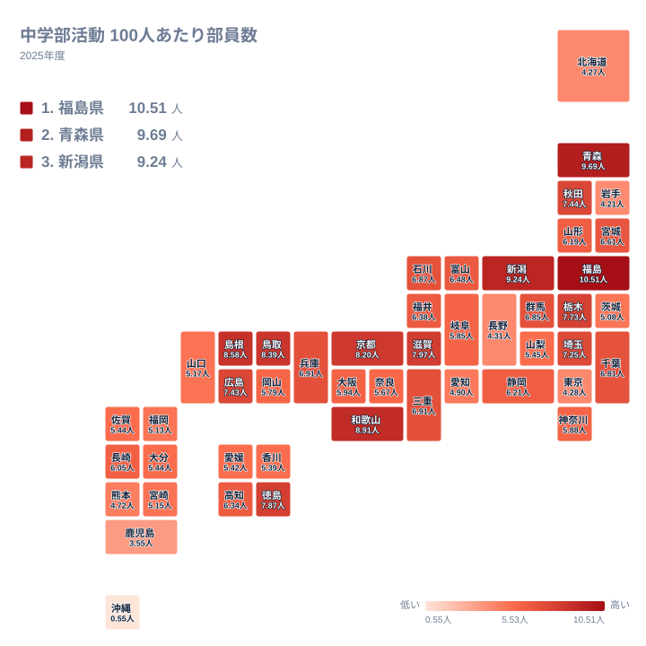

## 最大と最小の比は、そのまま読めるのか

中学生の部活動は、全国どこでも似たような姿だと思われがちです。しかし日本中学校体育連盟の2025年の数値を並べると、100人あたりの部員数は都道府県によって大きく異なります。最も多い福島県は10.51人で1位です。最も少ない沖縄県は0.55人で47位です。

実データにある最大と最小の比で見ると、福島県は沖縄県の約19倍にあたります。ただし、この倍率は最下位の沖縄県の値が極端に低いことに強く依存しています。46位の鹿児島県は3.55人で、福島県との比べ方はまったく違ってきます。沖縄県を除いた最小は鹿児島県であり、沖縄県の値は他の県から大きく離れた例外的な水準です。そのため、この記事では「19倍」を県民の部活動への取り組みの差とは読まず、統計上の特殊性を含んだ数字として扱います。

上位と下位がなぜその順になるのかを、地理・都市化・歴史の観点から、確認できる範囲で整理します。同じ分野の指標は[同じカテゴリの統計一覧](/category/educationsports)でも確認できます。

> [!NOTE]
> ここでの指標は、日本中学校体育連盟が把握する加盟競技の部員数を、中学生100人あたりに直したものです。単位は人です。連盟に加盟していない活動や、地域クラブ、民間のスポーツ教室などで取り組む生徒は、基本的に数字に含まれません。

## 上位と下位の顔ぶれを見る

まず、上位5県と下位5県を図で確認します。

<source-link href="/ranking/junior-high-club-per100-track-and-field">中学部活動100人あたり部員数ランキングをもっと見る</source-link>

上位は福島県の10.51人、青森県の9.69人、新潟県の9.24人、和歌山県の8.91人、島根県の8.58人です。地方別に数えると、東北から2県、中部から1県、近畿から1県、中国から1県で、特定の地方だけに偏っていません。

下位は、43位の東京都が4.28人、44位の北海道が4.27人、45位の岩手県が4.21人、46位の鹿児島県が3.55人、47位の沖縄県が0.55人です。地方では関東、北海道・東北、九州・沖縄にまたがります。大都市を抱える東京都もあれば、広い県土をもつ北海道や岩手県、九州南部の鹿児島県や沖縄県もあり、下位の顔ぶれは一つの理由では説明しにくいと言えます。

上位に東北の福島県と青森県が入り、下位に岩手県と北海道が入っている点も見逃せません。東北の中でも両端に分かれており、地方単位の傾向だけでは説明しきれないことが分かります。

> [!TIP]
> 順位だけを見ると差が大きく見えますが、中位は値が密集しています。たとえば20位の富山県は6.48人、21位の福井県は6.38人、22位の高知県は6.34人です。わずかな差で順位が入れ替わるため、中位の順位に大きな意味を持たせすぎないようにしてください。

## 福島県と青森県が上位に並ぶ背景

1位の福島県は10.51人、2位の青森県は9.69人です。詳しい数値は[福島県のデータ](/areas/07000)と[青森県のデータ](/areas/02000)でも見られます。

この2県に共通する背景として、中学校の部活動が放課後の活動の主な受け皿になっている可能性があります。民間のクラブや習い事が都市部ほど多くない地域では、学校の部活動が生徒にとって身近な選択肢になりやすいのではないか、という見方です。

また、地域の大会や行事と中学校の部活動が結びついている場合、参加が自然な流れになりやすい可能性もあります。いずれも仮説であり、今回の数値から直接確かめられるものではありません。ただ、上位に地方の県が目立つ事実とは矛盾しません。

3位の新潟県は9.24人、5位の島根県は8.58人、6位の鳥取県は8.39人です。中部、中国の県も上位に入っており、東北だけの現象ではないことが確認できます。

> [!WARNING]
> この統計は、部員数を示すものであり、活動の質や参加率の高さを直接示すものではありません。複数の競技に所属する扱いや、集計時点の届け出方法の違いが、県ごとの数値に影響する可能性があります。数字の差をそのまま「熱心さの差」と読むのは避けてください。

## 地理分布が示す、地方を超えた散らばり

続いて、地理的な広がりを図で確認します。

地図で見ると、高い値は特定の地方にまとまっていません。日本海側の新潟県や島根県、鳥取県に加え、太平洋側の福島県や、内陸を含む近畿の京都府、滋賀県も上位に入っています。一方で下位には、東京都、北海道、岩手県、鹿児島県、沖縄県が並び、海に面しているかどうかや南北の位置だけでは分けられません。

関東の内部でも差があります。10位の栃木県は7.73人、13位の埼玉県は7.25人である一方、39位の茨城県は5.08人、43位の東京都は4.28人です。同じ関東でも約3人以上の開きがあり、地方という単位で一括りにする読み方には限界があります。

九州・沖縄では、25位の長崎県が6.05人、38位の福岡県が5.13人、46位の鹿児島県が3.55人、47位の沖縄県が0.55人です。同じ地方に中位と最下位が同居しており、沖縄県の低さは九州・沖縄全体の傾向というより、個別の事情を強く疑わせる値です。

## 都市化は説明の一部にとどまる

東京都は4.28人で43位、大阪府は5.94人で26位、神奈川県は5.88人で27位、愛知県は4.9人で40位です。大都市圏を抱える都府県は、概して中位から下位に位置しています。

この背景として、都市部では民間のスポーツクラブや習い事など学校外の選択肢が多く、学校の部活動に集まる生徒の割合が下がる可能性があります。私立中学校に通う生徒が多い地域では、集計の対象範囲に影響が出ることも考えられます。ただし、これらは今回のデータで確認した事実ではなく、あくまで想定される仮説です。

実際、埼玉県は13位で7.25人、千葉県は18位で6.81人と、首都圏でも比較的高い県があります。さらに下位には北海道、岩手県、鹿児島県といった、都市化では説明しにくい県も入っています。都市化は差の一部を説明する可能性はあっても、全体を説明する鍵ではないと考えるのが安全です。

## 歴史や制度の違いと、沖縄県の低さ

部活動は、戦後の学校教育の中で広く定着してきました。ただし、運営の仕方や地域との関わりは、県によって異なる可能性があります。そうした歴史的な違いが数値に表れているかどうかは、今回のデータだけでは判断できません。

最下位の沖縄県は0.55人で、46位の鹿児島県の3.55人と比べても大きく離れています。この水準は、実際の参加がこれほど少ないというより、統計の捕捉範囲や加盟の仕方が他県と異なる可能性を考えるのが自然です。島しょ部が多く、競技団体の組織や大会の枠組みが他県と違う事情も背景にあるかもしれません。ただし、この点は実データだけでは確定できません。

沖縄県を除いて見ると、最下位は鹿児島県の3.55人で、1位の福島県の10.51人との開きは、沖縄県を含めた場合ほど極端ではありません。題にある倍率の印象は、沖縄県の値を割り引いて受け止める必要があります。

## まとめ

2025年の100人あたり部員数は、福島県が10.51人で1位、青森県が9.69人で2位でした。最下位の沖縄県は0.55人で、最大と最小の比はおよそ19倍ですが、この比は沖縄県の特殊な低さに強く依存しています。

上位は東北、中部、近畿、中国に散らばり、下位は関東、北海道・東北、九州・沖縄にまたがっています。東北の中でも福島県と岩手県で大きく分かれるなど、単純な地域差では語れません。学校中心の活動や都市化といった背景は、あくまで考えられる仮説として受け止めるのが適切です。

数字を読むときは、部員数が連盟加盟の範囲に限られる点を意識することが大切です。さらに知りたい方は、[同じカテゴリの統計一覧](/category/educationsports)から、他の教育・スポーツ指標も合わせてご覧ください。

## データについて

この記事で使った指標は、(公財)日本中学校体育連盟による「中学部活動 100人あたり部員数」の2025年の値です。単位は人で、全47都道府県の数値を比較しています。順位は値の大きい順で、同じ値の県は同順位として扱います。
